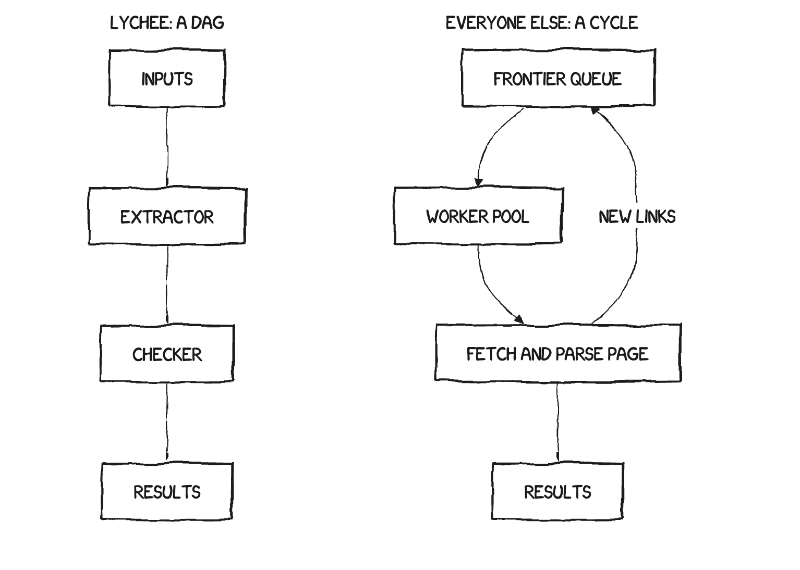
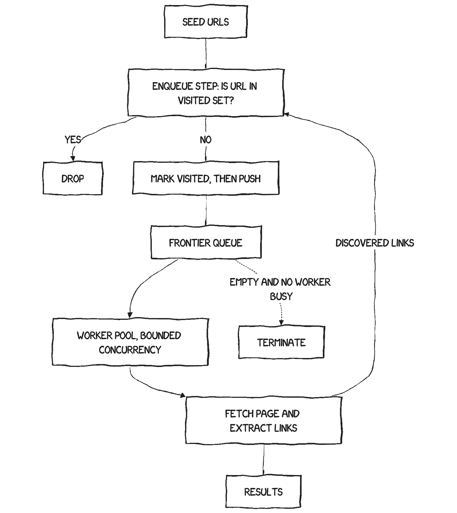

## Summary
Matthias Endler compares how muffet, LinkChecker, linkinator, and broken-link-checker implement recursive crawling, then relates their designs to [[Lychee]]. Despite different runtimes, all four combine a mutable crawl frontier, atomic enqueue-time deduplication, bounded execution or pacing, and a signal that the queue is empty with no work in flight. The comparison strengthens [[CrawlerArchitecture]] and [[DistributedTerminationDetection]] while showing why a recursive frontier must remain distinct from the mechanism that limits concurrency or request rate.

## Key Claims
- Recursive crawlers differ structurally from one-way checking pipelines because fetched pages feed newly discovered links back into the work frontier.

- A correct common design checks and marks a URL visited atomically at enqueue time, sends newly claimed URLs to a frontier, lets a bounded worker pool fetch and extract links, and terminates only when the frontier is empty and no worker remains active.

- [[Muffet]] uses a mutex-protected set for enqueue-time claiming, a daemon channel plus `sync.WaitGroup` for dynamic completion, and separate semaphores and host throttling for concurrency control.
- [[LinkChecker]] deliberately keeps its joinable frontier unbounded to prevent all worker threads from blocking while recursively producing work; its result-cache sentinel claims URLs at `put()` time, while fixed threads and per-host pacing limit execution.
- [[Linkinator]] uses a single-threaded event loop to make visited-set updates effectively atomic, a concurrency-limited queue whose `onIdle()` promise detects completion, and `GET` rather than `HEAD` when crawling requires a response body.
- [[BrokenLinkChecker]] claims pages before crawling, filters recursion by tag, internality, policy, and robots rules, and propagates completion through drain events across nested page and site queues.
- The compared designs keep the frontier separate from rate or concurrency limiting; using one bounded recursive channel as both queue and backpressure mechanism can deadlock when a consumer must also produce into it.
- Runtime conveniences change implementation cost rather than the underlying problem: Go supplies goroutines and `WaitGroup`, Node serializes visited-set access, Python uses locks and blocking threads, and Rust requires explicit shared-state ownership and synchronization.

## Key Quotes
> "There is no secret sauce." — on the shared worklist, visited-set, and quiescence structure across recursive checkers.

> "Dedup belongs at enqueue, before the request." — on preventing concurrent pages from submitting the same URL.

## Connections
- [[CrawlerArchitecture]] - synthesizes the frontier, admission, worker, pacing, and completion invariants shared by the compared tools.
- [[DistributedTerminationDetection]] - `WaitGroup`, joinable counters, idle promises, and drain events all detect quiescence in dynamic work.
- [[AdaptiveBackpressure]] - the article separates the recursive work frontier from concurrency and per-host rate controls.
- [[ConcurrencyFailureModes]] - enqueue-time claiming prevents duplicate-admission races, while bounded feedback channels can create deadlocks.
- [[Lychee]] - the comparison explains why retrofitting recursion into its original one-way stream was harder than starting with a crawler cycle.
- [[Muffet]] - Go checker using a mutex-protected set, `WaitGroup`, semaphore, and per-host throttler.
- [[LinkChecker]] - Python checker using a joinable unbounded queue, result-cache sentinel, worker threads, and per-host pacing.
- [[Linkinator]] - Node checker using an idle-aware concurrency queue and event-loop-serialized URL claiming.
- [[BrokenLinkChecker]] - Node checker using nested request queues, enqueue-time caching, crawler-policy filters, and drain events.

## Contradictions
- The article is a maintainer-authored source-code reading rather than controlled benchmarking or verification by each compared project. Throughput, memory, maturity, and extensibility judgments are qualitative and version-specific.
- An unbounded frontier prevents one cyclic backpressure deadlock but can exhaust memory; bounded workers, URL caps, cleanup, disk-backed queues, or explicit rejection remain necessary at larger scales.
- Single-threaded URL claiming avoids a shared-memory race but also makes CPU-heavy parsing contend for one event loop; it is not universally simpler or faster.
- The side-by-side table presents lychee as having the needed 2026 primitives, but the companion retrospective still described recursive crawling itself as unshipped, so architectural readiness should not be read as feature availability.
