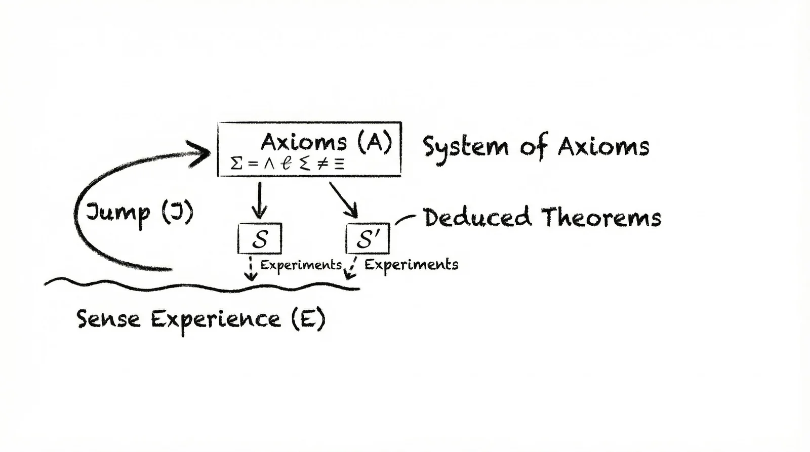

## Summary
[[TomZahavy]] presents a personal position paper arguing that current [[LanguageModeling|large language models]] can perform induction and deduction but do not obviously possess the [[AbductiveReasoning|abductive]] capacity needed to originate foundational explanatory hypotheses from sparse physical evidence. Using Einstein's equivalence-principle thought experiment and a diagram of the jump from sense experience to axioms, he proposes physically consistent multimodal [[WorldModels]] as a possible route toward this kind of scientific invention. The page explicitly narrows the claim: LLM-based systems already make real discoveries, and the disputed question is whether current recipes can reproduce this particular physically grounded conceptual leap.

## Key Claims
- Scientific invention sometimes requires abduction: proposing a new explanatory axiom or hypothesis rather than extending observed patterns by induction or deriving consequences from premises.
- Einstein's move from bodily and imagined physical experience to the equivalence principle is offered as the central case of a conceptual jump made with sparse observational data.
- The article claims that text-trained LLMs are structurally ill-suited to originate such foundational axioms because their predictions remain bounded by learned symbolic patterns; it does not present a controlled model evaluation proving impossibility.
- The proposed remedy is a physically consistent, multimodal world model that learns from interaction with the world rather than language alone.
- The author's scope note rejects the broader reading that LLMs cannot make scientific discoveries and allows that scaling current systems may prove sufficient.
- Public responses dispute both necessity and consequence: one argues that general relativity could be reached more deductively or by finding gaps between fields, while another accepts the limitation but assigns people the leap and AI the synthesis and verification.

The retained diagram separates an underdetermined jump from sense experience into an axiom system from the directed deduction of theorems and their later experimental checks. Its structure supports the paper's distinction between inventing premises and testing consequences, but it illustrates that distinction rather than demonstrating that an LLM cannot cross it.

## Key Quotes
> "The paper is about the jump." - the figure caption's statement of scope

> "The paper is narrower than that" - the author's correction of claims that the paper denies all LLM scientific discovery

## Connections
- [[TomZahavy]] - author who frames the argument as a personal position informed by work on AlphaProof.
- [[AbductiveReasoning]] - names the hypothesis-forming leap that the paper distinguishes from induction and deduction.
- [[WorldModels]] - proposed multimodal, physically consistent substrate for bridging the claimed capability gap.
- [[LanguageModeling]] - supplies the text-pattern mechanism whose scientific limits the position paper questions.
- [[DeepMind]] - institutional context for the author's AlphaProof contribution, not an institutional endorsement of the paper.
- [[SemanticGrammar]] - an existing proposal that meaningful language rests on a model of the world, though it does not establish scientific invention.

## Contradictions
- The article's categorical language about structural incapacity exceeds its evidence: it offers a philosophical and historical case study, not a benchmark, formal impossibility proof, or controlled comparison of current systems.
- A cited response argues that routes to general relativity need not require the same abductive jump and that cross-field gap detection could produce comparable progress; the page does not adjudicate that historical counterfactual.
- The author's own scope note qualifies broad readings by stating that LLM-based systems already make discoveries and that scaling may be sufficient, so the thesis should not be generalized to all scientific reasoning or future systems.
- The January 2026 date belongs to the position paper; the saved project page also contains reception and responses published later in 2026 and does not provide a separate page-publication date.
