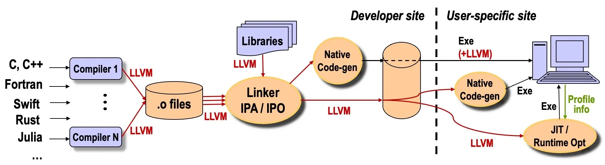

## Summary
[[VikramAdve]] and [[ChrisLattner]] trace [[LLVM]] from a federally funded UIUC research project into a broadly reused compiler infrastructure. They attribute its reach to [[LLVMIntermediateRepresentation|LLVM IR]], [[ModularCompilerArchitecture|modular library boundaries]], a common path across static, link-time, load-time, and just-in-time compilation, a permissive open-source model, and sustained community and industry adoption. The account also describes the resulting impact on programming languages, mobile and cloud platforms, gaming, scientific computing, AI systems, education, and compiler research while acknowledging growing IR complexity.

## Key Claims
- LLVM combines persistent program information, offline native code generation, user-specific profiling, a runtime-neutral model, and uniform whole-program compilation through one language- and hardware-independent representation.
- LLVM IR uses SSA-based data flow, first-class vectors, extensible intrinsics, and self-contained executable semantics to support analysis, transformation, distribution, and delayed code generation, but its operation and intrinsic set has grown substantially more complex.
- [[ModularCompilerArchitecture]] and separation of concerns made LLVM components reusable beyond conventional compilers, including graphics, browsers, databases, hardware synthesis, quantum computing, and AI compilation.
- The inspected architecture diagram shows multiple language front ends emitting LLVM IR, libraries joining at an IR linker for interprocedural analysis and optimization, and the combined program reaching ahead-of-time, user-site native, or JIT/runtime code generation with profile feedback.
- The authors identify NSF funding, academic freedom to redesign the compiler stack, a commercially neutral permissive license, technical and community leadership, and successful derivatives such as Clang, Swift, and MLIR as mutually reinforcing causes of adoption.
- The article reports pervasive production use across Apple, Android, Google and Meta datacenters, ARM and Intel toolchains, PlayStation and Nintendo platforms, CUDA and MLIR-based AI stacks, and national-laboratory computing.
- Current research directions include translation validation, heterogeneous parallel representations, multi-level IR dialects, specification-generated compiler components, and language models trained on LLVM IR and assembly.

## Key Quotes
> "The story of LLVM illustrates how foundational infrastructure projects can have an outsize influence on technological progress." — conclusion linking infrastructure design and institutional support to downstream adoption.

## Connections
- [[LLVM]] — the compiler infrastructure whose history, design, ecosystem, and impact are the article's subject.
- [[VikramAdve]] — co-creator, co-author, and principal investigator whose NSF-supported research program framed the project.
- [[ChrisLattner]] — co-creator, co-author, initial implementer, and leader of LLVM and several derivative projects.
- [[LLVMIntermediateRepresentation]] — common executable representation enabling analysis, optimization, code distribution, and multiple compilation times.
- [[ModularCompilerArchitecture]] — library-based separation of concerns presented as the main architectural cause of reuse.
- [[LifelongCompilation]] — strategy for retaining program information and applying compilation across an application's lifetime.
- [[StaticSingleAssignment]] — core data-flow form used by LLVM IR to make value definitions and uses explicit.

## Contradictions
- The source gives two dates for LLVM's first open-source release: October 2003 in the introduction and December 2003 in the history section.
- The claim that no other compiler infrastructure supports LLVM's complete combination of five capabilities is the authors' comparative judgment, not a systematic evaluation reproduced in the article.
- The economic reach, citation count, industry coverage, and counterfactual claim that several languages arguably would not exist without LLVM are broad author-attributed claims; the article supplies examples and references but no independent adoption census or causal estimate.
