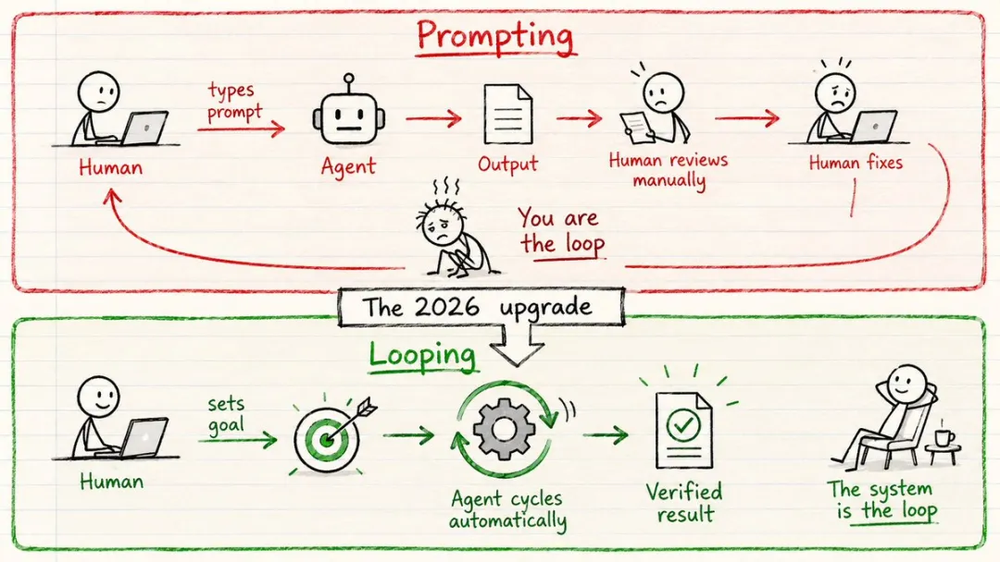
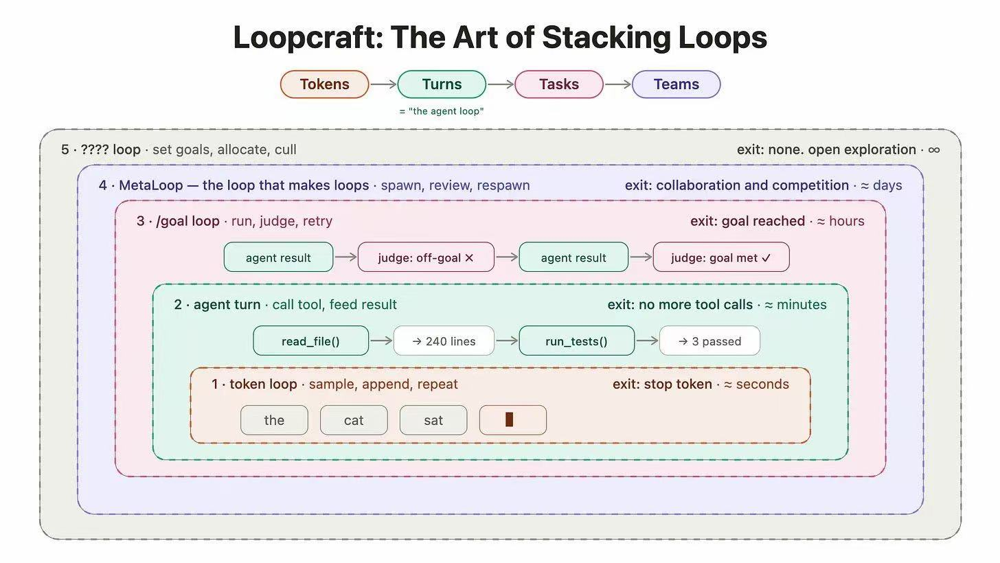
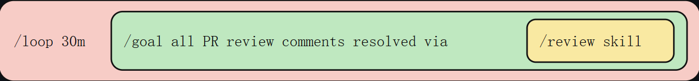
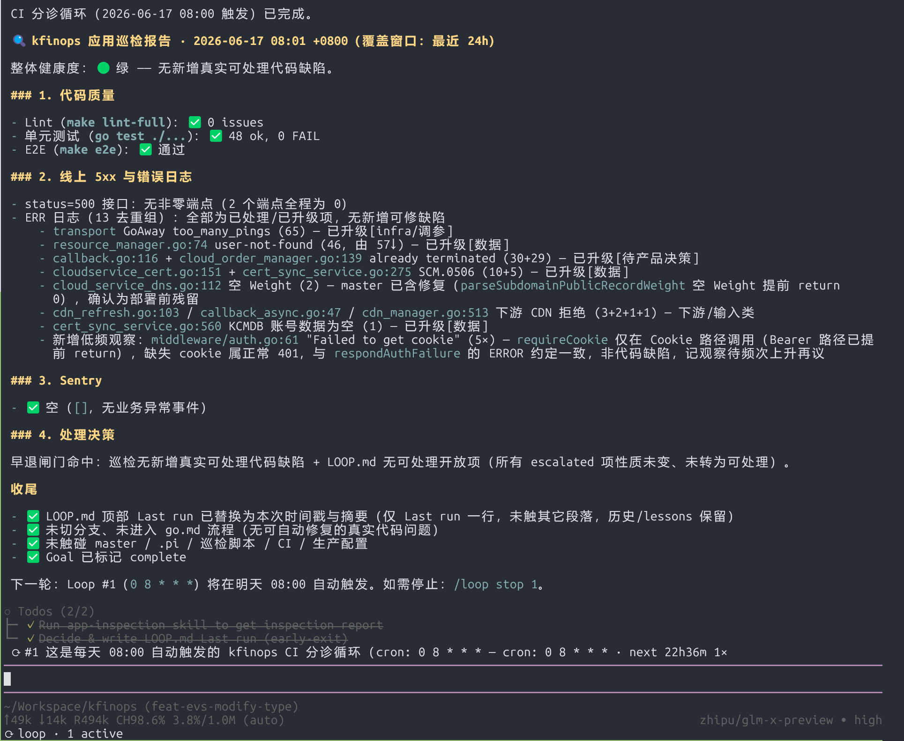

## Summary
This practitioner article defines [[LoopEngineering]] as moving from repeated human prompting to a persistent system that schedules agent work, restores state, verifies results, and decides whether to continue. It implements that idea around [[PiAgentHarness]] for recurring CI triage: an inspection Skill combines tests and production telemetry, `LOOP.md` carries work across runs, `/loop` schedules execution, `/goal` controls completion, and bounded repair gates lead to a branch and merge request or an explicit early exit.

## Key Claims
- The leverage point in agent-assisted development is shifting from optimizing isolated prompts toward designing the system that determines when an agent runs, what evidence it sees, how output is checked, and what state survives.
- A useful loop combines automation, a state file, a verifier, project Skills, external connectors, and role-separated subagents; the article recommends using it only for repeatable tasks with automated validation, an adequate token budget, and production-grade tools.
- `/loop` and `/goal` operate at different layers: the former sets recurring cadence, while the latter keeps one objective active until an independent check accepts its stop condition.

- The worked CI loop joins `make lint`, tests, E2E checks, 5xx metrics, error logs, and Sentry events into an inspection report, then reconciles that report with `LOOP.md` sections for work in progress, escalations, completed work, lessons, and stop conditions.
- An early-exit gate avoids repair work when inspection finds no actionable defect and durable state contains no open item; otherwise a constrained workflow creates a branch, writes a plan, implements, validates, reviews, simplifies, commits, opens a merge request, and updates state.
- Pi's scheduler and goal extension are separate, so the recurring prompt must inspect, create, resume, and finally complete goal state rather than assuming `/loop ... /goal ...` composes automatically.

## Key Quotes
> “Agent 会遗忘，但仓库不会。” — on using repository state to restore continuity across runs.

> “构建循环，但要始终保持工程师的思维。” — on retaining engineering judgment while automating execution.

## Connections
- [[LoopEngineering]] - principal system pattern developed and demonstrated by the article.
- [[PiAgentHarness]] - extensible coding-agent runtime used for scheduling, goal state, subagents, and project Skills.
- [[HarnessEngineering]] - the loop combines instructions, tools, state, observability, validation, permissions, and workflow gates around the model.
- [[AgentResumability]] - `LOOP.md` and explicit goal state allow later runs to continue or escalate unfinished work.
- [[VerificationDrivenAgentDelegation]] - automated checks and maker-checker separation determine whether agent work can proceed without human review.
- [[ServiceObservability]] - metrics, logs, and Sentry events supply production evidence that unit and integration tests cannot.

## Contradictions
- The article is one practitioner's design report. It gives no controlled comparison, defect rate, false-negative rate, token or infrastructure cost, mean repair time, merge acceptance rate, or evidence that the loop outperforms supervised work.
- The cited eightfold Anthropic throughput claim is acknowledged as potentially exaggerated and is not substantiated in the article.
- Automated tests, telemetry, a separate goal judge, and workflow gates can share blind spots or accept the wrong specification; maker-checker separation is not independent assurance when both roles inherit the same evidence and assumptions.
- The shown no-op triage run demonstrates control flow and reporting, not successful autonomous repair. Plugin commands and composition behavior are specific to the author's Pi configuration and may change across versions.
