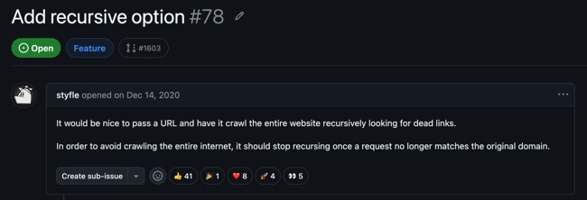

## Summary
[[Lychee]] maintainer Matthias Endler reconstructs four failed attempts to make the asynchronous Rust link checker crawl recursively. The attempts show that feeding discovered links back into a one-way pipeline turns completion into [[DistributedTerminationDetection]] and creates interacting failure modes around cyclic channel closure, counters, bounded-channel backpressure, duplicate submission, task ownership, and leaky abstractions. Work completed in 2025–2026—especially a cloneable-guard `WaitGroup`, per-host request pooling, unified fetching, and sitemap support—now makes recursion appear achievable, although the article says the feature still had not shipped and retrieving response bodies for extraction remained open.

## Key Claims
- The original architecture was a one-shot flow from input through extraction and checking to results; recursion adds a feedback edge from responses to new inputs.

- The original December 2020 request asked lychee to follow links across an input site's original domain, beginning a feature effort that remained open after five years and four major implementation attempts.

- Manual expected-versus-completed counters and a later atomic remaining-work counter were fragile because asynchronously discovered work could race with a zero or completion observation, causing premature exit or a hang.
- Feeding recursive discoveries through cyclic channels deadlocked because sender-drop was both the channel's termination signal and impossible while a response handler still needed a sender; bounded request channels also deadlocked when a blocked response handler could no longer consume responses and free capacity.
- Semaphores bounded concurrency but did not detect completion, while detached `tokio::spawn` tasks required shared `Send + 'static` state and could recreate manual accounting or unbounded background work.
- Concurrent discovery allowed duplicate URLs to be submitted before the post-check cache recorded them, showing that deduplication must occur atomically before or during admission rather than only after a request completes.
- A cloneable-guard `WaitGroup` separates cycle lifetime from channel closure: recursive tasks clone guards and completion occurs only after the final guard drops.
- The later `HostPool` supplies per-host rate limits, request delays, concurrent-request caps, cache-aware deduplication, and one request path for both initial and recursively discovered URLs.
- The remaining proposed recursion path is to retrieve a checked page body from cache, extract allowed same-domain links below the depth limit, and submit them with cloned work guards; this assumes a body-bearing GET path and still requires implementation and validation.

## Key Quotes
> "There is no connection back to the extractor." — the architectural gap identified when recursion was first requested.

> "The real question was never ‘how do I recurse?’" — reframing the feature around knowing when recursive work is complete.

## Connections
- [[Lychee]] - Rust link checker whose one-way asynchronous pipeline resisted four recursion implementations.
- [[DistributedTerminationDetection]] - recursive responses can create new work, so an empty input stream or open channel no longer proves completion.
- [[AdaptiveBackpressure]] - bounded request channels can form a deadlock when response processing must feed work back into the saturated channel.
- [[ConcurrencyFailureModes]] - the history combines circular waits, timing races, duplicate admission, lifecycle ambiguity, and unbounded detached work.
- [[Deadlock]] - channel closure and capacity dependencies formed cycles in which no stage could make progress.
- [[OpenSourceProjectMaintenance]] - refactors, moving CI rules, volunteer environment problems, lost motivation, and grant funding shaped the feature's five-year path.
- [[StructuredConcurrency]] - cloneable work guards restore explicit lifetime accounting for dynamically spawned recursive tasks, though they do not by themselves impose a parent-child task tree.

## Contradictions
- The source rejects a single-language explanation: it estimates that termination, cycles, and backpressure are mostly crawler-domain problems, while Rust adds ownership, `Send + 'static`, locking, and explicit atomic-ordering friction but also catches unsafe sharing.
- The article's confidence that recursion is now close is a maintainer forecast, not shipped-feature evidence. Response-body retrieval, GET-versus-HEAD behavior, full integration with configured extraction, and end-to-end performance and correctness tests remain unresolved in the supplied account.
- The `WaitGroup` addresses dynamic-work completion but does not alone solve admission backpressure, per-URL synchronization, depth and domain policy, cancellation, memory bounds, or rate limiting.
- Performance figures such as the stream rewrite's 35–50% gain and the channel path's roughly 30% regression are first-party branch observations without benchmark configuration, repeated-run variance, or independent reproduction.
