## Summary
Jun Song, Jingyi Ding, and colleagues present [[Magnus]], [[ByteDance]]'s [[ApacheIceberg]]-based data-management system for EB-scale [[MachineLearningDataManagement]]. Magnus combines wide-table and blob storage, primary-key and search indexes, manifest planning, metadata-only branch workflows, lightweight merge-on-read updates, and an Arrow-based reader with training-specific table and sharding designs. Production benchmarks report substantial improvements, but most comparisons are first-party, workload-specific, and sometimes compare different update modes.

## Key Claims
- Magnus places table formats, indexes, snapshots, branches, planning, and an Arrow-based native engine behind SDKs for Flink, Spark, Ray, Krypton, Primus, and BytedStreaming.

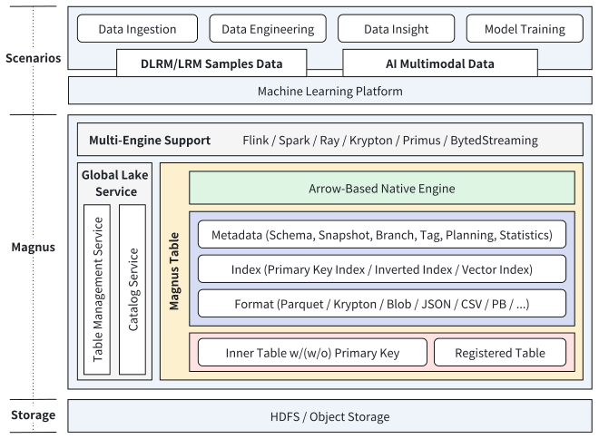

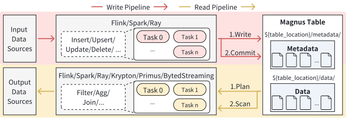

- Its physical table layout extends Iceberg-style data and metadata directories with primary-key, inverted, and vector indexes plus a parsed metadata cache.

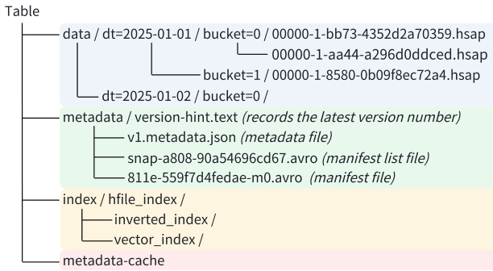

- Krypton reduces wide-table metadata from a row-group-by-column structure toward file-level column metadata, while Blob files move large media bytes out of columnar records and leave offsets and sizes for selective sub-item reads.

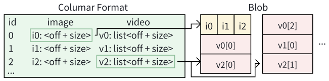

- Primary-key routing assigns records to deterministic buckets; monotonically increasing file sequence numbers let newer records override older ones during merge-on-read.

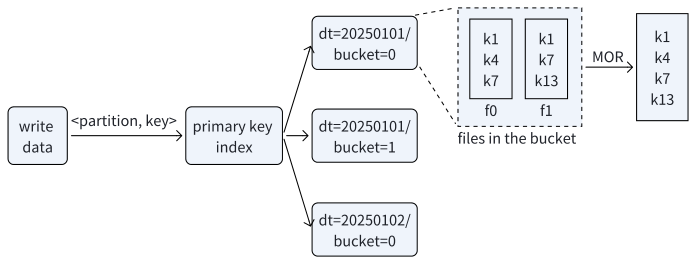

- Metadata planning drops unused wide-table statistics, sorts manifest entries by partition, and adds sparse block-offset indexes; branches add metadata-only merge and rebase while tags preserve reproducible snapshots.

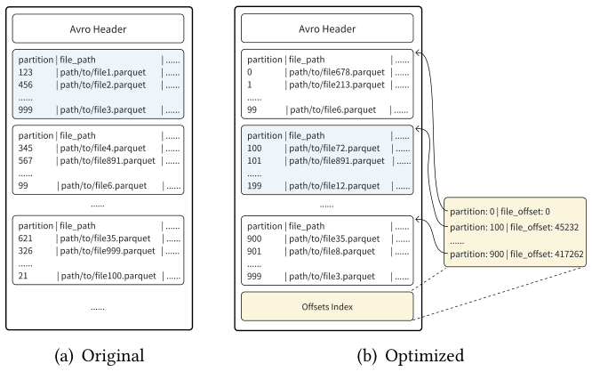

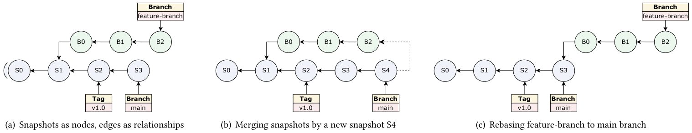

- Position and equality update files avoid rewriting unchanged columns. The native reader combines statistics, dynamic skipping, prebuffering, vectorization, and configurable file- and row-merge rules.

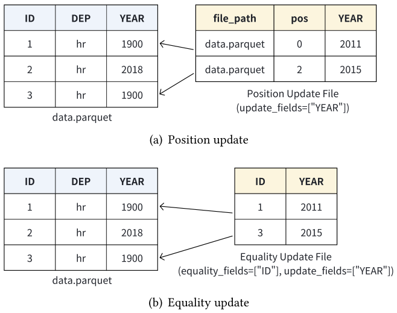

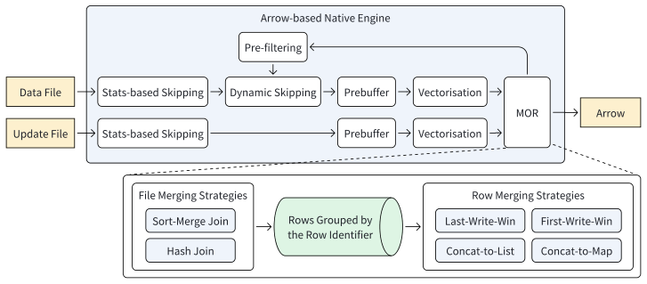

- Large recommendation model training separates frequently repeated per-user sequences into an Extra table joined to monthly Main-table samples; the authors report roughly 50-fold sequence-storage reduction in the stated production shape.

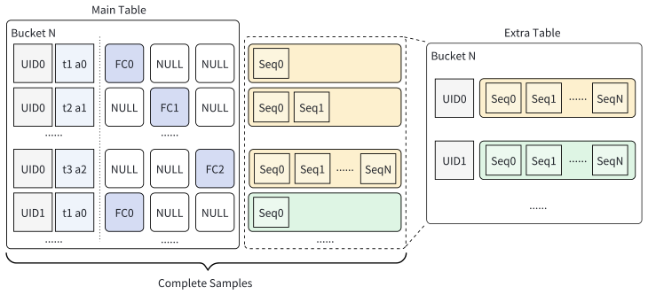

- The evaluation reports more than 30% storage savings for Krypton on five wide files, 5.25–26.12× faster single-partition metadata planning, cheaper writes with bounded read degradation, and lower LMM planning memory and startup time.

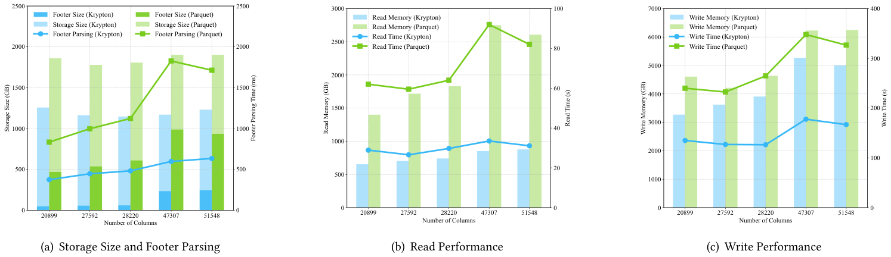

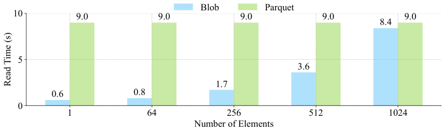

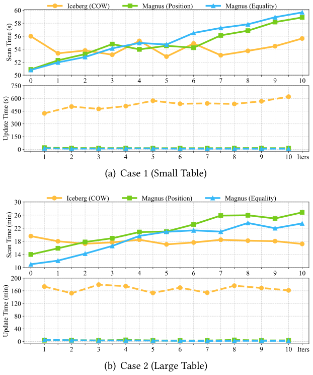

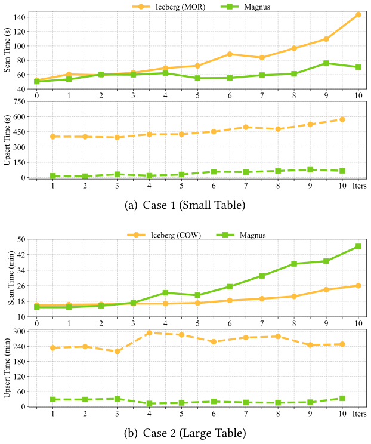

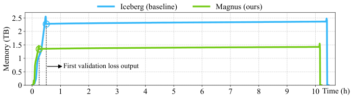

## Key Quotes
> "A holistic data management approach is essential to support large-scale ML workloads." — on treating format, metadata, updates, and training integration as one system.

> "All these operations above are implemented purely at the metadata layer" — on avoiding data rewrites for branch, tag, and audit operations.

## Connections
- [[Magnus]] - the production system described and evaluated.
- [[ByteDance]] - operator and deployment environment for the system.
- [[ApacheIceberg]] - open table format and metadata model that Magnus extends.
- [[MachineLearningDataManagement]] - joint problem spanning storage, indexing, versioning, mutation, and training delivery.
- [[ColumnarStorageTradeoffs]] - widened by Krypton's metadata design and Blob's separation of media bytes from references.
- [[MultimodalDataPipelines]] - gains storage, sharding, planning, and memory-management evidence upstream of execution.
- [[OpenTableFormats]] - table abstraction extended with indexes, branch workflows, and engine integration.

## Contradictions
- The benchmarks are first-party production experiments rather than independent reproductions, and several use small sample counts, selected tables, or undisclosed implementation details.
- Update comparisons use Iceberg copy-on-write because Iceberg merge-on-read performed poorly in the stated setup; upsert comparisons switch among Iceberg MOR and COW by table size, so the figures do not establish one mode-independent ranking.
- The Krypton experiment converts five selected Parquet files, and the Blob experiment fixes one 100 GB table with 1 MB elements; neither establishes general format superiority across schemas, codecs, engines, or storage tiers.
- The paper reports more than five years of deployment and EB-scale operation but does not expose reliability, failure-recovery, cost, concurrency, governance, or tail-latency measurements.
- Table 3's prose says 2.88 GB and 11 GB for user sequences while the table reports 2.88 PB and 11 PB; the table-scale interpretation is retained and the prose-unit inconsistency is flagged.
- Metadata-only branch merge and rebase preserve or recalculate sequence precedence, but the paper does not fully specify semantic conflict detection, schema conflicts, or user-facing resolution behavior.

## Image Notes
All 15 effective local image references were opened and retained once at their semantic positions. They provide system boundaries, data and metadata layouts, update and branch relationships, training-table structure, and quantitative benchmark evidence; none was decorative or duplicated.
