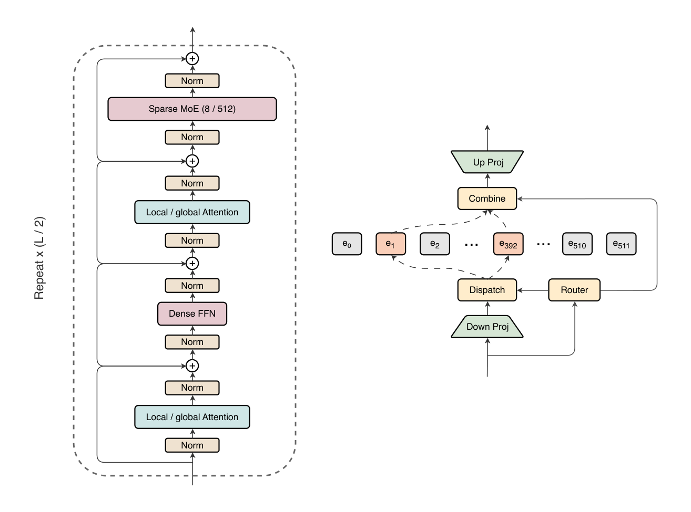
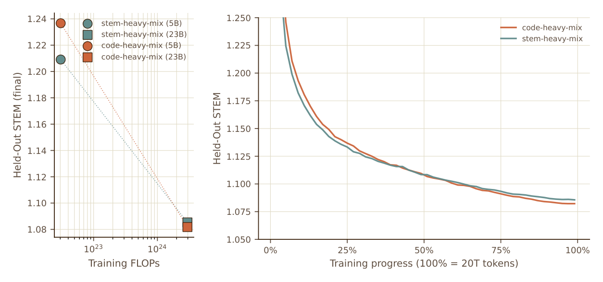
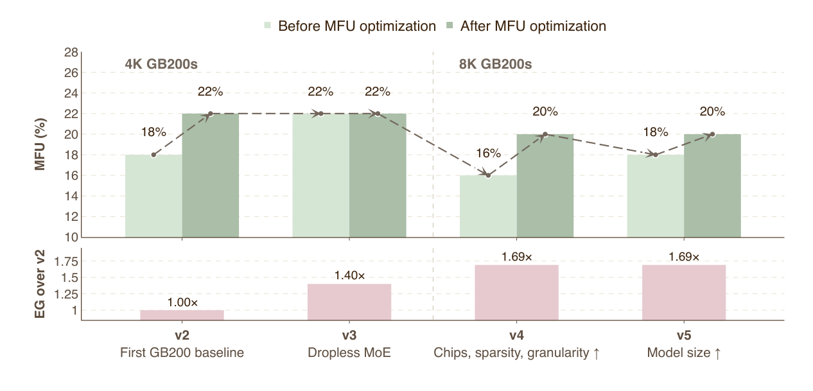
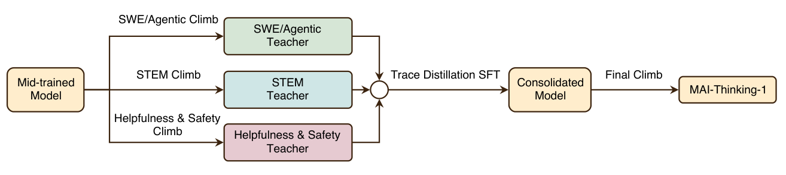
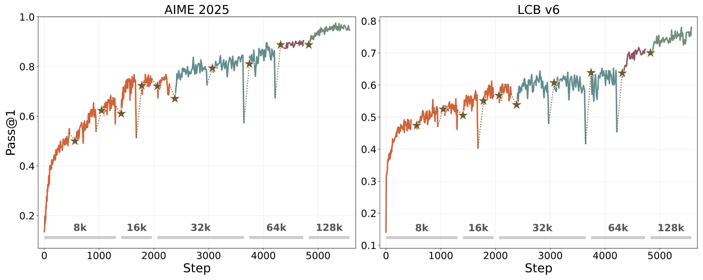
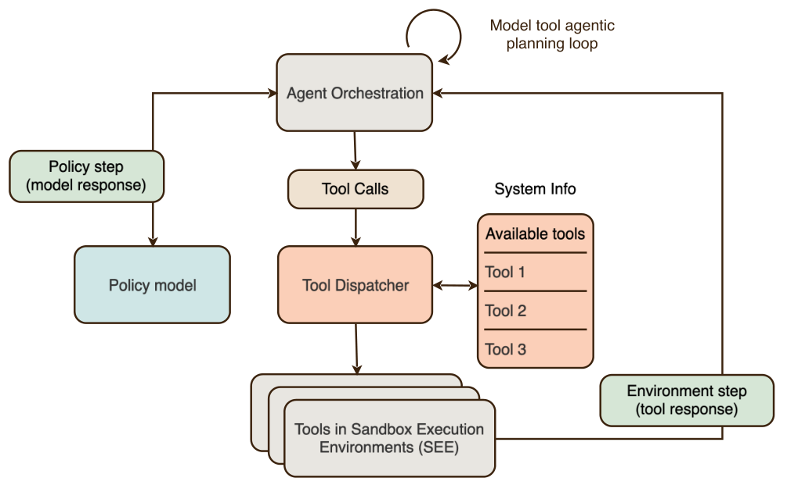
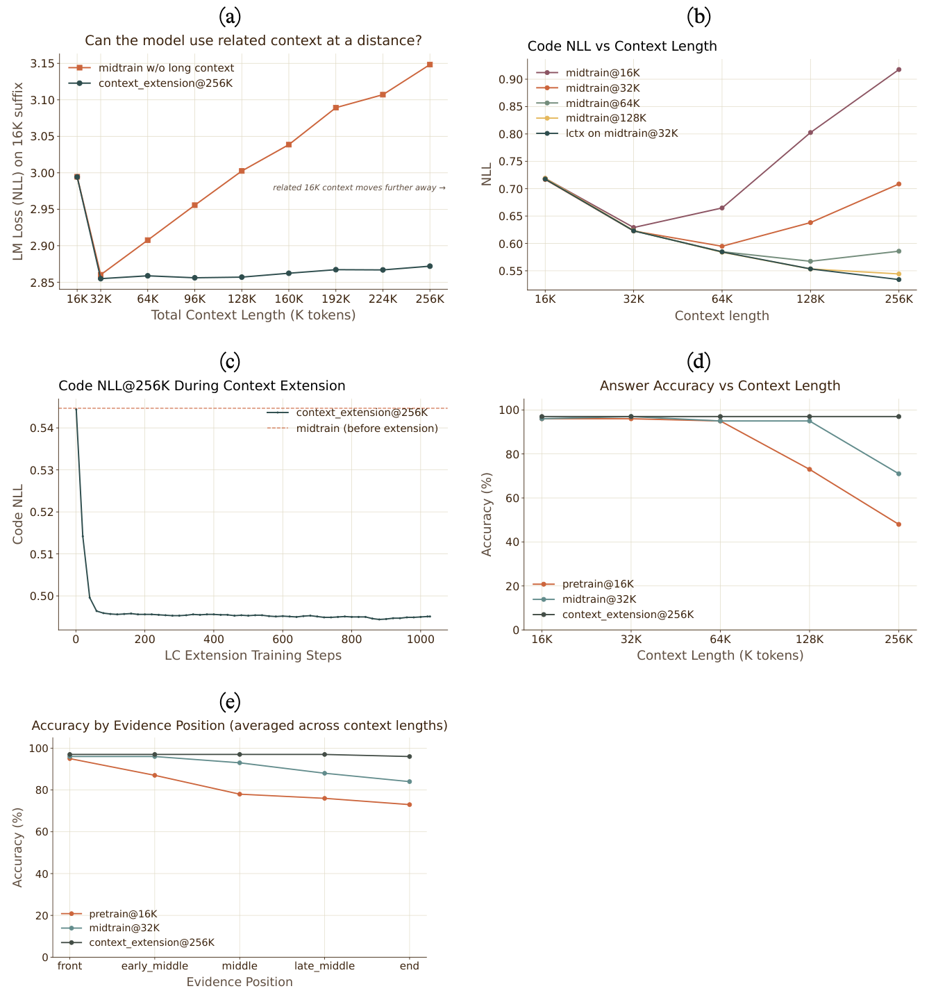

## Summary
The [[MicrosoftAI]] team presents [[MAIThinking1]], a 35B-active, roughly 1T-total-parameter sparse mixture-of-experts reasoning model developed from scratch without third-party model distillation. The report's central contribution is the [[HillClimbingMachine]]: a coupled optimization loop across data, architecture, training systems, reinforcement-learning environments, rewards, evaluations, and safety rather than a claim that one isolated recipe produced the model. It reports strong but not uniformly leading STEM and coding results, including 97.0% on AIME 2025, 94.5% on AIME 2026, 87.7% on LiveCodeBench v6, and 52.8% on SWE-Bench Pro. The evidence is unusually detailed for a first-party model report, but benchmark comparability, undisclosed data, proprietary evaluations, judge dependence, very large inference budgets, and absent independent reproduction remain important limits.

## Key Claims
- MAI-Base-1 was pretrained for 30T tokens and mid-trained for another 3.55T tokens on public and licensed human-generated data processed in-house; the team says it excluded model-generated synthetic pretraining data, open-source training datasets, private customer data absent explicit permission or agreement, and common evaluation repositories.
- The model combines periodic local and global attention with alternating dense and high-sparsity MoE feed-forward blocks; each sparse layer routes a compressed latent representation to 8 of 512 experts while routing decisions use the original representation.

- Small-scale data-mixture rankings did not always extrapolate: a STEM-heavy mixture led early and at small scale, but a code-heavy mixture overtook it during a 23B-active, roughly 20T-token run because two heavily weighted STEM sources were comparatively repetitive and less diverse.

- The [[HillClimbingMachine]] jointly optimized modeling efficiency and realized system throughput: every major architecture change initially exposed new compute, communication, memory, or launch bottlenecks, while more than twenty targeted optimizations restored model-FLOP utilization above 20% across the reported GB200 generations.

- The RL recipe modifies GRPO with entropy-controlled asymmetric clipping and an outer importance-ratio clip, replays top-p masks and MoE routing to narrow inference-versus-learner mismatch, filters uninformative rollout groups, and expands maximum reasoning length from 8K to 128K as training progresses.
- Three specialist climbs—for STEM and competitive coding, software engineering and tool use, and helpfulness and safety—are consolidated by supervised fine-tuning, followed by a final lightweight RL climb.

- Self-distillation is used as a continuity mechanism rather than third-party capability inheritance: roughly one million successful traces from later RL checkpoints can transfer learned behavior into a fresh or newer base, recover from latent numerical collapse, change chat format, rebalance experts, and resume exploration.

- Agentic RL runs a ReAct-style policy/tool loop inside fresh, network-restricted sandbox containers and combines executable state or test rewards with AI feedback. Its SWE pipeline narrows 102M public pull requests to 265,617 verified environments across 94,044 repositories, while its tool-use pipeline creates more than 150 mocked environments and 130,000 tasks.

- Progressive context extension trains mainly at 16K and 64K before a 140B-token 256K phase; the reported ablations show most adaptation within the first 1–10% of extension and comparable 128K code NLL to much more expensive long-context mid-training.

- Operational reliability is treated as a learning variable: bitwise determinism, asynchronous distributed checkpoints, hot-standby recovery, topology-aware scheduling, hardware certification, and goodput accounting are designed to keep infrastructure noise from being mistaken for model progress. The final 8K-GPU pretraining run reports 90% goodput.
- Human raters slightly preferred MAI-Thinking-1 to Sonnet 4.6 overall and preferred Opus 4.6 to MAI-Thinking-1; safety evaluation combines over-refusal and high-sensitivity compliance, jailbreak suites, fifteen internal red-team engagements, and independent red teaming, while acknowledging gaps in multilingual, multimodal, agentic, and dangerous-capability coverage.

## Key Quotes
> "Capabilities should be learned, not inherited." - the first design principle behind training from scratch rather than distilling third-party models.

> "Progress in AI is not the product of any single model; it is the product of pipelines that can be reliably improved." - the report's conclusion and hill-climbing thesis.

## Connections
- [[MicrosoftAI]] - research organization and authoring team behind the model and technical report.
- [[MAIThinking1]] - reasoning model whose architecture, training process, evaluations, and safety work the report documents.
- [[HillClimbingMachine]] - integrated model-development process spanning data, models, infrastructure, environments, rewards, evaluations, and safety.
- [[ReinforcementLearning]] - post-training framework used for reasoning, agentic behavior, helpfulness, and safety.
- [[ReasoningModelDistillation]] - self-distillation transfers progress between the team's own checkpoints while third-party distillation is explicitly excluded.
- [[DistributedNeuralNetworkTraining]] - YOLO, Rocket, parallelism, checkpointing, determinism, recovery, and topology-aware cluster operation make the climbs feasible.
- [[MixtureOfExpertsLoadBalancing]] - global-batch balancing and dropless routing control the 8-of-512 expert architecture.
- [[GroupRelativePolicyOptimization]] - base policy objective modified with adaptive entropy control and an outer ratio clip.
- [[AgenticSandboxInfrastructure]] - fresh isolated execution environments provide reproducible tool interaction and verifiable rewards.
- [[AgenticJudging]] - AI judges score subjective behavior, task decomposition, STEM answers, safety, and factuality where executable checks are unavailable.

## Contradictions
- The report is first-party and compares against a mixture of official external scores and in-house reruns. Different reasoning budgets, tool harnesses, timeouts, judges, and maximum outputs—up to 256K tokens for STEM—limit direct model-to-model comparison.
- The reported training-data exclusions, licensing controls, decontamination, 30T-token mixture, and absence of third-party distillation cannot be independently audited because the complete datasets, providers, prompts, code, checkpoints, and training logs are not public.
- “From scratch” applies to model weights and reasoning traces, not to intellectual or software independence: the system uses published architectures, algorithms, tokenization, benchmarks, open-source repositories, external model judges, and third-party data vendors.
- Benchmark specialization remains possible. The report drops MRCR after showing that 1,000 targeted synthetic examples can move a smaller model from roughly 60% to above 90%, a useful warning that benchmark gains need not reflect general long-context improvement.
- Self-distillation makes long climbs recoverable but also narrows the policy when overused; the team reports diminishing returns beyond roughly one million traces and degradation from early-checkpoint or final-checkpoint-only trace selection.
- Safety gains are measured mainly with model judges and English text. Internal red teaming excluded agentic tool use and multimodal input, non-English coverage was limited, structured dangerous-capability uplift testing was out of scope, and long-tail low-resource-language robustness remains open.
