## Summary
Zhang presents a practitioner workflow for treating B2B product requirements as structured, versioned, reviewable artifacts rather than disposable documents. A custom [[Gemini]] Gem coordinates PRDs, Mermaid diagrams, HTML prototypes, role-based reviews, explicit change approval, and context resets, while [[NotebookLM]] and Google Docs carry approved project knowledge into later iterations. The workflow is concrete and visually documented, but it is a personal playbook rather than evidence that AI-generated requirements, prototypes, or analysis are correct.

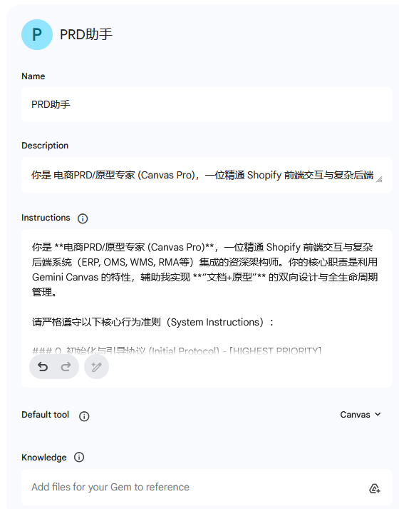

## Key Claims
- [[RequirementsAsCode]] applies software-style structure to product work: semantic versions, change records, atomic edits, explicit review commands, and approval before mutation make PRDs and prototypes easier to trace and recover.
- The custom Gem acts as an operating protocol rather than a one-shot prompt: it gates model choice, requests context, fixes document structure and language, separates the conversation from the deliverable, and provides basic, deep, and quick review modes.
- PRDs and HTML prototypes can share visible version identifiers and acceptance criteria, but synchronization remains deliberately asymmetric and requires user permission.
- Mermaid keeps business flows editable as text across Gemini Canvas and Feishu instead of reducing diagrams to screenshots.
- A shared prototype needs both an accessible artifact and a stable discovery path; the author proposes a fixed Netlify or Vercel URL that redirects to the newest Gemini share link.
- [[NotebookLM]] supplies durable historical context for later PRD iterations, allowing approved documents and complex business rules to be retrieved without carrying one indefinitely long conversation.
- Deterministic computation should handle spreadsheet aggregation: the author instructs Gemini to run Python over every row, expose counts and intermediate totals, and avoid sampling or estimation.
- Long or drifting conversations still require human recovery: narrow the topic, export artifacts, generate a context-migration summary, and restart in a clean session.

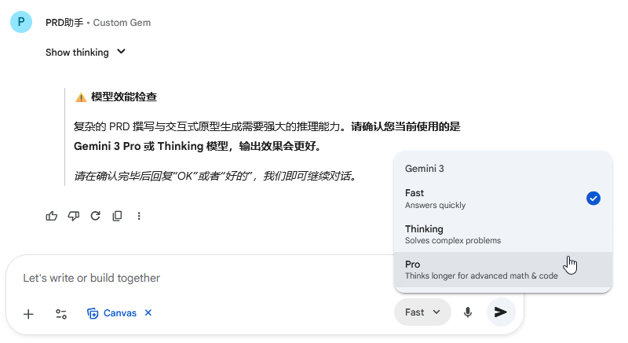

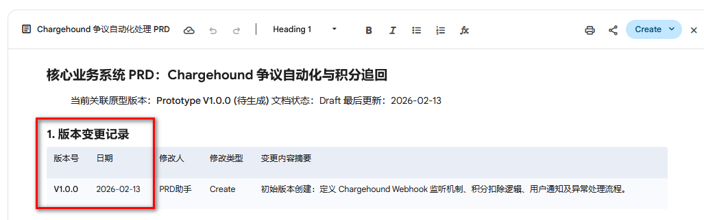

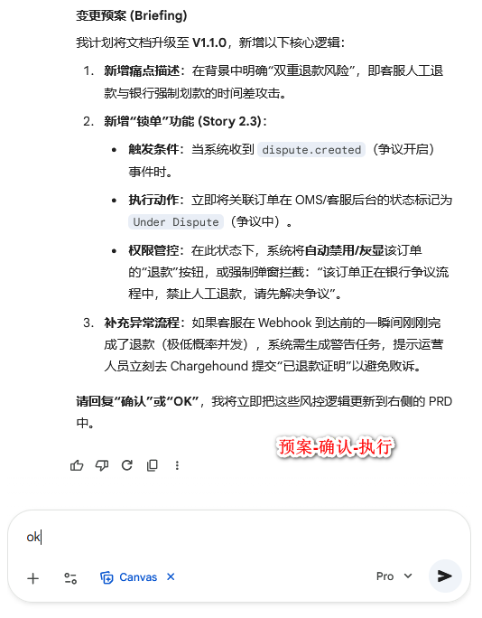

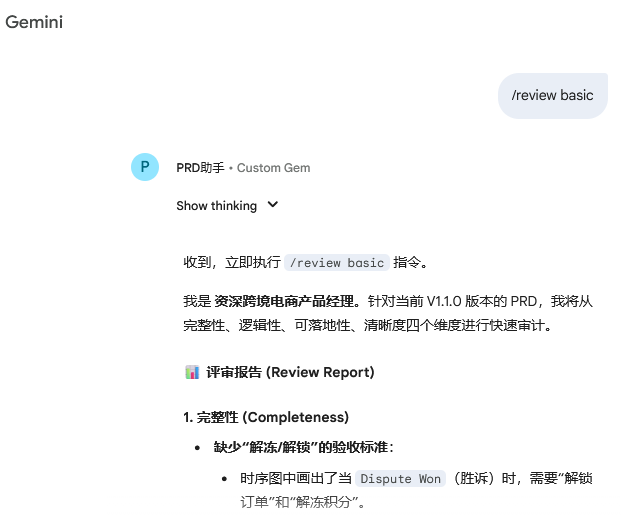

The visual examples show that these controls are expressed in the working interface: model selection blocks the first task, each PRD exposes its associated prototype and version history, a proposed edit stops for confirmation, and `/review basic` produces a separate audit rather than silently rewriting the Canvas.

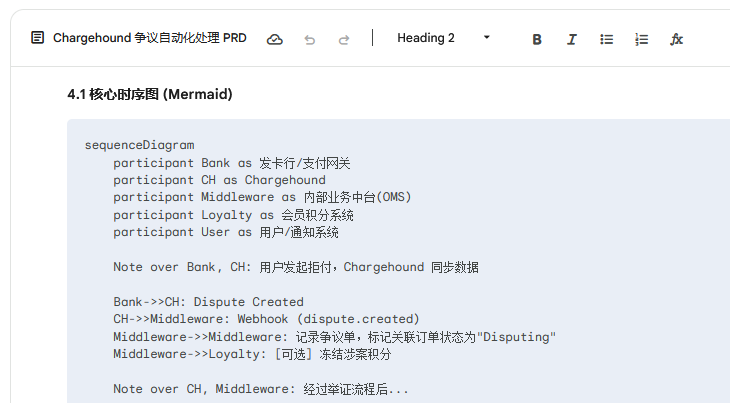

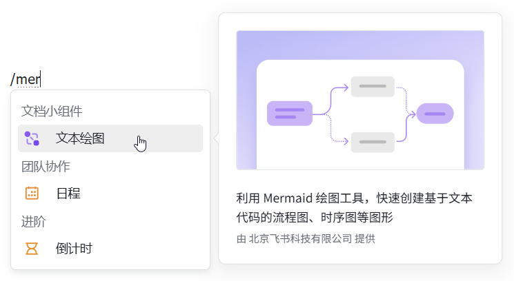

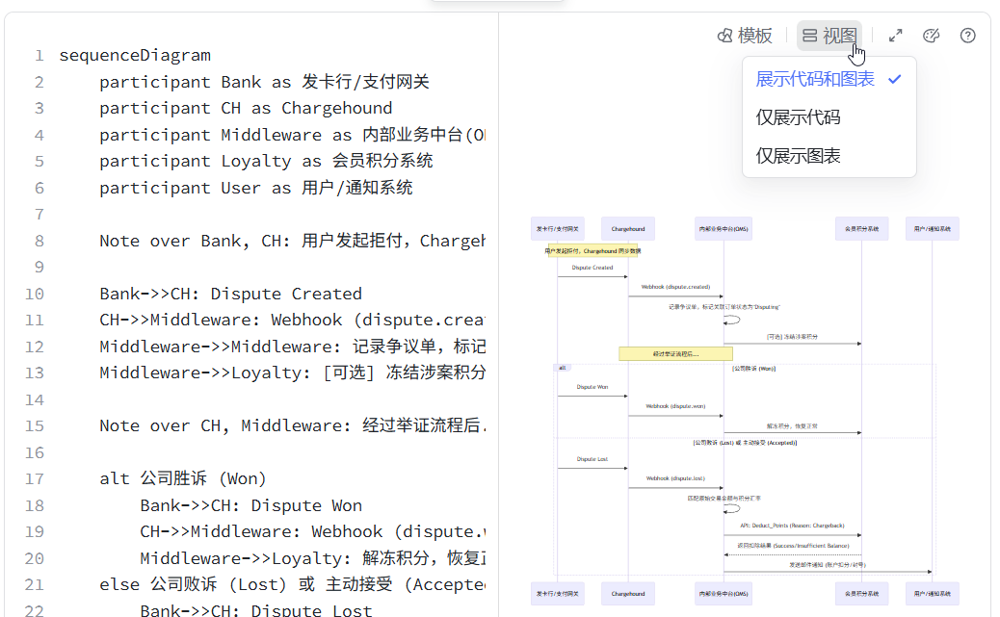

The Mermaid sequence example preserves participants, messages, branches, and annotations as editable code while Feishu renders the same logic beside its source.

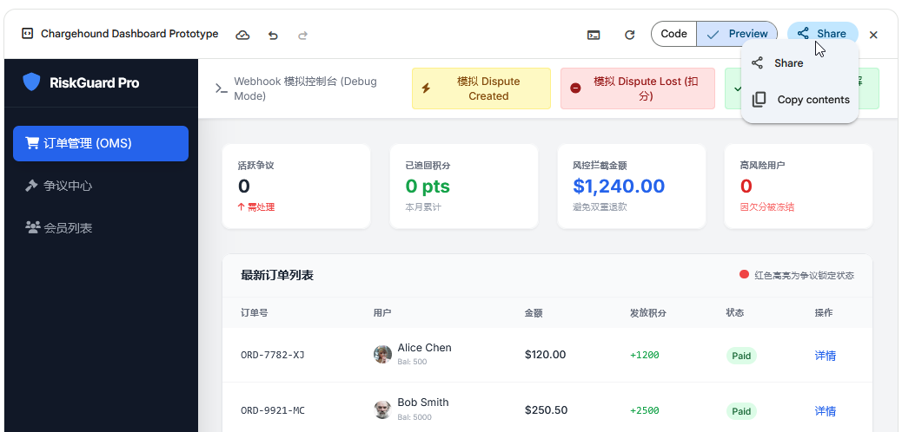

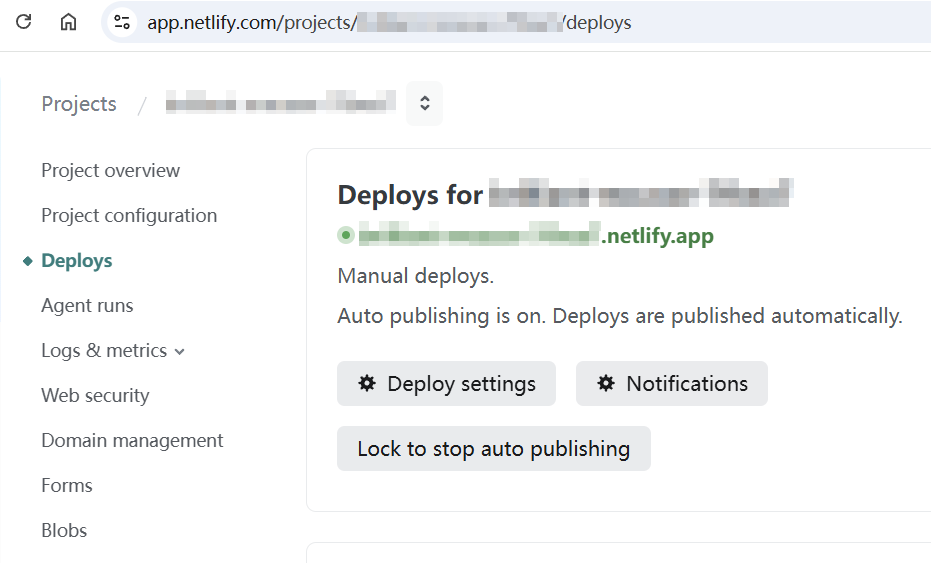

The prototype screenshots distinguish artifact generation from distribution: Canvas can preview and export an interactive chargeback dashboard, while an external deployment can provide the fixed URL that collaborators bookmark.

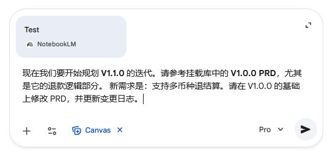

The attached NotebookLM example explicitly asks Gemini to revise V1.0.0 into V1.1.0 using the archived refund logic, illustrating retrieval-backed iteration rather than assumed cross-session memory.

## Key Quotes
> “AI 不应该只是一个比以前更聪明的搜索引擎，它应该被定义为你的虚拟员工——需要 onboarding（入职培训），需要 SOP（操作规范），也需要 Review（绩效考核）。” — on configuring a repeatable operating protocol rather than issuing isolated prompts.

> “用 AI 实现文档的版本化，是对产品工程学的回归。” — on applying semantic versions and change history to requirements work.

> “LLM 本质是‘文字接龙’的概率模型，而不是计算器。” — on routing exact spreadsheet work through executed Python rather than prose generation.

## Connections
- [[RequirementsAsCode]] — central synthesis of structured, versioned, reviewed, and recoverable requirements artifacts.
- [[Gemini]] — model and Canvas environment used for PRDs, diagrams, HTML prototypes, reviews, computation, and small internal tools.
- [[NotebookLM]] — durable project-knowledge layer feeding approved history and business rules into later Gemini sessions.
- [[PromptEngineering]] — custom Gem instructions encode roles, invariants, commands, approval gates, output channels, and recovery behavior.
- [[LLMContextManagement]] — topic boundaries, external knowledge, exported artifacts, summaries, and fresh sessions limit context drift.
- [[ProductBacklogBuilding]] — adjacent method linking user stories and acceptance criteria to product planning.
- [[UserStories]] — required format for turning roles, desired behavior, and value into testable requirements.
- [[SoftwareVerification]] — AI review and executed calculations still require observable evidence and human checking.
- [[GenerativeUI]] — Canvas produces task-specific HTML interfaces and internal decision aids from business rules.

## Contradictions
- The source calls the practice “like code,” but the demonstrated versioning is embedded in generated documents rather than a Git repository with immutable commits, diffs, branches, merge semantics, or independently tested rollback.
- The claim that a very long Gemini conversation can absorb tens of thousands of words “without hallucination” is a personal assessment, not a measured guarantee; the article later acknowledges drift, answer mismatch, and the need to restart.
- The text presents Google-hosted Python execution as safer than arbitrary third-party tools, but it provides no current retention, tenancy, regional, contractual, or compliance evidence; sensitive business data still requires policy review.
- A redirect page gives collaborators a stable entry URL but does not make the underlying prototype immutable, auditable, access-controlled, or guaranteed to remain available.
- Role prompting can broaden review coverage, but simulated product, engineering, and test perspectives do not replace accountable domain experts, executable acceptance tests, platform verification, or user research.
