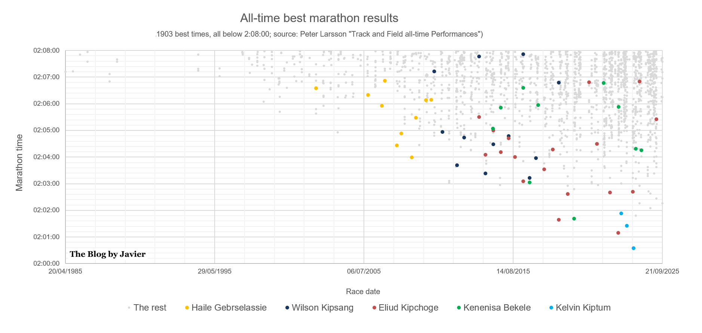
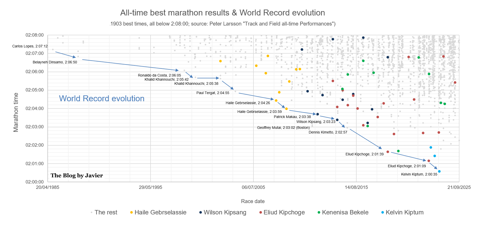
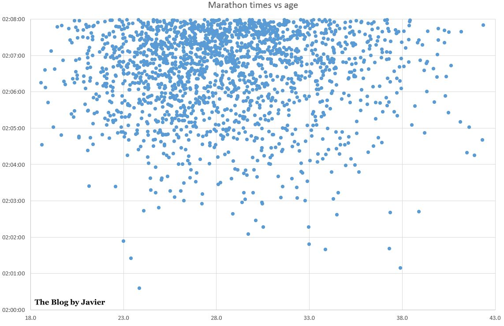
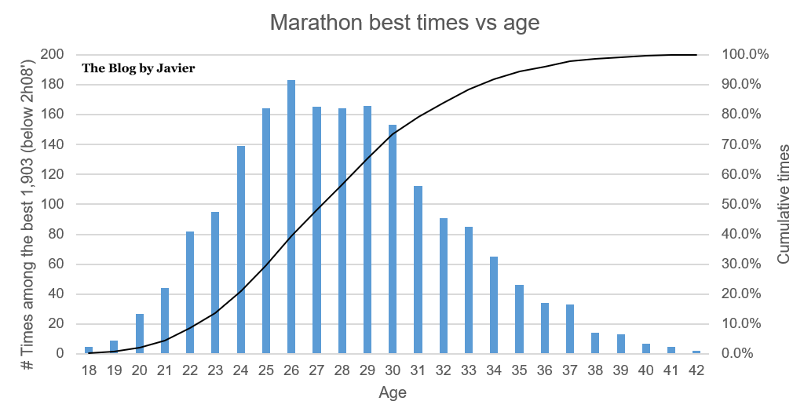

## Summary
Using Peter Larsson's Track and Field all-time Performances compilation, Javier analyzes 1,903 men's marathon results below 2:08 through September 2025. The article describes the concentration of elite times by country, athlete, and race city; traces 13 official world-record improvements since 1985; and relates finishing time to athlete age. Its charts show a long-run increase in the number and speed of elite performances, the stepwise official record progression, and a performance distribution concentrated in athletes' twenties and early thirties.

## Key Claims
- Of 1,903 listed men's times below 2:08, Kenyan athletes produced 853 (44.8%) and Ethiopian athletes 570 (30.0%); the dataset contains 742 athletes from 43 countries.
- At the stricter threshold of 2:05 or faster, Kenya and Ethiopia account for 206 of 231 results (89.2%), while Berlin and Valencia lead the host-city count with 35 each.
- [[EliudKipchoge]] leads the recurrence counts with 18 performances below 2:08 and 14 at or below 2:05; he also set two official world records and made the period's largest single record improvement, 1 minute 18 seconds.
- The men's world record improved 13 times from 1985 through 2023, from Carlos Lopes's 2:07:12 to [[KelvinKiptum]]'s 2:00:35.
- Belayneh Dinsamo's 1988 record lasted just over ten years, while Khalid Khannouchi, Haile Gebrselassie, and Kipchoge each set the official record twice during the period.
- Geoffrey Mutai's 2:03:02 at Boston in 2011 was faster than the standing record but did not qualify because the course is downhill and point-to-point.
- Eighty percent of the listed sub-2:08 results were achieved from ages 23 through 33, with the histogram peaking at age 26; the charts describe an association and do not establish an optimal causal age.

## Key Quotes
> "In the last 40 years, the record has been beaten 13 times." - summary of the official men's record progression shown in the second chart.

> "Between 23 and 33 (both included) 80% of those times are achieved." - the article's descriptive age concentration for sub-2:08 results.

## Connections
- [[MensMarathonPerformance]] - synthesis of the source's time, nationality, venue, record-eligibility, and age evidence.
- [[EliudKipchoge]] - most frequent athlete at both performance thresholds and a two-time record setter in the dataset.
- [[KelvinKiptum]] - current record holder in the source's September 2025 snapshot and a young outlier among the fastest performances.

## Contradictions
- No direct contradiction with existing wiki content was identified.
- The source's language about the “best age” is stronger than its evidence: the charts are descriptive, contain only already-elite sub-2:08 results, and do not isolate age from athlete selection, era, course, conditions, training, or technology.
