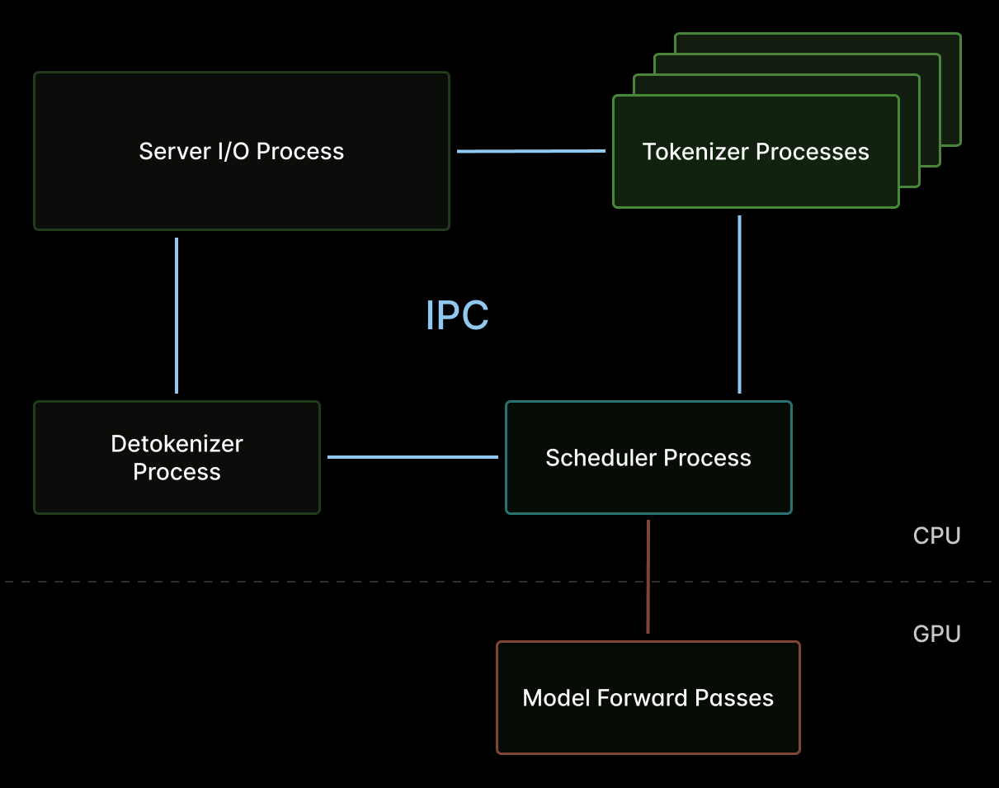
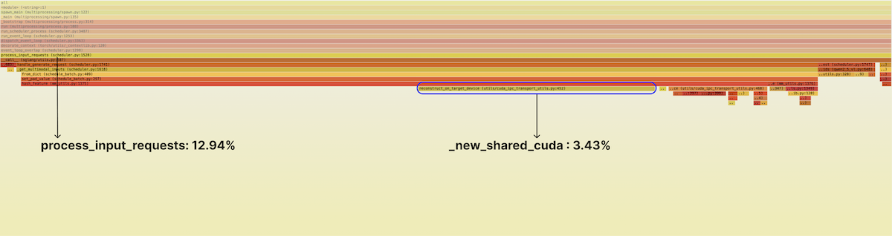
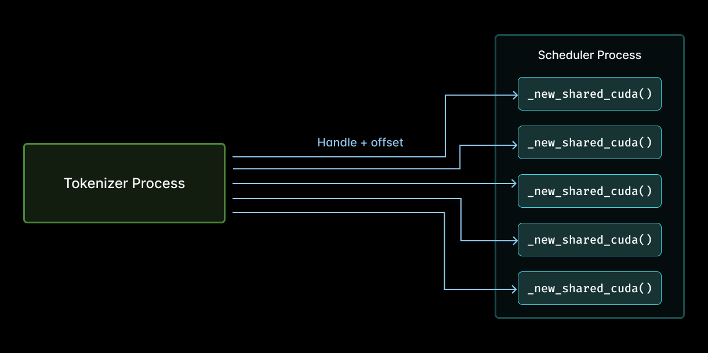
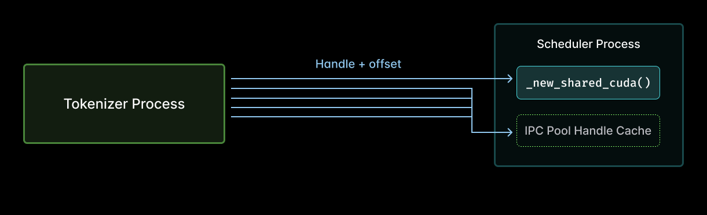
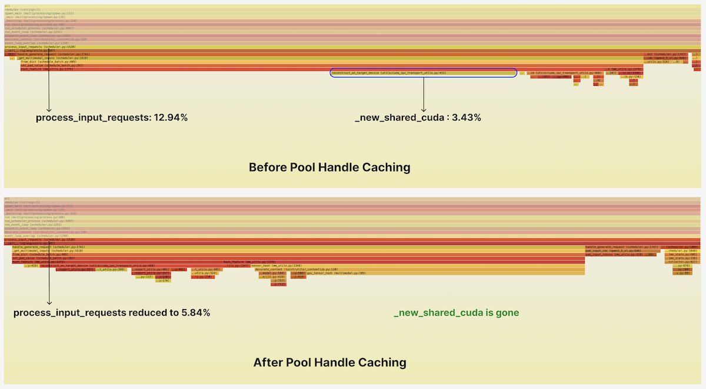

## Summary
[[SaatwikNagpal]] and [[CharlesFrye]] trace an [[SGLang]] multimodal-inference bottleneck to repeated PyTorch reconstruction of the same CUDA IPC pool storage inside its single-threaded scheduler. A small pool-handle dictionary removes that recurring host work and, in a first-party Qwen2.5-VL-3B-Instruct benchmark on one H100, raises throughput 16.2% while improving mean and p99 latency metrics.

## Key Claims
- [[InferenceHostOverhead]] can leave GPU capacity idle because SGLang's single scheduler thread must finish request preparation before it can dispatch the next prefill or decode batch.
- Multimodal feature hashing crosses process boundaries: tokenizer workers pass a CUDA IPC pool handle plus tensor offset to the scheduler, which previously called `torch.UntypedStorage._new_shared_cuda` for every tensor.
- Because the memory pools are stable, a dictionary keyed by device index and pool handle can retain the reconstructed storage; a lock is needed only for rare cache writes, with a second lookup inside the lock.
- The optimization removes repeated PyTorch-side `StorageImpl`, CUDA-event, GIL, and allocator bookkeeping even though repeated CUDA-level handle opens are reference-counted and relatively cheap.
- Under the reported Qwen2.5-VL-3B-Instruct/H100 workload, throughput increases from 22.2 to 25.7 requests/s; mean TTFT falls from 965 to 838 ms, mean TPOT from 72 to 60 ms, and mean end-to-end latency from 1,979 to 1,768 ms.
- Decode improves despite an input-path change because mixed-chunk scheduling can place prefill and decode tokens in one batch, and any scheduler delay postpones dispatch for all in-flight work.
- The cache was merged in SGLang v0.5.10 and applies to multimodal models using its CUDA IPC transport, but broader gains remain dependent on request composition and system configuration.

## Key Quotes
> "Every millisecond spent in the scheduler is a millisecond that prefill and decode iterations are stalled for all in-flight requests." - on the global cost of host-side scheduler work.

> "Do it once, but don’t do it again!" - on caching stable CUDA IPC pool reconstruction.

## Connections
- [[InferenceHostOverhead]] - the main performance mechanism and diagnostic lesson.
- [[SGLang]] - the inference engine whose scheduler and CUDA IPC transport were optimized.
- [[Modal]] - the authors' platform and the publisher of the benchmark account.
- [[StoragePerformanceBenchmarking]] - complements the source's profile-hypothesis followed by end-to-end benchmark method.
- [[HighThroughputIOOptimization]] - shares the principle of moving invariant bookkeeping out of a recurring data path.
- [[PyTorchTransformers]] - PyTorch's shared-storage wrapper supplied most of the avoidable handle-reconstruction cost.

## Contradictions
- No direct contradiction with existing pages. The result qualifies any GPU-only view of inference optimization by showing that a small host-side scheduler change can improve both prefill and decode latency.
