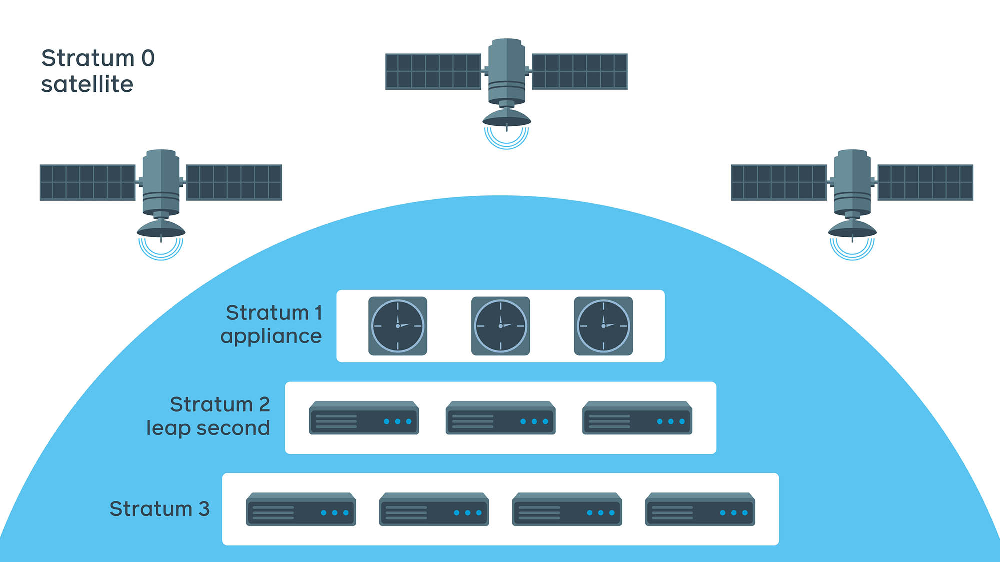
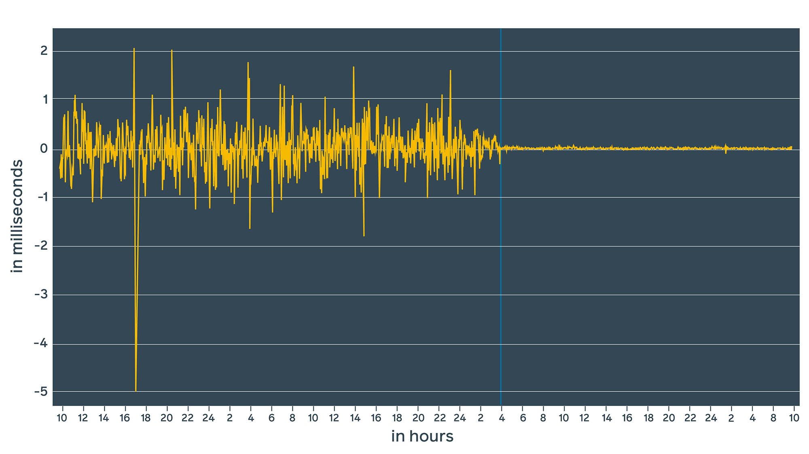
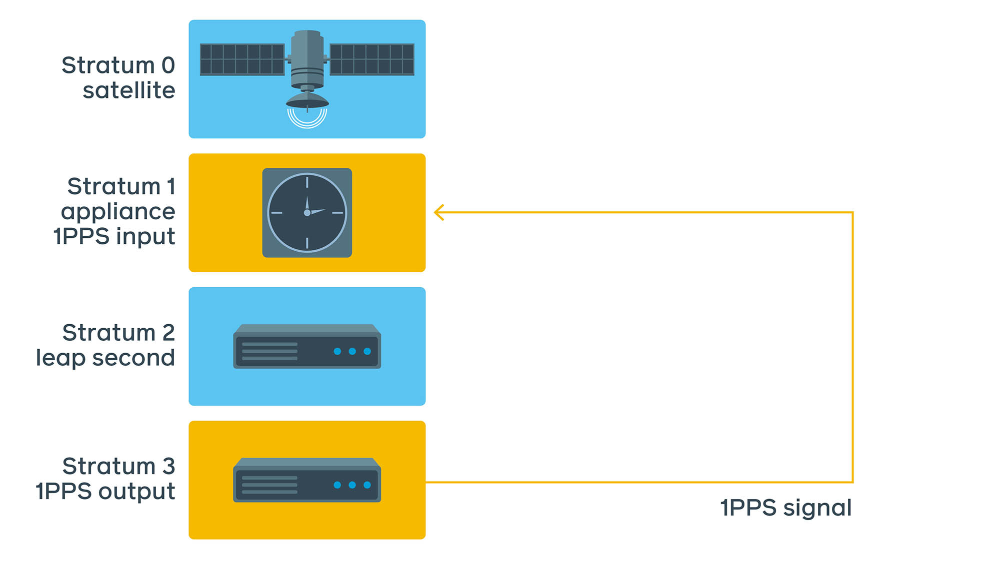
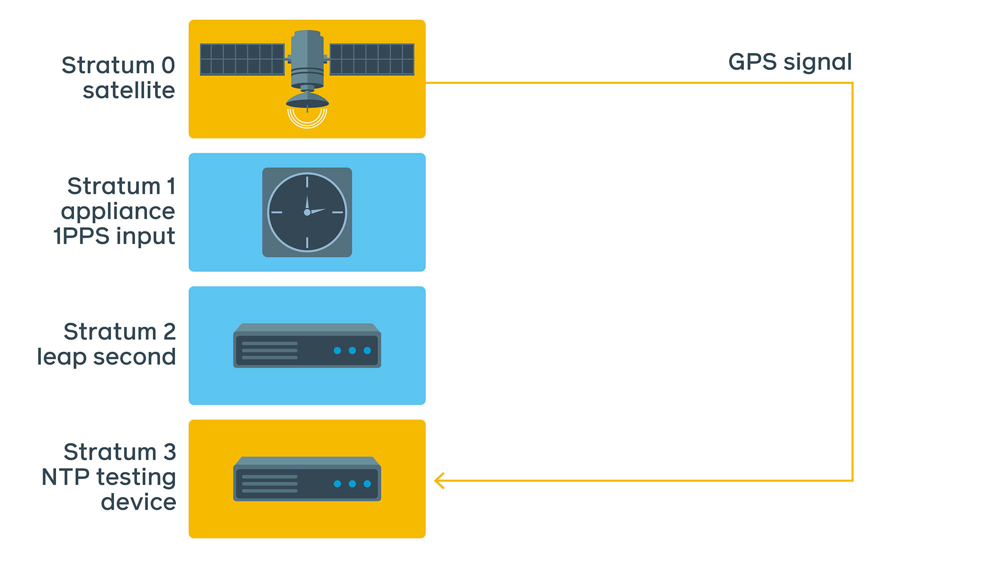
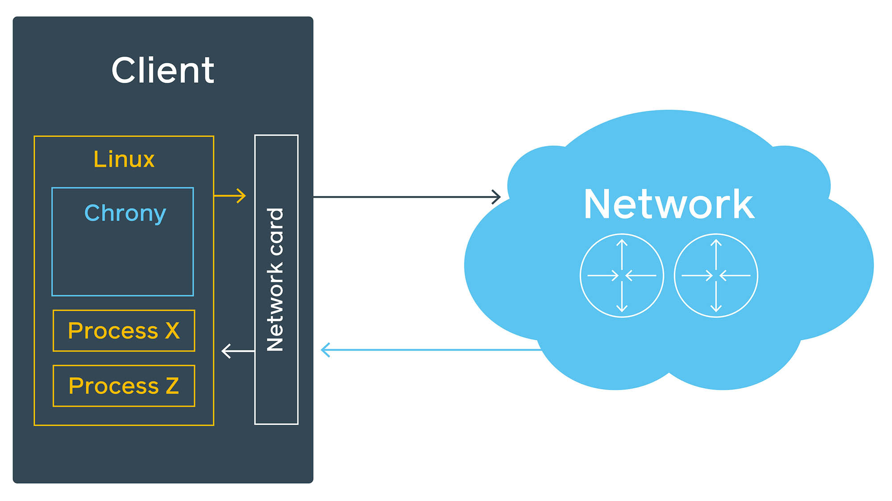
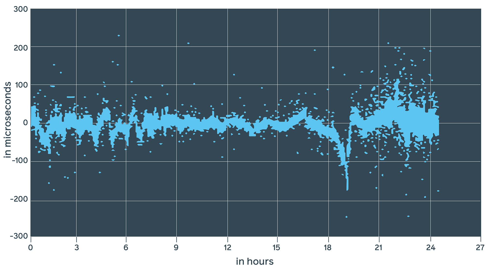
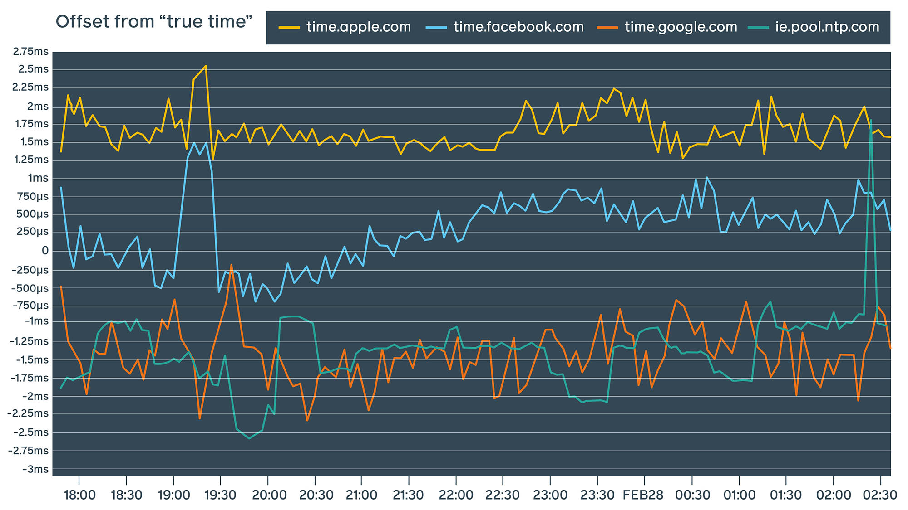
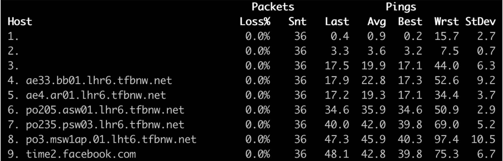
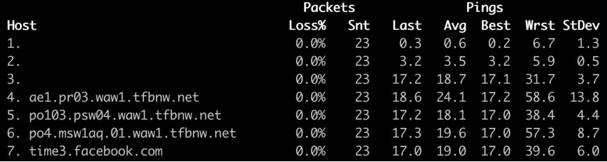
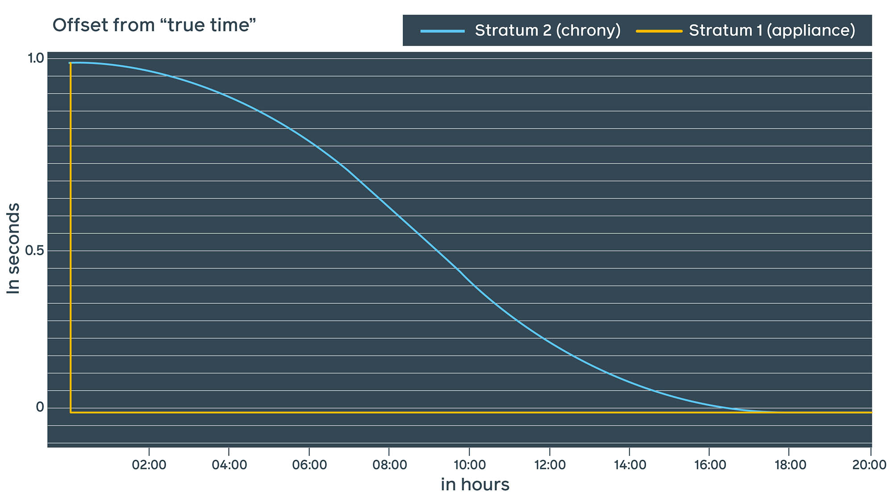

## Summary
Oleg Obleukhov explains why [[Facebook]] replaced ntpd with [[Chrony]] and built a four-stratum [[NetworkTimeSynchronization]] service backed by GNSS-disciplined atomic clocks. Internal lab measurements—not daemon estimates alone—reported an improvement from millisecond-scale ntpd error to hundreds of microseconds with chrony and often about plus or minus 100 microseconds when [[HardwareTimestamping]] was enabled. The account also covers 1PPS and portable reference-device validation, geographically distinct public endpoints, and an approximately 18-hour post-event [[LeapSecondSmearing]] policy.

## Key Claims
- The production hierarchy uses GNSS satellites as Stratum 0, a GNSS-synchronized atomic-clock appliance as Stratum 1, leap-smearing servers as Stratum 2, and a larger Stratum 3 serving tier; additional layers are possible when load and precision needs require them.
- Facebook's daemon estimates and independent measurements found chrony roughly 10 to 100 times more precise than ntpd on the tested hardware, while CPU use was similar and chrony used about 1 MiB less RAM in the cited comparison.

- Offset estimates depend on symmetry, prompt packet dispatch, and stable oscillators, so the team validated them using nanosecond-scale 1PPS phase comparisons and a portable GNSS/atomic-clock device that timestamps NTP packets independently of the server operating system.

- Software timestamps can absorb Linux scheduling, queueing, and ARP delay between timestamp creation and packet transmission; compatible network-interface timestamps move observation closer to the wire, although the residual uncertainty reported by chrony can remain hundreds of microseconds.

- One external-device run placed Facebook's public endpoint within roughly -0.75 to +1.5 milliseconds while the three comparison services occupied different bands; the article correctly qualifies this result as path-, location-, and connection-dependent rather than a universal provider ranking.

- Five independently located public endpoints reduce shared path-failure exposure and can improve precision; two retained path captures reach `time2.facebook.com` through LHR6 in nine hops at about 42.8 ms average and `time3.facebook.com` through WAW1 in seven hops at about 19.0 ms average.

- Facebook chose chrony's leap indicator and a smooth post-event smear of approximately 18 hours at Stratum 2, leaving Stratum 3 servers unaware of the leap and requiring synchronized smear shapes across the serving pool.

## Key Quotes
> "Measuring time is challenging." - Obleukhov's summary of why independent reference instrumentation matters.

> "This confirms that daemon estimates might be inaccurate." - conclusion after comparing ntpd, chrony, and hardware-timestamped chrony with the lab device.

## Connections
- [[OlegObleukhov]] - Facebook production engineer and author of the first-party implementation account.
- [[Facebook]] - operator of the internal and public NTP systems described.
- [[Chrony]] - daemon selected over ntpd for precision, scaling, extended NTP behavior, and hardware-timestamp support.
- [[NetworkTimeSynchronization]] - broader problem of distributing reference time through variable-latency networks.
- [[HardwareTimestamping]] - technique used to reduce operating-system delay in packet timing.
- [[LeapSecondSmearing]] - continuity policy applied at Stratum 2 before time reaches the larger serving tier.

## Contradictions
- The article's headline improvement combines daemon estimates, short lab traces, and selected hardware in a first-party account; it supplies no raw dataset, statistical distribution, reproducible configuration, fleet-wide failure rate, or independent replication.
- The public-provider chart is explicitly path-sensitive and cannot establish a general service ranking. The two route screenshots demonstrate distinct paths from one vantage point, not global geographic independence or availability.
- A displayed 11 ns adjusted offset is not an 11 ns end-to-end accuracy guarantee: the same chrony output reports an estimated error of 193 microseconds, and the external device found a much wider distribution.
- Hardware timestamps reduce software-path uncertainty but do not remove network asymmetry, oscillator behavior, queueing after the network-interface timestamp, reference-clock error, or unsupported-card constraints.
- Eleven inspected images were omitted: one decorative cover, two fully summarized CPU/RAM charts, a redundant oscilloscope topology and trace, one setup photograph, two measurements superseded by the retained comparison, and three packet-flow diagrams whose evidence is captured more directly by the retained scheduling-delay diagram and text.
