## Summary
[[PranjalShankhdhar]] builds a plain-CUDA and inline-PTX NVFP4 GEMM for one Nvidia GB300, progressing from a 3.271 PFLOP/s baseline to 7.653 PFLOP/s on the selected 8192-cubed shape. The work combines two-CTA tensor-core execution, independent operand and scale pipelines, TMEM accumulator overlap, compiler and store-path micro-optimizations, exact tail handling, and a scheduler that assigns reusable A rows to the GB300's two requester-side L2 populations. Under the author's current benchmark protocol the final kernel is reported 4.7% faster than cuBLASLt, but the margin, schedule, and several tail choices are hardware-, shape-, software-, power-, and protocol-specific.

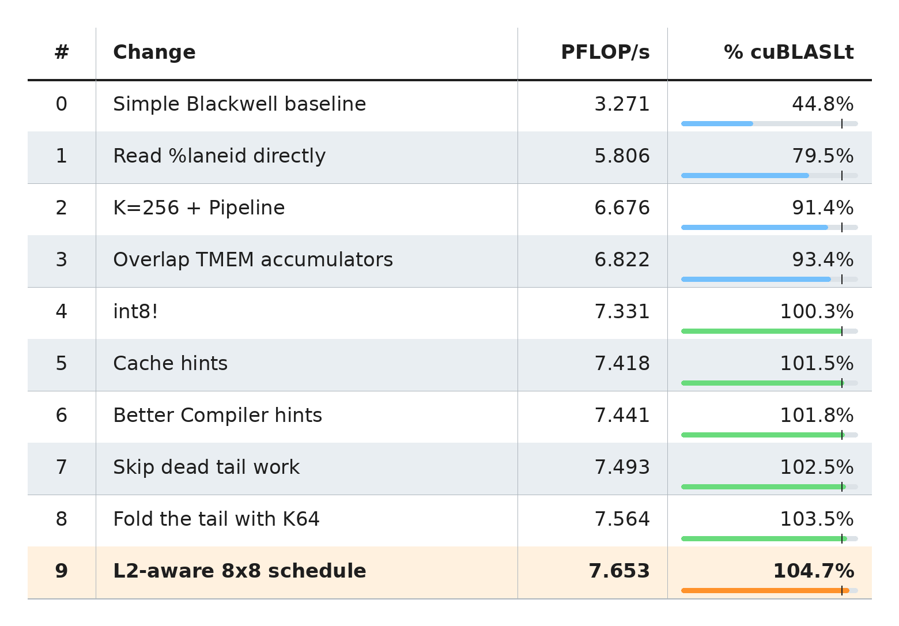

## Key Claims
- NVFP4 stores each value in E2M1 and shares one UE4M3 scale across 16 values along K, producing an effective 4.5-bit cost; Blackwell's `tcgen05.mma` applies those scales in the tensor core and accumulates in FP32.

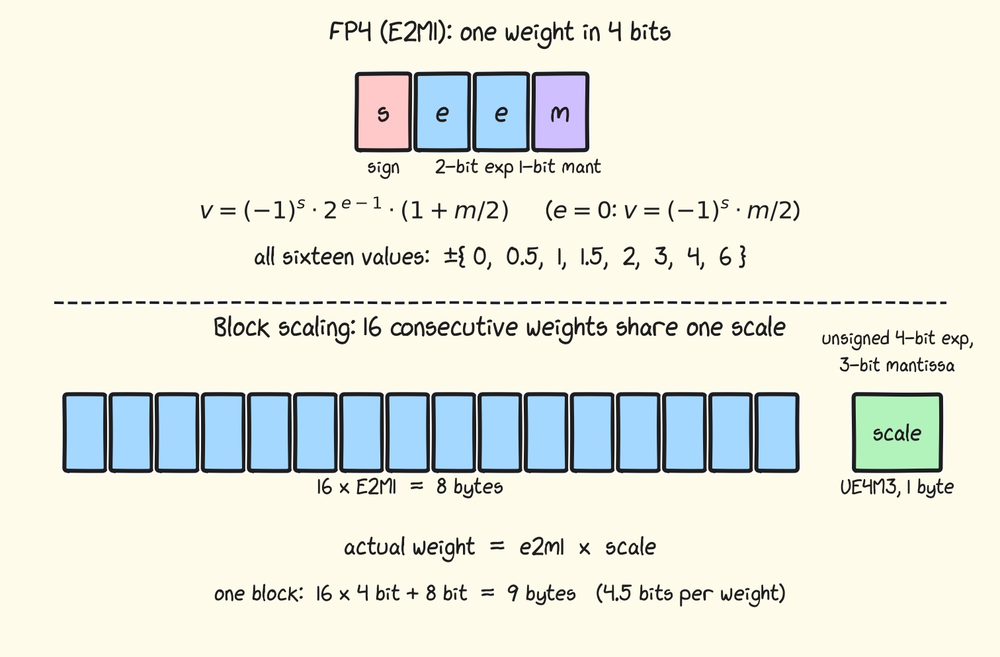

- The baseline uses two coordinated CTAs for a 256 by 256 output tile. Seven warps divide TMA operand loads, TMA scale loads, scale copies plus MMA issue, and FP32-to-FP16 epilogue stores; mbarriers connect three concurrently active producer-consumer handshakes.

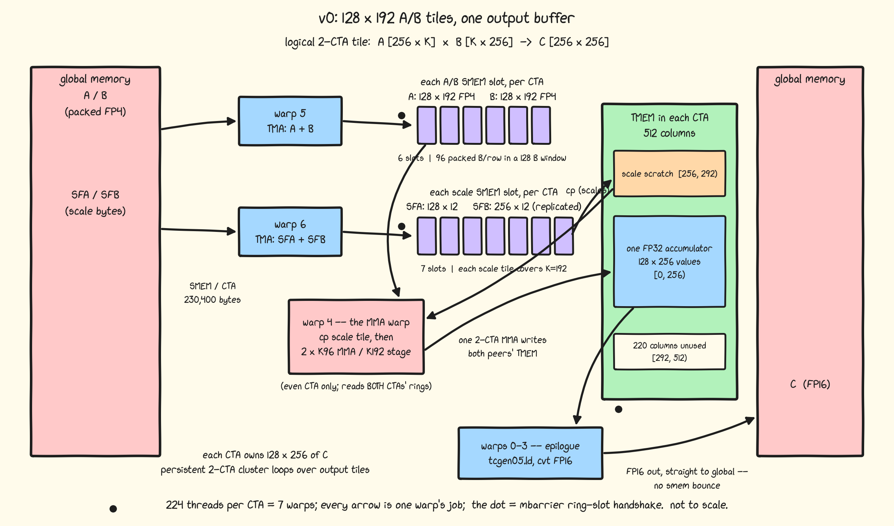

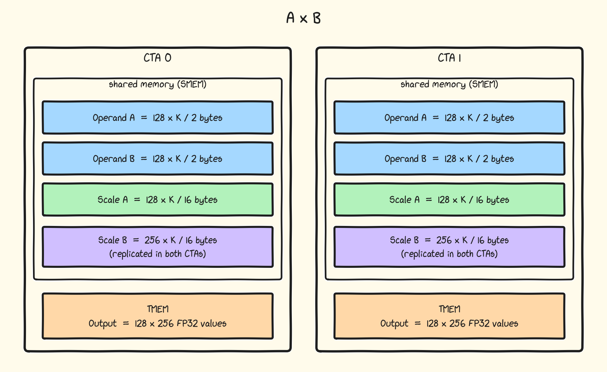

- A K96 MMA consumes six scale bytes per row. Grouping two MMAs makes a K192 scale stage fit exactly into three SFA and six SFB 512-byte copies, occupying 36 TMEM columns and aligning scale and operand release boundaries.

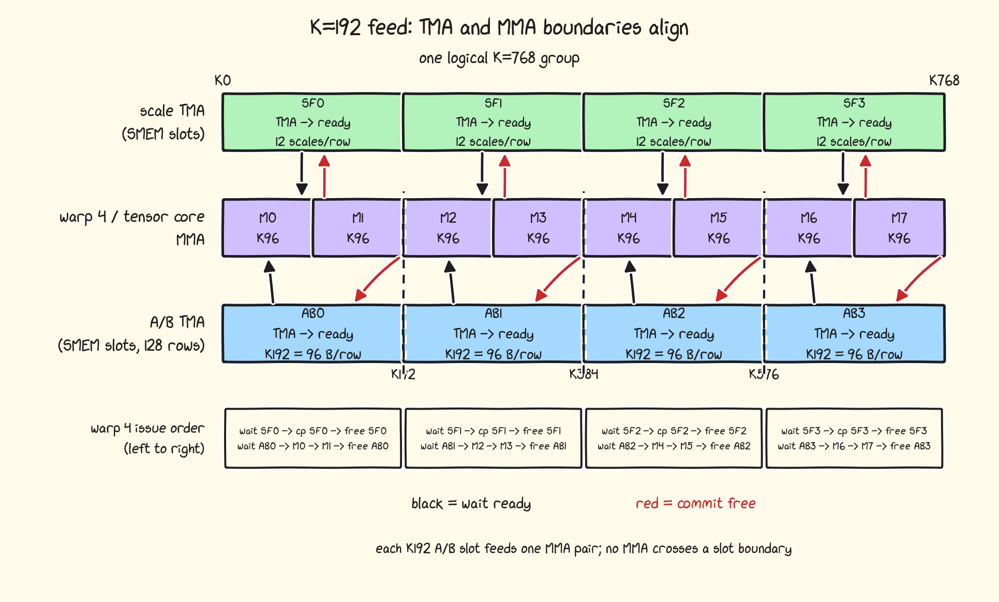

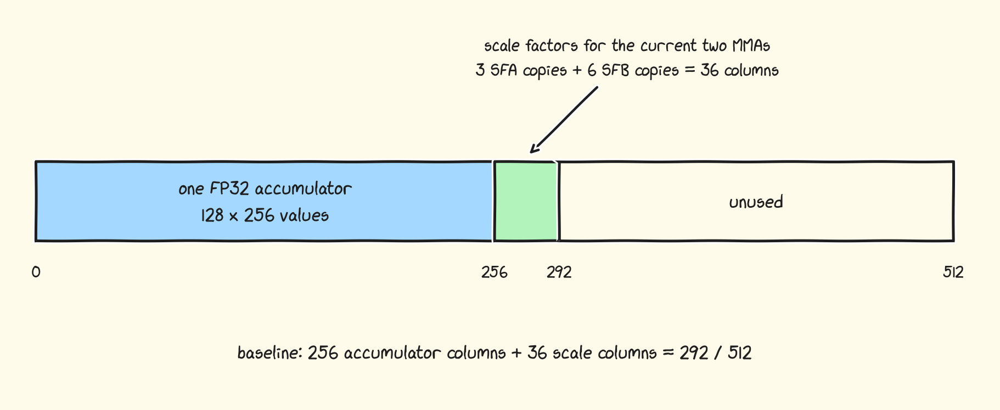

- Reading `%laneid` directly at five single-lane sites reportedly raises throughput from 3.271 to 5.806 PFLOP/s because ptxas preserves more warp-uniform state and removes 135 `R2UR` transfers; mathematically equivalent source expressions need not compile to equivalent GPU control paths.
- Expanding operand TMA stages from K192 to K256 fills 128-byte row windows but makes K96 MMAs cross stage boundaries. A manually unrolled K768 schedule, early buffer release, copy-before-MMA issue order, and descriptor absolute-address mode raise the result to 6.676 PFLOP/s while using 230,400 of 232,448 shared-memory bytes per SM.

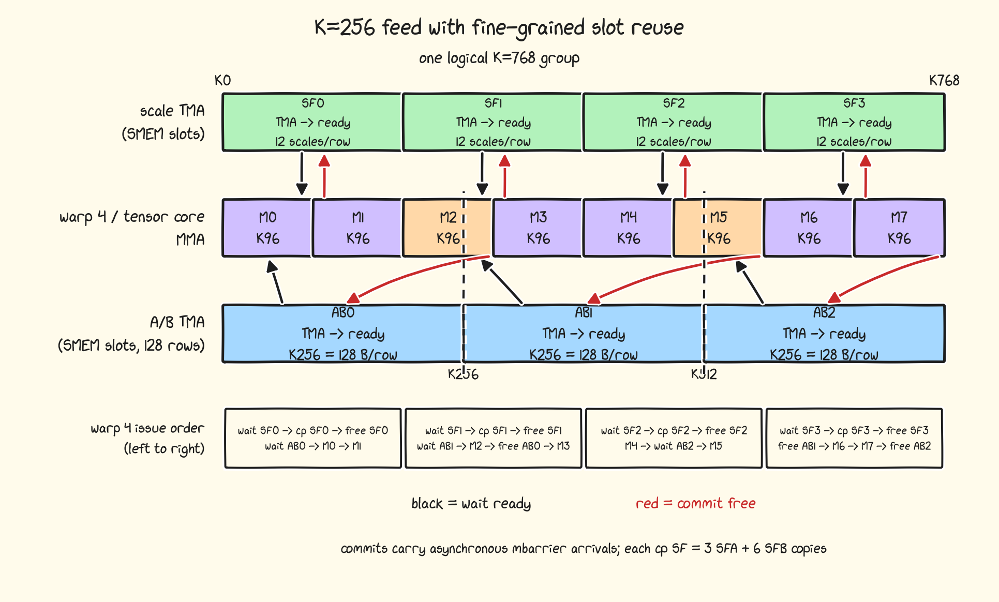

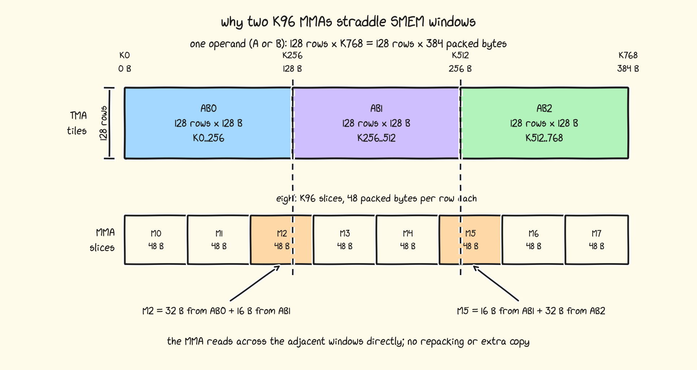

- Two 256-column output buffers and 36 scale columns exceed TMEM's 512 columns. Overlapping the output windows by 36 columns, draining that edge first, and delaying rather than eliminating synchronization lets MMA work begin sooner and raises measured throughput to 6.822 PFLOP/s.

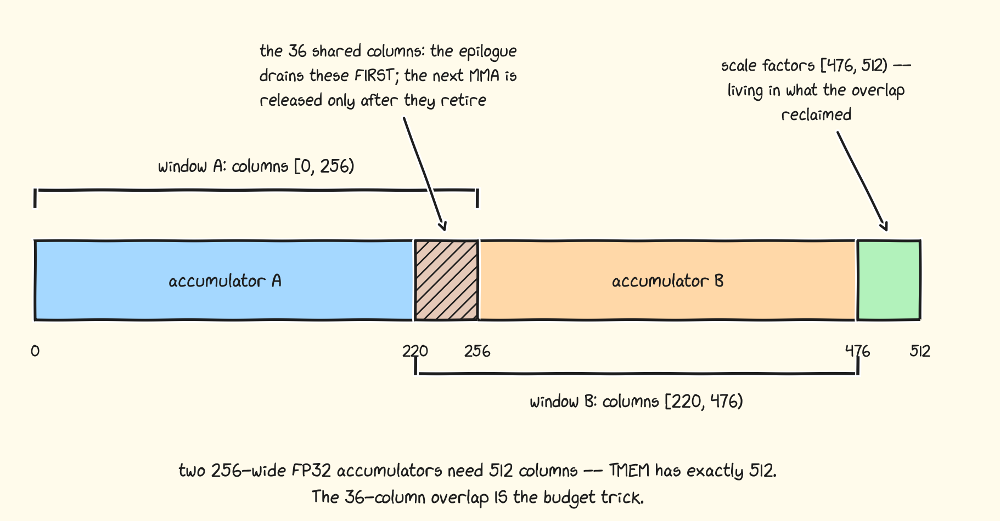

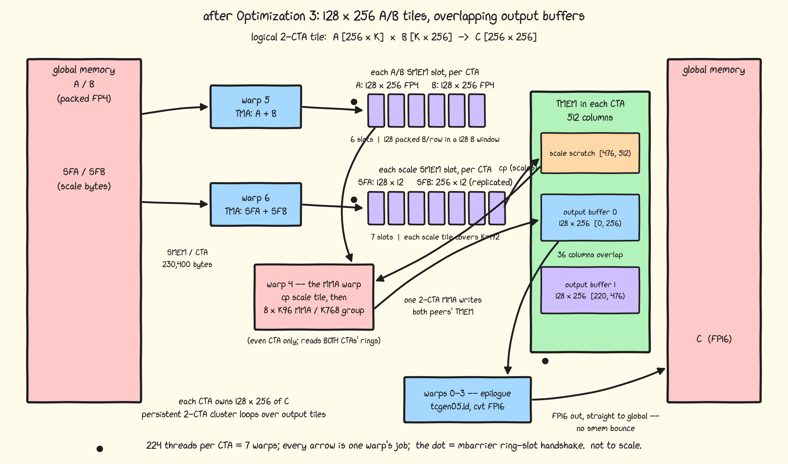

- Wider 256-bit stores, write-once cache hints, exact block-size compiler information, removal of dead K-tail MMAs, and a mixed K96/K64 tail contribute the next measured steps from 6.822 to 7.564 PFLOP/s; the largest of these is the 7.5% gain attributed to the wider store.
- Local 8 by 8 tile pockets alone regress from 7.570 to 7.508 PFLOP/s. The author's model treats GB300 as two requester populations near separate L2 halves: assigning each output M row and its reusable A data to one requester side, then applying local pocket order within that side, raises the selected result to 7.653 PFLOP/s.

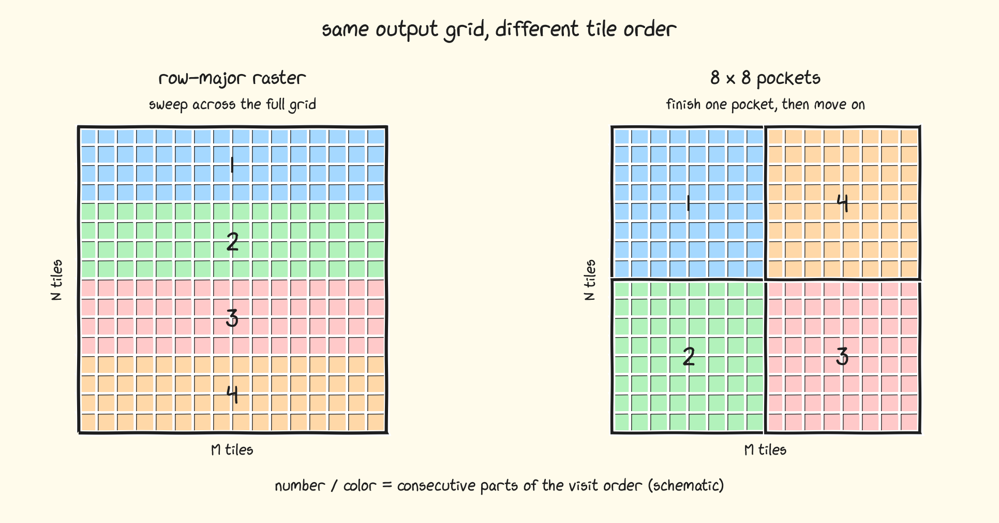

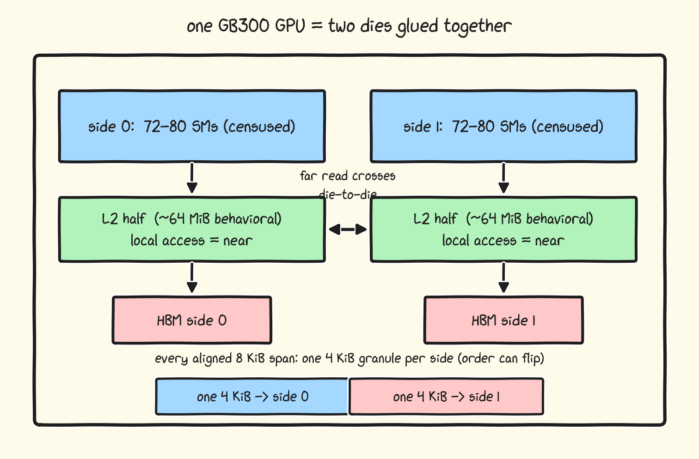

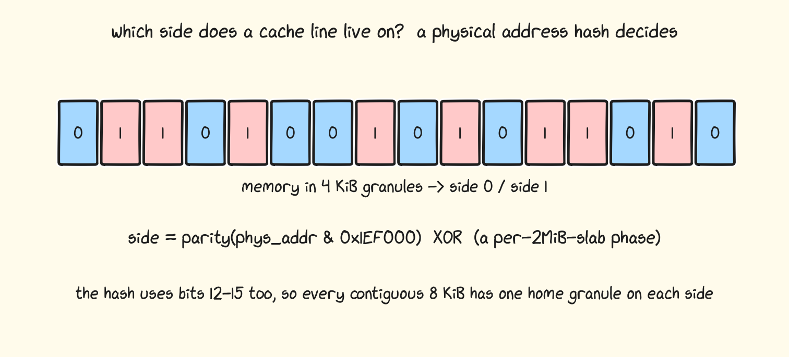

- The useful schedule changes by matrix shape. The source reports positive gains over cuBLASLt on five displayed shapes using owned 8 by 8, owned 8 by 4, owned M-fast, or owned Hilbert order, while explicitly saying this code does not beat cuBLAS on several other shapes.

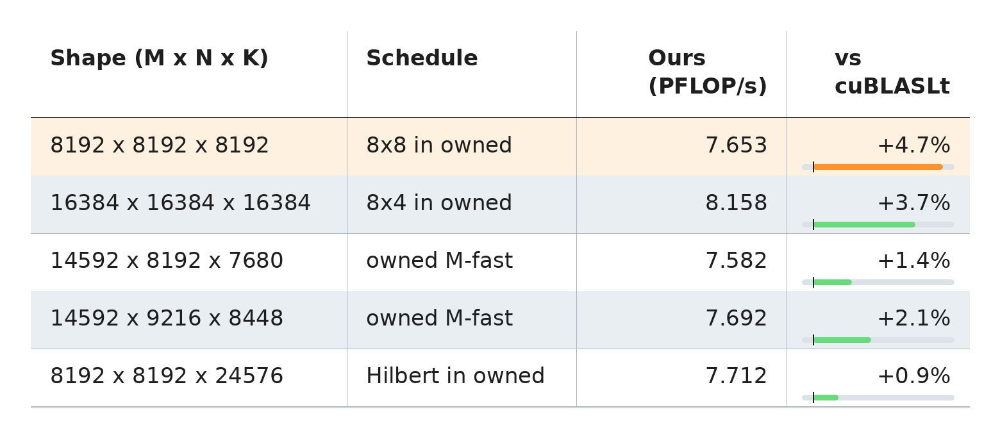

- The benchmark rotates inputs, alternates the custom kernel and cuBLASLt over five rounds, reverses first-run order, averages 25 launches per arm, and cools between timed arms. Four protocols report advantages from 3.92% to 7.83%, showing that power state, cache clearing, and clock control materially affect the headline.
- The author says the kernels were entirely generated by [[Claude]], but gives no prompting transcript, iteration count, rejected outputs, verification history, human edit boundary, or comparison with unaided implementation; the result therefore supports a source-scoped authorship claim, not autonomous correctness or productivity.

## Key Quotes
> "Everything is just yet another piece of code." - on encouraging developers to understand and own kernels rather than treat them as black boxes.

> "There is no single right way to benchmark kernels." - on reporting several protocols for a power-sensitive comparison.

## Connections
- [[PranjalShankhdhar]] - author and kernel implementer reporting the optimization work.
- [[FoundationModelKernelOptimization]] - the article is a shape- and hardware-specific example of dataflow, compiler, memory, and scheduling co-design.
- [[GPUMemoryHierarchy]] - Blackwell HBM, L2 halves, shared memory, TMEM, registers, and cache policy determine the implementation.
- [[BlockQuantization]] - NVFP4 couples each block of 16 E2M1 values to one shared UE4M3 scale.
- [[Nvidia]] - vendor of the GB300 hardware, CUDA, PTX, Blackwell tensor-core instructions, and cuBLASLt baseline.
- [[Claude]] - model family credited with generating the kernels, subject to missing process and verification evidence.

## Contradictions
- The 4.7% headline is not a general claim of cuBLASLt inferiority. It covers one GB300, CUDA 13.1, NVFP4 inputs, FP16 output, an 8192-cubed GEMM, and the author's chosen current protocol; the source acknowledges losses on several other shapes.
- The L2 description is a reverse-engineered behavioral model combining cited public clues and microbenchmarks. A dependent atomic chain measures near/far latency but does not itself measure GEMM throughput, and the reported 72/80 through 76/76 SM-side splits vary by GPU.
- Stepwise gains are measured along one rebuilt chain and are not necessarily independent or portable. Several changes rely on fixed K, tile size, exact thread count, memory layout, compiler behavior, or GB300-specific instructions and topology.
- The source reports correctness and public code availability but does not provide independent reproduction, error distributions, energy, cost, portability, maintenance burden, or an end-to-end model workload.
- All 17 local images were opened. Fourteen unique evidence-bearing charts and diagrams were retained at their semantic positions; the duplicated baseline dataflow and two performance-summary charts redundant with the retained optimization ladder were omitted.
