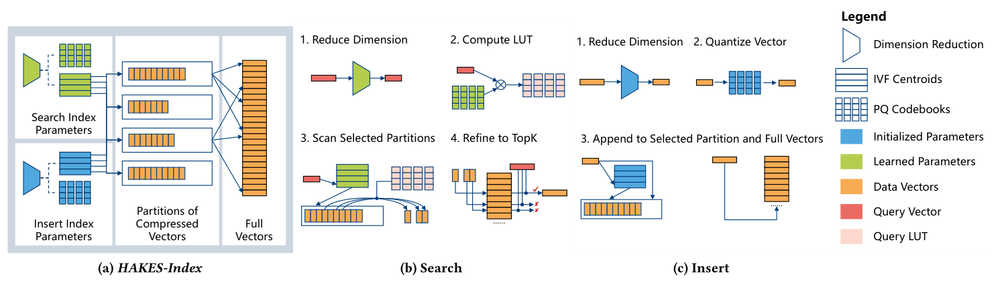
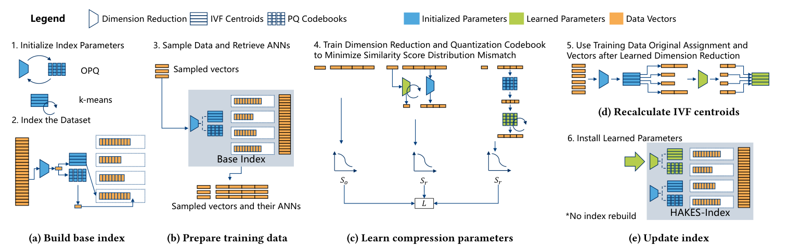
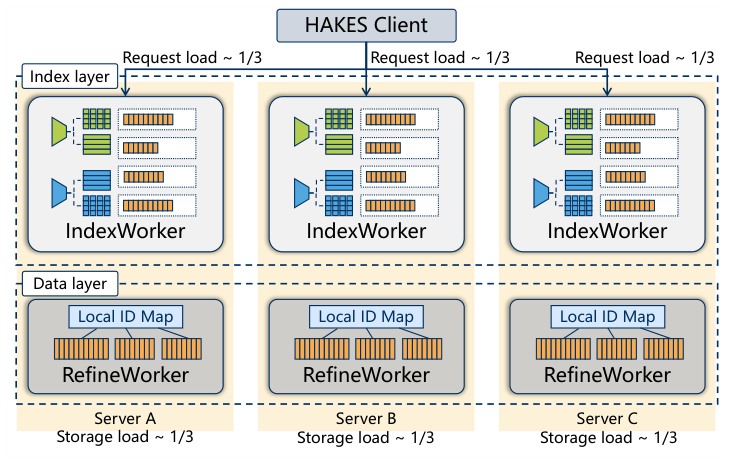
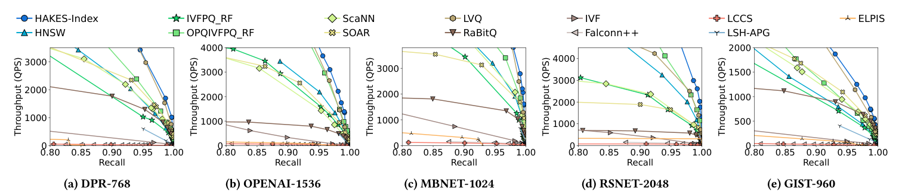
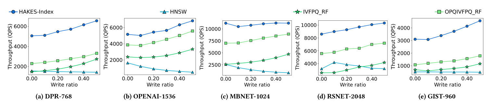
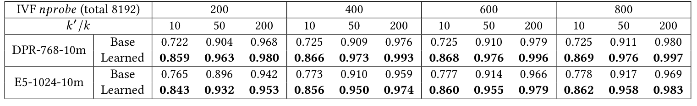
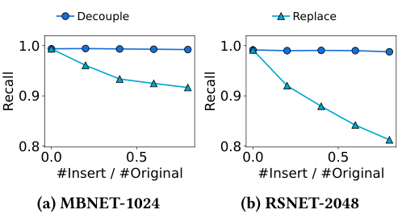
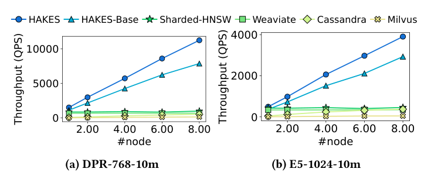
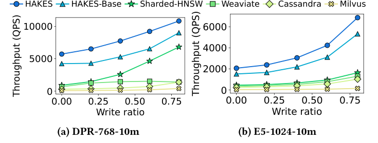

## Summary
Hu and collaborators present [[HAKES]], a distributed [[VectorDatabase]] built around [[HAKESIndex]], a two-stage [[ApproximateNearestNeighborSearch]] index that aggressively compresses vectors for candidate filtering and reranks candidates with full-precision vectors. The design learns search-time dimensionality-reduction and product-quantization parameters while retaining separate initialized parameters for inserts, then independently scales replicated filter workers and sharded refine workers. Across the paper's first-party high-dimensional benchmarks, HAKES-Index leads twelve index baselines in the high-recall region and HAKES reports up to 16× the throughput of three distributed database baselines.

## Key Claims
- [[HAKESIndex]] reduces candidate-filtering cost with dimensionality reduction, IVF partitioning, and 4-bit [[VectorQuantization]], then restores ranking quality by refining a larger candidate set against full-precision vectors.

- Its self-supervised objective jointly tunes dimensionality reduction and PQ codebooks to preserve local similarity-score distributions among approximate neighbors, without semantic labels, ground-truth neighbors, or access to the embedding model.

- Search and insert parameters are intentionally decoupled: new vectors keep the original code assignments while learned parameters reinterpret those codes at search time, allowing trained parameters to be installed without re-indexing.
- A lightweight early-termination heuristic stops partition scanning after enough consecutive partitions contribute fewer than a threshold number of candidates; it can increase throughput but may terminate prematurely and reduce recall.
- [[HAKES]] replicates the small compressed global index across compute-heavy IndexWorkers and shards full vectors across RefineWorkers, so filter compute and refine storage can scale independently.

- In sequential-read tests over five one-million-scale, 768-to-2,048-dimensional datasets, the reported throughput-recall curves place HAKES-Index ahead of twelve IVF-, graph-, LSH-, and quantization-based baselines in the high-recall region.

- Under 32-client concurrent read-write workloads at roughly 0.99 recall, partitioning indexes lose less throughput than HNSW as writes rise, and HAKES-Index leads the tested baselines.

- On the two ten-million-scale datasets, learned compression improves recall in every displayed probe and candidate-ratio configuration, with the largest gains when the candidate set is smallest.

- Replacing insert parameters with learned search parameters makes recall fall as data is added, while decoupling keeps it near the original level in the paper's MobileNet and ResNet tests.

- At 0.98 Recall10@10 on two ten-million-scale datasets, HAKES and its untrained base variant scale nearly linearly from one to eight nodes, unlike the sharded graph and commercial-system baselines in the reported setup.

- With four nodes, HAKES also leads Weaviate, Cassandra, Milvus, and a common-codebase sharded-HNSW baseline as the write fraction rises, despite broadcasting compressed-index updates to IndexWorkers.

## Key Quotes
> "The filter stage narrows down the search candidates using compressed vectors for efficiency."

> "The system does not guarantee strong consistency."

## Connections
- [[HAKES]] - distributed vector database introduced by the paper.
- [[HAKESIndex]] - learned filter-and-refine ANN index at the center of the system.
- [[ApproximateNearestNeighborSearch]] - retrieval problem evaluated across recall-throughput tradeoffs.
- [[VectorQuantization]] - 4-bit product quantization compresses filter-stage vectors and makes full-vector refinement necessary.
- [[VectorDatabase]] - system category whose indexing, update contention, sharding, consistency, and recovery boundaries the paper addresses.
- [[HNSWIndex]] - graph-based comparator that performs poorly under the paper's write-heavy and shard-scaled tests.
- [[RetrievalAugmentedGeneration]] - motivating application that repeatedly searches and updates vectorized knowledge.

## Contradictions
- The results challenge a blanket preference for graph indexes in high-dimensional, concurrent read-write services: the tested partitioning-and-refinement design leads graph baselines at high recall and avoids neighborhood-locking updates.
- The reported rankings are first-party and implementation-sensitive. The baselines span different languages, versions, feature sets, shard layouts, and tuning surfaces; only Sharded-HNSW shares the authors' serving implementation.
- HAKES trades away strong consistency, replicates its global compressed index, relies on in-memory experiments up to ten million vectors, and leaves production concerns such as multi-tenancy, security, long-duration recovery, and independent reproduction unevaluated.
