## Summary
The [[Databricks]] and [[Neon]] authors present [[Lakebase]], a third-generation transactional architecture that separates elastic [[PostgreSQL]] compute from WAL durability, page materialization, and open page-format persistence in cloud object storage. Safekeepers quorum-replicate WAL, Pageservers reconstruct versioned pages, and copy-on-write timelines provide O(1) [[DatabaseBranching]], while independent analytical engines can read consistent snapshots without consuming OLTP compute. First-party production telemetry and benchmarks support sub-second startup, workload-responsive autoscaling, competitive OLTP throughput, and faster direct analytical access, but the paper does not independently validate cost, tail behavior, or multitenant failure recovery.

## Key Claims
- Agentic workloads amplify database proliferation and ephemerality: the service reportedly manages more than 10 million databases daily, agents create about four times as many as humans, and most observed computes live for one to ten seconds.

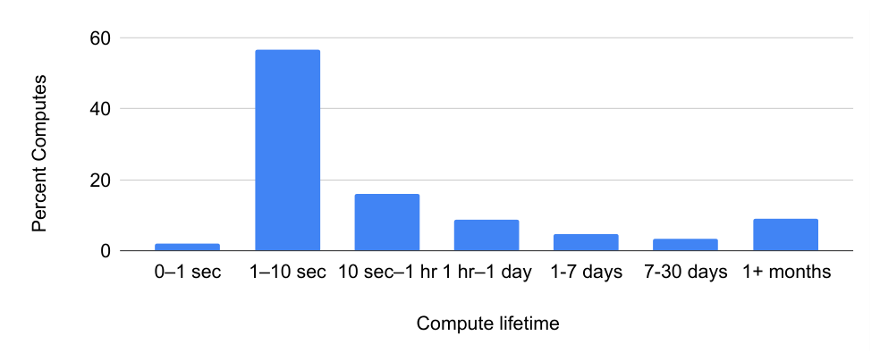

- Database state increasingly follows code-like evolutionary workflows; most projects have shallow branch depth, but production hierarchies can extend beyond 500 branches.

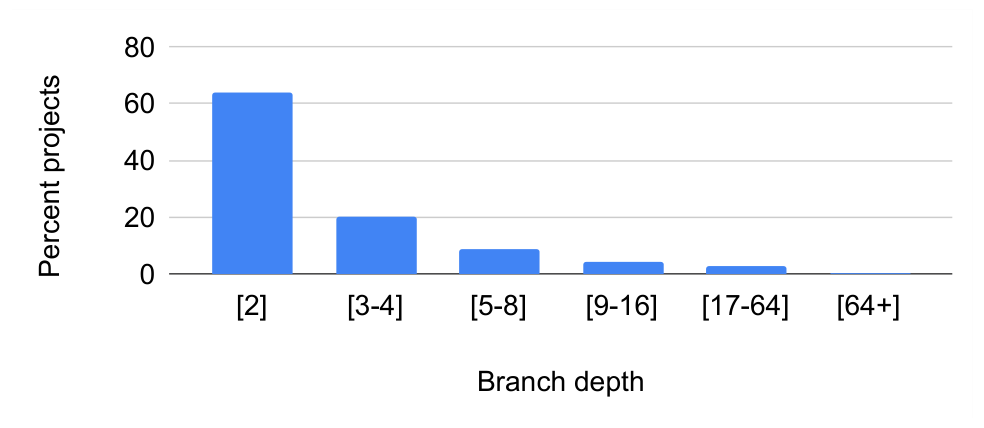

- [[DisaggregatedTransactionalDatabase]] separates PostgreSQL compute from multi-tenant storage: computes cache pages locally, Safekeepers establish WAL durability, Pageservers materialize and serve pages, and object storage is the durable source of truth shared with the Lakehouse.

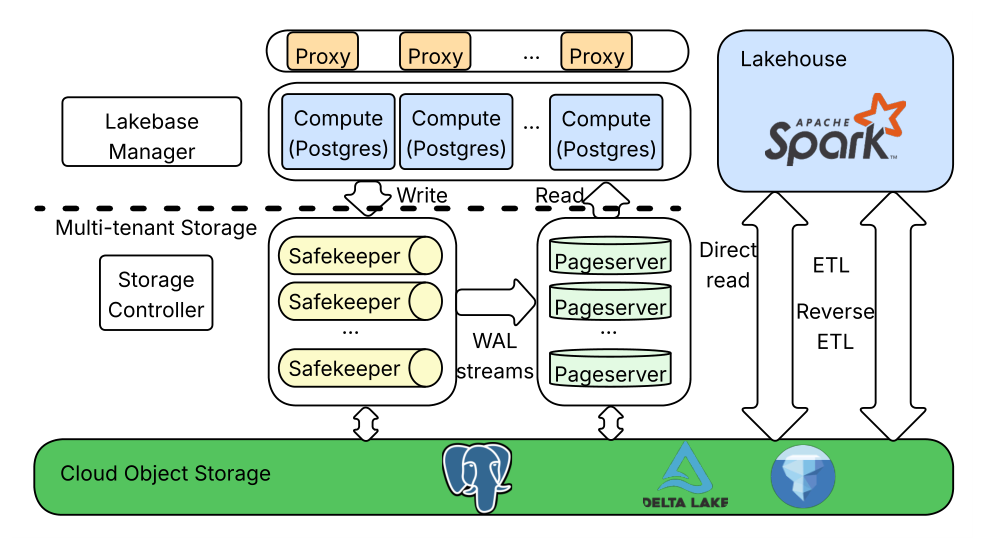

- Correctness is coordinated through distinct LSN frontiers for compute, Safekeepers, Pageservers, and branches; a write commits after quorum disk flush, while remote-consistent and backup LSNs track recoverable object-store state.

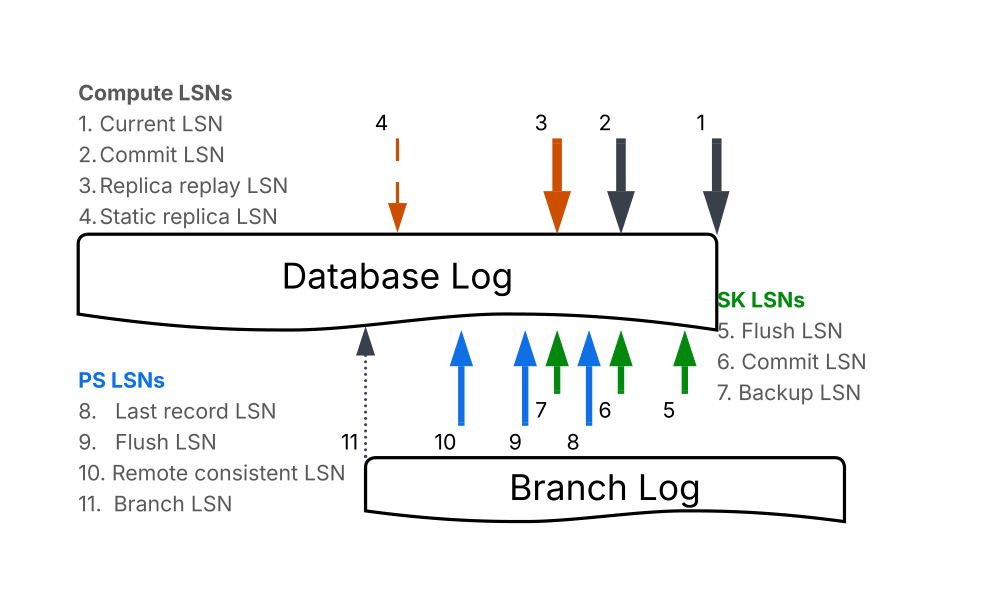

- A Pageserver stores delta WAL and materialized image layers across key and LSN dimensions, reconstructing `GetPage@LSN` from the newest earlier image plus bounded deltas.

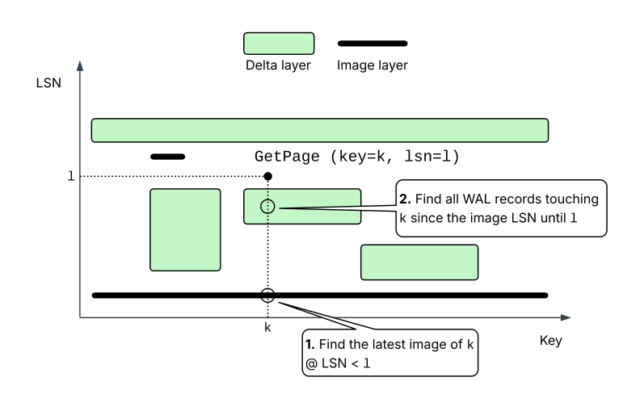

- The storage model trades predictable constant-level write amplification against bounded reconstruction work: image threshold controls delta depth, while garbage-collection compaction and the PITR window dominate retained history.

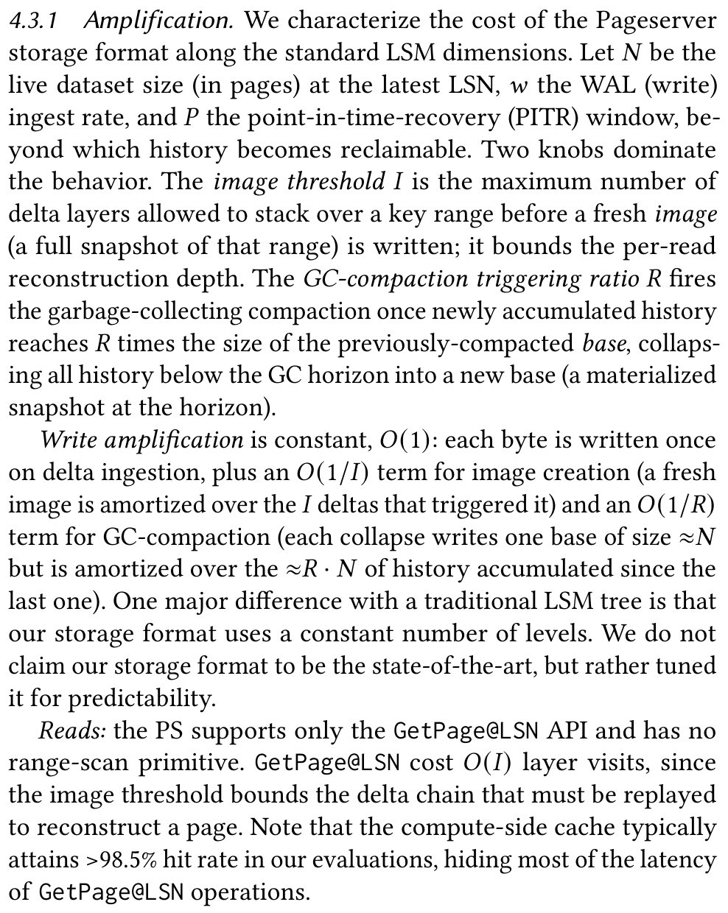

- The authors model space amplification as live state, unreclaimed GC slack, and in-window WAL history, and report about 7x across the production fleet.

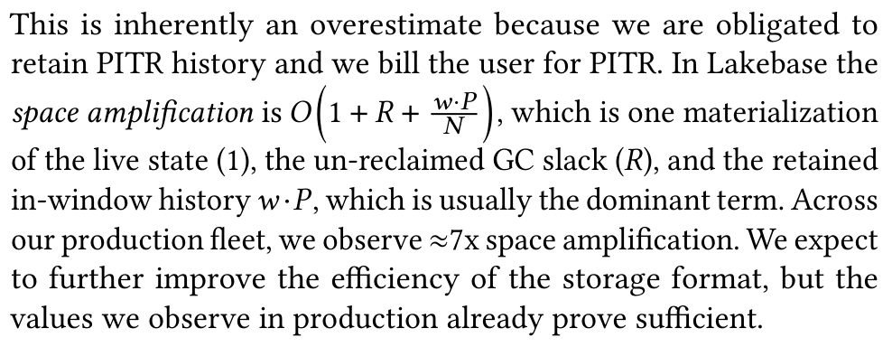

- Reads prefer a compute-local file cache; misses carry request and not-modified-since LSNs to avoid waiting for irrelevant WAL, then reconstruct pages on a Pageserver and fetch evicted layers from object storage when necessary.

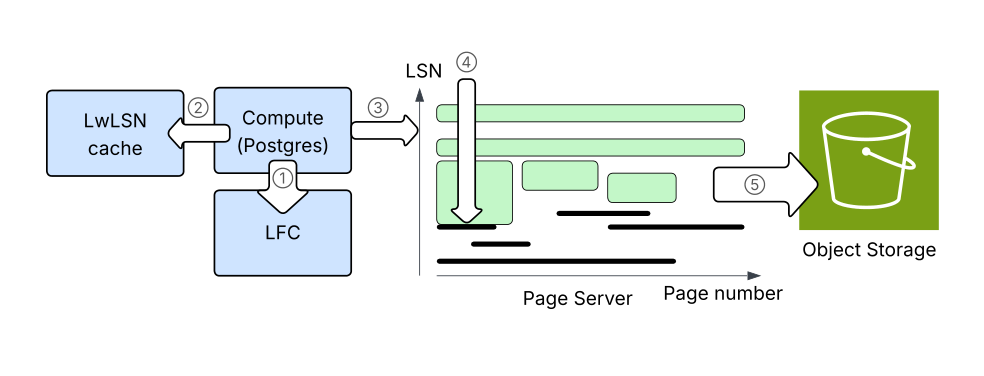

- Writes stream from a PostgreSQL WAL proposer to three Safekeepers, commit at quorum flush, upload committed segments to object storage, and feed relevant WAL to Pageserver shards; lag thresholds apply backpressure.

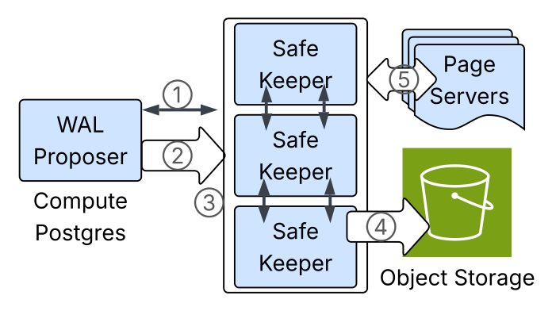

- Availability spans three zones: compute replicas share Safekeepers, each Pageserver shard has a cross-zone hot standby, and failed compute nodes are reportedly replaced from warm pools in under 500 ms.

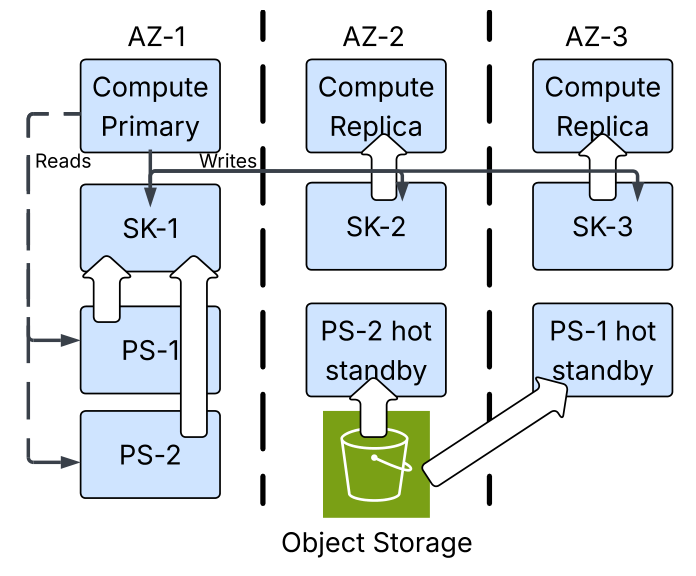

- [[DatabaseBranching]] creates a child timeline through O(1) metadata and recursively reads unchanged history from ancestors; detachment copies ancestry asynchronously, deep trees can slow reads, and branch merging is not supported.
- Serverless compute uses NeonVM for in-place CPU, memory, and disk resizing, a custom cache and working-set estimator, a five-minute default idle timeout, and a warm VM pool; production p95 startup remains below 500 ms in the displayed series while no-warm-pool startup is tens of seconds.

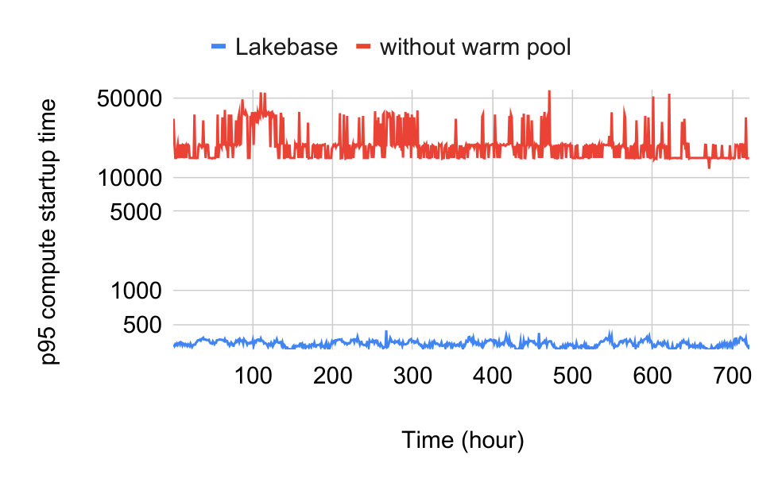

- In a simulated production stock workload, CPU rose rapidly when target load jumped from 32 to 10,000 QPS, then varied around six CPUs while actual QPS generally tracked demand; comparison with fixed capacity found slightly higher latency but fewer CPU-hours.

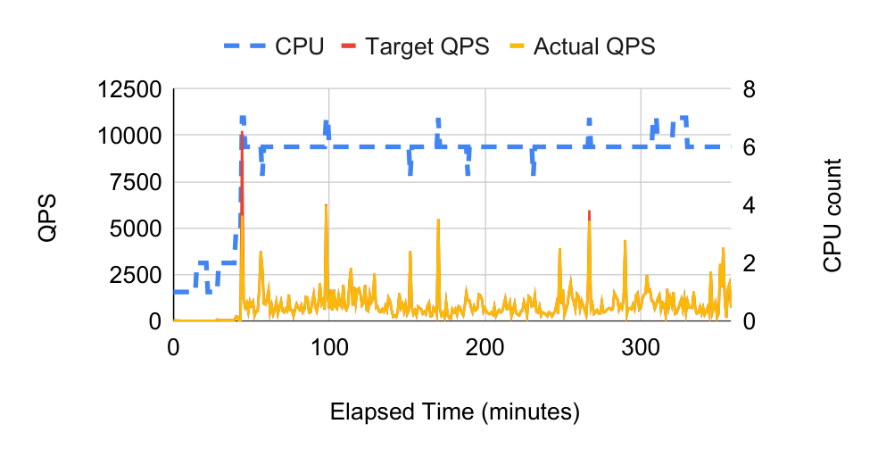

- In HammerDB TPROC-C, Lakebase reports 23.3K to 515.6K peak NOPM across 1-24 vCPU tiers under a 20 ms p95 bound, ahead of the anonymized Gen-2 comparison at every tier and up to 5.3x the Gen-1 comparison.
- Direct-to-Storage Spark ingestion writes PostgreSQL-compatible heap pages in parallel and reports 2.6x speedup at 5 GB rising to 73.3x at 1 TB; atomic visibility comes from a metadata-only relation swap after pages are durable.
- Lakehouse Direct Access binds to a committed snapshot and reads page files outside PostgreSQL compute. At TPC-H scale factor 10 it reports 10x lower total time and 3x lower geometric-mean query latency, but Q8 and Q19 are slower because the implementation lacks index nested-loop joins.

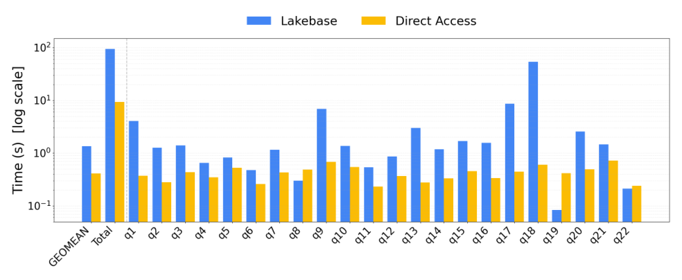

## Key Quotes
> "Lakebase redefines the database as elastic transactional compute over open, durable storage." - the paper's architectural thesis.

> "Many production database instances stay active for under 10 seconds." - on the workload shape motivating rapid scale-to-zero and wake-up.

## Connections
- [[Lakebase]] - transactional system and production service described and evaluated.
- [[Databricks]] - company deploying Lakebase and integrating it with Unity Catalog, Spark, Delta, and Lakehouse analytics.
- [[Neon]] - open-source database architecture and engineering base on which the service builds.
- [[PostgreSQL]] - compatible transactional engine and open page format used by compute and external readers.
- [[DisaggregatedTransactionalDatabase]] - separation of compute, WAL durability, page materialization, and object-store persistence.
- [[ObjectStorageNativeDatabase]] - durable storage pattern extended here with quorum WAL, page services, and multi-engine access.
- [[DatabaseBranching]] - copy-on-write timeline primitive used for development, recovery, and agent isolation.
- [[ServerlessComputing]] - scale-to-zero, in-place resizing, and warm-pool provisioning model.

## Contradictions
- The paper calls PostgreSQL page storage “open format,” but practical interoperability still requires PostgreSQL-version-aware page, WAL, MVCC, and snapshot semantics; this is less broadly portable than an open table format such as Parquet.
- Production metrics and benchmarks are author- and vendor-reported. The paper anonymizes Gen-1 and Gen-2 systems, omits pricing-normalized end-to-end cost and statistical uncertainty, and does not independently reproduce failure, recovery, durability, or noisy-neighbor behavior.
- Deep branching is enabled but not free: ancestor traversal can hurt reads, detachment performs asynchronous copying, retained PITR history contributes to roughly 7x reported space amplification, and merge semantics remain application-owned.
- Direct Access does not dominate every analytical query, and its 1.76x scan slowdown under concurrent 400-QPS OLTP reflects cache invalidation even though primary write latency remains isolated.

## Image Notes
All 13 effective local image references were opened and retained at their semantic positions. They supply production distributions, component and failure paths, LSN relationships, storage reconstruction, amplification bounds, read/write behavior, availability topology, startup and scaling telemetry, and per-query analytical comparisons not fully recoverable from captions alone.
