## Summary
[[XiangpengHao]], [[AndrewLamb]], [[YiboWu]], [[AndreaArpaciDusseau]], and [[RemziArpaciDusseau]] present [[LiquidCache]], a [[DisaggregatedCaching|disaggregated cache]] that applies [[FilterPushdown]] before returning analytical data to compute nodes. Its central observation is that Parquet decoding and decompression, rather than predicate evaluation, dominate cache-server CPU time, so the system progressively transcodes cached [[ApacheParquet]] data into an ephemeral, filter-aware representation while preserving Parquet at the durable storage boundary. ClickBench and TPC-H results report Arrow-like latency and CPU use with Parquet-like space use, subject to selective-workload, prototype, and first-party evaluation limits.

## Key Claims
- Parquet filter pushdown can move a network bottleneck into limited cache-server CPU: in ClickBench Q22, decoding and decompression account for more than 90% of the baseline time.

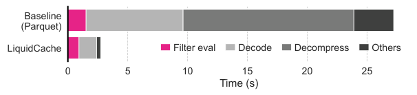

- LiquidCache places an independently scalable cache close to compute nodes and uses Arrow Flight to return filtered batches, while object storage remains the durable Parquet source.

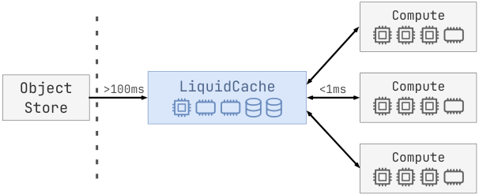

- A cold query obtains schema, splits scan work from later operators, downloads and caches Parquet bytes if necessary, returns filtered output, and schedules Arrow-to-Liquid transcoding outside the critical path.

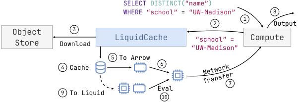

- The Liquid representation cascades independently decodable encodings: strings use dictionary encoding, bit-packed keys, and FSST-compressed values; integers use frame-of-reference plus FastLanes bit packing; floating-point values use ALP.

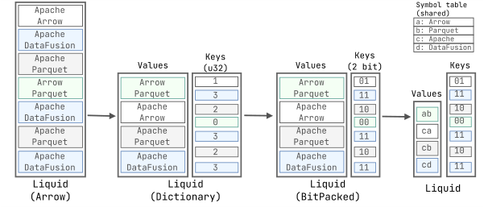

- Element-level selective decoding avoids Parquet's page-granularity penalty, and late filter materialization uses earlier predicates to reduce the rows decoded and tested by later predicates.

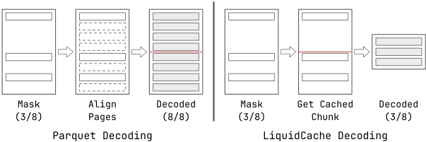

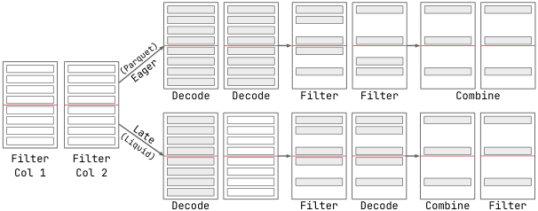

- Encoding-aware predicates can compare encoded dictionary values directly, while incompatible operations decode only as far as necessary; this co-design requires the decoder and embedded query engine to share filter knowledge.
- On the selected ClickBench queries, LiquidCache stays below 0.5 seconds, approaches Arrow-pushdown CPU time, uses memory near compressed Parquet, and sends orders of magnitude less data than a Parquet file server on highly selective queries.

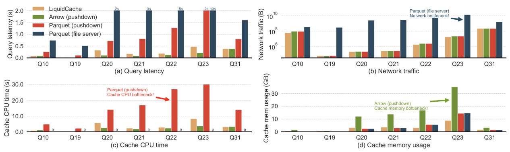

- With an 8 GB cache on TPC-H SF100, Arrow is fastest when the scan fits but degrades sharply when it does not; Liquid reports the best latency on the evaluated larger-than-cache inputs.

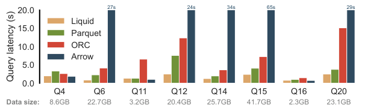

- Q22 profiling reports about 27 seconds of cache CPU time for Parquet pushdown versus 2.7 seconds for LiquidCache; Arrow reaches similar total time but spends more of it stalled on a representation four times larger.

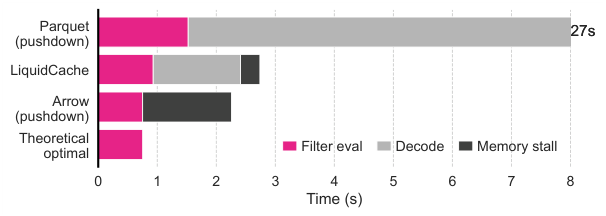

- For ClickBench's largest string column, full Liquid occupies 2.0 GB versus 2.4 GB for Parquet and 12.9 GB for Arrow; the chart also shows faster Liquid decoding than Parquet and cheap bit packing relative to dictionary construction.

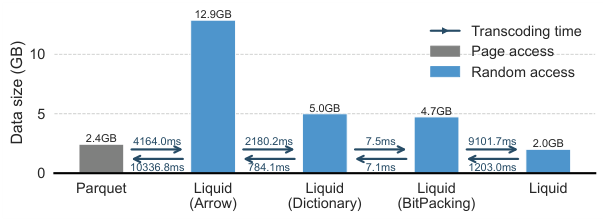

- Background transcoding progressively cuts Q21 cache memory by about fourfold with roughly 20% higher latency than Arrow pushdown and is largely hidden by storage I/O except when input arrives at memory speed.

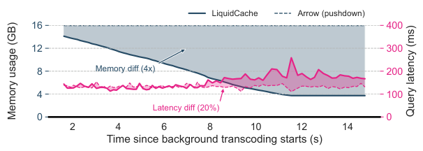

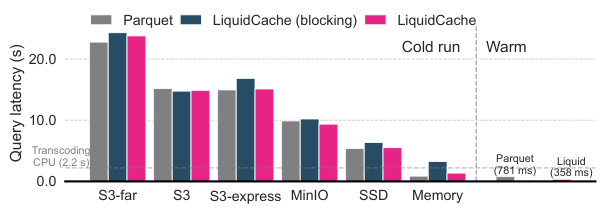

- The ablation attributes gains to multiple mechanisms rather than faster decoding alone; selective decoding helps projection-heavy selective queries, late materialization helps multi-filter queries, and compatible encoded evaluation can remove most remaining decode work.

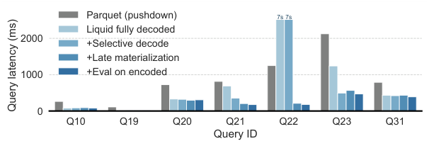

## Key Quotes
> "data decoding, not filter evaluation, is the primary bottleneck" - the paper's central diagnosis.

> "the cache server is the only producer and consumer of Liquid data" - why the ephemeral representation can evolve without a durable interoperability contract.

## Connections
- [[LiquidCache]] - proposed pushdown-enabled cache and ephemeral data representation.
- [[FilterPushdown]] - query optimization co-designed with selective and encoding-aware decoding.
- [[DisaggregatedCaching]] - system architecture separating cache capacity from compute nodes.
- [[ApacheParquet]] - durable interoperable format and transcoding input whose decoding cost motivates the design.
- [[ApacheDataFusion]] - embedded query engine and implementation substrate for the prototype.
- [[ColumnarStorageTradeoffs]] - compression, random access, decoding cost, and compatibility tradeoffs exposed by the evaluation.

## Contradictions
- Pushdown is not universally beneficial: ClickBench Q27 has 99% selectivity and a 31% compression ratio, causing LiquidCache to run about three times slower than the Parquet file server because it sends filtered data uncompressed.
- The prototype always pushes supported filters, projections, and simple aggregations; cost-based pushdown, automatic local-mode placement, joins, better cache replacement, Substrait interoperability, and non-selective-filter adaptation remain future work.
- The headline gains come from a first-party prototype evaluated on selected ClickBench filters and scan-heavy TPC-H queries on one CloudLab hardware setup. The paper does not establish multi-tenant behavior, failure recovery, TLS cost, production tail latency, transcode-energy cost, or independent reproducibility.
- LiquidCache's best results generally assume fully transcoded warm data. Cold-run overhead is hidden when I/O is slower than transcoding, but becomes visible for memory-speed input.
- Comparison quality depends on implementation maturity: the paper itself notes that Parquet beats similarly compressed ORC partly because DataFusion and DuckDB integrate with Parquet more deeply.

## Image Notes
All 13 effective local image references were opened and retained at their semantic positions. They cover the architecture and query flow, encoding and decoding mechanisms, four-way system comparisons, TPC-H behavior, transcoding costs, cold-run overlap, and the optimization ablation; no referenced figure was decorative or redundant.
