## Summary
[[HironobuSuzuki]] explains PostgreSQL 18's read-side asynchronous I/O through its `io_uring` and `io_worker` implementations, then traces how `ReadStream` combines read-ahead, vectored I/O, completion waits, and tuple processing during sequential scans. The chapter shows that [[PostgreSQLAsynchronousIO]] is adaptive rather than a fixed prefetch loop: cache hits bound contiguous requests, the combine window grows on misses and decays through warm runs, and a Fast Path bypasses stream bookkeeping for sustained hits. Its performance claim is deliberately narrow—benefits are strongest for cold, sequentially read workloads and diminish as buffer-cache hit rates rise.

## Key Claims
- Synchronous reads serialize application waiting and storage work, whereas asynchronous submission lets PostgreSQL overlap other backend work with several outstanding reads.

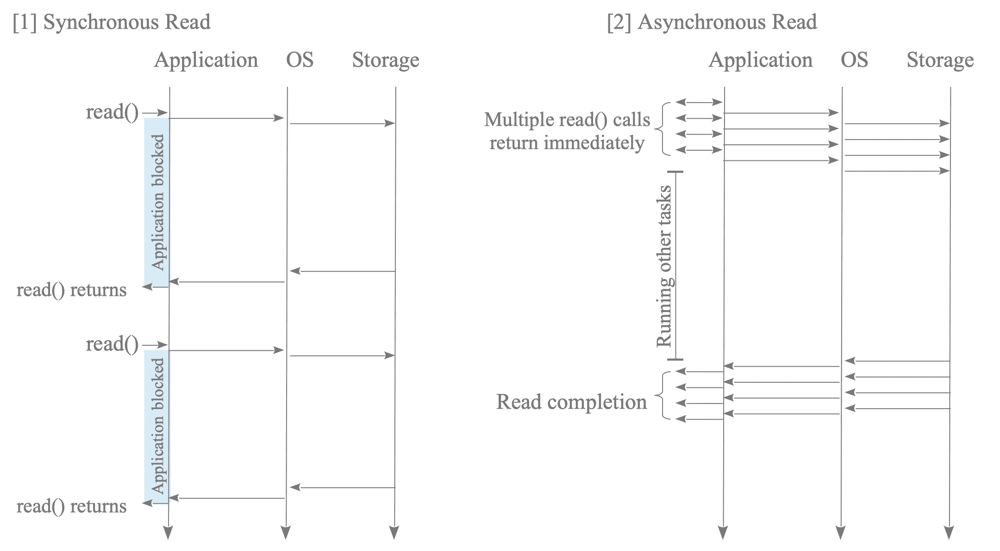

- PostgreSQL 18 offers Linux `io_uring`, whose kernel-shared submission and completion rings can place data directly into buffer slots, and portable `io_worker` processes, which coordinate conventional reads through PostgreSQL shared-memory queues.

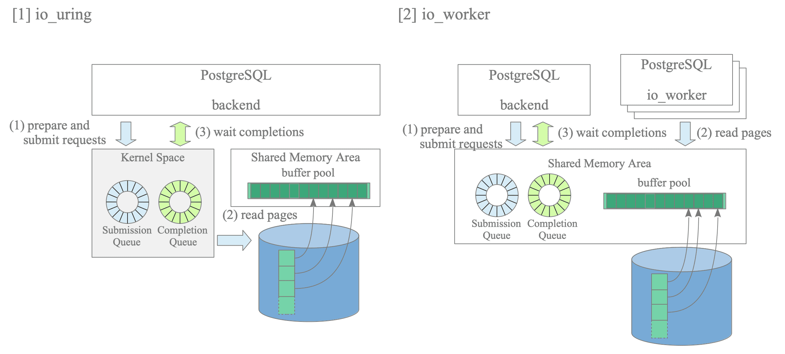

- Vectored I/O combines contiguous relation blocks into one request while scattering their results into distinct buffer-pool slots, reducing calls and completion events.

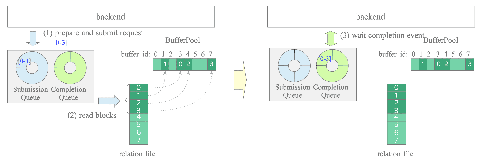

- `ReadStream` tracks pinned buffer identifiers in a circular FIFO array whose active window is abstracted as `stream_buffers`; enqueue and dequeue operations connect relation blocks, descriptors, and buffer-pool slots.

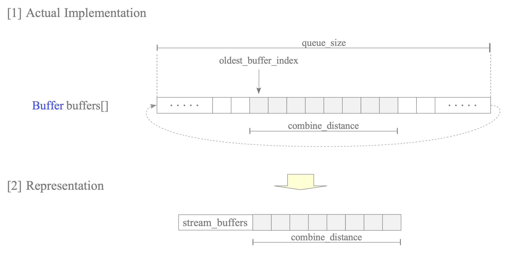

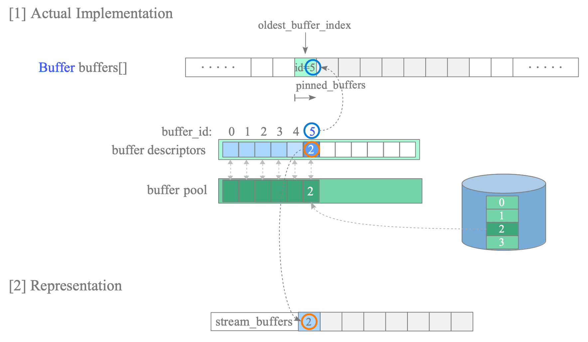

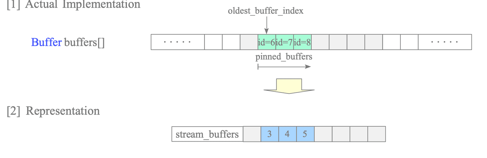

- In a cold sequential scan, PostgreSQL submits the next contiguous batch before finishing tuple work on the current batch; it waits when the next dequeued page is still in progress, then consumes the completed pages without another wait.

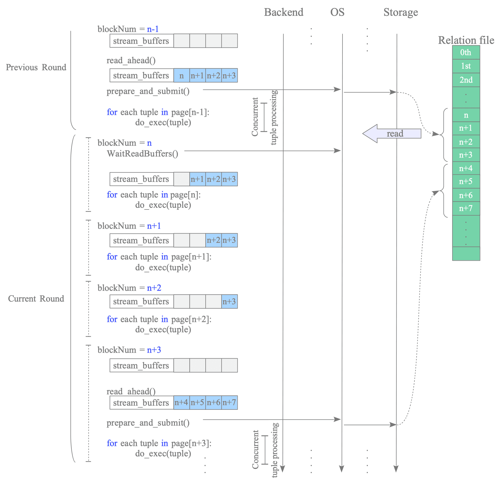

- Earlier synchronous sequential scans instead repeat allocation, blocking read, I/O termination, and tuple processing for every page, leaving no equivalent overlap.

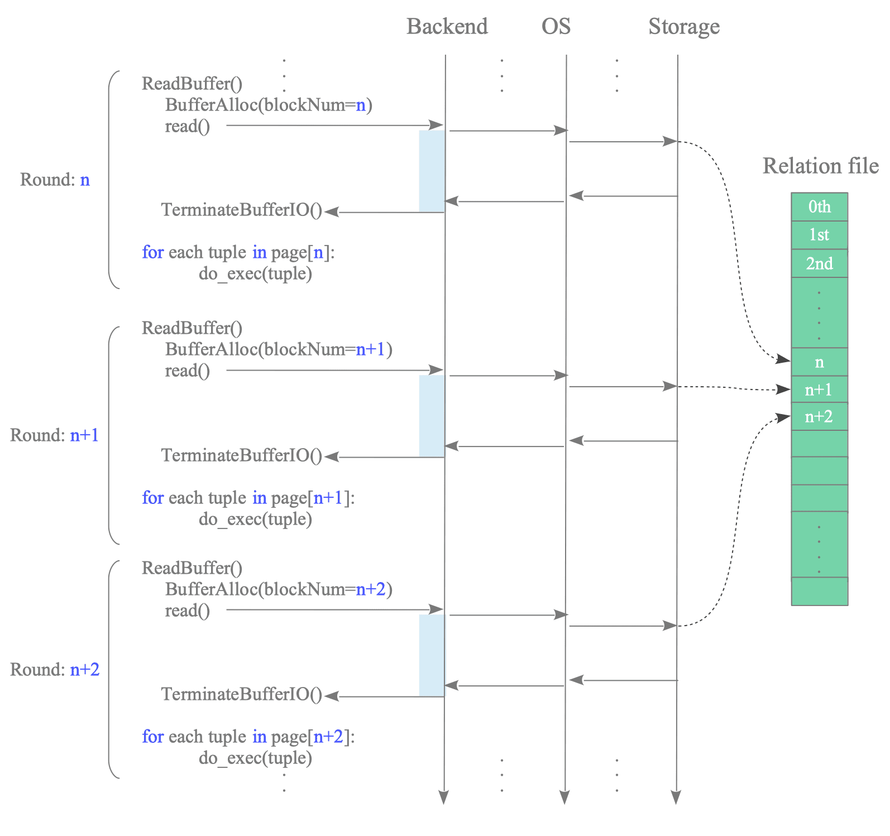

- A cache hit terminates the current read-ahead search so accumulated misses remain physically contiguous for one vectored request; later misses refill a batch, while consecutive hits are initially handled one at a time.

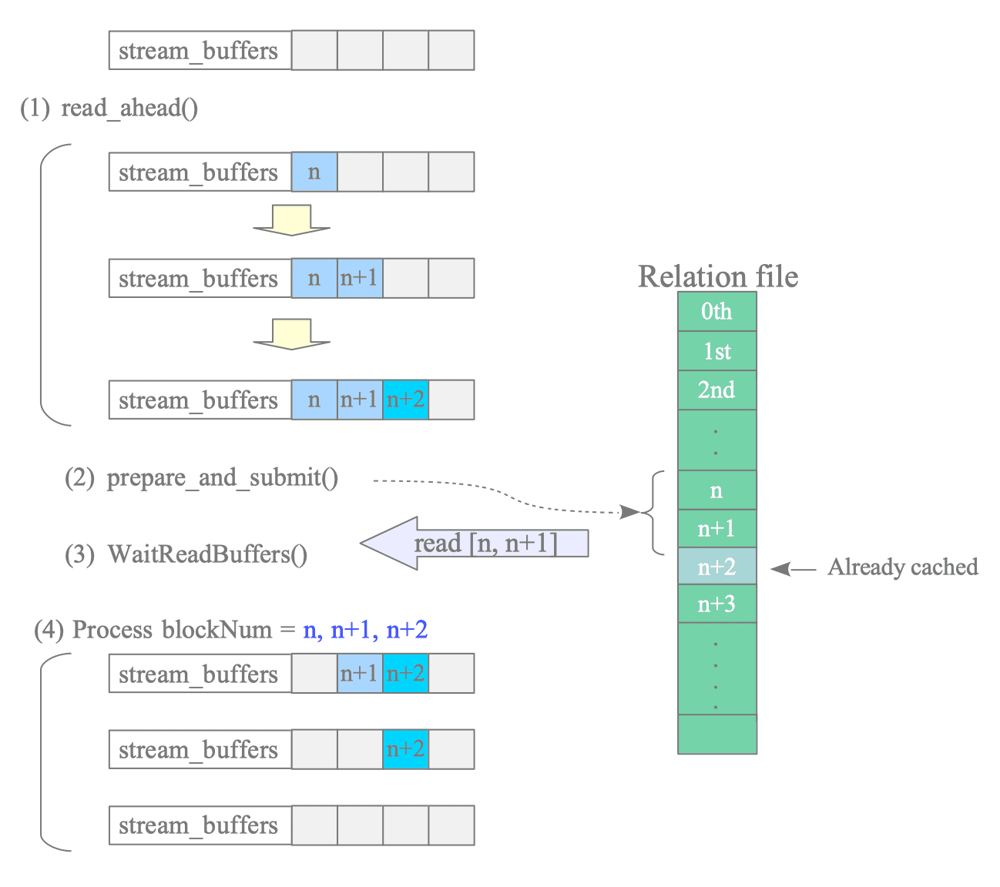

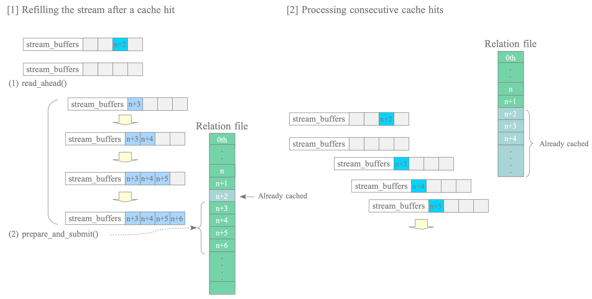

- `combine_distance` begins at one and doubles toward `min(io_combine_limit / BLCKSZ, queue_size - 1)` on storage reads; after more than `queue_size - 1` consecutive hits it decays one block at a time, and a miss resumes growth.

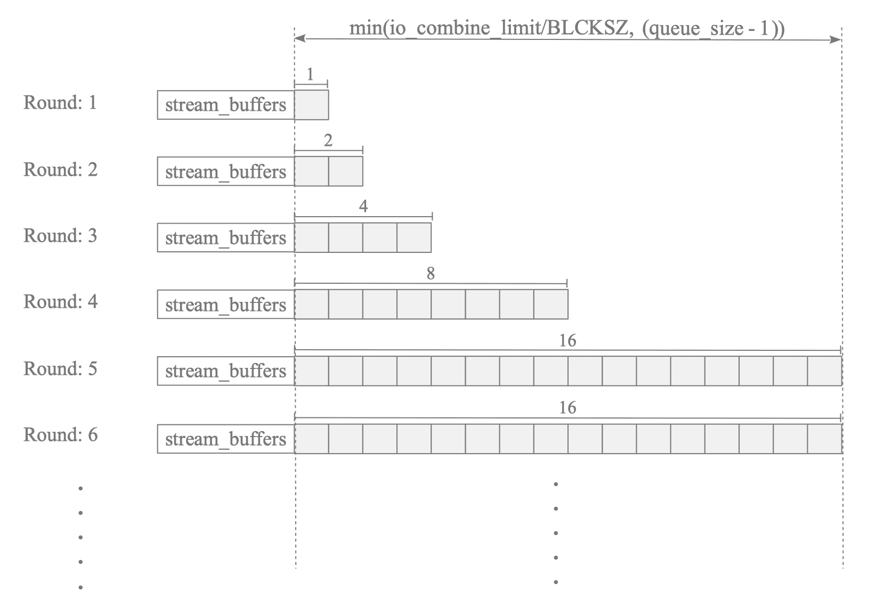

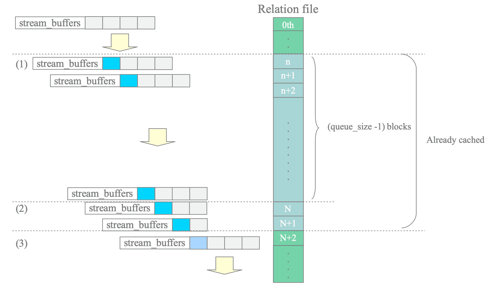

- When the window reaches one during sustained cache hits, Fast Path reads buffer slots without `stream_buffers`; any cache miss returns the scan to normal read-ahead.

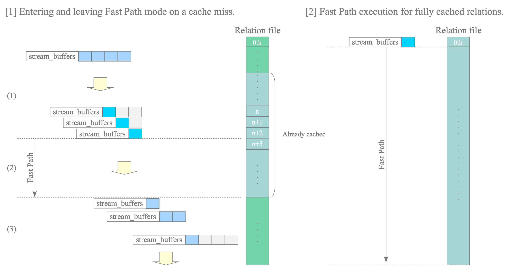

- The implementation targets read-heavy sequential access such as sequential scans, bitmap heap scans, and vacuum; it does not provide asynchronous writes or accelerate index scans in the described release.

## Key Quotes
> "Its benefit is greatest when the buffer pool is cold." - the chapter's benchmark boundary.

> "A cache miss immediately triggers the increment mode." - on adaptive read-ahead recovery.

## Connections
- [[HironobuSuzuki]] - author of the PostgreSQL internals chapter.
- [[PostgreSQL]] - database whose version 18 buffer manager gains read-side asynchronous I/O.
- [[PostgreSQLAsynchronousIO]] - synthesis of the implementations, sequential-scan pipeline, and adaptive behavior.
- [[PostgreSQLBufferManagement]] - supplies the page residency, pinning, cache-hit, and buffer-slot substrate used by `ReadStream`.
- [[PostgreSQLPageArchitecture]] - supplies the default 8KB blocks combined into vectored reads.
- [[StoragePerformanceBenchmarking]] - provides the cache-state and workload discipline needed to evaluate the source's performance claims.

## Contradictions
- No direct contradiction was found. The source narrows generic AIO performance claims by excluding index scans and asynchronous writes and by warning that cold-cache-only benchmarks can overstate real-world benefit.
- The chapter is an implementation explanation, not a comparative benchmark. It supplies no throughput, latency, CPU, device, queue-depth, workload, or repeated-run measurements for `io_uring`, `io_worker`, or synchronous mode.
- Details are version-sensitive: PostgreSQL 18 is the implementation baseline, while the dynamic `io_worker` controls described for version 19 are prospective relative to that baseline.
