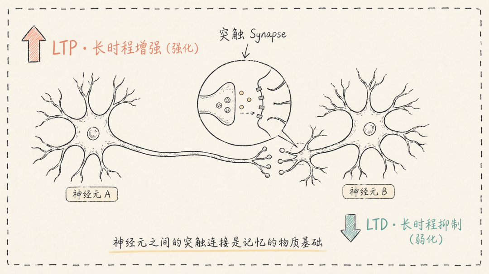
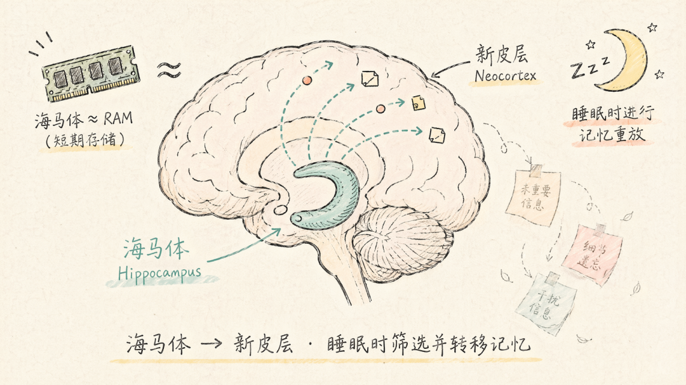
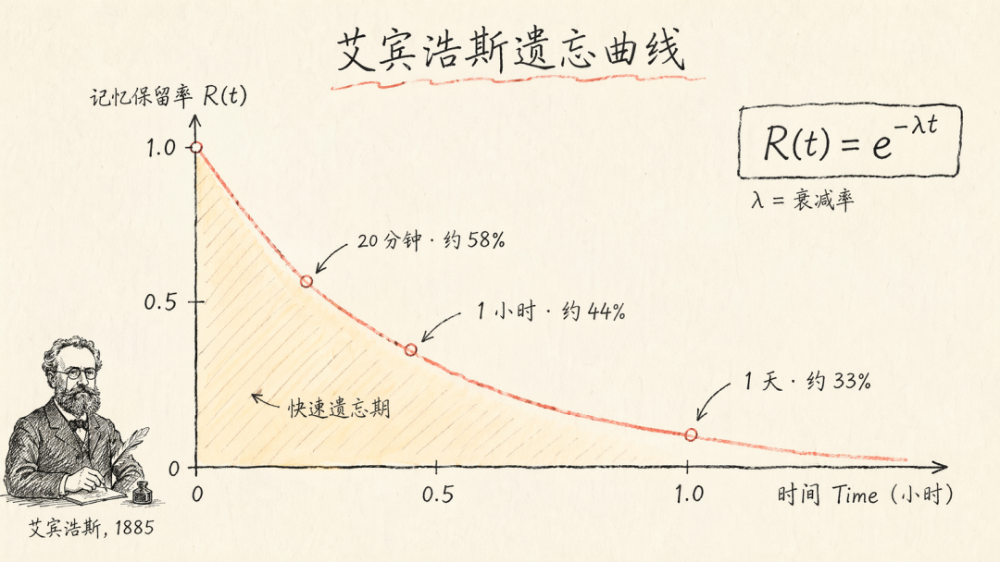
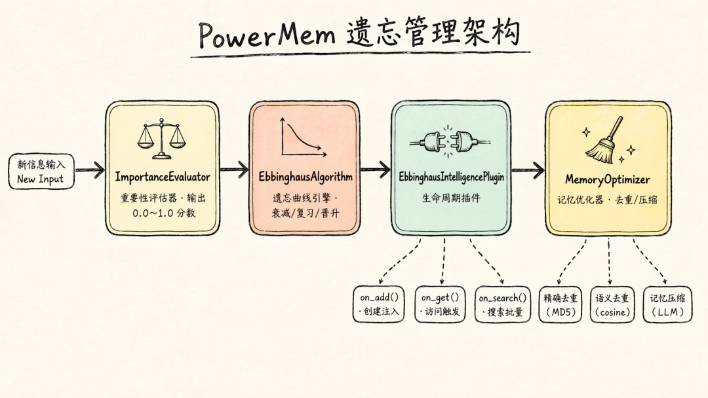

## Summary
This project-authored article presents [[PowerMem]]'s forgetting subsystem as an implementation of [[MemoryForgetting]] rather than a deletion switch. It maps selective biological retention onto three memory tiers, exponential decay, access-driven promotion, decay-weighted retrieval, and separate deduplication or compression stages, while leaving its neuroscience analogies, thresholds, and retrieval benefits unvalidated.

## Key Claims
- Forgetting should continuously reduce the retrieval priority of inactive memories so unlimited retention does not overwhelm useful matches.
- The article treats synaptic strengthening and weakening as a biological analogy for selectively concentrating finite memory resources on active pathways.

- Selective consolidation from hippocampus to neocortex motivates a `working` → `short_term` → `long_term` hierarchy in which repeated access or high importance earns promotion.

- [[PowerMem]] classifies importance scores below 0.6 as working memory, scores from 0.6 to below 0.8 as short-term memory, and scores of at least 0.8 as long-term memory; the respective decay-rate multipliers are 2.0, 1.5, and 1.0.
- Its exponential model `R(t) = e^(-λt)` makes decay continuous and allows access or review to reset and flatten a memory's future decay curve.

- The implementation separates importance scoring, decay and promotion decisions, lifecycle hooks on creation/access/search, and optimization through exact deduplication, semantic deduplication, and LLM compression.

- Search ranks a relevant memory by `final_score = relevance_score × decay_factor`, making forgetting an attention-allocation input before any eventual deletion or archival decision.

## Key Quotes
> “遗忘不是缺陷，而是能力。” — on treating selective loss of retrieval priority as a designed memory function.

> “遗忘不是单纯的删除开关，而是检索质量的调节器。” — on the role of decay in ranking.

## Connections
- [[PowerMem]] - project whose three-tier memory and forgetting pipeline the article explains.
- [[MemoryForgetting]] - decay changes salience continuously rather than equating inactivity with falsity or immediate deletion.
- [[AgentMemory]] - the forgetting subsystem governs which retained agent memories enter finite retrieval and context budgets.
- [[MemoryCompaction]] - exact and semantic deduplication plus LLM compression complement decay-based attention control.
- [[AttentionManagement]] - retrieval weighting allocates limited computational attention among stored memories.

## Contradictions
- The article does not contradict the existing distinction between attention decay and epistemic confidence in [[MemoryForgetting]], but it does not model confidence separately and therefore covers a narrower design.
- Its forgetting-curve image labels the horizontal axis in hours while placing “1 day” at `1.0`; the prose and table communicate the intended elapsed-time trend, but the plotted unit is internally inconsistent.
- The neuroscience and information-theory sections are engineering analogies rather than evidence that the stated tier boundaries, multipliers, or ranking formula are biologically derived or optimal.
