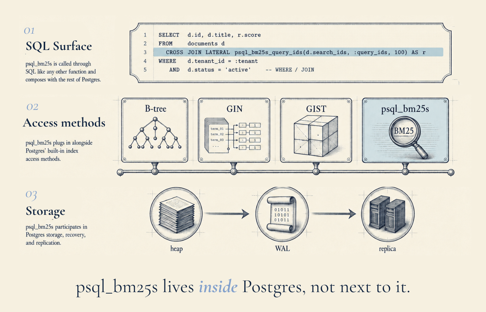
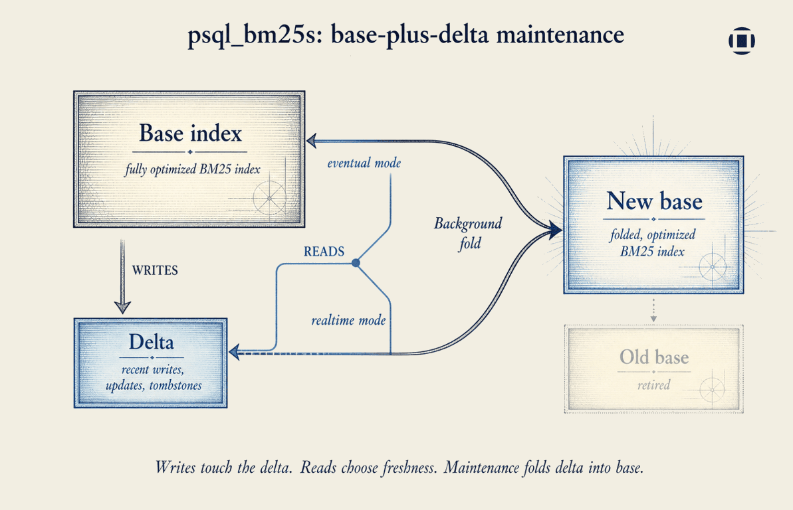
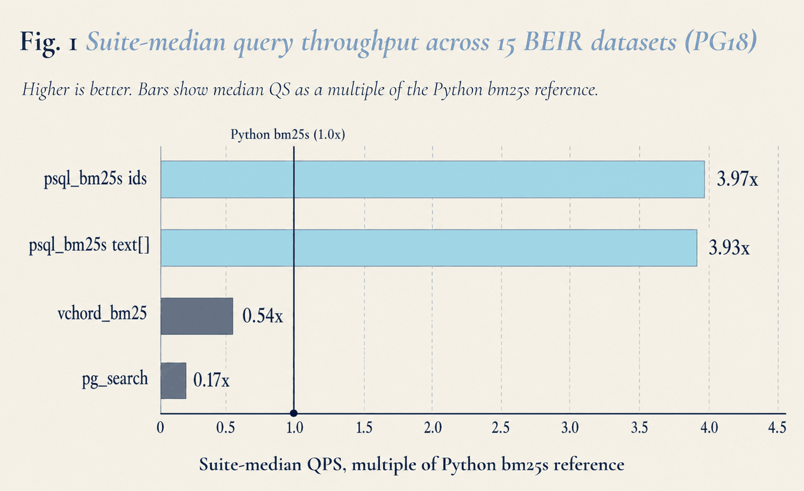
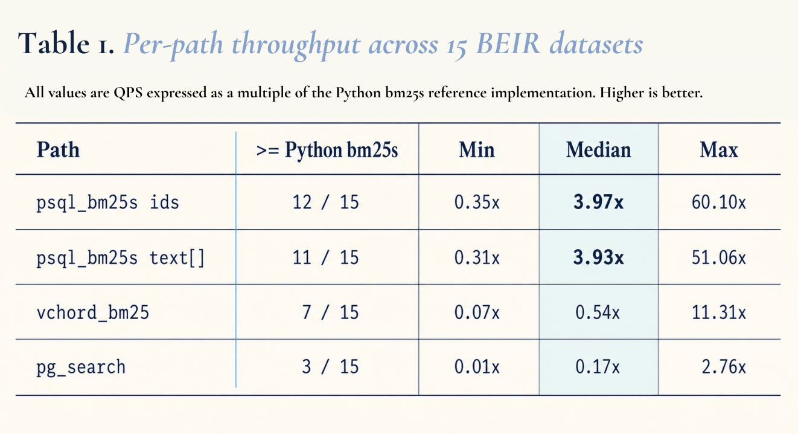
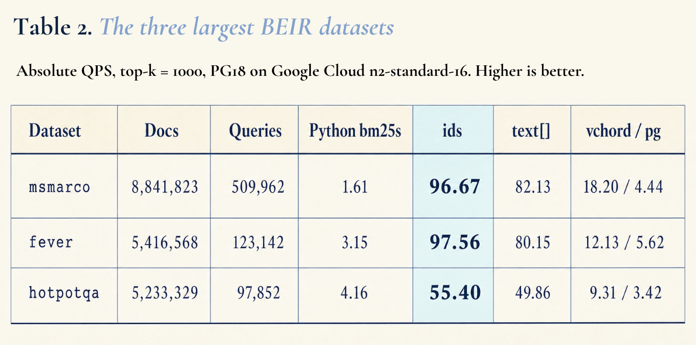
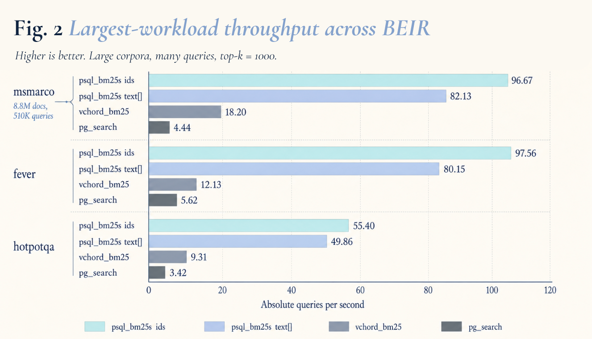
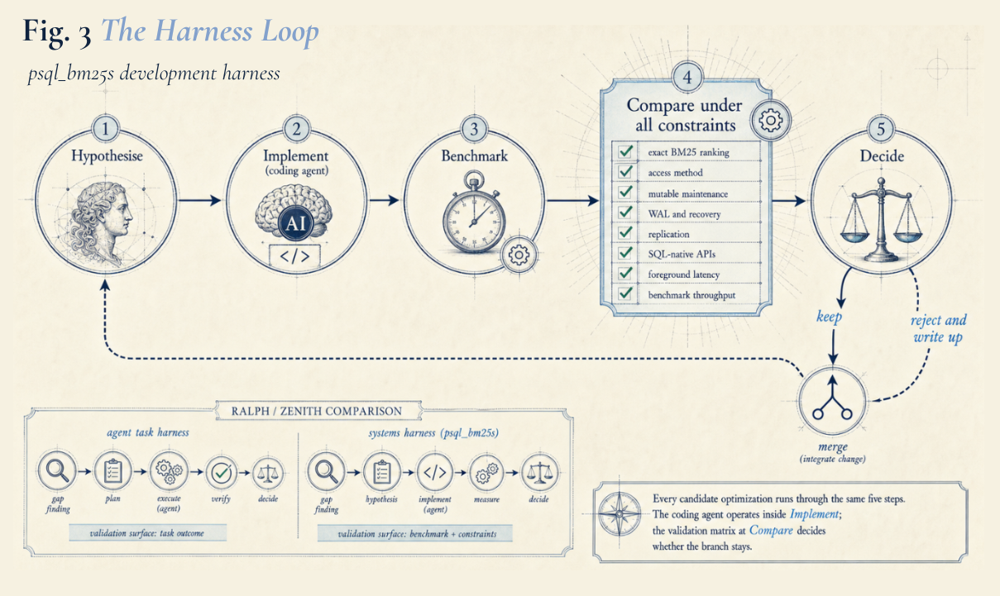

## Summary
[[PsqlBm25s]] is Intelligent Internet's open-source PostgreSQL access method for exact BM25-family retrieval over mutable application and agent state. The article argues that retrieval latency becomes a control-policy constraint for long-running agents, then describes SQL composition, base-plus-delta maintenance, and a validation-heavy optimization loop. Its 15-dataset PostgreSQL 18 benchmark reports large throughput gains, but the evidence is first-party and does not evaluate relevance, update cost, tail latency, recovery behavior, or independent reproduction.

## Key Claims
- Slow search makes an agent harness ration retrieval, while sufficiently cheap retrieval permits several focused lookups and repeated grounding against accumulated state.
- [[PsqlBm25s]] lives inside [[PostgreSQL]] as an access method, composes with joins, filters, permissions, recency, and vector candidates, and participates in WAL, crash recovery, and physical replication.

- [[BaseDeltaIndexMaintenance]] sends writes, updates, and tombstones to a small delta, periodically folds that delta into a new optimized base, and lets reads choose realtime or eventual freshness.

- The PG18 benchmark covers 15 BEIR datasets at top-k 1,000 on a Google Cloud n2-standard-16; the two psql_bm25s paths reach suite-median throughput of 3.97x and 3.93x the Python bm25s reference.

- On the three largest reported workloads, the ids path reaches 96.67 QPS on msmarco, 97.56 on fever, and 55.40 on hotpotqa, versus 4.44, 5.62, and 3.42 for pg_search.

- The optimization harness repeats hypothesis, implementation, benchmark, comparison across correctness and operational constraints, and keep-or-reject decision; the coding agent executes inside that bounded loop rather than choosing the architecture.

- The source treats benchmark archives, raw results, branch comparisons, and closeout notes as durable engineering memory that prevents future teams from reopening rejected optimizations without evidence.

## Key Quotes
> "The agent made exploration cheap; the harness made dropping things safe." - on separating fast implementation from evidence-based retention.

> "The hard part was knowing which code should remain." - on validation rather than code generation as the binding decision.

## Connections
- [[PsqlBm25s]] - PostgreSQL-native implementation described and benchmarked by the article.
- [[RetrievalBudgeting]] - explains how query cost changes when and how often an agent grounds itself.
- [[BaseDeltaIndexMaintenance]] - mutable-index design that separates bounded writes from periodic optimization.
- [[BM25]] - lexical scoring family implemented by the extension.
- [[HybridSearch]] - SQL can combine lexical candidates with vector candidates and application filters.
- [[HarnessEngineering]] - validation loop that bounds AI-assisted systems optimization.
- [[AgentMemory]] - accumulated tool output and project state are the motivating retrieval corpus.

## Contradictions
- The benchmark establishes throughput only for the authors' selected PG18 setup and top-k setting; it supplies no relevance scores, statistical uncertainty, tail latency, update or fold cost, storage footprint, failure-injection result, resource-normalized comparison, or independent reproduction.
- The claim that most production agent state already lives in PostgreSQL is asserted rather than measured. Cheap lexical lookup can increase retrieval frequency, but query cost alone does not ensure useful evidence, safe context use, sound memory policy, or better task outcomes.
- The article says the ids build takes 0.31x and the text path 0.52x of the Python reference's rate, framing this as operationally reasonable without publishing a complete construction-cost or mutable-workload comparison in the article.
