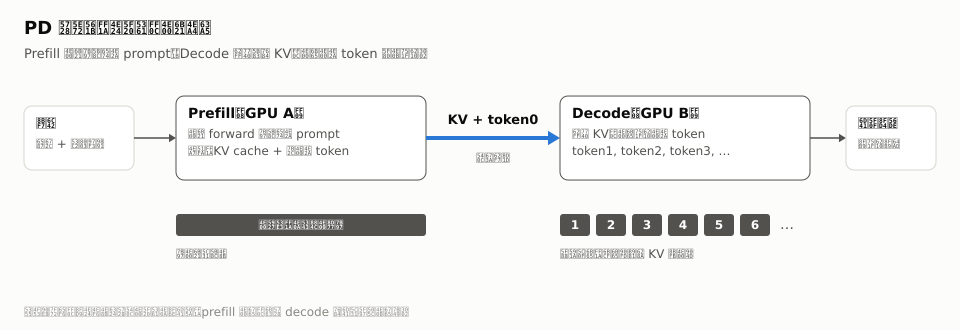
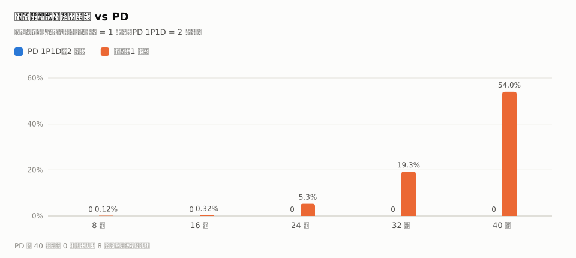
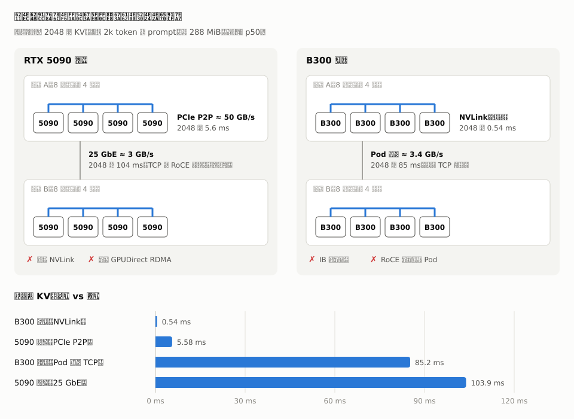
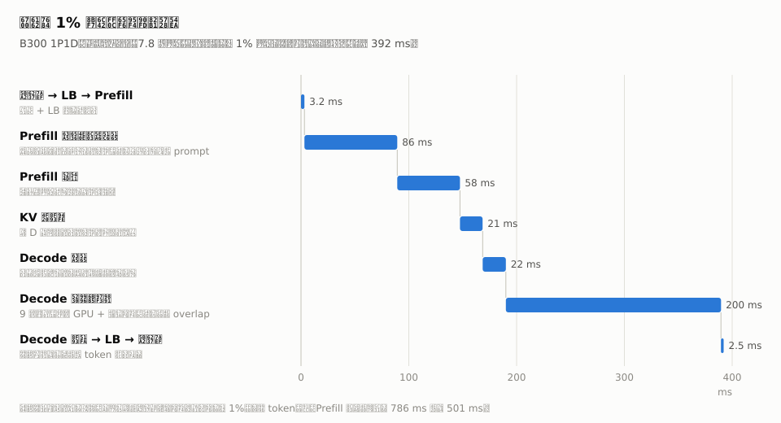
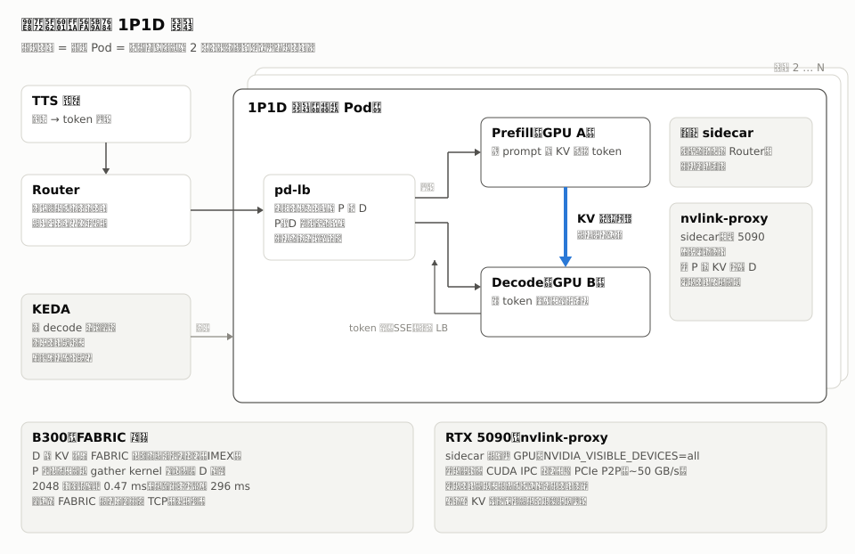
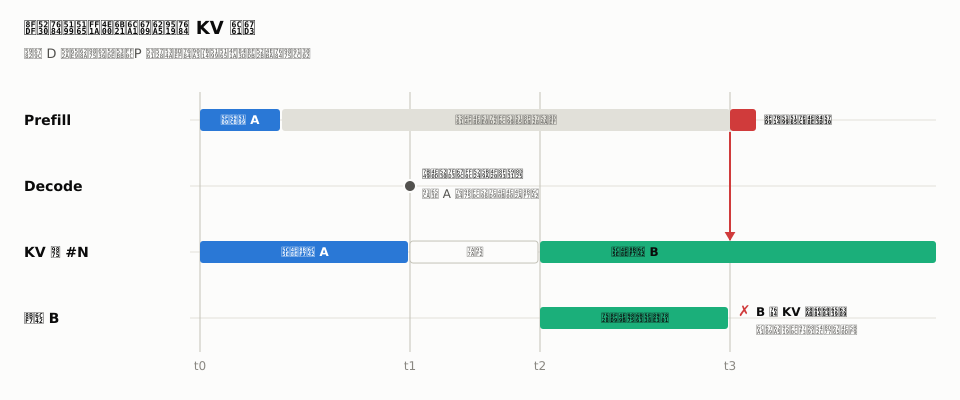
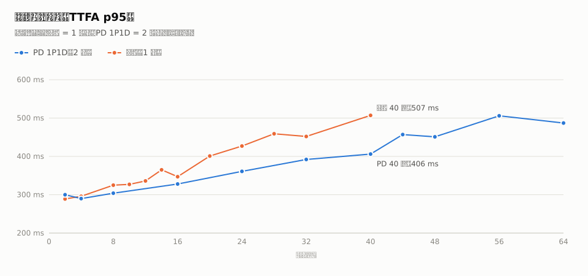

## Summary
This production account presents [[PrefillDecodeDisaggregation]] as a latency-isolation technique for streaming TTS rather than a generic way to lower time to first token. With cross-host RDMA unavailable or too slow, the team kept prefill and decode on one host, used B300 FABRIC memory or an RTX 5090 CUDA-IPC proxy to move KV state, and ultimately favored a fixed 1P1D unit despite an underused prefill GPU. The source also shows that realistic traffic replay, stage timing, fragmentation control, overlap scheduling, explicit transfer finality, and fault injection were necessary to turn a fast copy microbenchmark into a correct production service.

## Key Claims
- Prefill and decode have incompatible workload shapes: a cold long prompt can block every active decode stream on a monolithic GPU, so isolating them can protect a hard per-stream generation-rate floor.

- Under traffic shaped like production, the monolithic RTX 5090 deployment showed stuttering from eight streams and reached 54.02% at 40 streams, while the two-GPU 1P1D deployment recorded none through 40 streams.

- A roughly 288 MiB KV transfer took 0.54 ms over same-host B300 NVLink and 5.6 ms over same-host RTX 5090 PCIe P2P, but 85 ms and 104 ms respectively across the available host networks; this made host-local pairing the practical boundary.

- Container GPU visibility constrained the transfer design. Updated B300 hosts could let prefill import decode's FABRIC allocation and write it with a gather kernel, whereas RTX 5090 units needed a sidecar that could open both workers' CUDA IPC handles and perform P2P copies.
- Real KV pools invalidated contiguous-copy assumptions: transfer time deteriorated as logical requests expanded into many fragments, and a gather-transfer-scatter staging path restored a fragmented-pool transfer from 48.5 ms to 3.79 ms.
- Stage instrumentation and replay of 78,000 traffic-shaped requests found prefill admission and non-overlapped decode scheduling to be larger optimization opportunities than KV copying. Compact array transport reduced serialization overhead, while overlap scheduling cut decode step time from 12.6 ms to 9.0 ms and raised reported GPU busy time from 79% to 98%.

- Although 1P2D achieved better per-GPU capacity, the production choice was a fixed two-GPU 1P1D pod because it simplified routing, health, scaling, draining, and rollout; KEDA scaled whole units by active decode streams with substantial burst headroom.

- A timeout does not prove that an in-flight writer is quiescent. Reusing decode pages before the old prefill operation reaches a proven terminal state can silently corrupt another request's KV state.

- The final recovery protocol combined request IDs, remaining-time metadata, receiver rejection of late chunks, terminal-state acknowledgement, sender restart after three withheld acknowledgements, and decode draining above 25% withheld capacity. Fault injection and more than 13,000 KV checks then reported zero mismatches.
- At the stated no-stutter and at-least-42-token/s threshold, monolithic inference supported at most eight streams on one RTX 5090, 1P1D supported 32 on two GPUs, and 1P2D supported 64 on three. At matched concurrency above eight streams, 1P1D also had lower p95 time to first audio, including 406 ms versus 507 ms at 40 streams.

## Key Quotes
> “P 打断，D 饿死。” — the production symptom that motivated separating the two phases.

> “先在代码里加分阶段的计时日志，跑一遍看时间花在哪，再针对性地修。” — the rule used to replace optimization guesses with stage-level evidence.

> “浪费一点资源，换部署简单。” — the rationale for choosing 1P1D over the denser 1P2D topology.

## Connections
- [[PrefillDecodeDisaggregation]] - the article's central architecture and workload-selection argument.
- [[Mooncake]] - transfer library forked for local proxying, gather kernels, multithreaded TCP, and stronger failure semantics.
- [[InferenceLoadBalancing]] - the simpler 1P1D unit moves routing complexity out of the internal load balancer.
- [[KVCacheAwareRouting]] - session affinity and prefix locality influence which prefill worker should receive a voice request.
- [[MicroserviceFailureContainment]] - draining, health gating, restart-as-proof, and capacity withholding contain unsafe transfer states.
- [[TechnicalDecisionReview]] - two independent reviews rejected plausible but unproven page-reclamation protocols.

## Contradictions
- No direct contradiction was found. The source qualifies generalized cross-host PD guidance by showing a host-local case whose objective is decode isolation under a hard streaming-rate constraint rather than generic TTFT reduction.
