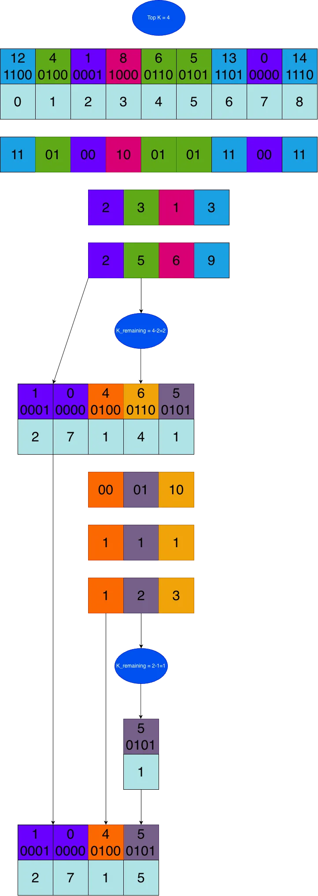

## Summary
This compact technical note presents [[RadixTopK]], an iterative selection method that finds the `k` smallest unsigned integers by processing fixed-width bit chunks from most significant to least significant. At each round it builds a digit histogram and inclusive prefix sum, accepts every bucket below the rank boundary, keeps only the boundary bucket as the next candidate set, and discards larger buckets; reversing bucket order finds the largest values. A worked four-bit example and minimal PyTorch/CUDA script illustrate the mechanics, but the source provides no complexity analysis, benchmark, kernel design, or comparison with sorting and other selection methods.

## Key Claims
- Full-array sorting is unnecessary when only the top `k` values are required: successive radix digits can eliminate candidates while certifying whole lower buckets.
- For the smallest values, the first bucket whose inclusive count reaches the remaining rank is the boundary bucket; all lower buckets are guaranteed results, only the boundary bucket remains unresolved, and all higher buckets can be discarded.
- The remaining rank must be reduced by the number of newly certified elements after each round.
- After all digit chunks are consumed, excess boundary candidates may be truncated because equal values can tie at the cutoff.
- Reversing bucket order changes the procedure from selecting the `k` smallest values to selecting the `k` largest values.
- The worked illustration processes `[12, 4, 1, 8, 6, 5, 13, 0, 14]` two bits at a time: the first round certifies `1` and `0`, the second certifies `4` and leaves `5` at the boundary, producing values `1, 0, 4, 5` at original indices `2, 7, 1, 5`.

## Key Quotes
> "Radix Top-K is an algorithm for finding the top-k elements in an array without sorting the full array." - opening definition.

> "After all bit chunks have been processed, if more candidates remain than open top-k slots, keep only as many as needed." - tie handling at the selection boundary.

## Connections
- [[RadixTopK]] - canonical synthesis of the digit-wise selection procedure, boundary invariant, and evidence limits.
- [[ParallelProgramming]] - the note's per-candidate digit extraction, histogram, and scan stages are compatible with data-parallel execution, although it does not describe or benchmark a parallel kernel.
- [[GPUMemoryHierarchy]] - the CUDA-backed PyTorch example places the procedure on a GPU, but the source does not analyze storage placement, traffic, or working-set limits.

## Contradictions
- No direct contradiction with existing wiki content was identified.
