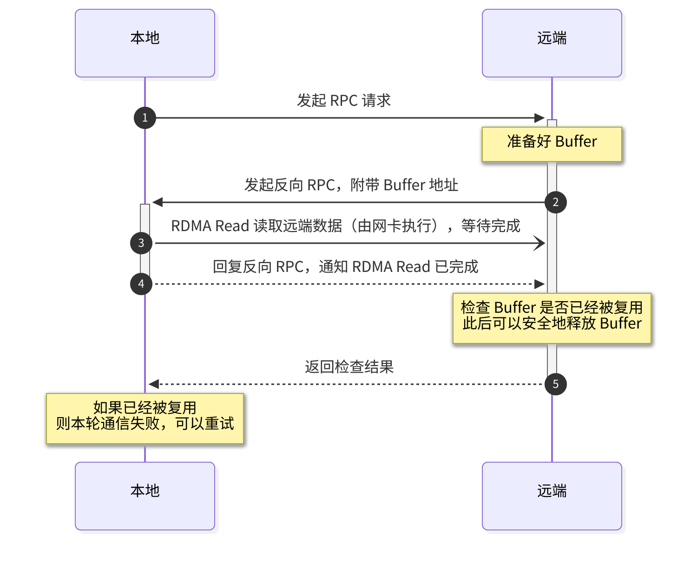
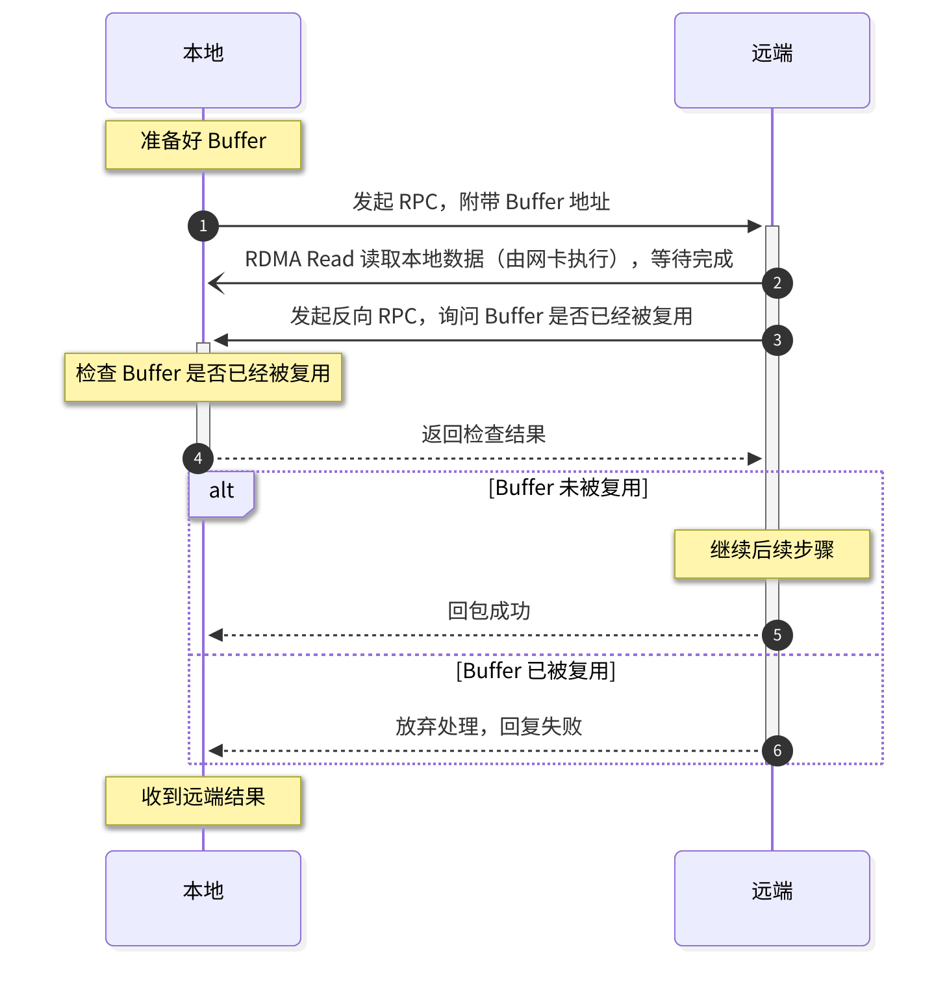
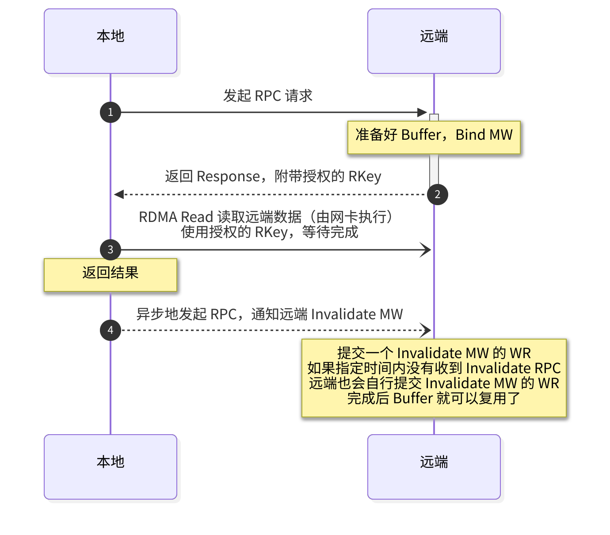
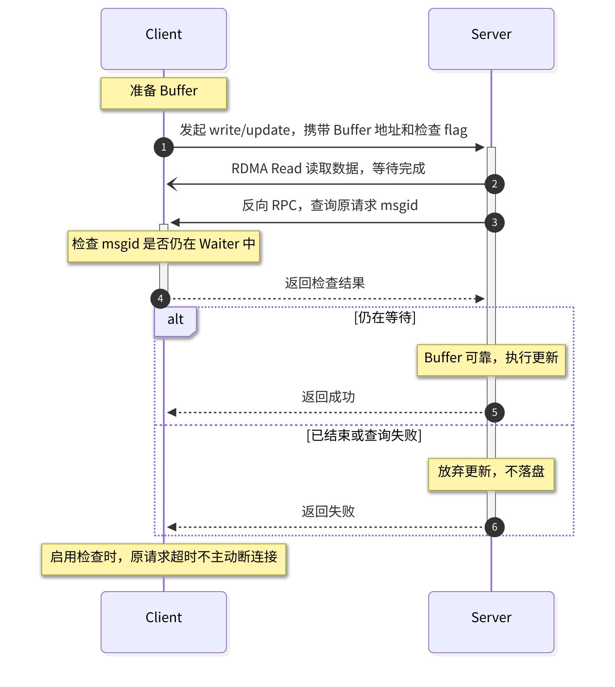
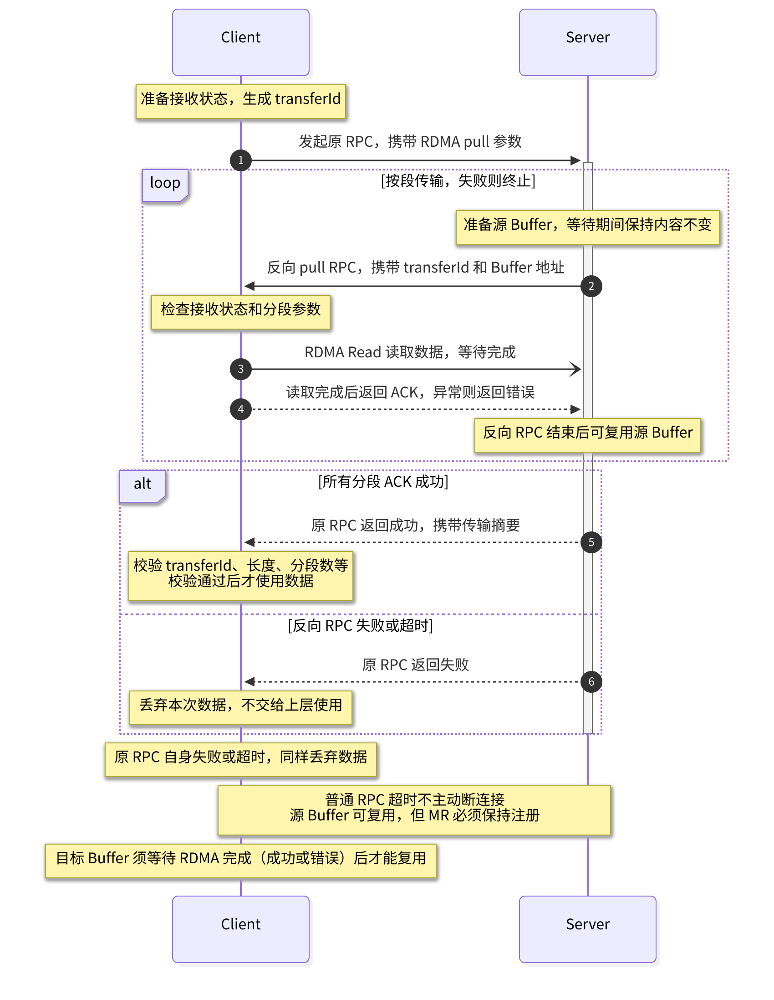

## Summary
SF-Zhou proposes making RDMA buffer reuse safe without routinely tearing down a connection: avoid RDMA Write, use receiver-initiated RDMA Read, and validate after completion that the exposed buffer still belongs to the original request. The design combines one-sided data movement with two-sided RPC to supply missing ownership and error semantics, while [[ReceiverDrivenFlowControl]] also lets the receiver govern network admission. [[3FS]] adopted variants for both chunk writes and reads, while Type 2 Memory Windows remain a lower-latency hardware-dependent alternative.

## Key Claims
- Once an RDMA Write target has been disclosed, the remote peer can silently modify it; safe early reuse therefore requires revocation, connection teardown, or avoiding RDMA Write.
- RDMA Read reverses the corruption risk: a peer can read stale or newly repurposed contents unless the protocol checks that buffer ownership remained valid through completion.

- An extra reverse RPC can ask the buffer owner whether the request is still pending; success is accepted only when the ownership check passes, at the cost of another round trip.
- Type 2 Memory Windows can bind a request-scoped RKey and asynchronously invalidate it, keeping the normal path near one RTT; a sufficiently late RDMA Read fails after invalidation but can put the QP into an error state.

- For 3FS writes, the client exposes a buffer and a check flag, the server completes RDMA Read, then queries whether the original `msgid` is still waiting before returning success.

- For 3FS reads, a reverse pull RPC makes the client issue RDMA Read against the server's buffer; if the original client request times out while a read remains in flight, the client waits briefly and still closes the connection if ownership cannot be recovered safely.

- Receiver-driven reads let the application limit issuance before traffic reaches the fabric; the author reports congestion in 3FS and KV-cache storage that network-layer congestion control alone did not prevent.

## Key Quotes
> “用 RPC 来弥补 RDMA 在 buffer 生命周期和错误语义上的不足。” — the protocol-level rationale

> “Invalidate RPC 是异步的，不占用请求的延迟。” — the Memory Window latency argument

## Connections
- [[RDMABufferLifecycleSafety]] - makes buffer ownership, remote access authority, completion, timeout, and reuse one explicit protocol.
- [[ReceiverDrivenFlowControl]] - uses receiver-issued reads as an application-level admission point for network traffic.
- [[3FS]] - production deployment replaces server-pushed RDMA Write with validation and pull-style read flows.
- [[AdaptiveBackpressure]] - provides the broader principle that the component observing local capacity should regulate upstream work.
- [[HighThroughputIOOptimization]] - complements bandwidth tuning with the lifecycle and recovery conditions required for safe registered-buffer reuse.

## Contradictions
- The application-level confirmation path preserves connections in ordinary timeout cases but adds one RTT and does not eliminate teardown: the 3FS read path still resets the connection if an in-flight read does not finish within a short grace period.
- Type 2 Memory Windows reduce normal-path latency but depend on NIC and environment support; a read racing after invalidation can fail the operation and force QP reconnection.
- The congestion claim is a first-party operational observation without traffic traces, topology, algorithm settings, controlled comparison, or quantitative results; it does not establish that network-layer congestion control is generally insufficient.
- The article supplies protocol reasoning and sequence diagrams rather than formal verification, implementation results, failure-injection evidence, or measured latency and throughput.
