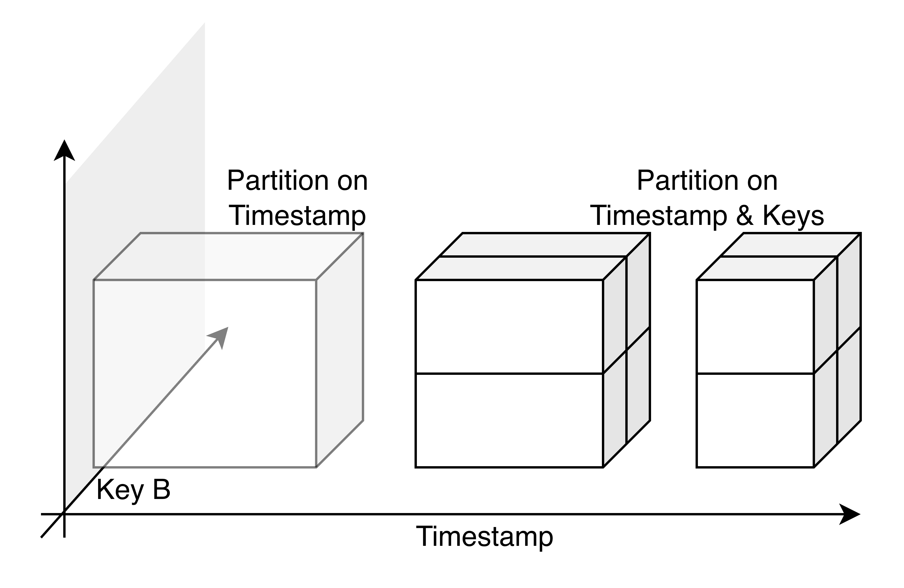
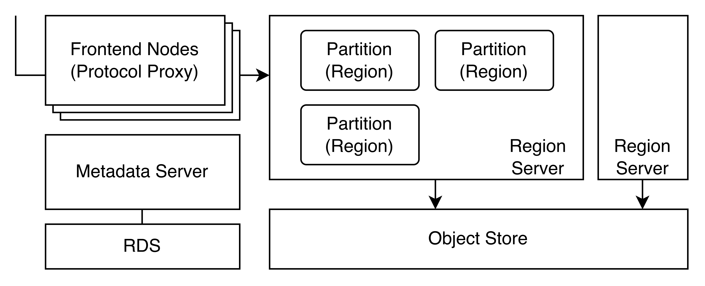
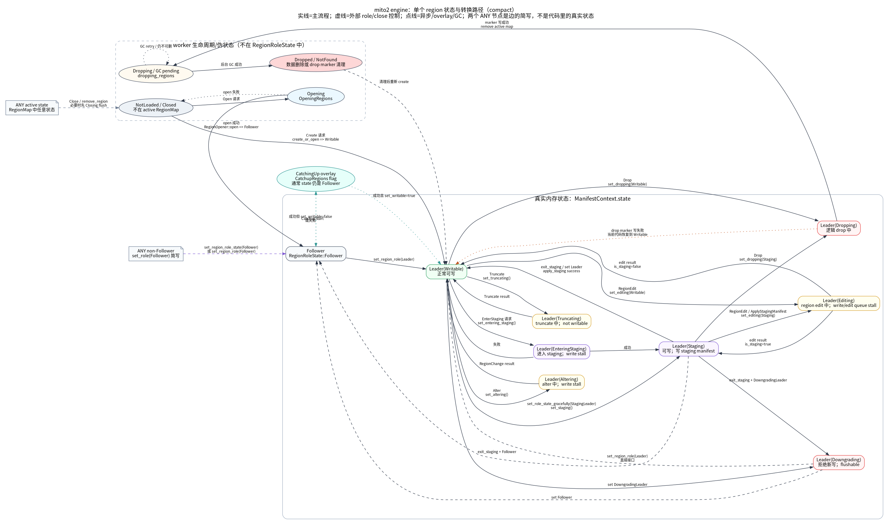
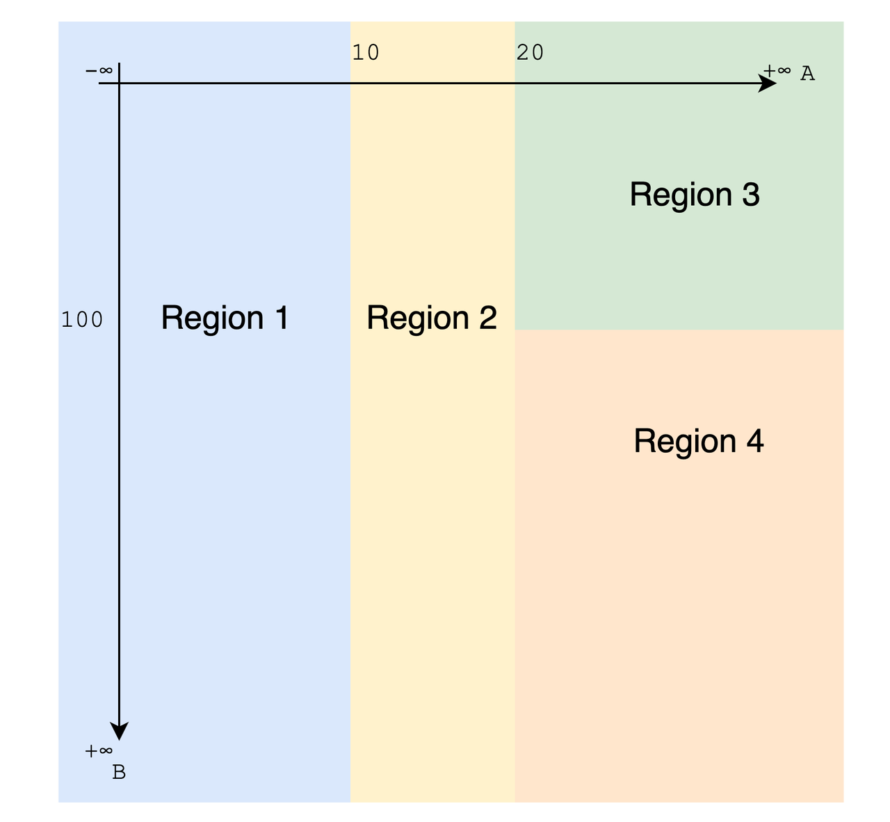

## Summary
[[Wayne]] re-examines [[GreptimeDB]] partitioning from the premise that time-only partitioning expands retention but does not distribute the concentrated active workload of a time-series system. The article argues that GreptimeDB's Region became an overloaded unit of routing, ownership, state, files, caching, reads, writes, and maintenance, making repartitioning operationally heavy. Its proposed direction is to remove stateless write work from Regions, optimize placement around query load, and eventually let files or automatically adjusted multidimensional key ranges carry finer-grained partition responsibility.

## Key Claims
- [[DatabasePartitioning]] solves several distinct problems: time partitioning can bound retention and simplify TTL deletion, while primary-key partitioning can distribute active data and compute load across nodes.
- GreptimeDB's architecture sends protocol and routing work through Frontend nodes, keeps Region-local MemTables and read and disk caches on Region Servers, stores metadata through a reliable KV or RDS service, and treats object storage as the durable source of truth.

- Treating a Region as the atomic unit for read and write routing, file ownership, metadata, cache, alteration, compaction, versioning, and lifecycle state creates coupled bottlenecks and makes a nominal rule change span metadata, flushing, file reassignment, online writes, rollback, and later recompaction.

- GreptimeDB's batch-write path moves stateless validation, encoding, file creation, and object-store upload to Frontend nodes; a Region then registers the completed file, reducing partition-bound write work at the cost of higher average write latency, new visibility and failure concerns, and proactive cache loading.
- The author argues that partitioning should primarily serve query load because write preprocessing can scale independently, and speculates that each immutable data file could become the natural physical partition instead of preserving a heavy intermediate Region abstraction.
- Independent range expressions across each primary-key column avoid imposing one lexicographic column order, let filters on any partition column prune regions, and make query predicates plus observed min/max statistics potential inputs to automatic hotspot detection and repartitioning.

- Fully automatic partitioning remains incomplete because Region state is still heavy, repartitioning is expensive, write pressure still influences partition decisions, and the cluster lacks a complete query-load feedback loop.

## Key Quotes
> “分区不会消失，只会转移。” — partition responsibility moves between the database, application, and infrastructure rather than vanishing.

> “分区在大部分时候只应该为了查询负载而服务。” — the article's proposed criterion for future partition decisions.

## Connections
- [[Wayne]] — author reflecting on GreptimeDB's implementation history and proposed direction.
- [[GreptimeDB]] — database whose Region abstraction, batch-write path, and multidimensional ranges are examined.
- [[DatabasePartitioning]] — central distinction among retention, data ownership, write work, query placement, and automatic repartitioning.
- [[TimeSeriesDatabase]] — workload in which recent time partitions remain hot and therefore do not by themselves enable horizontal throughput scaling.
- [[ObjectStorageNativeDatabase]] — shared durable storage makes ownership changes possible without physical file movement, while leaving cache and metadata work.
- [[Prometheus]] — comparison system whose time-based Blocks simplify retention but do not distribute active ingestion or query load within one instance.
- [[DatabaseEngineeringTradeoffs]] — batch writing trades lower Region-bound work for latency, visibility, failure-model, and cache-warming concerns.

## Contradictions
- The article qualifies the intuition that more partitions automatically provide horizontal scale: time-only partitions can increase retained history without distributing the currently active workload.
- The file-as-partition design is explicitly the author's personal idea and is not on GreptimeDB's roadmap; it should not be treated as a shipped feature or organizational commitment.
- The automatic multidimensional mechanism is described as recently completed at the rule-maintenance layer, but the end-to-end query-feedback loop and lightweight repartitioning needed for a no-intervention system remain unfinished.
- The account is an affiliated practitioner's architectural retrospective without benchmarks, version pins, controlled workload comparisons, failure experiments, or measurements of repartitioning cost, batch-write latency, cache effectiveness, or automatic-placement quality.
