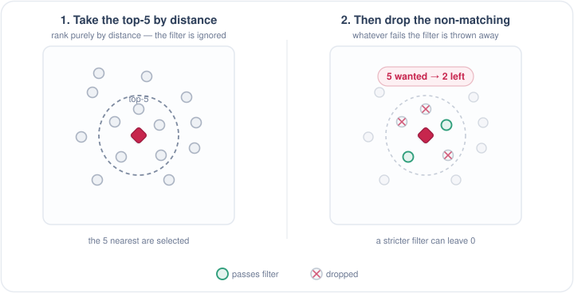
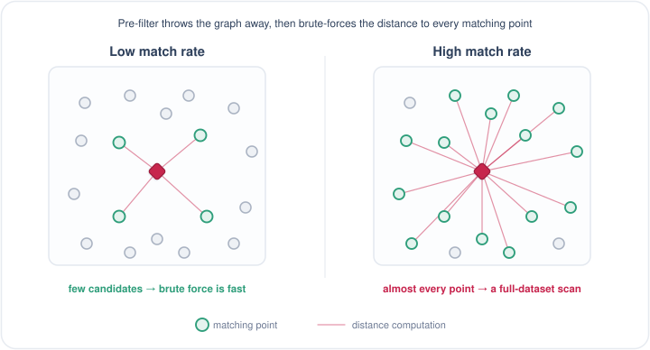
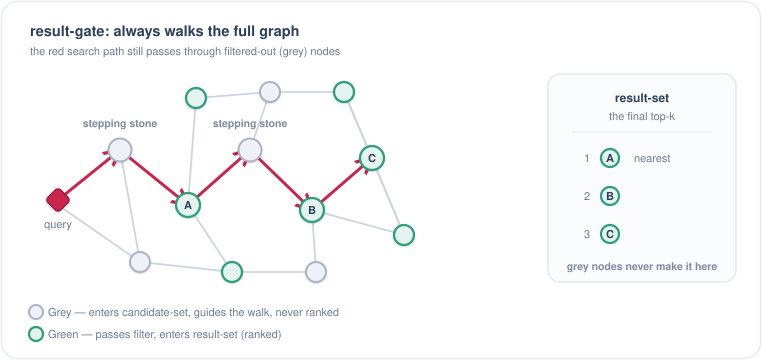
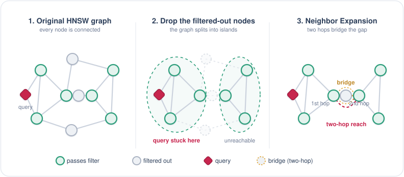
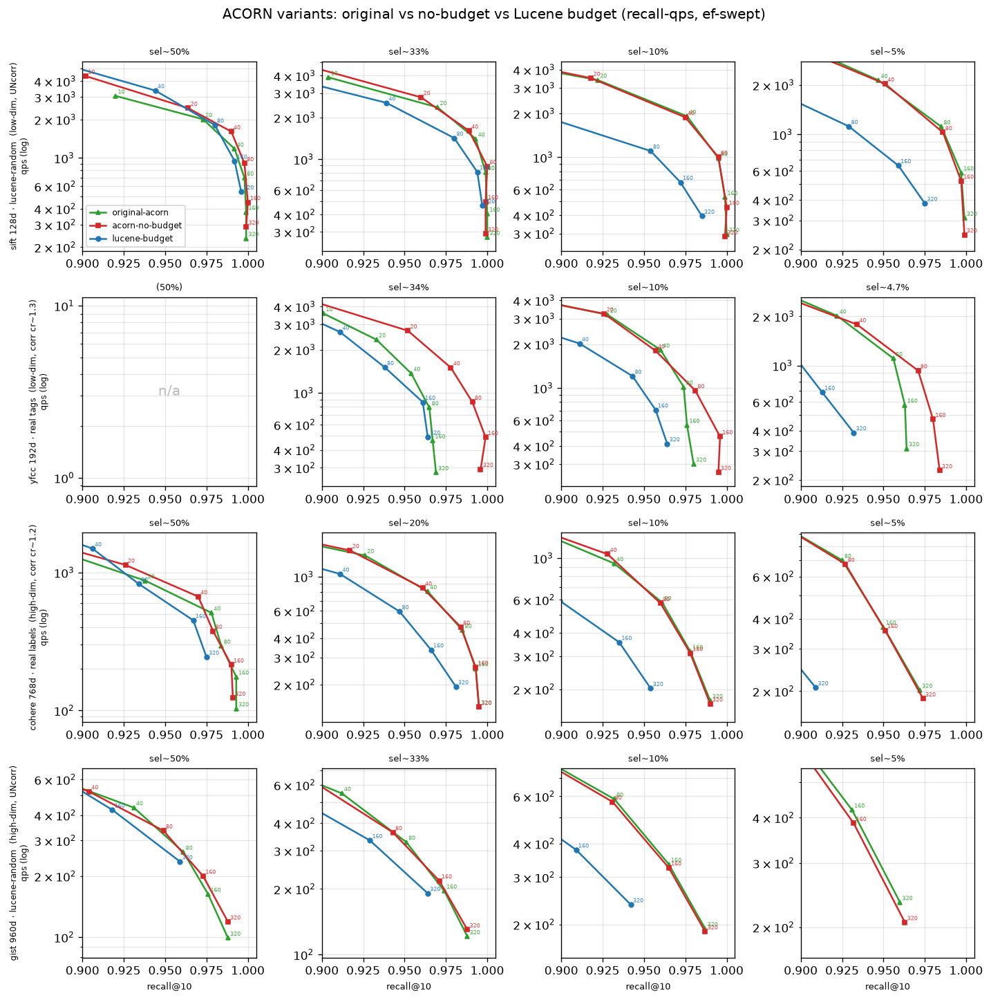
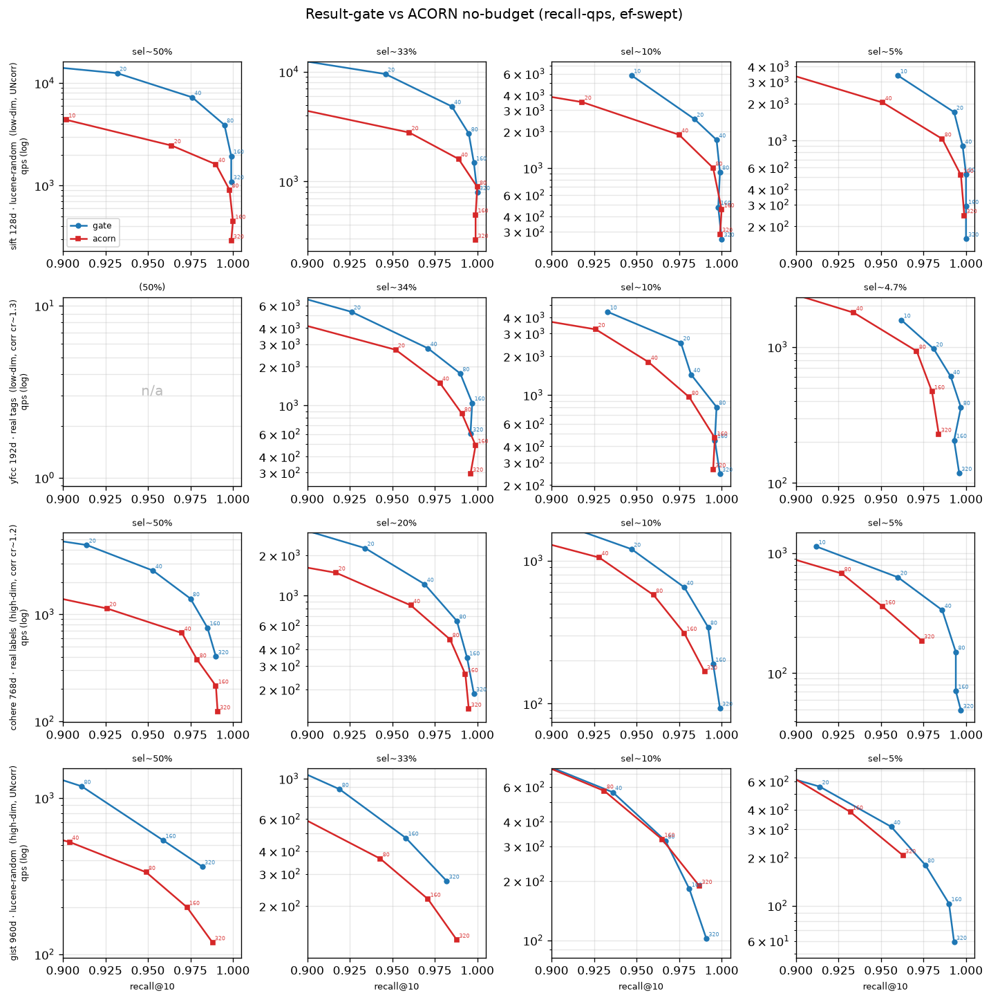
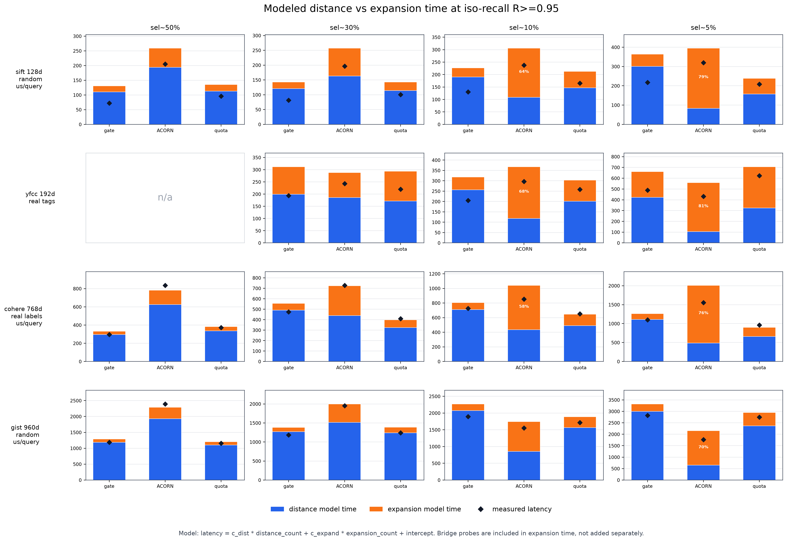
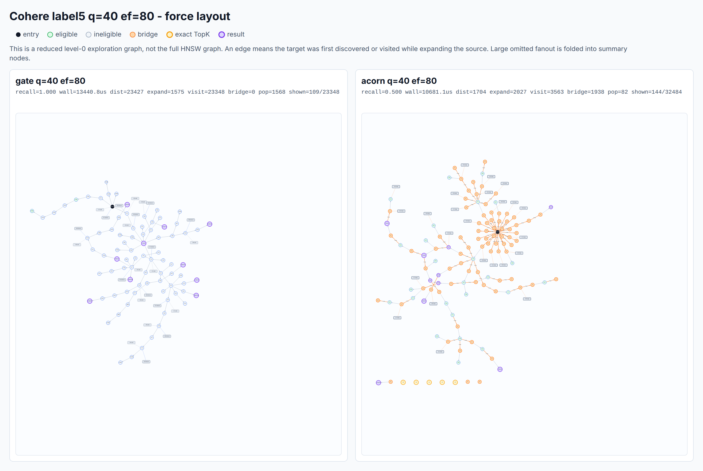
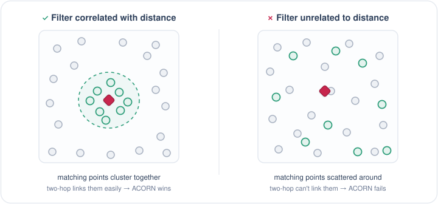
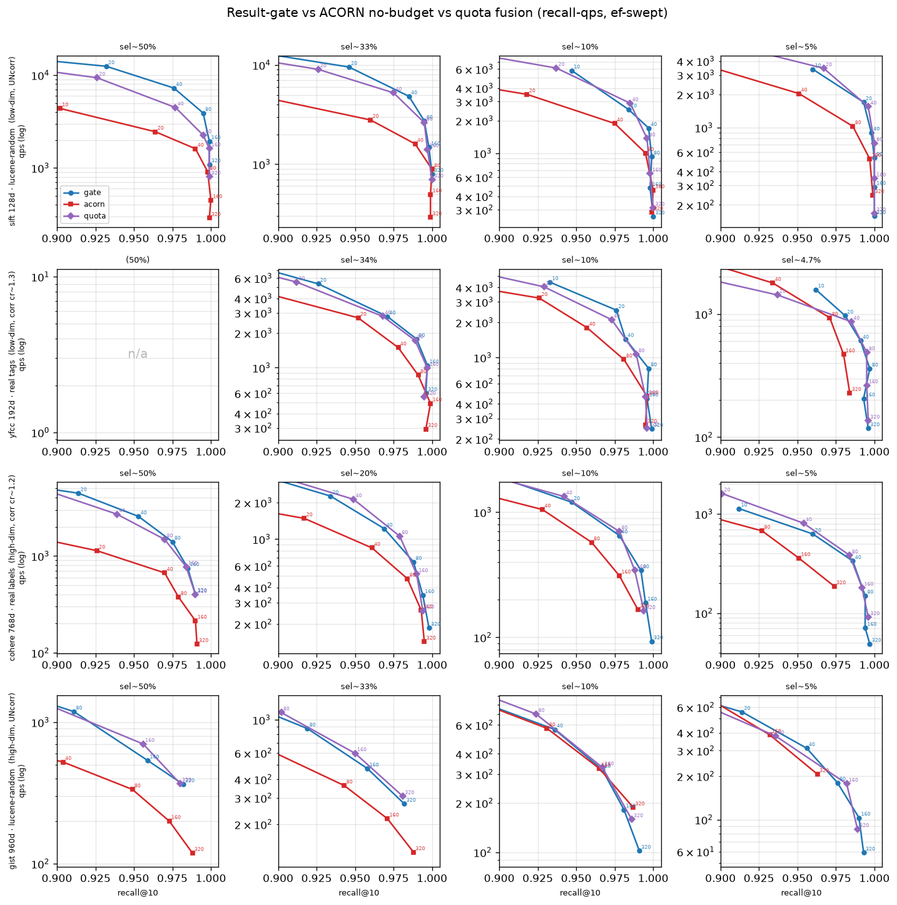

## Summary
This article explains why metadata filtering is structurally difficult for graph-based [[ApproximateNearestNeighborSearch]] and compares pre-filtering, post-filtering, result-gate filtering, ACORN-1, and a quota-based hybrid on four datasets. Its inspected diagrams and recall-QPS plots show that preserving the full [[HNSWIndex]] graph often matters more than reducing distance calculations: result-gate usually beats ACORN in the author's tests, while ACORN becomes plausible only for high-dimensional, selective, vector-correlated filters. The practical recommendation is workload-specific measurement, with result-gate as the default when the workload is unknown.

## Key Claims
- Post-filtering can return fewer than `k` matches or none at all because it filters only the unfiltered TopK; oversampling raises cost without guaranteeing enough eligible results.

- Pre-filtering guarantees an eligible candidate set but discards HNSW navigation and brute-forces every matching vector, so it is attractive only when selectivity makes that set small.

- Result-gate filtering leaves candidate-set admission and full-graph routing unchanged, but admits only eligible points to the result set; it can therefore traverse filtered-out nodes as stepping stones until it fills the result set or exhausts the graph.

- ACORN-1 saves distance calculations by routing through eligible points, then uses two-hop Neighbor Expansion through ineligible bridge nodes to repair connectivity lost by filtering.

- Lazy and multi-hop expansion slightly improved the author's ACORN implementation, but Lucene-style exploration budgets reduced average recall-QPS performance even while bounding extreme exploration.

- Across the tested SIFT1M, GIST1M, YFCC1M, and Cohere1M workloads, result-gate usually achieved higher QPS at equal recall than no-budget ACORN.

- ACORN's lower distance-computation time was frequently outweighed by expansion and memory-access cost, and its sparse eligible-only routing often required larger `ef` to recover recall.

- ACORN is most plausible when vectors are high-dimensional, the filter is selective, and eligible points cluster in vector space; a filter unrelated to vector geometry scatters eligible nodes beyond reliable two-hop repair.

- A quota hybrid conditionally uses eligible-only ACORN routing when enough eligible neighbors are found and otherwise restores result-gate-style routing, but the author's plots do not show it universally beating both parents.

## Key Quotes
> “没有银弹” - on the absence of one filtering method that wins across workloads.

> “那就无脑选 result-gate” - on the recommended default when workload characteristics are unknown.

## Connections
- [[HNSWFiltering]] - synthesizes the article's selectivity, connectivity, routing-quality, and memory-cost tradeoffs.
- [[HNSWIndex]] - supplies the graph and candidate/result-set mechanics modified by each filtering strategy.
- [[ApproximateNearestNeighborSearch]] - filtered HNSW search must balance recall, result completeness, throughput, and latency.
- [[VectorDatabase]] - metadata-filtered vector queries are a common database workload that exposes these tradeoffs.

## Contradictions
- No direct contradiction found. The article qualifies generic claims that HNSW performance follows mainly from distance-computation savings: for these filtered workloads, memory access, graph expansion, filter-vector correlation, and routing quality can dominate.
