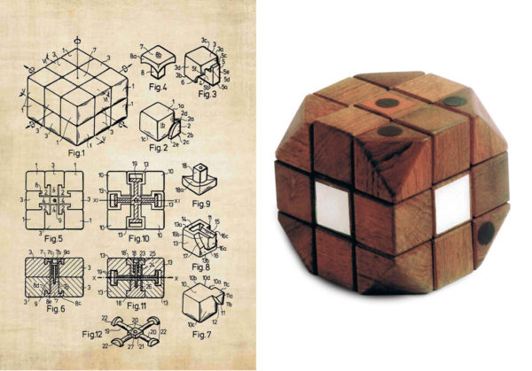
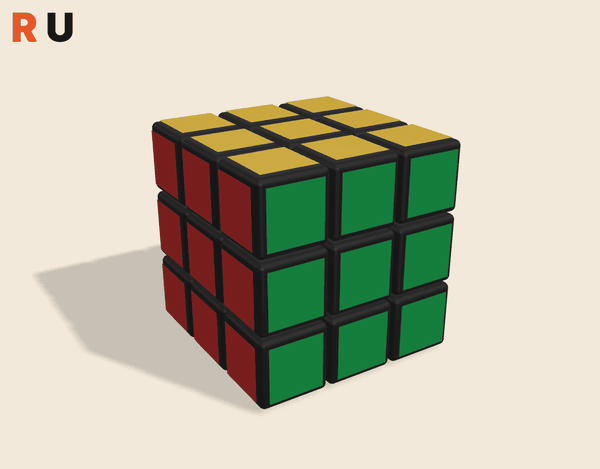
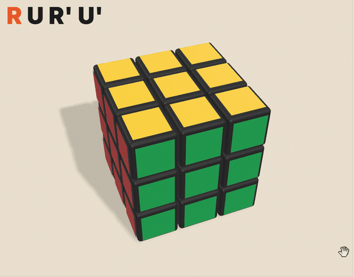
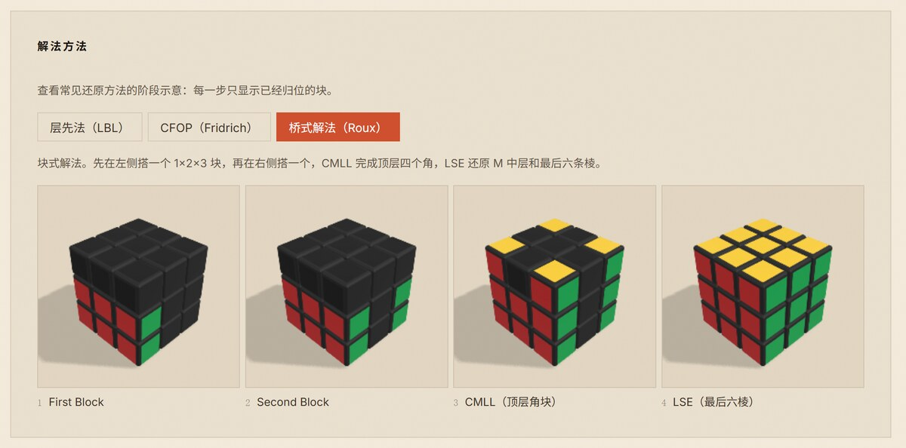
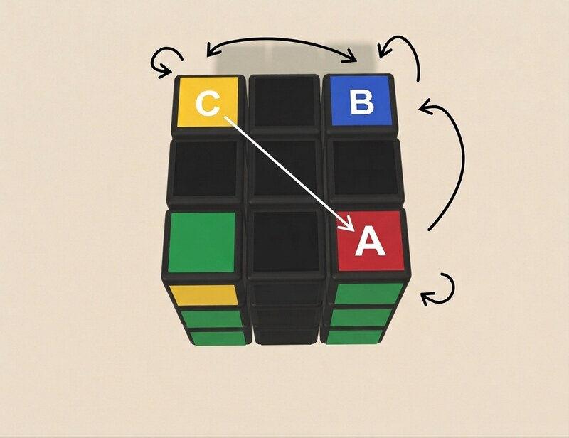
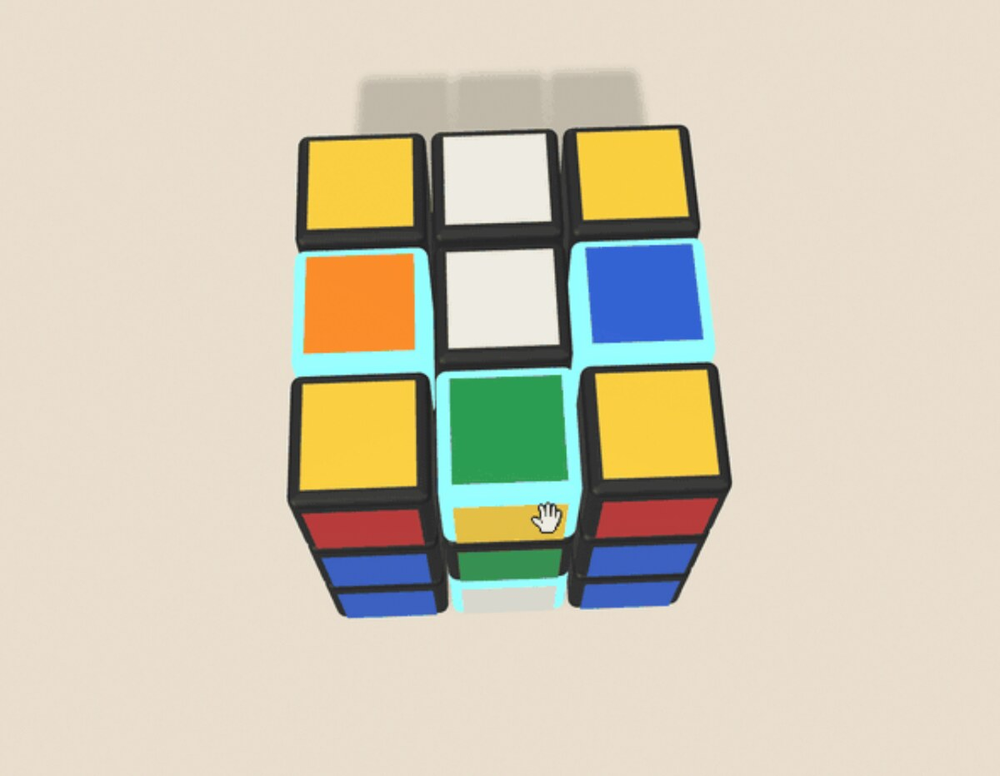

## Summary
This beginner tutorial reframes [[RubiksCubeSolving]] as observation and reversible piece movement rather than rote algorithm recall. It introduces [[GroupTheory]] through non-commuting turns, uses [[Commutators]] as an “open, act, close” mental model, and then adapts the [[RouxMethod]] into a worked progression: build two 1×2×3 bridges, orient and position the last four corners, orient the last six edges, and place those edges with `M` and `U` turns. The approach reduces memorization by explaining moves spatially, although the worked solve still supplies several fixed sequences and therefore does not literally eliminate algorithms.

## Key Claims
- [[ErnoRubik]] created the first cube prototype in 1974 to demonstrate how parts could move independently without destroying the whole structure; the inspected image pairs the wooden prototype with patent-style structural drawings.

- A 3×3 cube has eight corner pieces, twelve edge pieces, six fixed centers, and roughly `4.3 × 10^19` reachable states, making exhaustive trial an impractical learning strategy.
- Cube turns compose and have inverses but generally do not commute: `R U` and `U R` produce visibly different final arrangements.

- The tutorial uses a commutator-shaped sequence `A B A⁻¹ B⁻¹` to teach controlled disturbance and restoration. Its recurring `R U R' U'` example is explained as moving a layer aside, inserting a target piece, and restoring the moved layers.

- The practical method fixes the cube's viewing orientation, builds left and right 1×2×3 bridges, solves the four remaining corners, and finishes the last six edges.

- Three-cycles let the solver reposition or reorient a small set of corners while preserving the completed bridges; mirror sequences reverse the direction and twist behavior.

- In the last-six-edges stage, an edge is treated as correctly oriented when its white or yellow sticker faces up or down. `M` and `U` sequences first repair orientation, then place the red, orange, blue, and green edges.

## Key Quotes
> “移开、插入、归位。” — the spatial interpretation used to replace blind recall of the basic insertion sequence.

> “不用死背公式，只有‘开门—操作—关门’的交换子逻辑。” — the tutorial's summary of controlled disturbance and restoration.

## Connections
- [[ErnoRubik]] — inventor whose prototype motivates the cube's movable-whole structure.
- [[RubiksCubeSolving]] — the broader practice reframed around piece observation and reversible transformations.
- [[GroupTheory]] — supplies the vocabulary of composition, inverses, and non-commutativity.
- [[Commutators]] — provide the tutorial's main mental model for local changes that preserve prior work.
- [[RouxMethod]] — supplies the two-bridge, corners, and last-six-edges solve structure.

## Contradictions
- “Without formulas” is a pedagogical slogan rather than a literal description: the tutorial explicitly gives two corner three-cycles, a J-perm variant, edge-orientation sequences, and edge three-cycles. Its narrower contribution is reducing unsupported memorization by attaching spatial meaning to those sequences.
- The source is a beginner tutorial, not a rigorous group-theory treatment. Its claim that inverse suffixes simply restore the “environment” and that an atomic move exchanges only three corners or three edges is an intuition-building simplification; `R U R' U'` itself affects multiple corner and edge positions or orientations.
- The worked scramble and animations demonstrate one route through the method, not that a novice can derive every case unaided. Claims that the same idea solves every cube variant or that a beginner can reach 90 seconds with little practice are not benchmarked.
- All 28 unique remote images were opened, including representative frames spanning each animated sequence. Seven non-duplicative images were retained for the prototype, non-commutativity, commutator, Roux progression, corner cycle, and bad-edge state; completed-cube views, portrait, variant collage, UI screenshot, prose-redundant intermediate animations, and three duplicate references were omitted.
