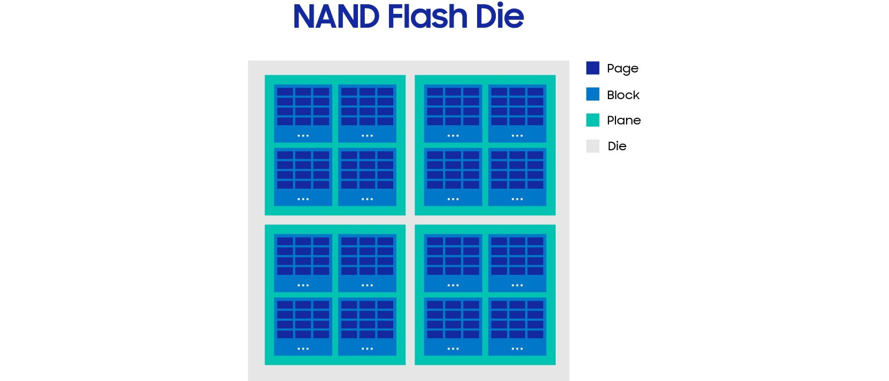
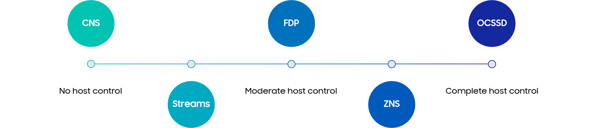
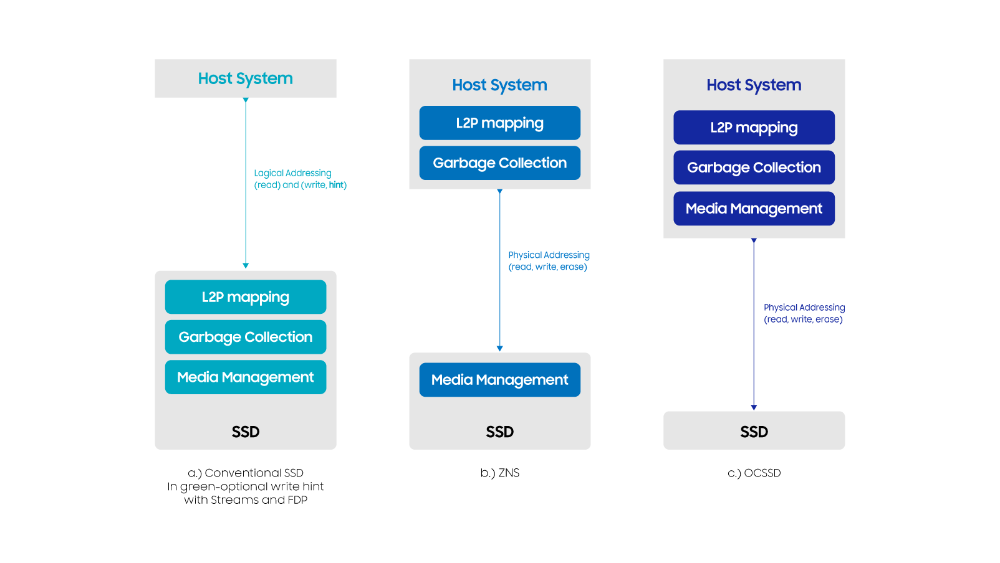
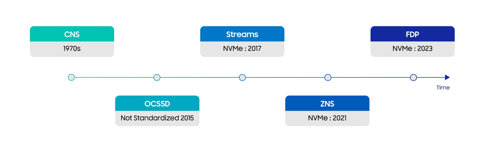
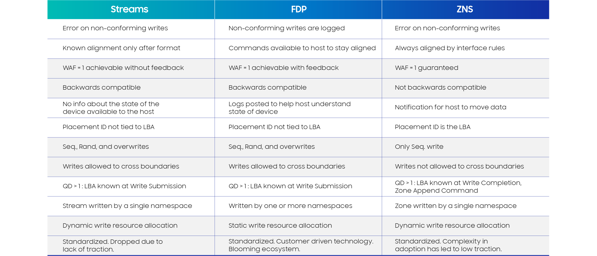

## Summary
[[Samsung]] traces SSD data placement from conventional device-managed flash through Open Channel SSDs, NVMe Streams, [[ZonedNamespaceStorage]], and [[FlexibleDataPlacement]]. The article argues that useful designs minimize [[SSDWriteAmplification]] while leaving NAND-media management in the device and limiting host-stack redesign. Its preferred outcome is workload-specific rather than universal: ZNS fits already-sequential systems, while FDP seeks most placement benefits through a backward-compatible interface and host-device feedback.

## Key Claims
- NAND cannot overwrite pages in place: its page-sized writes and block-sized erases require an FTL to redirect logical writes, invalidate old pages, update logical-to-physical mappings, and reclaim blocks.

- [[SSDWriteAmplification]] arises when garbage collection relocates still-valid pages. Sequential invalidation can approach device WAF 1, while mixed-temperature random overwrites leave valid and invalid pages together and consume extra program/erase cycles.
- [[SSDDataPlacement]] is a spectrum of host control. Conventional SSDs provide none, Streams add write hints, FDP adds moderate placement control and feedback, ZNS moves mapping and garbage collection to the host, and OCSSD also exposes media management.

- Historical adoption did not track theoretical control alone. OCSSD promised device WAF 1 but burdened hosts with vendor-sensitive NAND management; Streams was easy and compatible but lacked compelling adoption; ZNS standardized sequential zones but imposed substantial state and redesign work.

- [[ZonedNamespaceStorage]] guarantees device WAF 1 by requiring sequential writes inside host-managed zones, but random workloads may merely move write amplification and garbage collection into the application layer.
- [[FlexibleDataPlacement]] keeps ordinary sequential, random, and overwrite behavior, separates writes by placement ID, and exposes device-state feedback so a host can tune placement toward WAF near 1 without adopting ZNS's interface constraints.

- No single interface is best for every workload: existing log-structured systems may fit ZNS, while conventional random-write stacks may find FDP's lower integration cost more attractive.

## Key Quotes
> "Leave media management to the SSD" - the main lesson drawn from OCSSD.

> "the search for a single data placement technology that serves all use-cases might be a futile exercise" - the article's workload-fit conclusion.

## Connections
- [[Samsung]] - publisher and SSD vendor presenting the historical comparison and advocating FDP's engineering-cost tradeoff.
- [[SSDDataPlacement]] - central design space balancing host knowledge, device control, compatibility, and integration effort.
- [[SSDWriteAmplification]] - main device-level cost that the compared interfaces try to reduce.
- [[FlexibleDataPlacement]] - Samsung's favored moderate-control, feedback-based NVMe approach.
- [[ZonedNamespaceStorage]] - standardized sequential-zone design that guarantees device WAF 1 while shifting more state to the host.
- [[StoragePerformanceBenchmarking]] - supplies the broader discipline needed to test end-to-end amplification, latency, QoS, endurance, and workload fit rather than relying on interface-level claims.

## Contradictions
- The prose says Streams provides no WAF guarantee, while the retained comparison table says WAF 1 is achievable without feedback; these can coexist only if “achievable” is read as workload-dependent rather than guaranteed.
- The article is a Samsung-authored industry history and forward-looking case for FDP. Its adoption, “blooming ecosystem,” low-traction, and engineering-effort claims are not supported here by independent deployment counts, matched implementations, or end-to-end benchmarks.
- Device WAF 1 is not the same as end-to-end WAF 1: ZNS can transfer relocation and garbage-collection writes into host software, and FDP's near-1 outcome depends on workload classification and feedback use.
