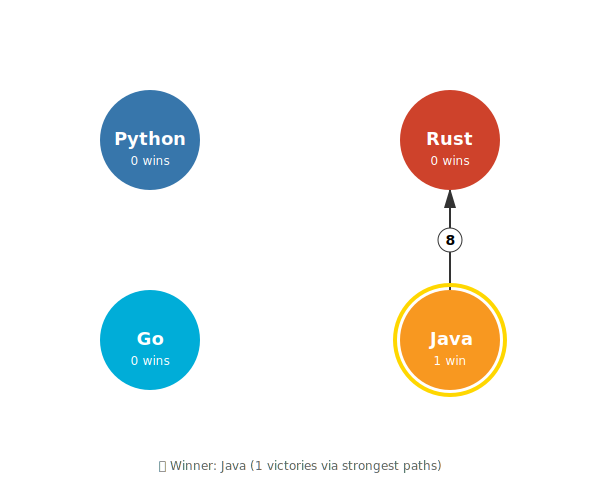
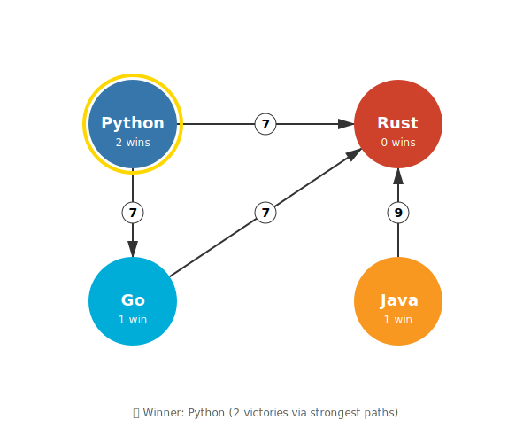

## Summary
[[AshVardanian]] implements the O(n³) strongest-path stage of the [[SchulzeMethod]] as a blocked Floyd-Warshall-style computation in Numba, CUDA C++, and [[Mojo]]. His first-party benchmarks report that Mojo runs the same source across CPUs and Nvidia and AMD GPUs, while the voting example also demonstrates a participation paradox in which adding a Java-first ballot changes the winner from Java to Python. The article is a hackathon engineering report rather than an independent voting-system assessment or controlled cross-platform language comparison.

## Key Claims
- Schulze aggregates ranked ballots into pairwise preferences, computes maximum-bottleneck paths, and selects candidates whose strongest paths beat the reverse paths; the path stage is O(n³) in the candidate count.
- A blocked traversal preserves the sequential dependency between pivot tiles while exposing three phases per pivot: the diagonal tile, its row and column, and then the remaining independent tiles.
- The max-min recurrence is a tropical-semiring-like graph computation, but its non-invertible operations and sequential pivot dependency prevent treating it as ordinary matrix multiplication.
- The same Mojo implementation reportedly ran without source changes on Nvidia and AMD GPUs, whereas adapting the CUDA C++ implementation to AMD HIP took more than 200 changed lines.
- On the reported 32,768-candidate case, Mojo reached 893.7 billion cell updates per second on H100, 2.8 trillion on MI300, and 3.5 trillion on MI355X; CUDA reached 921.4 billion on H100, while the 384-core CPU implementations were substantially slower.
- SIMD raised the reported 32,768-candidate Mojo CPU result from 82.3 to 293.1 billion cell updates per second, although the roughly fourfold claim and every accelerator result remain configuration-specific.
- The worked ballot example shows a participation failure: adding a voter whose first choice is Java strengthens lower-ranked Python enough to change the Schulze winner from Java to Python.

## Key Quotes
> "The Mojo code written for Nvidia GPUs worked on AMD hardware with zero modifications" - the author's central portability observation.

> "No voting system is." - the author's explicit qualification that GPU acceleration does not establish electoral perfection.

## Connections
- [[AshVardanian]] - author and implementer of the benchmarked Numba, CUDA, and Mojo variants.
- [[SchulzeMethod]] - ranked Condorcet method whose strongest-path computation is parallelized.
- [[Mojo]] - language used for the cross-CPU and cross-GPU implementation.
- [[ParallelProgramming]] - blocked traversal exposes row, column, and independent-tile work around a sequential pivot dependency.
- [[Nvidia]] - H100 platform used for the CUDA and Mojo GPU comparison.

## Contradictions
- The source does not directly contradict an existing wiki claim. It qualifies simple accounts of GPU parallelism by showing that a globally sequential pivot dimension can coexist with substantial tile-level parallelism.
- The participation example contradicts any assumption that a Condorcet method necessarily satisfies participation: a Java-first ballot changes the selected winner from Java to Python in the displayed construction.
- The benchmark is author-run and mixes different processors, machines, toolchains, implementations, and tuning levels. It does not normalize price, power, memory capacity, software maturity, or optimization effort, and the author says the Mojo work was lightly optimized.
- GPU feasibility does not remove quadratic matrix capacity or cubic total-work growth. The article discusses 100,000 candidates conceptually but reports results only through 32,768.
- The retained SVGs encode the displayed strongest-path outcomes and edge strengths, not the complete pairwise preference graph; the surrounding ballot table and script supply the omitted derivation.
