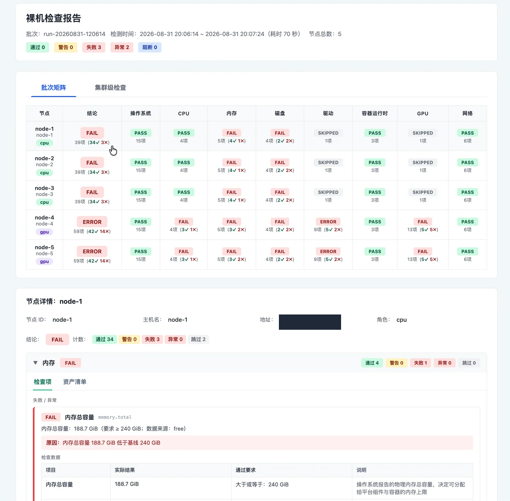

## Summary
[[ChaneyZorn]] describes [[BareMetalCheck]], an offline server-inspection tool distributed as one archive for Ubuntu 22.04 and 24.04 environments that have Python 3.10+ but no internet access, package installation, or container runtime. The design combines a shiv-built Python zipapp, an alternate embedded [[Ansible]] entry point, relocatable native-tool archives, manifest-driven conditional delivery, and a single-file HTML report into a layered [[SelfContainedToolDistribution]] strategy. The retained report screenshot shows how the output joins a five-node batch matrix with role-aware status categories and drill-down evidence for individual failures.

## Key Claims
- A self-contained field tool should bundle application code, Python dependencies, automation entry points, native utilities, and report assets while avoiding the target's package manager and standard system paths.
- Because the target already guarantees Python 3.10+, `zipapp` plus shiv offers a smaller fit than bundling another interpreter; native wheels remain platform- and architecture-specific.
- `SHIV_CONSOLE_SCRIPT=ansible-playbook` lets the same `.pyz` run either the product CLI or Ansible's packaged console entry point, keeping their Python environment and versions aligned.
- Native command bundles become relocatable when their non-system libraries are copied into the archive and `patchelf` sets an `$ORIGIN`-relative rpath; drivers, firmware, kernel modules, and most host-bound runtimes remain prerequisites rather than bundled repairs.
- Manifests select archives by OS, architecture, and node role, checksums verify built artifacts separately, and digest-aware installation skips unchanged transfers.
- Active tests such as NCCL are distributed only after GPU nodes pass prerequisites and explicitly allow load-generating checks.
- A Vite-built single-file HTML template can carry base64-encoded JSON in a data island, supporting direct `file://` viewing and optional temporary HTTP sharing without external requests.

## Key Quotes
> "目标环境没有可用的依赖" — the operating constraint behind the packaging design.

> "关键在于数据接口的标准化" — the author's retrospective argument for JSON Schema and pragmatic Ansible use.

## Connections
- [[ChaneyZorn]] — author reflecting on the architecture and an earlier inspection-tool implementation.
- [[BareMetalCheck]] — the described CLI, orchestration, offline-tool, and report-delivery system.
- [[SelfContainedToolDistribution]] — the cross-layer distribution pattern derived from the case.
- [[Ansible]] — packaged inside the Python archive and invoked through an alternate console-script entry point.
- [[Python]] — guaranteed host runtime used instead of shipping another interpreter.
- [[ImmutableInfrastructure]] — adjacent principle: private tool bundles are versioned and isolated instead of mutating system packages.
- [[DeploymentAutomation]] — SSH delivery, qualification gates, checksums, and idempotent installation automate field execution.

## Contradictions
- The opening promise of “no dependencies” is operational shorthand rather than literal independence: the design still requires compatible Ubuntu and CPU architecture, Python 3.10+, glibc and selected base libraries, SSH, hardware drivers and firmware, and optionally a browser.
- The single-file `.pyz` covers the control program and Ansible, but the complete delivery remains one compressed package containing additional native archives and the report template.
- Building native bundles on Ubuntu 22.04 improves the intended 22.04/24.04 compatibility range but does not establish portability beyond the tested ABI, architecture, driver, CUDA, and hardware combinations.
