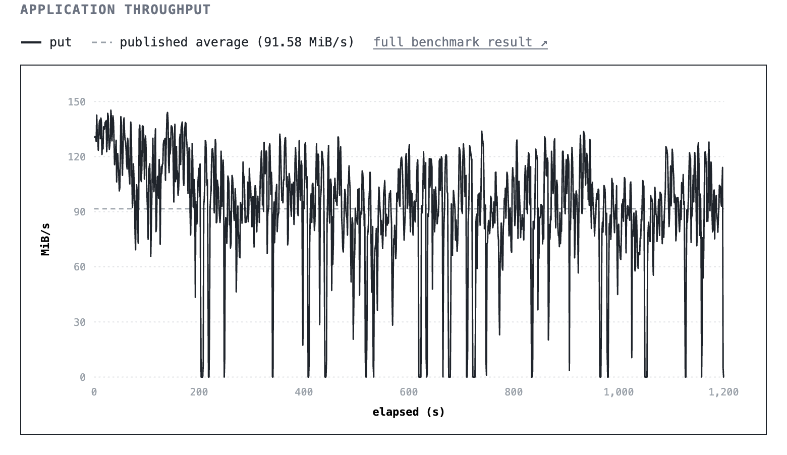
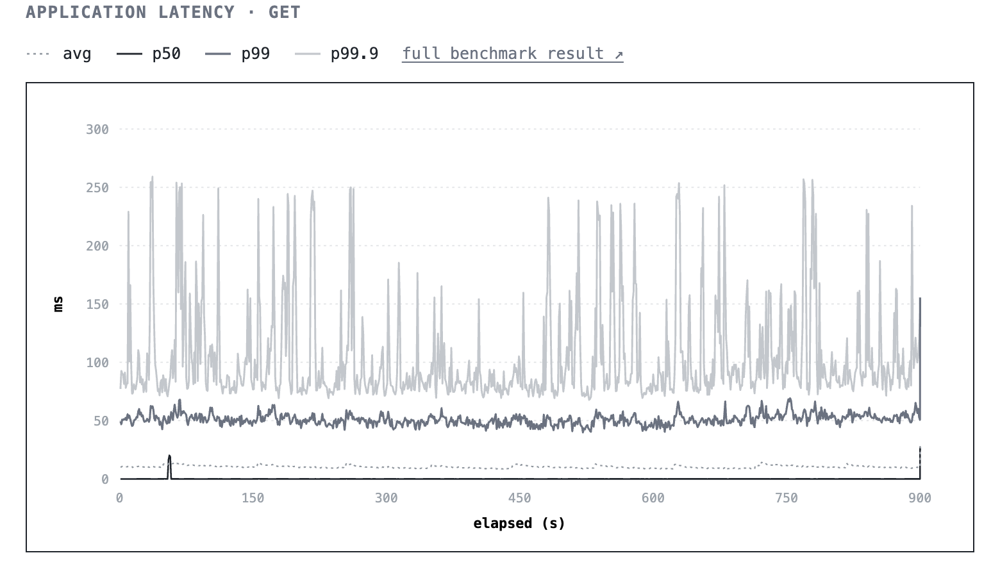

## Summary
[[SlateDB]] rebuilt its ignored microbenchmark and nightly-script setup into a public suite, automated workflows, and an inspectable results site. The methodology adapts YCSB and RocksDB `db_bench` workloads to an object-storage-native system and adds API-cost measurement, while deliberately retaining realistic cache and mixed-workload constraints rather than optimizing for a flattering comparison. The suite exposed network-routing instability, a missing compaction fast path, roughly US$40 per month of idle polling cost, and tail-latency spikes from fetching 4 MiB cache partitions for small reads, leading to concrete implementation and roadmap changes.

## Key Claims
- Public benchmarks should be discoverable and diagnostic, with readable results and regression visibility rather than output buried in CI summaries.
- The suite combines a standalone repository, GitHub Actions runs, and a public results site; it borrows common YCSB and `db_bench` workloads instead of attempting Tectonic's full operation, distribution, and dynamic-workload coverage.
- Cost belongs beside throughput and latency for an object-backed database because cache misses incur remote latency and metered API calls.
- Tests run on an AWS Graviton m8g.2xlarge in `us-east-1`, access same-region S3 and Tigris through its regional on-ramp, and keep roughly 10% of SlateDB's database in cache; the RocksDB comparison keeps its whole database on local disk.
- Public-internet routing and local cloud routing produced unstable tail latency and sawtoothed ingestion as SlateDB throttled writes; the sustained-ingest chart reports a 91.58 MiB/s average but contains repeated collapses toward zero across 1,200 seconds.

- The ingestion workload justified trivial moves: when ingested key ranges do not overlap, SlateDB can move data from L0 into the next sorted run without rewriting it. The benchmark disables the optimization to keep measuring baseline performance.
- Remote-style persisted-state polling made a default idle single-process deployment cost roughly US$40 per month in object-store API fees; in-memory local coordination, while preserving state for remote compactors, reduced the reported cost below US$5.
- A small-key miss in the object-store cache can fetch a 4 MiB partition, producing large p99.9 spikes in the balanced workload even while p50 remains near zero; SlateDB therefore distinguishes whole-database object mirroring from partial caching with smaller Foyer-managed units.

- The planned object-store mirror cache adds read-through, write-through, and write-back modes; Foyer remains the preferred partial cache because it supports eviction and smaller units, while ZeroFS demonstrates spatial-locality prefetching.

## Key Quotes
> "Throughput and latency matter, but SlateDB exists in part because object storage changes the economics of persistence."

> "A request for a small key can trigger a 4 MiB fetch from object storage."

## Connections
- [[SlateDB]] - object-storage-backed LSM tree whose performance, cost, compaction, and caching behavior the suite measures.
- [[StoragePerformanceBenchmarking]] - workload fidelity, cache state, topology, diagnostic visibility, and cost jointly determine what these results mean.
- [[ObjectStorageNativeDatabase]] - remote API pricing and cache-miss granularity are first-class consequences of using object storage as the durable substrate.
- [[DatabaseEngineeringTradeoffs]] - representative configuration, baseline comparability, throughput, latency, and cost cannot all be optimized independently.
- [[LatencyHierarchy]] - small logical reads can cross cache, network, object-store, and large-partition-fetch boundaries before returning.

## Contradictions
- The author explicitly calls the SlateDB-versus-RocksDB setup apples-to-oranges: SlateDB caches about 10% over remote object storage, whereas RocksDB keeps the entire database on local disk. The results characterize configured systems rather than intrinsic engine superiority.
- Mixed reads and writes share one task, so remote cache misses suppress write throughput; separating readers and writers or increasing parallelism would produce a stronger aggregate number but a less comparable workload.
- The benchmark disables the newly implemented trivial-move optimization, so its sustained-ingest result intentionally understates an available optimized path in order to preserve a baseline.
- The two retained charts diagnose instability and tail behavior but do not provide controlled before-and-after evidence for routing fixes, cache redesign, or trivial moves.
- Cost figures are first-party estimates for default settings and the tested providers. They omit request mix, pricing assumptions, storage and compute charges, tuned polling intervals, and independent reproduction.
- The article gives no statistical uncertainty, run-to-run variance, failure testing, durability overhead decomposition, or matched local-versus-object-store comparison.

## Image Notes
Both effective local PNG references were opened and retained at their semantic positions. The throughput chart supplies elapsed time, units, the 91.58 MiB/s average, and repeated near-zero collapses; the latency chart separates average, p50, p99, and p99.9 and shows that the largest spikes are concentrated in the extreme tail.
