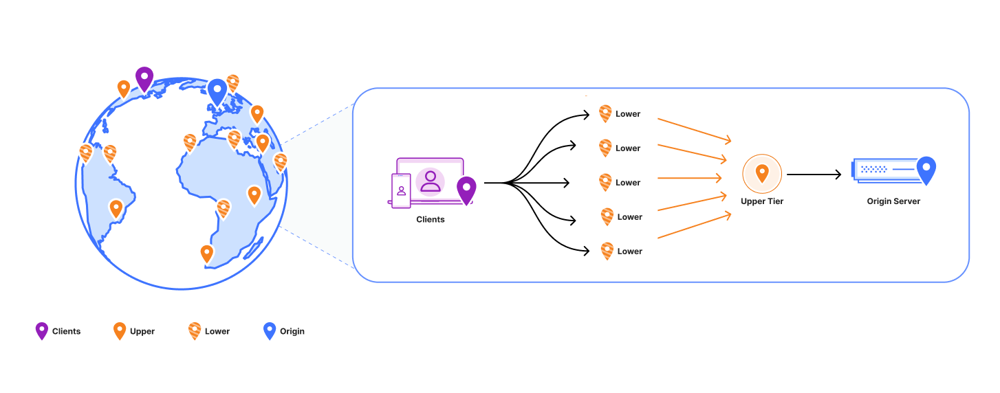
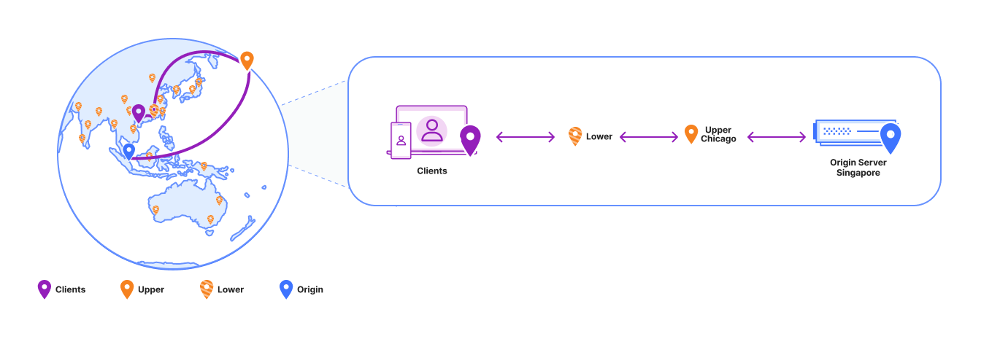
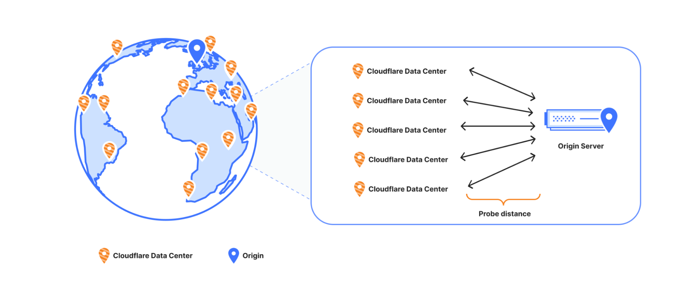
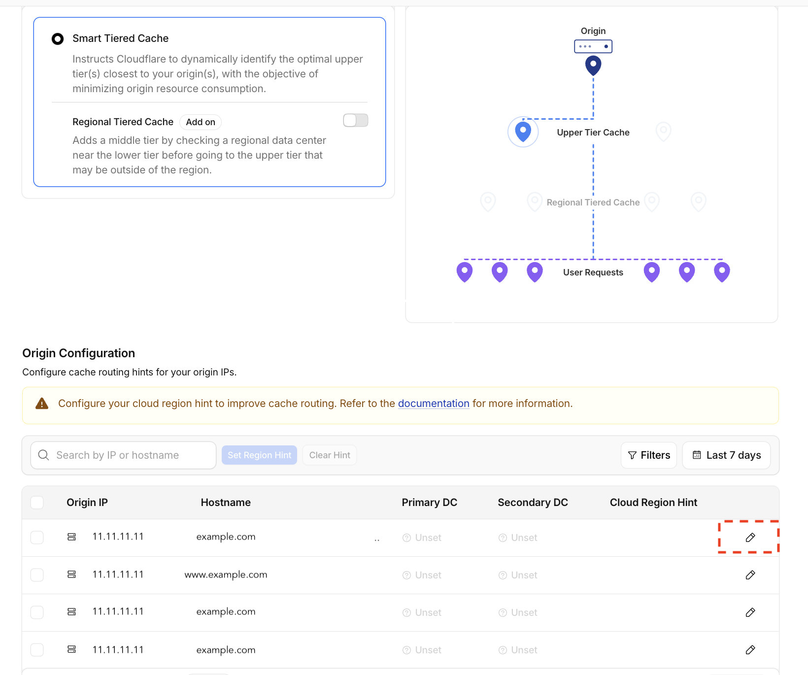
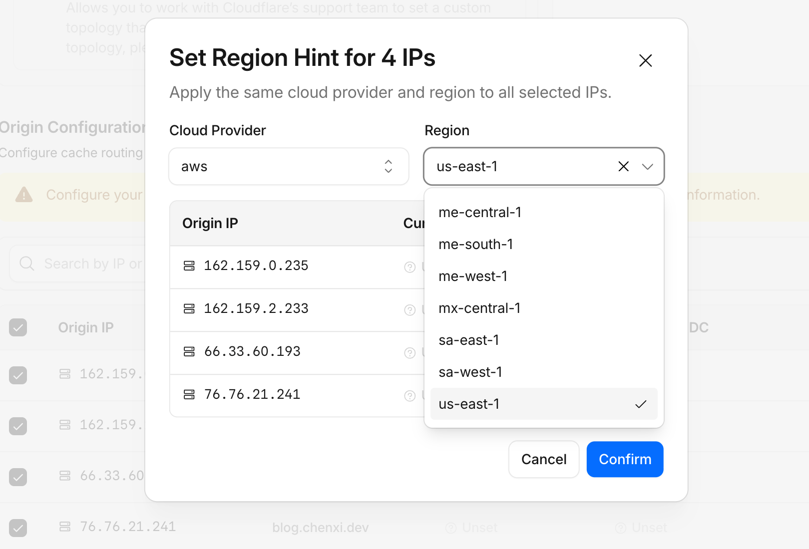
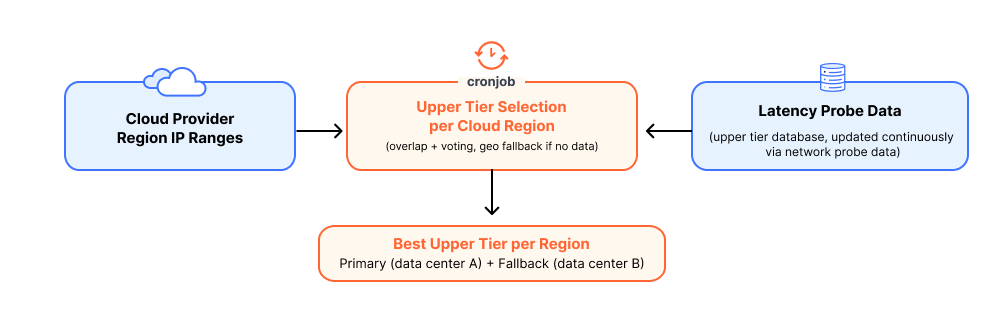

## Summary
[[ChenxiZhang]] explains how [[CloudflareSmartTieredCache]] uses customer-supplied public-cloud region hints to choose primary and fallback upper-tier caches when an origin's anycast or regional-unicast front end makes latency probes geographically ambiguous. The system combines frequently refreshed provider IP ranges with a continuously probed upper-tier database, weighted regional voting, separate-PoP failover, and a Tier 1 geographic fallback. The architecture aims to avoid cross-continent hairpinning and recover single-tier cache concentration, but the Cloudflare-authored launch post supplies no before-and-after latency, hit-ratio, origin-load, failover, or misconfiguration measurements.

## Key Claims
- A fixed unicast origin lets Smart Tiered Cache choose one low-latency upper tier, concentrating misses to improve cache reuse and reduce origin connections and pull latency.

- [[AnycastRouting]] and regional-unicast front ends can make one origin IP appear close to several Cloudflare data centers because probes terminate at different provider edges rather than identifying the backend's physical region.
- A misleading probe result can create geographic hairpinning: the illustrated Asia request travels through a Chicago upper tier before returning to a Singapore origin, adding two cross-ocean legs.

- Cloudflare detects likely anycast origins by comparing probe latencies from multiple checkpoints: if two origin paths are jointly faster than light in fiber could travel between the checkpoints, one fixed answering location is physically implausible.

- Without a confident single location, Smart Tiered Cache safely uses several upper tiers; this preserves tiered caching but distributes misses across more caches and can send more requests to the origin.
- For detected anycast origins, operators can assign a provider-region hint in the Origin Configuration table; the dashboard also exposes the selected primary and secondary data centers.

- Region hints can be bulk-applied to selected origin IPs and are also available through API and Terraform workflows.

- Every few hours, the system refreshes AWS, GCP, Azure, and Oracle Cloud IP ranges. Matching subnets vote, weighted by current upper-tier assignments from latency data refreshed every 15 minutes, to select a primary and a fallback in different PoPs; sparse-data regions use the closest Tier 1 PoP until probe evidence accumulates.

## Key Quotes
> "The IP address represents the cloud provider's front end, not a single physical origin location." - on why latency to an anycast address does not locate the backend.

> "Primary and fallback always come from different points of presence (PoPs), so losing one PoP can't take out both." - on the selected topology's failure boundary.

## Connections
- [[ChenxiZhang]] - Cloudflare author explaining the product change and its routing logic.
- [[Cloudflare]] - operator of the edge network, latency probes, cache tiers, dashboard, API, and provider-range ingestion pipeline.
- [[CloudflareSmartTieredCache]] - product extended with public-cloud region hints and separate-PoP fallbacks.
- [[AnycastRouting]] - shared-address behavior that makes frontend latency an unreliable proxy for backend location.
- [[AnycastDNS]] - another application of the same shared-address routing mechanism, used there for DNS availability and locality.
- [[NetworkLoadBalancing]] - upper-tier selection concentrates cache misses while anycast provider front ends distribute traffic before the backend.
- [[NetworkResilienceTradeoffs]] - single-cache concentration improves reuse while multi-tier fallback and distinct-PoP placement protect ambiguous or failed paths.
- [[AWS]] - one of the four launch providers whose region identifiers and IP ranges can supply routing context.

## Contradictions
- No direct contradiction was found. The article complements [[AnycastDNS]] by showing that anycast's locality and redundancy benefits can obscure the location of a backend behind the advertised address.
- The post is a first-party launch explanation. It does not quantify the prevalence of incorrect tier selection, the claimed hundreds of milliseconds of hairpin cost, cache-efficiency improvement, origin-load reduction, control-plane freshness, hint accuracy, fallback convergence, or customer outcomes.

## Image Notes
All seven local PNGs were opened. Six evidence-bearing topology, detection, configuration, and selection visuals were retained at their semantic positions; the generic stopwatch-and-cache cover illustration was omitted as decorative.
