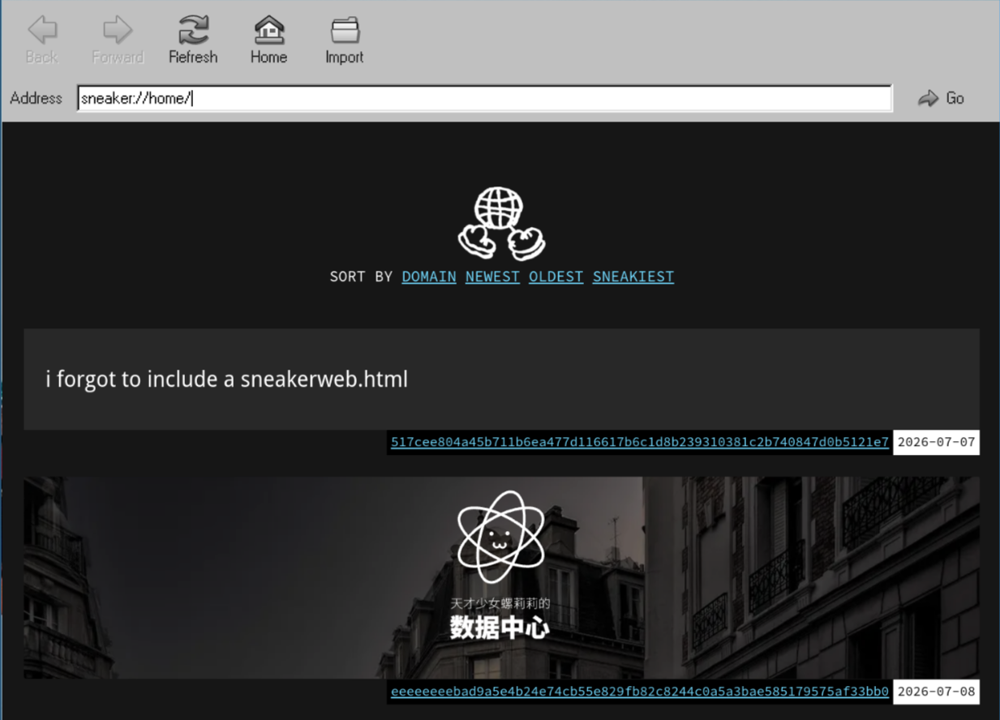

## Summary
[[RORIRI]] argues that service-hosted web content is fragile because continued access depends on servers, domains, subscriptions, licenses, intermediaries, and sometimes political permission. [[Sneakerweb]] is presented as an experimental response: publishers package a complete website into a signed SNK archive that readers can import, replay, retain, and later synchronize through physical media, local networks, or the internet, connecting [[OfflineWebDistribution]] with [[DigitalContentDurability]] and [[LocalFirstSoftware]].

## Key Claims
- El Paquete Semanal shows that people can distribute a useful, frequently updated offline content collection through hard drives and USB sticks when internet access is scarce, slow, or expensive.
- Web access does not guarantee preservation: hosting or domain lapse, author withdrawal, platform shutdown, licensing changes, censorship, and incomplete archival capture can all remove content.
- [[Sneakerweb]] lets a publisher package an already-built site as an SNK archive for direct import and browser-based replay instead of requiring each reader to crawl the site.
- The Willow data model is intended to support incremental, transport-independent synchronization over USB, Bluetooth, infrared, QR codes, local networks, or internet links, although the synchronization design and performance remain immature.
- Public-key-derived Sneaker addresses bind identity to signing keys without depending on expiring certificate-authority chains or renewable DNS names, at the cost of long, difficult-to-remember addresses.
- Compared with WACZ, crawler-based Kage, ZIP files, and Web Bundles, the author prefers Sneakerweb's publisher-generated whole-site experience, future synchronization path, stable address identity, and ability for archived sites to link to one another.
- Publishing an independently replayable archive transfers practical custody to readers: the author gives up some ability to retract access, while retaining copyright and accepting possible traffic loss.

The inspected screenshot shows Walky6 as a compact conventional browser shell with Back, Forward, Refresh, Home, Import, and Go controls; a `sneaker:` home location; sorting by domain, newest, oldest, or “sneakiest”; and locally listed site snapshots identified by long key-derived addresses and dates.

## Key Quotes
> “作为一种资源托管手段的互联网是相当脆弱的，我们需要一种能够把它固定下来的方法。” - on the gap between online availability and durable custody.

> “只要你得到了它，它就永远是你的。” - on a public-key-derived address that is not lost through domain non-renewal.

## Connections
- [[RORIRI]] - author and publisher of the first-person evaluation and Walky6 implementation.
- [[Sneakerweb]] - experimental package, replay, identity, and synchronization system at the center of the article.
- [[OfflineWebDistribution]] - broader pattern of moving complete web experiences without requiring continuous wide-area connectivity.
- [[DigitalContentDurability]] - separates temporary service access from reader-held, independently replayable custody.
- [[LocalFirstSoftware]] - Sneakerweb makes local replicas primary usable copies while keeping later synchronization optional and transport-independent.
- [[WebCentralization]] - publisher-generated portable archives offer a partial counter-model to access controlled by hosting, platforms, DNS, and certificate authorities.

## Contradictions
- The article is a first-person preference argument and prototype report, not an independent protocol audit or comparative usability, preservation, security, or performance study.
- Willow and Sneakerweb are described as drafts with poor current performance; incremental synchronization, true deletion, interoperability, recovery, key management, revocation, authenticity after compromise, and long-term renderer compatibility are not demonstrated.
- A stable public-key address removes domain renewal but does not ensure discoverability, human memorability, continued seeding, software availability, safe content, or preservation of external dependencies.
- Reader custody strengthens durability and resistance to withdrawal, but it can conflict with correction, privacy, consent, legal removal, malware response, and a publisher's legitimate need to retract harmful material.
- The proposed IPFS-backed subscription network and widespread peer serving are speculative. The author explicitly notes that ZeroNet failed to sustain mainstream adoption and identifies no proven demand advantage for Sneakerweb.
- The El Paquete Semanal access figures and current status are presented without citations in the supplied article and should be treated as source claims rather than independently verified measurements.

## Image Notes
The article's only image was downloaded and opened. It was retained because the Walky6 screenshot adds concrete interface and archive-state evidence not fully repeated in the prose.
