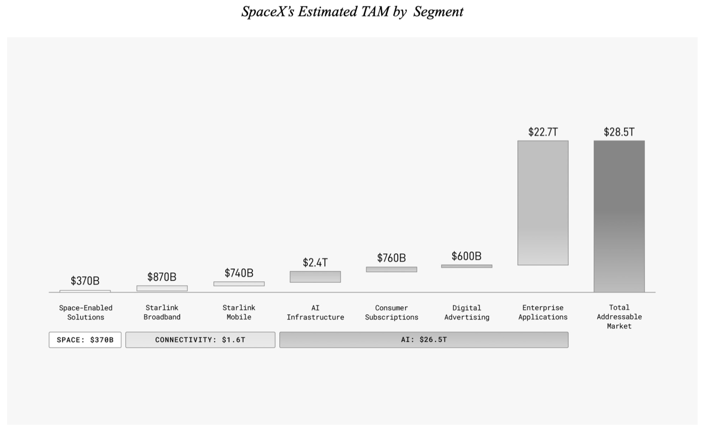

## Summary
[[BenThompson]] argues that [[SpaceX]] could turn launch scale, [[Starlink]] satellite infrastructure, and capital-market belief into a new business supplying orbital compute. The technical and economic case is explicitly conditional: rack-like satellites may suit latency-tolerant [[AgenticInference]], while terrestrial power and zoning constraints could eventually make [[SpaceBasedDataCenters]] valuable despite their engineering difficulty. Thompson still calls the proposed IPO valuation financially unjustified on current results, distinguishing a possible long-run market from a defensible present price.

## Key Claims
- Musk-led companies can use scale to change customer expectations and industry rules rather than merely compete within existing categories; Starlink's airline adoption is the article's current example.
- The filing's estimated $28.5 trillion addressable market is dominated by $26.5 trillion attributed to AI, far exceeding its combined space and connectivity estimates.

- A space data center need not reproduce a terrestrial campus: Thompson proposes disposable rack-sized satellites with onboard compute, solar power, radiator arrays, and laser interconnects.
- [[AgenticInference]] is the proposed workload fit because asynchronous computer-directed work can trade latency and peak accelerator speed for capacity, cheaper memory, and adequate compute.
- Terrestrial power and zoning constraints supply the economic “stick”: orbital capacity becomes more plausible if local opposition and scarcity raise the cost or cap the supply of Earth-based data centers.
- Capital-market belief can finance infrastructure before conventional financial models support it, but prior Musk successes do not remove the IPO's valuation and execution risk.
- The thesis depends on Starship, suitable chip supply, radiation tolerance, heat rejection, reliable inter-satellite networking, much larger compute demand, architecture change, and persistent terrestrial siting constraints.

## Key Quotes
> “what matters is if the dream is even possible” — Thompson's test for evaluating the speculative thesis.

## Connections
- [[BenThompson]] — author evaluating SpaceX through strategy, scale, workload architecture, and capital formation.
- [[SpaceX]] — prospective public company and integrated launch, connectivity, and compute platform at the center of the article.
- [[Starlink]] — operating satellite network used as evidence for launch scale, airline connectivity, laser links, and disposable orbital infrastructure.
- [[ElonMusk]] — founder whose brand, risk appetite, and capital-market narrative connect Tesla and SpaceX in Thompson's argument.
- [[Tesla]] — comparison case for premium brand formation, autonomy-led differentiation, scale, and investor-funded infrastructure.
- [[SpaceBasedDataCenters]] — core proposal to distribute compute across rack-like orbital satellites.
- [[AgenticInference]] — latency-tolerant workload Thompson identifies as the strongest prospective use case.
- [[AIInfrastructureFinancing]] — adjacent framework for separating useful infrastructure, funding structure, utilization, and valuation risk.

## Contradictions
- The article does not directly contradict an existing wiki claim, but it sharply qualifies treating ambitious total-addressable-market figures or past founder success as present valuation evidence.
- Its space-compute case also qualifies terrestrial-data-center assumptions: power and zoning may create a genuine alternative market, while Earth remains cheaper and easier if those constraints do not bind.
- All company financials, filing figures, hardware estimates, future market sizes, and engineering comparisons are source-reported and were not independently verified during ingestion.
