## Summary
Victor Ostromoukhov unifies [[ArtisticHalftoning]], [[MulticolorDithering]], and [[DigitalEngraving]] as variations on controllable threshold structures rather than purely mechanical tone-reproduction methods. The paper replaces simple repeated dots with interpolated contours, allocates nonstandard inks side by side through cumulative color thresholds, and builds facial engravings by warping and merging feature-following layers. Its diagrams show that the same technical substrate can encode tone, cultural or security information, and artist-directed line structure, while print physics and perception still require local equilibration.

## Key Claims
- [[ArtisticHalftoning]] can carry a second semantic layer by interpolating artist-authored contours across intensity levels, rasterizing each level in advance, and nonlinearly mapping screen tiles into the rendition plane.

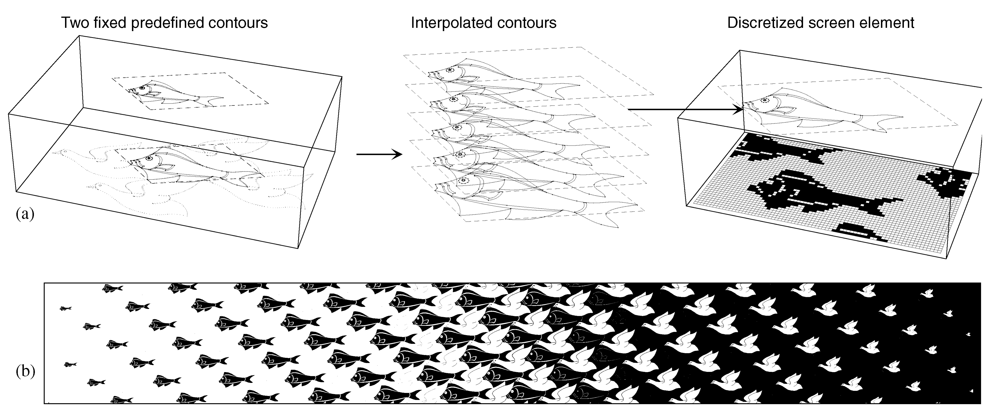

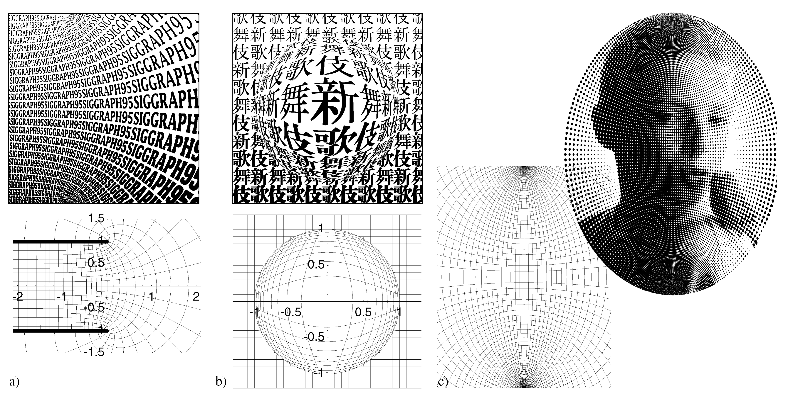

- Large, nonrepetitive artistic screens can embed image-related motifs or microletters; the illustrated banknote replacement makes SIGGRAPH95 lettering form the portrait tones and would introduce Moire artifacts when conventionally rescanned.

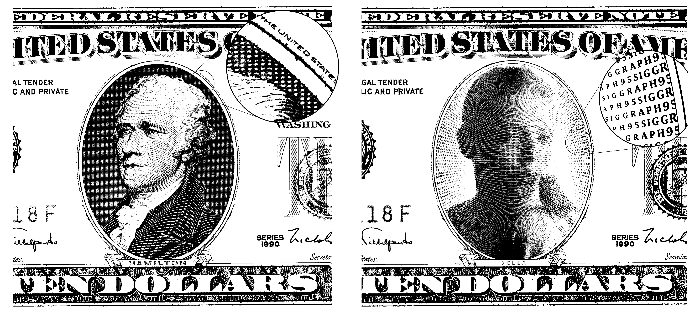

- [[MulticolorDithering]] compares a single threshold function with cumulative barycentric color amounts, selecting exactly one basic color at each output location and therefore enforcing side-by-side rather than overlapping coverage.

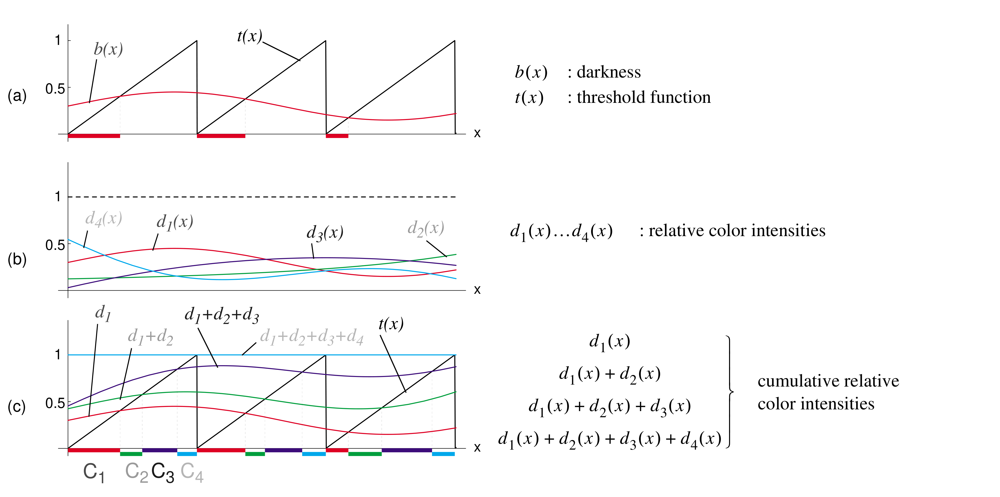

- Tetrahedral color separation supplies four neighboring basic colors and their barycentric coefficients; the illustrated RGB wedge crosses six tetrahedra while every rendered cell contains nonoverlapping basic-color dots.

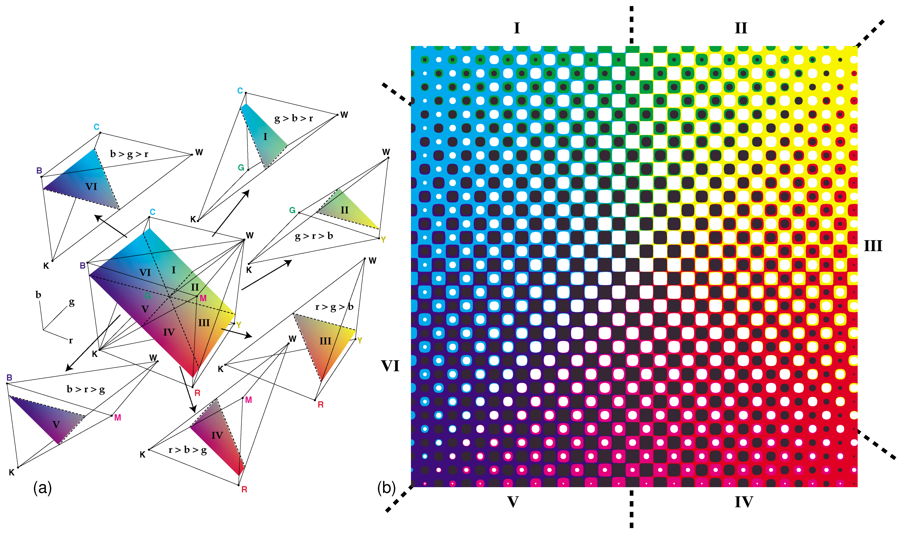

- Mixing continuous motive thresholds with randomized background thresholds keeps a letter-shaped screen recognizable over a wider darkness range, although dot gain can reduce the advantage at high coverage.

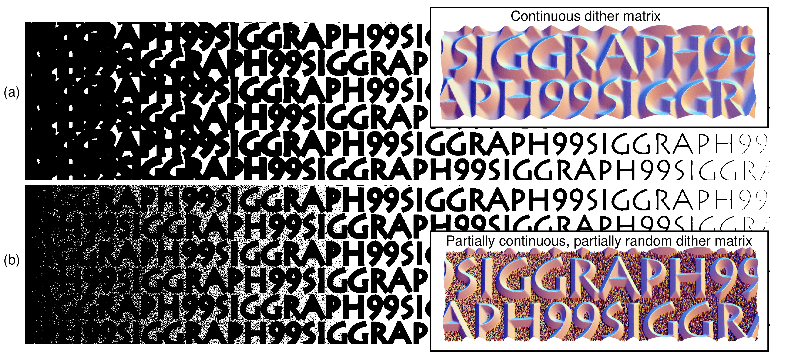

- [[DigitalEngraving]] treats a virtual copperplate height field as a dither threshold matrix: different cuts expose different furrow widths, and ordinary threshold comparison turns those widths into printable lines.

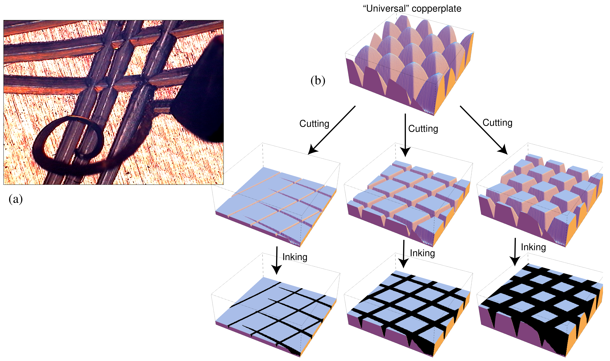

- Feature-following engraving begins with a regular threshold-wave layer in parametric space and warps it into a four-boundary patch in image space.

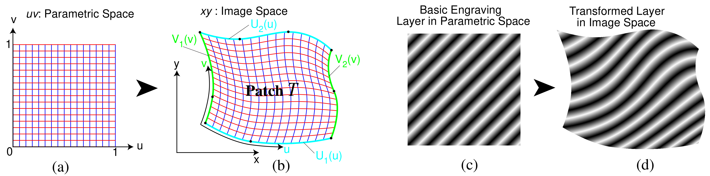

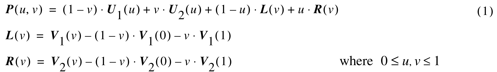

- Sequential copy, minimum, maximum, multiply, and add operations merge threshold layers; the minimum and maximum rules produce complementary cross-etching behavior, while range shifts can restrict a layer to selected tonal bands.

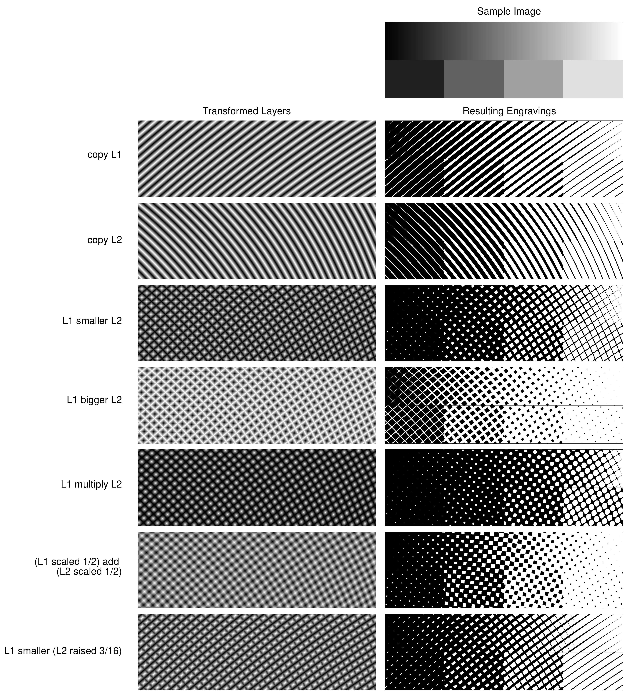

- An engraving style consists of reusable warped layers, range-shift masks, scale masks, and merge rules. In the five-layer example, face, eye, cheek, hair, and background grids accumulate into a coherent portrait while abrupt or smooth mask boundaries control their junctions.

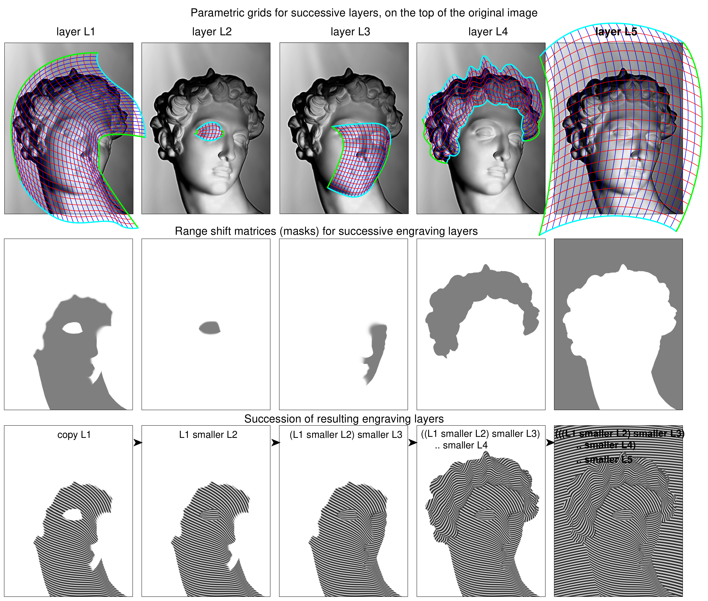

- Cross-hatching, mixed minimum and maximum rules, and simulated mezzotint expand the expressive vocabulary; the figure compares the stochastic digital texture with a microphotograph of a real aquatint plate.

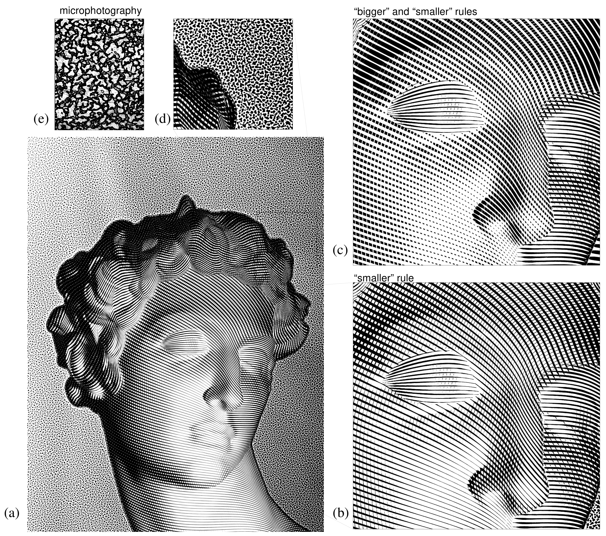

- Real portraits can emphasize weak features through local layers and abrupt changes of line orientation or frequency; local equilibration compensates elsewhere so the added line does not necessarily darken the region overall.

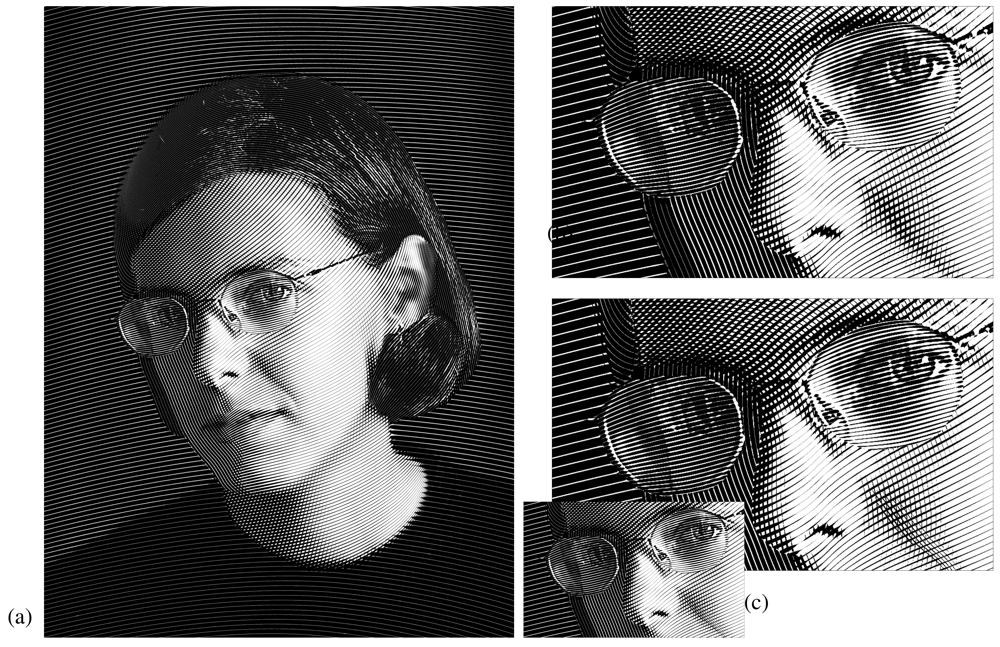

## Key Quotes
> "the art of digital copperplate engraving may be resumed as the art of building appropriate threshold structures" - the paper's unifying technical analogy.

## Connections
- [[VictorOstromoukhov]] - author synthesizing earlier artistic screening, multicolor dithering, and facial engraving work.
- [[ArtisticHalftoning]] - contour-driven screen design that makes the halftone layer carry recognizable form and information.
- [[MulticolorDithering]] - cumulative-threshold allocation of nonoverlapping basic colors, including opaque and special inks.
- [[DigitalEngraving]] - feature-following, layered threshold construction for simulating copperplate engraving.

## Contradictions
- No direct contradiction with an existing wiki page was found.
- The paper demonstrates mechanisms and visual examples but provides little quantitative comparison, no user study of aesthetic or security effects, and no independent replication.
- The color method assumes in-gamut inputs and explicitly leaves full printer calibration outside scope; dot gain, registration, ink density, and perceptual filtering can materially change output.
- The engraving workflow still depends on artist-authored contours, patches, masks, merge choices, and portrait preprocessing, so it does not establish automatic photo-to-engraving conversion.
