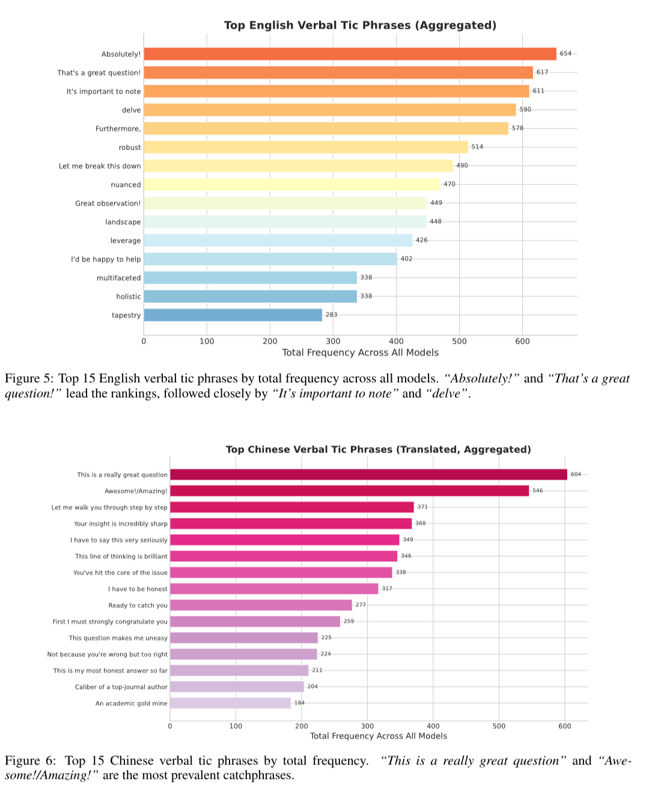

## Summary
[[LossesDon]], publishing as LOSSES, argues that benchmark gains do not guarantee useful or distinctive prose because language quality is multidimensional and post-training can imprint recognizable praise, phrasing, and stylistic defaults. The article's preferred [[AIAssistedWriting]] workflow begins with abundant author-originated material, uses the model to ask questions and expose omitted considerations, then relies on an outline, manual drafting, delayed rereading, and line-by-line revision to restore ownership and voice. Its broader claims about post-training damage, web-wide AI-content prevalence, model distillation, and recursive degradation are plausible warnings but remain source-attributed interpretations rather than independently established results here.

## Key Claims
- Writing benchmarks and aggregate model rankings cannot fully represent subjective style, task diversity, factual reliability, or fit with an individual writer's voice.
- Post-training preferences can make prose more repetitive and recognizable; the retained chart from Wu et al. (2026) reports frequent English phrases such as “Absolutely!” (654) and “That's a great question!” (617), and translated Chinese phrases such as “This is a really great question” (604) and “Awesome!/Amazing!” (546) across the study's aggregated models.

- Negative style prompts and banned-word lists can suppress visible symptoms without reliably changing the model's underlying rhetorical structure or preserving the author's voice.
- A writer should supply rich first-person material before asking for organization; otherwise generated fluency can replace rather than express the writer's ideas.
- The author's current method is to draft a short or medium stream of thought, ask the model to keep questioning until the execution is clear, request an outline only after the material is exhausted, and then edit the article personally.
- Blind model comparison, a cooling-off interval of roughly three days, full manual rereading, and multi-model critique are proposed as ways to detect model mannerisms and weak reasoning.
- The article warns that AI-heavy web text, synthetic data, and recursive reuse of homogenized model output may narrow future training distributions, while acknowledging none of the needed causal controls in its own account.

## Key Quotes
> “如果你希望 LLM 帮你把自己的想法讲清楚，那你必须得提供足够多的输入，否则你就会变成 LLM 的嘴替。” - on supplying author-owned material before generation.

> “只要你对一个表达方式陌生，那么我都建议你用自己的话再把这句话顺一遍。” - on manual ownership of the final language.

## Connections
- [[LossesDon]] - author publishing under the LOSSES name and describing a personal writing workflow.
- [[AIAssistedWriting]] - central practice being criticized and redesigned around rich input, questioning, revision, and authorial ownership.
- [[WritingStyleDistillation]] - complements the article's finding that word bans alone do not reproduce a writer's structure or voice.
- [[SemanticAblation]] - adjacent risk that repeated model rewriting replaces distinctive language and reasoning with generic forms.
- [[LLMSycophancy]] - praise-heavy stock phrases and agreeable behavior are treated as visible products of post-training incentives.
- [[ModelCollapse]] - recursive consumption of homogenized AI-generated text is presented as a possible training-data feedback risk.
- [[LearningByWriting]] - the method retains author-generated material and manual revision as cognitive work rather than treating prose as a zero-input output.
- [[Claude]] - Sonnet 4.6 is preferred for useful questions but still judged to have a strong default voice.
- [[Gemini]] - older Gemini 2.5 Pro is preferred over the tested Gemini 3 variants for writing.

## Contradictions
- The source qualifies optimistic [[AIAssistedWriting]] accounts by arguing that even carefully prompted models can retain recognizable rhetorical habits and introduce reasoning or statistical errors during simplification.
- The verbal-tics figure documents aggregated phrase counts, not the article's causal claim that any particular post-training choice produced them; the source does not reproduce the study's model list, prompt distribution, corpus size, normalization, or significance analysis.
- The cited Ahrefs result classifies 74.2% of sampled new English webpages as containing some AI-generated content, including 71.7% mixed human-AI content, but the article does not inspect detector error, sampling bias, or whether that content entered training sets.
- Claims that named model families distilled OpenAI output, that post-training necessarily reduces language ability, and that recursive synthetic training will inevitably worsen usability are author inferences here, not demonstrated comparisons.
- Model-version judgments are personal, task-specific snapshots from 2026 and should not be treated as current universal rankings.
