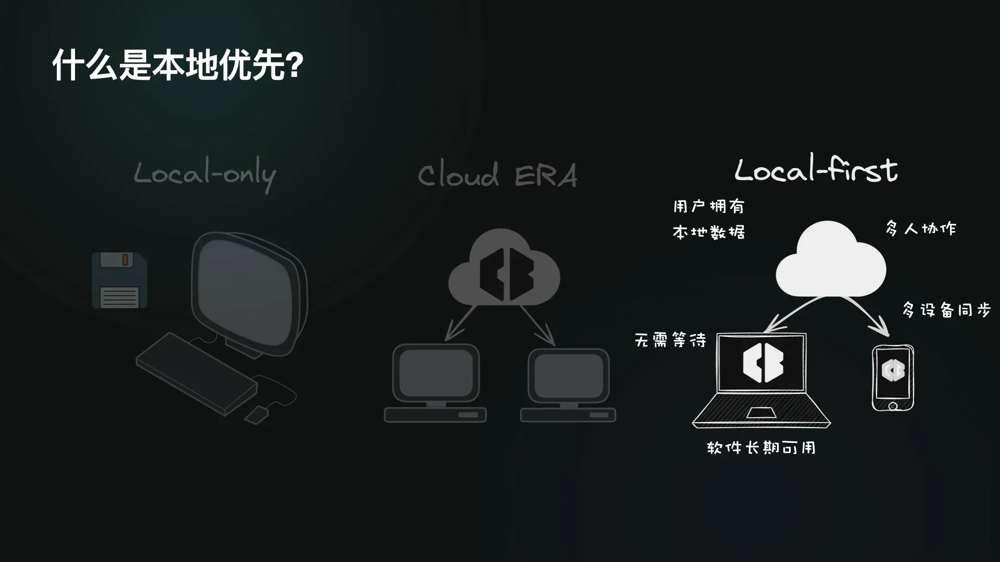
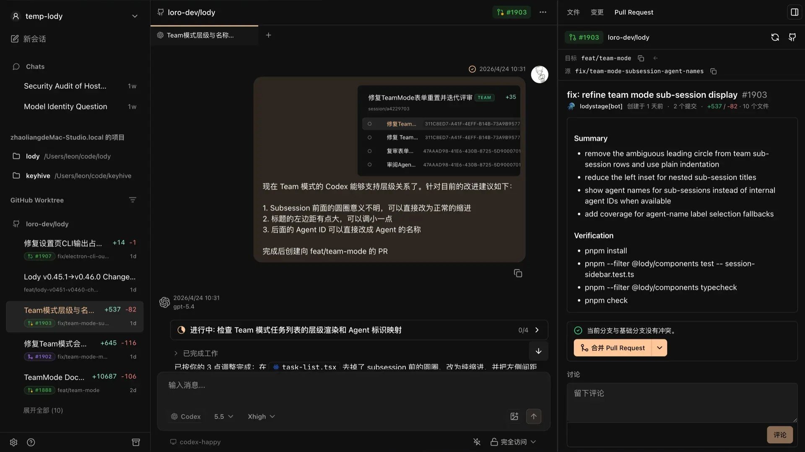
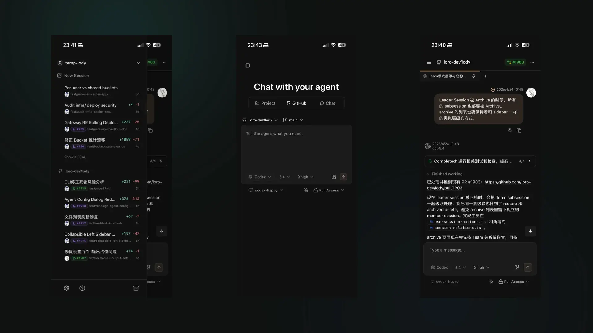
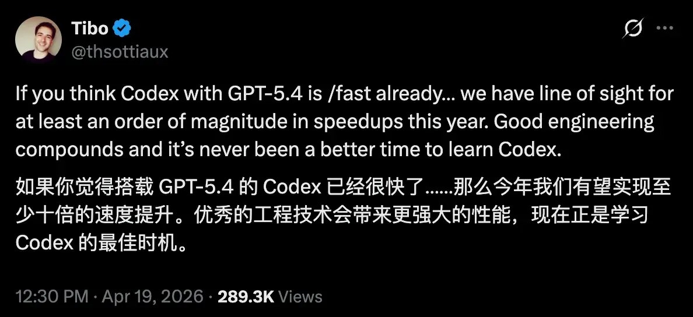

## Summary
[[LeonZhao]] presents [[Lody]] as a desktop, web, and mobile control plane for coding agents running on user-controlled machines. The current product combines synchronized conversations, agent-only Git worktrees, model switching, diffs, pull requests, and CI visibility, while its roadmap uses [[Loro]] to turn fragmented team context into local-first, versioned, reusable data. The longer-term proposal is a context-aware [[AgentTeam]] leader that routes work among heterogeneous models and automates increasingly verifiable development loops.

## Key Claims
- [[Loro]] is a CRDT framework for business-independent conflict merging, eventual consistency, version history, end-to-end encryption, and local-first data ownership; identical operation sets converge even when the chosen merge does not match human intent.

- [[Lody]] controls coding-agent CLIs across desktop, web, and mobile clients; its desktop interface exposes Chat, Local Project, and GitHub Worktree sessions alongside conversation progress, files, changes, pull requests, and model selection.

- Agent-only worktrees isolate parallel tasks and let Lody create, refresh, and reclaim branches, while the human keeps one ordinary local workspace and pulls agent changes for testing.
- Multi-device, offline-first synchronization separates the control surface from the execution machine, allowing work to continue through a temporary mobile-network outage and resynchronize later.

- Lody uses ACP to integrate several coding CLIs and models, treating model choice as task-specific and preserving conversations, diffs, PR state, and CI results as inspectable development context.
- The planned workspace would structure PRDs, research, designs, discussions, decisions, conversations, and code history as a local-first “Git for context” that new agent sessions can retrieve and inherit.
- The planned [[AgentTeam]] uses a leader to decompose intent, route UI, logic, review, search, and small tasks to different models, and automate verifiable steps as agent execution becomes faster.

## Key Quotes
> “代码在 Git 里，但真正的上下文散落在各处。” — on the gap between versioned code and fragmented product or decision context.

> “这些对话才是真的源代码，而且是可以交互的源代码。” — on treating coding-agent history as a reusable explanation of why and how software changed.

> “拥有 context 的前提下，你就拥有了最懂你们团队的 Agent Leader。” — on the proposed relationship between durable workspace context and orchestration.

## Connections
- [[LeonZhao]] — speaker and co-founder describing Lody and Loro.
- [[Lody]] — current product and future team workspace at the center of the talk.
- [[Loro]] — CRDT and local-first data layer underlying Lody's synchronization and context roadmap.
- [[LocalFirstSoftware]] — data-placement and synchronization model used to combine user custody with cross-device collaboration.
- [[AgentTeam]] — future heterogeneous-model orchestration model proposed for development workflows.
- [[LLMContextManagement]] — fragmented decisions and conversations are treated as retrievable, versioned agent context.
- [[AgentSystemTransparency]] — per-turn diffs, files, PRs, CI results, and conversation sharing provide operator visibility.
- [[ClaudeCode]] — one of the coding agents and model families discussed in the multi-model workflow.

## Contradictions
- This is a founder-authored product talk, not a comparative evaluation. It reports no task-success, synchronization-conflict, latency, uptime, security, privacy, defect, review-cost, or team-productivity measurements.
- The desktop and mobile product behavior is presented as current, while automatic historical-context retrieval, the full lifecycle workspace, heterogeneous agent routing, and an agent leader that closes verification loops are roadmap claims.
- CRDT convergence does not guarantee intent-correct conflict resolution, and the source explicitly acknowledges that distinction. Claims about end-to-end encryption and user ownership lack a protocol description, threat model, key lifecycle, or independent audit.
- The homogeneous-multi-agent result is cited secondhand and the speaker himself questions the cited paper's evidence. Heterogeneous routing is therefore a plausible design hypothesis rather than demonstrated superiority.
- The tenfold speed premise comes from a point-in-time social post about a possible 2026 improvement, not a benchmark or delivery commitment; faster task completion would not by itself remove planning, integration, or verification bottlenecks.
- All 16 unique remote images were opened. Four evidence-bearing topology, product-interface, and external-post images were retained at their semantic positions; the cover, section dividers, repeated summary cards, and prose-redundant slides were omitted, including one duplicate image reference.
