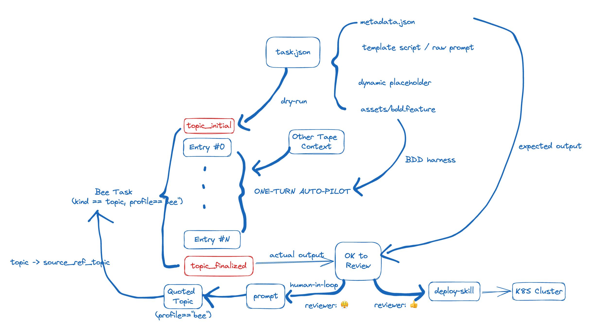
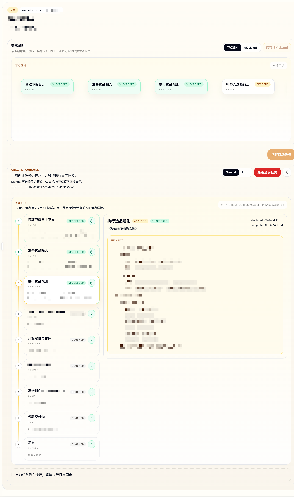

## Summary
[[PsiACE]] extends [[AgentTopicLifecycle]] into [[AgentTaskOrchestration]] through Bee, a Topic profile for bounded Job and Cron work. Bee describes a task as a human-maintained Skill plus DAG metadata, private configuration, BDD-style completion criteria, a workspace-local runtime state file, Tape-backed execution history, and an external executor such as Kubernetes or Argo Workflows. Frequent DAG anchors record node and whole-workflow progress so an agent can resume or retry without replaying one oversized context window, while human review remains a gate before revision or deployment.

## Key Claims
- Existing CI, Job, Cron, container, and scheduler infrastructure should execute agent workloads rather than being replaced by a new agent-specific scheduler.
- A Bee is a specialized Topic whose goal, boundaries, Turn sequence, final summary, and embedding index make a long-running task both executable and recallable.
- Bee templates combine `metadata.json` DAG structure, `config.toml` private configuration, a business-facing `SKILL.md`, and BDD `.feature` files that define observable node-completion criteria.
- Runtime `task.json` exposes the DAG state to the UI, while [[TapeAndAnchors]] preserves the agent's entries, node results, and final Topic range as the durable execution record.
- A DAG node can be retriggered after editing its Skill, letting human review and iterative alignment occur at milestone boundaries rather than only after the entire task.
- Kubernetes Jobs or CronJobs and Argo Workflows can supply scaling, resource control, isolation, audit, DAG execution, and operational tooling, with namespaces, service accounts, and Topic labels limiting each workload.
- Frequent DAG anchors summarize task initialization, node start and finish, external-call results, whole-DAG checkpoints, and finalization so retries can reason from recorded progress instead of restarting blindly.

## Key Quotes
> "为什么换到 agent 时代，我们就需要重新发明一套所谓『用于给 agent 任务调度的调度器』？" — argument for reusing existing schedulers.

> "DAG Anchor 牺牲了一些存储上的冗余，来换取了更清晰的思考和重新过程。" — tradeoff behind frequent workflow checkpoints.

## Connections
- [[PsiACE]] — author describing the Bee implementation and its relationship to the earlier Topic proposal.
- [[AgentTaskOrchestration]] — source's central pattern for template-defined, DAG-shaped, reviewable agent work over existing infrastructure.
- [[AgentTopicLifecycle]] — Bee is implemented as a Topic profile and returns its completed task to the same bounded Tape lifecycle.
- [[TapeAndAnchors]] — entries preserve execution history while DAG anchors record finer-grained node and workflow state.
- [[LLMToolingSkills]] — each Bee carries a business-facing Skill, and deployment or executor access is also exposed through Skills.
- Behavior-driven development (BDD) — `.feature` files provide harder observable completion criteria than prose instructions alone.
- [[Kubernetes]] — reused as the workload isolation, resource-control, audit, and execution substrate.
- [[AgentResumability]] — node and DAG checkpoints make retry decisions more informed, although they do not by themselves make external effects idempotent.

The architecture diagram shows `metadata.json`, a template prompt, dynamic placeholders, and a BDD harness constraining a one-Turn autopilot. Actual output reaches an explicit review gate: rejection creates a prompt and quoted Bee Topic for another pass, while approval invokes a deployment Skill targeting a Kubernetes cluster.

The product screenshot makes the milestone model concrete. Four early nodes are succeeded or pending, later nodes are blocked by dependencies, and the console exposes manual versus automatic progression, per-node replay, details for the selected node, and an explicit task-termination control.

## Contradictions
- No direct contradiction was found. The source specializes [[AgentTopicLifecycle]] and complements [[AgenticWorkflowPatterns]] by combining a predetermined DAG with agent implementation inside each node.
- BDD criteria reduce reliance on soft prompting but do not prove semantic correctness; an agent can still satisfy incomplete or poorly specified scenarios.
- `task.json` plus Tape checkpoints create two state representations whose consistency and recovery behavior are not evaluated. DAG anchors improve contextual retry but do not establish idempotency, exactly-once execution, rollback, or compensation for external side effects.
- The evidence is a first-party architecture and UI example without task-success, failure-recovery, cost, latency, concurrency, security, audit, or human-review measurements. The author also says the OpenClaw and Hermes comparison was AI-summarized rather than based on reading their code.
