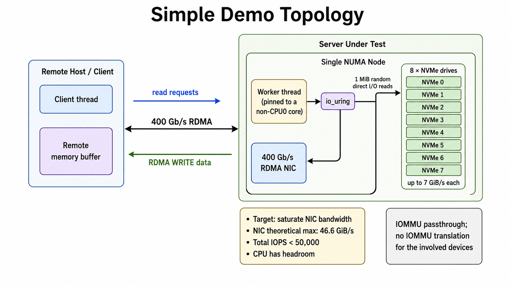
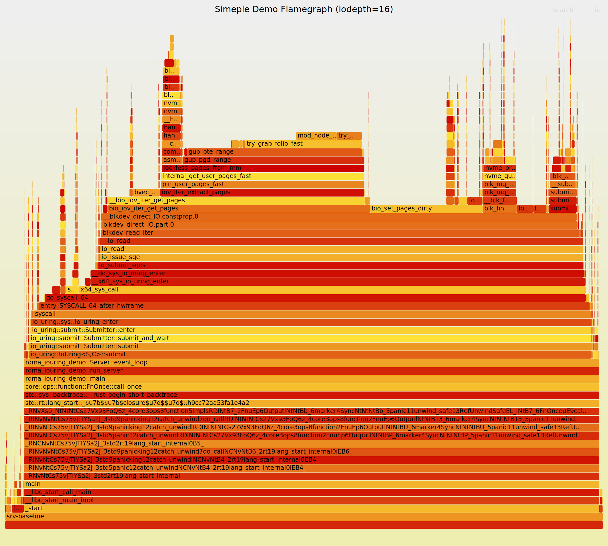
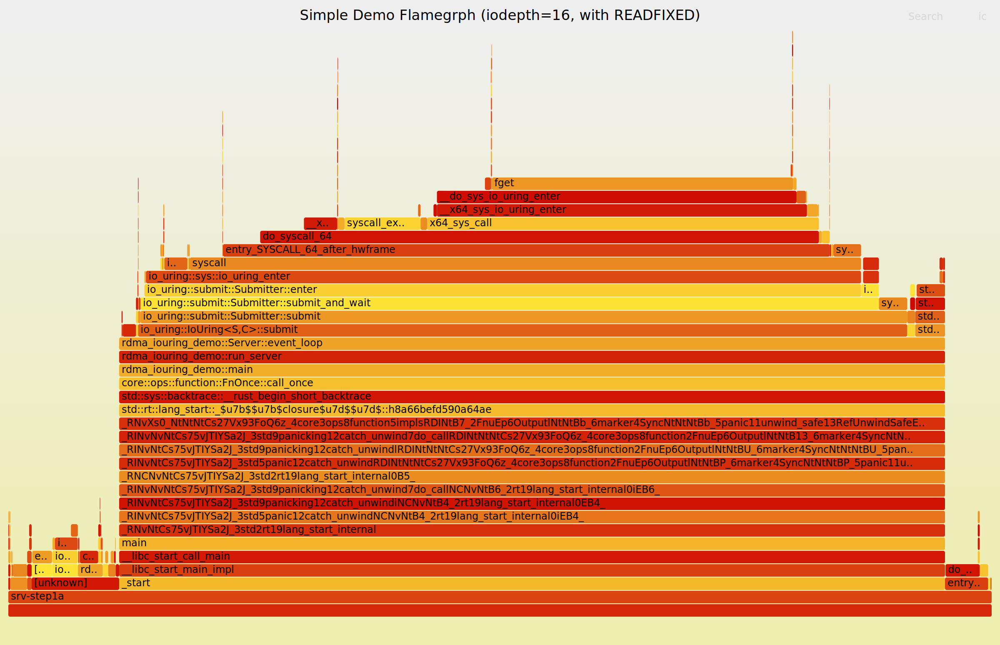
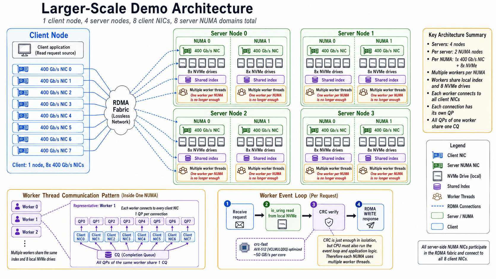
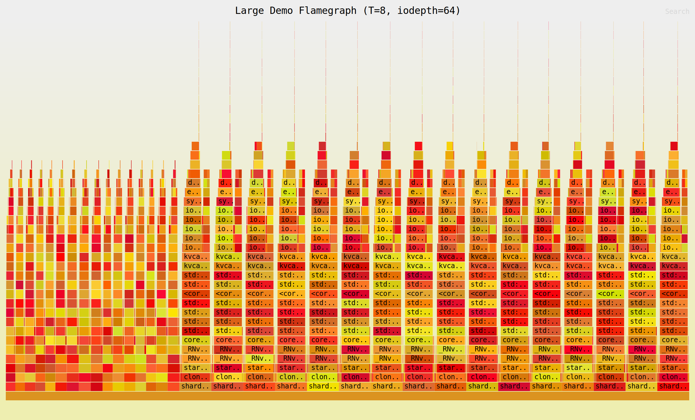
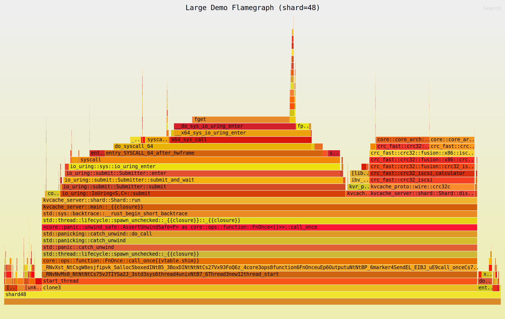
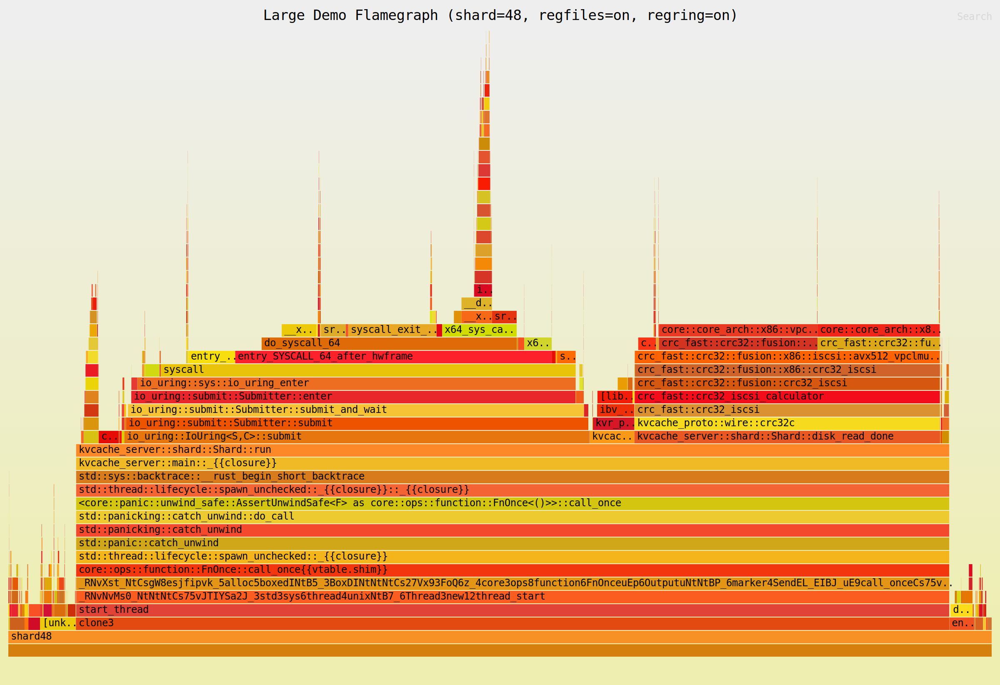

## Summary
This case study follows two distinct throughput limits in an NVMe-to-RDMA path. Registered io_uring buffers move page discovery and pinning out of the per-request path, raising a single 400 Gb/s NIC test from roughly half bandwidth to 46.0 GiB/s; at larger scale, controlled experiments show that scanning 1,028 KiB buffers backed by 4 KiB pages—not CRC arithmetic, io-wq, request splitting, or file-descriptor lookup—creates dTLB pressure, while 1 GiB hugepages restore roughly 348–351 GiB/s with CRC enabled. The episode links [[HighThroughputIOOptimization]] and [[StoragePerformanceBenchmarking]] to [[BottleneckAwareAICoding]]: an agent found an effective hugepage change before it could supply the causal evidence.

## Key Claims
- In the single-thread demo, ordinary direct-I/O reads force the kernel to discover, pin, dirty, and unpin hundreds of 4 KiB pages per 1 MiB request; the baseline plateaus near 22 GiB/s while one CPU reaches full utilization.

- Registering a 64 MiB arena as 64 fixed 1 MiB buffers and using `READ_FIXED` removes most repeated buffer-preparation work: at queue depth 64, measured throughput rises from 22.15 to 46.00 GiB/s and nearly saturates the NIC.

- The scaled topology has one client with eight 400 Gb/s NICs and four dual-NUMA servers; each NUMA shard owns one NIC and eight NVMe drives, while several pinned workers share the local index and devices and verify CRC before RDMA WRITE.

- Fragmented 4 KiB backing turns one 1,028 KiB read into about 257 scatter-gather segments and three bios under `max_segments=128`, triggering io-wq handoff; however, queue waits near 8 µs, fewer than one runnable io-wq worker on average, shallow disk queues, and an unchanged 211.2 GiB/s after forcing five splits per read rule this mechanism out as the throughput wall.

- Registered files and a registered ring remove most `fget` overhead without changing throughput, and the remaining `io_uring_enter` cost is predominantly an idle busy-poll path rather than evidence of CPU saturation.

- Disabling CRC raises throughput to roughly 306 GiB/s, but replacing it with a computation-free 64-byte-stride scan falls back to about 209 GiB/s; therefore reading across the buffer, not checksum arithmetic, reproduces the limit.
- Hugepages reduce measured dTLB load misses from roughly 81–89 per GET to about 5 while preserving high L1D miss counts, and raise CRC-enabled aggregate throughput from about 210–211 GiB/s to 348–351 GiB/s. This directly implicates address translation rather than cache-line fetching alone.
- An optimization is not a causal explanation: the agent suggested hugepages early and achieved the target, but performance counters and discriminating controls were still required to explain why it worked.

## Key Quotes
> "READ_FIXED removed the repeated kernel-side cost of discovering and pinning user pages, but it did not change what the CPU had to pay when the application later scanned the data."

> "It could produce the answer, but not the full chain of reasoning that leads to it."

## Connections
- [[HighThroughputIOOptimization]] - distinguishes per-I/O buffer-registration overhead from later CPU address-translation cost.
- [[StoragePerformanceBenchmarking]] - uses topology controls, queue depth, throughput and tail latency, flamegraphs, iostat, synthetic substitutions, and hardware counters to localize the limiting resource.
- [[BottleneckAwareAICoding]] - shows an agent reaching the performance target while misidentifying the mechanism.
- [[ServiceObservability]] - flamegraphs, io-wq timing, runnable-thread counts, block-queue statistics, and perf counters progressively eliminate hypotheses.
- [[LatencyHierarchy]] - connects application scans to TLBs, page walks, cache behavior, kernel submission, storage, and RDMA.
- [[SoftwareVerification]] - controlled counterfactuals verify the optimization mechanism rather than accepting a plausible explanation.

## Contradictions
- The result qualifies the idea that `READ_FIXED` or io_uring alone makes a high-throughput data path efficient: fixed buffers remove recurring kernel metadata work but do not improve CPU translation locality when the application later scans scattered 4 KiB pages.
- Large flamegraph frames are not automatically bottlenecks. Removing `fget` changes the profile but not throughput, while busy polling can consume samples precisely because the worker has idle cycles.
- Hugepages are an effective remedy in this controlled, NUMA-local workload, not proof that they universally improve storage systems; page size, arena allocation, access pattern, hardware TLBs, memory pressure, and deployment constraints determine the result.
- Measurements come from one first-party implementation and hardware configuration. The source does not provide code, independent reproduction, confidence intervals, energy cost, or behavior under writes, failures, mixed workloads, or multi-tenant contention.
