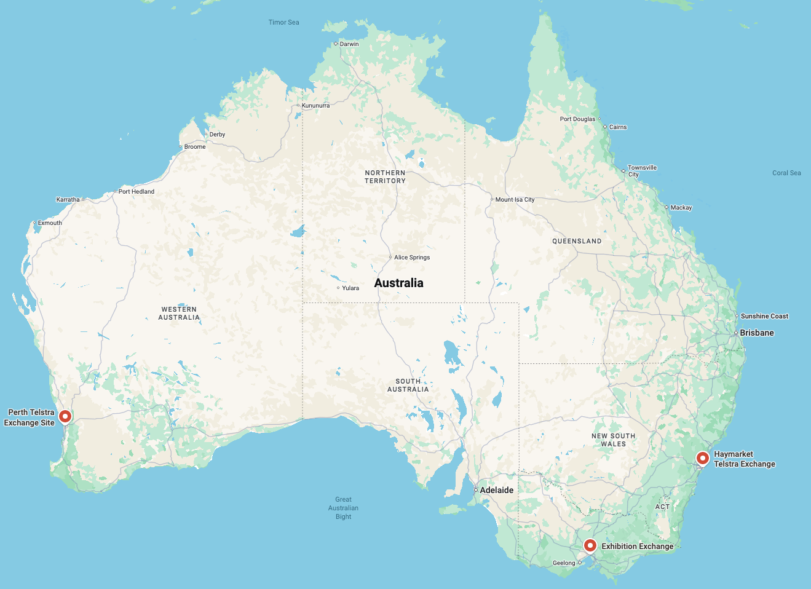
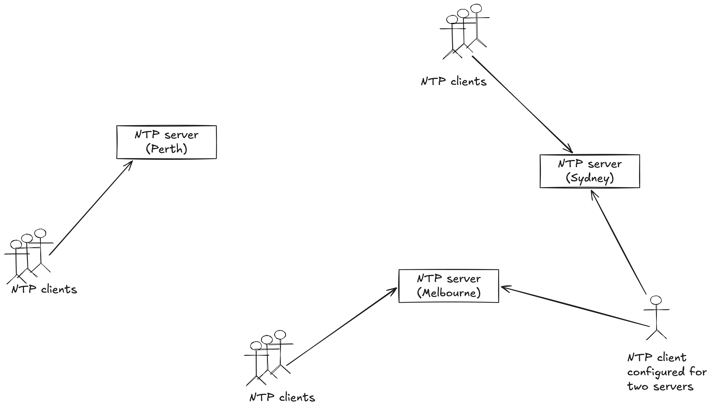
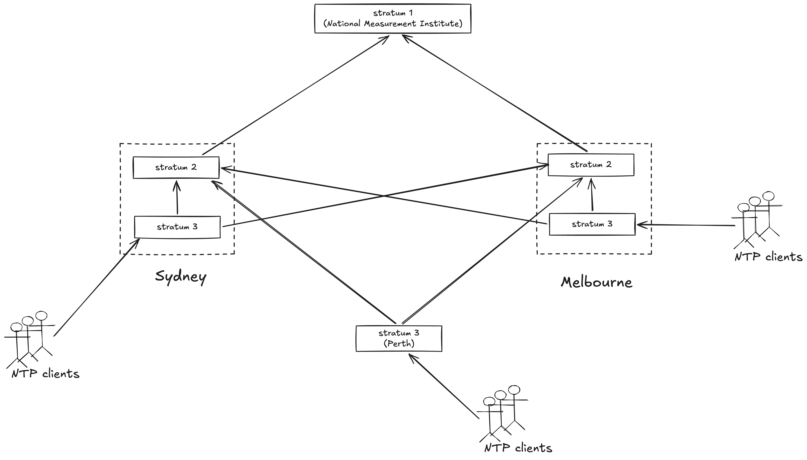
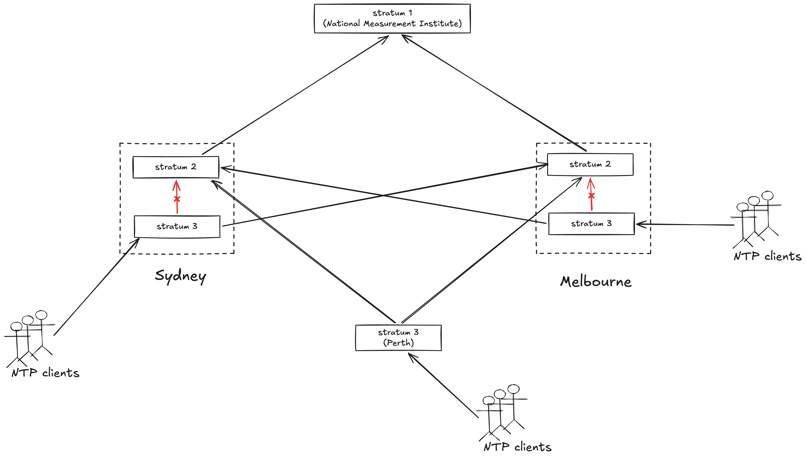
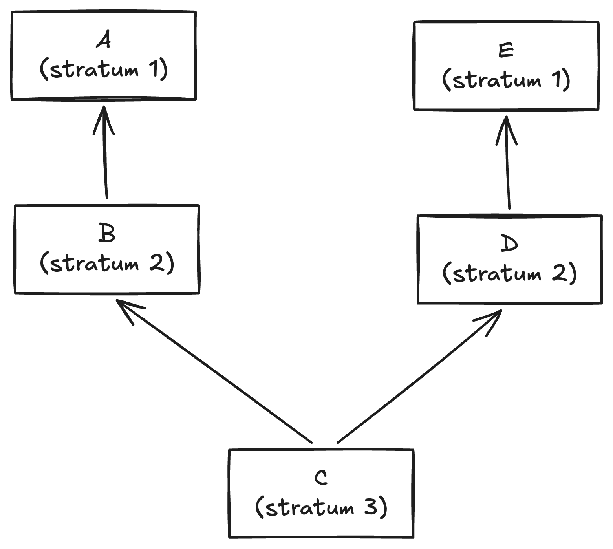
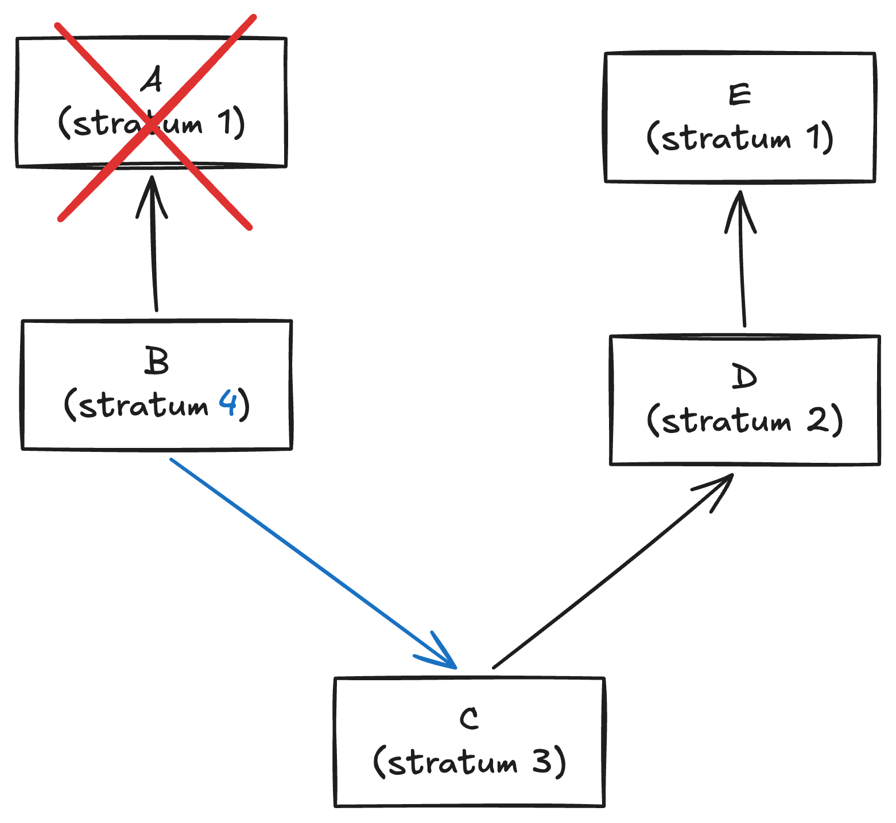
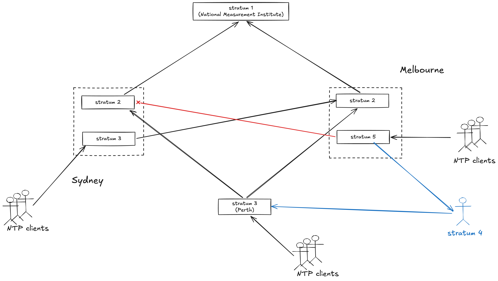
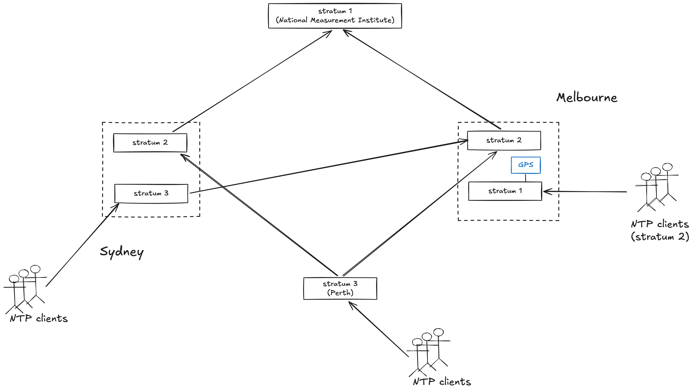
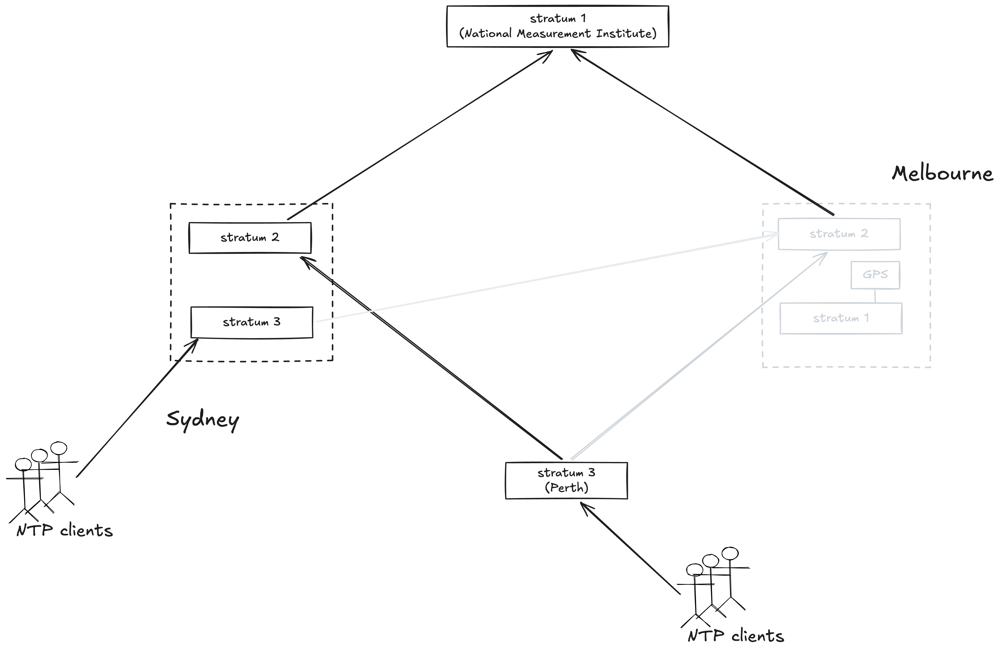
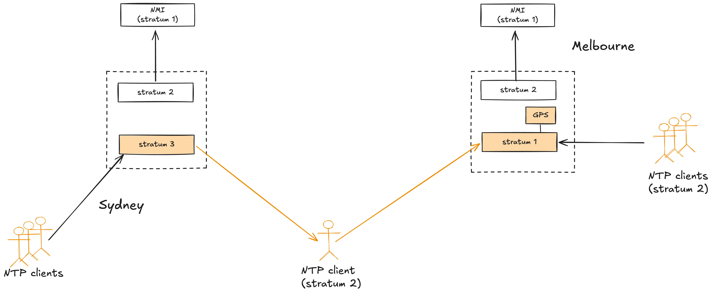

## Summary
[[LorinHochstein]] reconstructs [[Telstra]]'s July 8, 2026 mobile outage as a multi-year interaction among a 2020 timing-system migration, lost local NTP redundancy, symmetric peering, a latent [[SSU2000]] GPS week-rollover defect, inconsistent architectural understanding, and a maintenance restart. The restarted Melbourne GPS card moved its clock back 19.7 years; bad time then propagated through a shared client to Sydney, reset mobile control-plane instances, overloaded remaining capacity, and corrupted about 30,000 IP-prefix records. The analysis extends [[NetworkTimeSynchronization]] and [[SystemReliability]] while criticizing the public review through the lens of [[BlamelessPostmortem]] practice.

## Key Claims
- Telstra's pre-2020 design placed Stratum 2 and 3 servers in Sydney and Melbourne, a Stratum 3 server in Perth, and cross-site paths that let each Stratum 3 server use either Stratum 2 source.

- The 2020 [[SSU2000]] migration prevented a Stratum 3 server from using a same-chassis Stratum 2 source, so Sydney and Melbourne each lost one independent path; GPS cards supplied a new failover source, while symmetric peering allowed servers to select clients as time sources.

- Some SSU 2000 GPS cards were vulnerable to a September 18, 2022 week-number rollover that would move the date back about 19 years after a post-rollover restart; the warning specifically named affected hardware revisions.

- Symmetric NTP changes the failure topology: if an upstream source disappears, a server can select a former client, creating circular validation or a path by which incorrect time travels upstream.

- In October 2025, Melbourne repeatedly lost its Sydney Stratum 2 source and selected an unidentified Stratum 4 client, making Melbourne Stratum 5 and demonstrating that timing loops were already possible before the outage.

- Engineers mitigated that incident by activating Melbourne's GPS card, promoting its NTP server to Stratum 1 and its clients to Stratum 2; later testimony conflicted over whether the GPS module was an intended failover source, helping explain why a January 2026 firmware reminder was judged irrelevant.

- On July 8, maintenance replaced the Melbourne chassis because its backup power supply had failed. The NTP servers went offline without immediate user impact, but restarting at 2:50 a.m. activated the GPS rollover defect and changed the date from July 2026 to November 2006.

- Symmetric peering let the incorrect Melbourne time reach a client shared with Sydney and then Sydney's Stratum 3 server, expanding the affected timing domain beyond the restarted chassis.

- About 70 minutes after restart, Mobility Management Entity instances began resetting; reduced capacity overloaded the remaining mobile core, affecting voice, messages, data, and emergency calls, with Telstra reporting roughly 45% of calls and data sessions affected at peak.
- Approximately 30,000 IP prefixes were written with the wrong date in a Diameter Signalling Controller and then blocked, so restoring correct time was insufficient: operators and a vendor also had to repair poisoned operational data.
- The author rejects a hindsight-heavy review that asks for more discipline or curiosity without reconstructing how engineers understood the architecture, assessed update risk, or performed the work.

## Key Quotes
> "It is critical to have at least two independent reference sources." - the public report on avoiding timing loops and common-reference validation.

> "Any software update creates a risk" - Telstra CEO Vicki Brady explaining why the available GPS-related update was assessed rather than automatically installed.

> "you can't understand how the incident happens unless you understand how the work really gets done within the organization" - Hochstein's criticism of the investigation.

## Connections
- [[LorinHochstein]] - author reconstructing the failure mode and separating report evidence from his own technical inferences.
- [[Telstra]] - mobile operator whose timing architecture and outage are analyzed.
- [[SSU2000]] - timing chassis whose topology limits, GPS failover card, rollover defect, and restart behavior shaped the incident.
- [[NetworkTimeSynchronization]] - the incident shows that source selection, hierarchy, loops, restart behavior, and propagation boundaries are part of NTP correctness.
- [[SystemReliability]] - latent failover defects, architectural drift, maintenance, saturation, and poisoned records combined into one outage.
- [[BlamelessPostmortem]] - the author argues that investigation must reconstruct work conditions rather than stop at missing expertise or discipline.
- [[ChangeSafety]] - both applying and deferring firmware updates carry risk, while an otherwise successful chassis repair exposed a dormant defect.

## Contradictions
- The public report says the GPS card was available as an architectural failover source, while Telstra testimony says the GPS module was not used as part of the intentional SSU 2000 design; the source cannot reconcile these accounts beyond differing internal understandings.
- Hochstein explicitly lacks telecom-domain expertise and labels several points as assumptions, including whether "peering" means NTP symmetric mode, the reason for same-chassis routing limits, the identity and placement of the Stratum 4 source, the unaffected status of Perth, and product vendors behind the MME and Diameter functions.
- The source is a secondary reconstruction of a public report, vendor documentation, Senate testimony, and related material rather than Telstra's complete configuration or incident record. It does not establish the offline duration, exact Perth behavior, detailed recovery timeline, or whether every diagrammed path matched production.
- The article reports material consequences but does not supply a complete customer count, outage duration, raw telemetry, configuration, packet captures, or an independently verified causal model.
