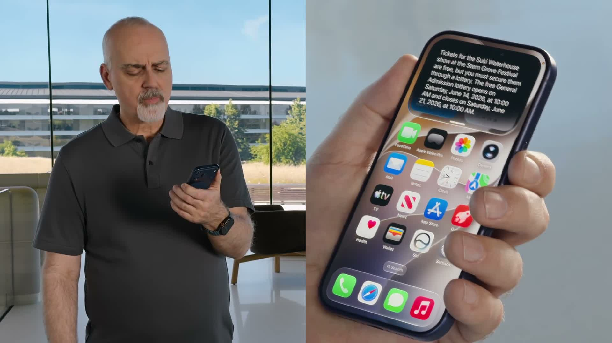

## Summary
[[BenThompson]] contrasts [[Microsoft]]'s cloud-resident, enterprise-oriented [[ProjectSolara]] vision with [[Apple]]'s rebuilt [[Siri]], whose differentiation comes from personal context, screen awareness, and cross-app actions centered on the [[IPhone]]. He argues that Apple's weaker long-running agency may be acceptable in a consumer market oriented more toward communication and entertainment than paid productivity, while enterprise context and willingness to pay make longer-running agents more viable for Microsoft. The article and demos establish two strategic directions, not shipped adoption, reliability, or durable platform outcomes.

## Key Claims
- Project Solara proposes a chip-to-cloud ecosystem of agent-first devices that act as interchangeable portals to cloud-resident agents rather than standalone computers.
- Agent delegation weakens the historical coupling between computing and continuous interaction: a short request can initiate hours of remote work, making thin wearable or ambient clients more plausible.
- Apple's Siri demo combined current world knowledge, conversational context, Reminders through App Intents, and music playback, but stopped at reminding the user to enter a ticket lottery rather than completing the task.

- Siri's distinctive advantage is access to personal data, on-screen context, Spotlight-indexed third-party data, and App Intents, allowing it to find information across messages, email, voicemail, and apps without granting a general agent broad local-machine access.
- Thompson argues that limited agency matters less for mass-market consumers than for enterprises because productivity creates a direct willingness to pay while consumer software at scale is more often organized around attention and entertainment.
- Apple's implementation reinforces iPhone centrality through a reported 20-billion-parameter on-device mixture-of-experts model and Private Cloud Compute expansion, while Microsoft organizes Solara around cloud infrastructure and work that continues without a person in the loop.
- Apple and Google are unusually positioned to assemble consumer context through iOS and Android, but Apple is more strongly incentivized to make the device itself the integration point.

## Key Quotes
> “Agents, however, compute on your behalf, without any interaction necessary” — Thompson on separating delegated work from continuous device interaction.

> “Siri being good enough is enough” — the article's consumer-market judgment.

## Connections
- [[BenThompson]] — author comparing consumer and enterprise agent strategies.
- [[Apple]] — company centering AI differentiation on iPhone context, privacy, and cross-app integration.
- [[IPhone]] — personal-context and interaction hub at the center of Apple's approach.
- [[Siri]] — assistant whose useful contextual capabilities remain less agentic than the article's enterprise benchmark.
- [[Microsoft]] — company proposing the cloud-first Project Solara ecosystem.
- [[ProjectSolara]] — agent-first device vision used as the article's strategic contrast.
- [[AgentNativeComputing]] — broader shift from continuous app operation toward delegated, agent-mediated outcomes.
- [[Stratechery]] — publication context for Thompson's analysis.

## Contradictions
- The article's confidence that Apple had crossed a “good enough” Siri threshold rests on prerecorded working demos. The later [[do-you-trust-apple]] reports that shipped Siri was slower and less reliable on basic tasks; the evidence differs by date and by demo-versus-deployment context rather than establishing a clean factual contradiction.
- The claim that consumers generally do not value productivity is a broad market thesis supported through business-model examples, not representative willingness-to-pay or usage evidence.
- Project Solara is explicitly treated as a vision rather than deployed proof, while Apple's model size, cloud architecture, privacy, app coverage, and reliability claims are reported from the presentation and article rather than independently audited.
