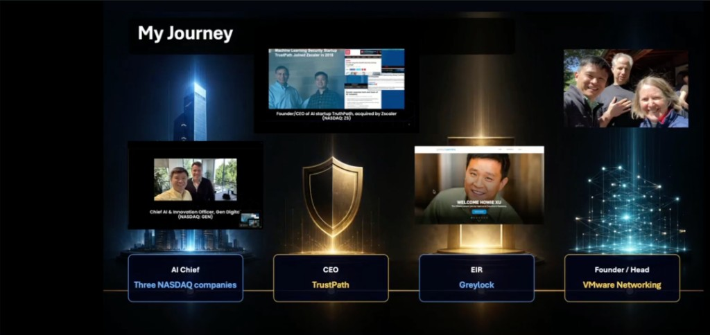

## Summary
[[MaiYang]] turns a second viewing of [[HowieXu]]'s AI-era career masterclass into both a learning-method critique and a career framework. Pausing to reconstruct each point exposes the gap between fluent recognition and usable understanding, while the course's `EQ × TQ × IQ` model argues that career impact increasingly combines human trust and attention, the ability to direct AI capacity, and intelligence plus execution intensity. The article also connects AI adoption to outcome ownership and workflow redesign rather than task completion or automation of inherited steps.

## Key Claims
- [[ActiveLearning]] begins when a learner must reconstruct an idea in their own words; following a speaker smoothly can conceal missing concepts that appear immediately when writing starts.
- [[AIEraCareerImpact]] is presented as a multiplicative model: EQ combines emotion and attention, TQ names the ability to command token-based AI capacity, and IQ combines intelligence with intensity.
- Specific skills may be absorbed into AI systems, while reliability and trust accumulate through years of completed commitments inside professional communities.
- Superlinear careers depend on compounding assets and threshold-crossing work rather than only exchanging more hours for proportionate returns.

- AI lowers content- and execution-production costs, increasing the importance of [[AttentionManagement]], judgment, taste, context, verification, and selecting signal from noise.
- [[AIFirstEngineering]] requires workflow redesign: electrification produced limited gains while factories kept steam-era layouts, just as adding AI to every inherited step can preserve unnecessary work.
- Engineering speed is not a business outcome; practitioners should own customer or revenue results rather than report task completion or local efficiency as sufficient value.

## Key Quotes
> “skill 会被蒸馏，trust 不会。” - the author's first adopted career judgment.

> “Own the outcome, not the task.” - on full-stack accountability in the founder era.

> “Win hearts. Command tokens. Show intensity.” - the course's summary of EQ, TQ, and IQ.

## Connections
- [[MaiYang]] - author who converts the masterclass into written reconstruction, source checks, and three personal commitments.
- [[HowieXu]] - masterclass speaker and source of the AI-era career framework.
- [[AIEraCareerImpact]] - synthesis of EQ, TQ, IQ, trust, judgment, leverage, and outcome ownership.
- [[ActiveLearning]] - pausing and writing in one's own words functions as an immediate comprehension test.
- [[ProfessionalRelationshipCompounding]] - long-lived communities turn repeated reliable action into trust, reputation, and future opportunity.
- [[AIFirstEngineering]] - the factory-electrification analogy distinguishes process redesign from inserting AI into unchanged work.
- [[AttentionManagement]] - cheap content production raises the cost of allocating finite attention poorly.
- [[LLMContextManagement]] - the author connects context-dependent advice with the engineering principle that agent output depends on supplied context.
- [[PaulGraham]] - cited for exponential growth and thresholds as the mechanisms behind superlinear returns.
- [[SamAltman]] - used with [[GregBrockman]] as a secondary account of long-horizon professional trust.

## Contradictions
- The article is a participant's reconstructed note, not a transcript or controlled study. Its `EQ × TQ × IQ` formula, predictions about skill distillation, and claims about career advantage are interpretive frameworks rather than measured causal relationships.
- The author flags two unresolved details: whether the recruiter said “angle” or “anchor,” and whether 1880 was Howie Xu's exact date. Those details should not be silently normalized as verified quotations.
- The forty-year electrification lag and the Sam Altman–Greg Brockman relationship timeline are post-event background added by the author; they illustrate the argument but do not independently prove that AI workflow redesign or trust accumulation will produce the claimed outcomes.
- The retained career graphic confirms the four-stage sequence shown in the course, but it does not verify dates, acquisitions, responsibilities, or the broader “three Nasdaq companies” characterization. The title banner was opened and omitted as decorative and duplicative.
