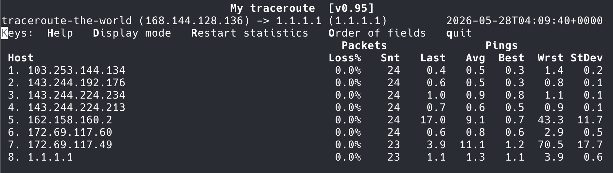
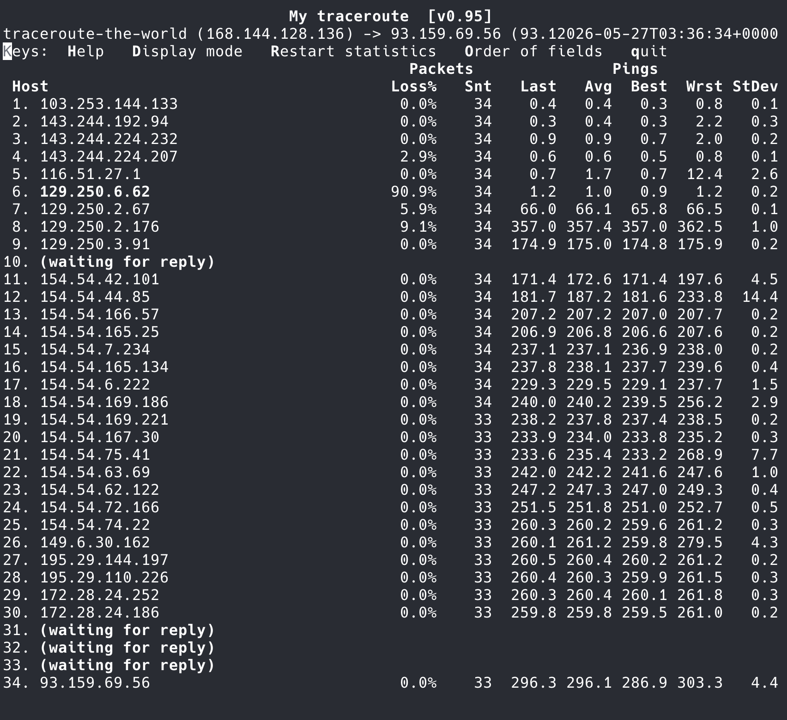

## Summary
The author of [[TracerouteTheWorld]] turns a search for unusually long IPv4 paths into a staged [[InternetWideNetworkScanning]] design: send ICMP probes to the address space one TTL at a time, remove destinations that answer at each round, and continue with the survivors. The implementation combines AF_XDP transmission, ingress XDP filtering, a BPF ring buffer, an `mmap`-backed IPv4 bitmap, and sparse files to reduce waiting, per-target process overhead, kernel-networking work, and disk use. It reports stopping after finding a 34-hop [[Traceroute]], but unstable replies, alternate reply addresses, non-decrementing TTL behavior, routing dynamics, and the absence of a disclosed reproducible result set make this an engineering account rather than proof of a world maximum.

## Key Claims
- Conventional per-destination [[Traceroute]] is a poor fit for exhaustive search because it serializes send-and-wait cycles, sends multiple probes per hop, and scales process scheduling and timeout cost across the IPv4 space.
- A breadth-first TTL scan can identify long responding paths without retaining every intermediate router: probe all candidates at TTL 1, eliminate destinations that already echo-reply, and repeat at increasing TTL values.
- AF_XDP for egress and XDP for ingress move the hot packet path closer to the NIC, while a BPF ring buffer carries only accepted reply addresses from kernel space to user space.
- IPv4's 32-bit address space maps exactly onto a bitmap: one bit per address requires 512 MiB per round, versus 16 GiB for packed four-byte addresses or up to 64 GiB for fixed-width text.
- `mmap` makes the bitmap writable as memory, and sparse files can avoid allocating untouched zero regions when responsive addresses cluster in contiguous prefixes.
- The source estimates a 2 Gbit/s ceiling at roughly 3.4 million 74-byte packets per second, but deliberately limits probing to 100,000 packets per second, giving a theoretical full IPv4 pass of about 11.9 hours.
- The experiment found a responding destination at hop 34; that observation is not equivalent to a stable 34-router route or a verified global maximum.

## Key Quotes
> “我们怎么知道收到的包对应的 TTL 是多少呢？” — the constraint that motivates separate scan rounds for each TTL.

> “恭喜我们自己！我们刚刚发明了 bitmap！” — the realization that the IPv4 address itself can serve as a one-bit array index.

## Connections
- [[TracerouteTheWorld]] - project and code repository implementing the scan.
- [[Traceroute]] - TTL and ICMP behavior used to rank responding destinations by the first round in which they answer.
- [[InternetWideNetworkScanning]] - staged exhaustive scan pattern and its rate, storage, and interpretation tradeoffs.
- [[DigitalOcean]] - Singapore-hosted VPS used for the experiment, with a provider-documented 2 Gbit/s maximum used in the throughput estimate.

The baseline screenshot shows eight listed hops to `1.1.1.1`, with the destination averaging 1.3 ms over 23 probes; two intermediate hops show much higher latency variation, so the image supports the hop-count baseline more directly than a uniform-path latency claim.

The final screenshot lists a destination at hop 34 with an average around 296 ms, but shows “waiting for reply” at hop 10 and hops 31–33. It therefore evidences the observed terminal TTL and incomplete visible path, not 34 uniquely identified forwarding routers.

## Contradictions
- The arithmetic assumes a packet-rate ceiling derived from nominal link throughput and a 74-byte frame. It does not include Ethernet preamble, inter-packet gap, encapsulation, host limits, provider policing, loss, receive load, or address exclusions, so the rate figures are planning estimates rather than measured end-to-end capacity.
- ICMP responsiveness is an imperfect path-length filter: rate limiting, filtering, asymmetric routing, alternate source addresses, transient route changes, loops, devices that mishandle TTL, and non-responsive destinations can create false elimination or survival.
- A first echo reply at TTL 34 establishes the probe TTL under the observed conditions, not a stable count of 34 visible routers; the retained screenshot itself has four non-responding hop positions.
- Scanning all IPv4 values includes non-routable, reserved, multicast, and otherwise inappropriate destinations unless the implementation explicitly excludes them. The source does not document its exclusion policy, consent/abuse handling, complete result set, repeated-run stability, or independent verification.
