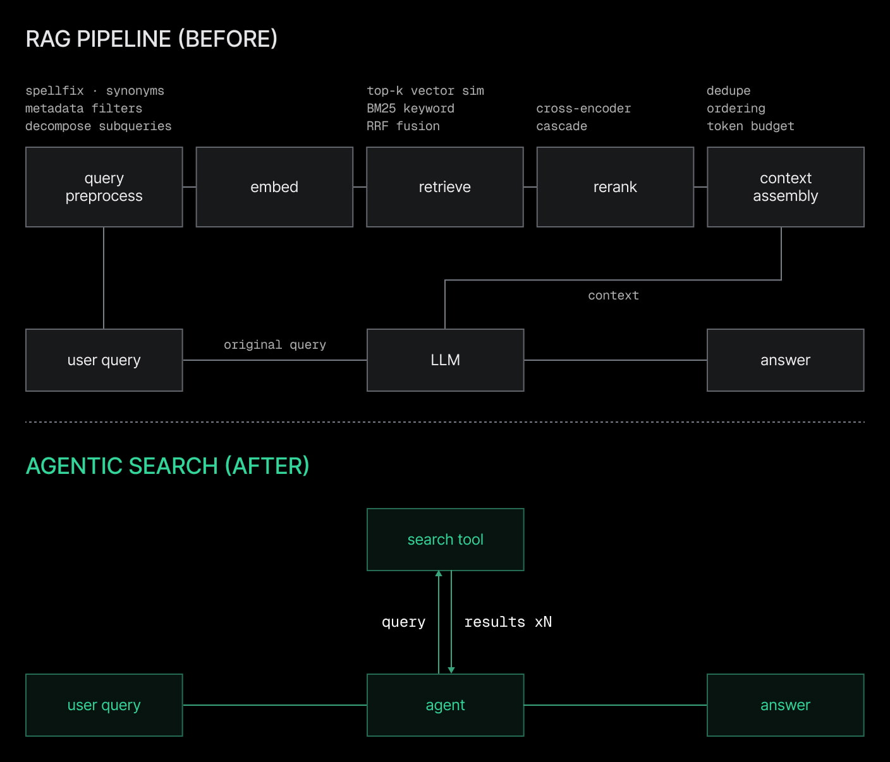
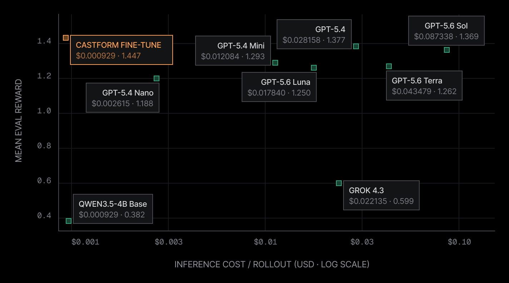
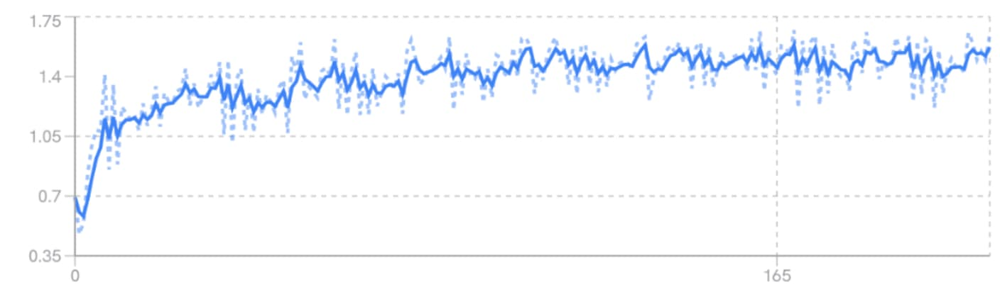
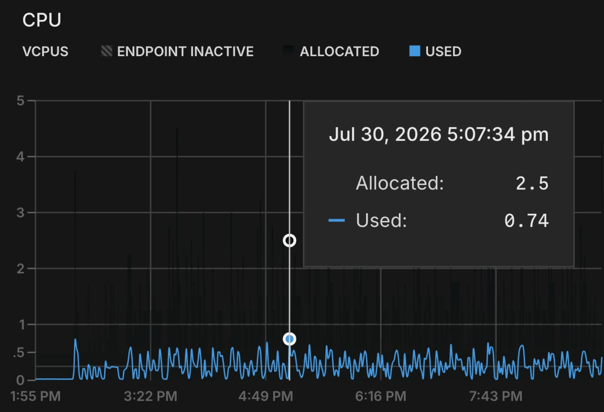

## Summary
[[Neon]] and [[Castform]] present a joint system for turning an existing document corpus into synthetic question-answer tasks, reinforcement-learning a small open-weights model to use hybrid search, and serving the resulting retrieval agent against the same database interface. The first-party case study reports a Castform fine-tune with higher mean evaluation reward and much lower per-rollout inference cost than several named frontier models, while Neon's autoscaling and proposed per-rollout branches supply elastic and isolated database environments. The benchmark, reward curve, and CPU trace are visually informative but omit enough methodology that the performance and cost claims should be treated as vendor-reported results rather than independently established comparisons.

## Key Claims
- [[AgenticRAG]] replaces a fixed retrieve-once pipeline with a model-controlled loop that can issue multiple searches before answering, increasing adaptability as well as latency and inference cost.

- [[Castform]] generates question-and-ground-truth tasks from an existing corpus, lets developers define tools and rewards, and manages [[ReinforcementLearning]] rollouts intended to teach an open-weights model how to retrieve, cite, and answer.
- The worked reward combines retrieval of the correct source, citation of the correct chunk, and final-answer correctness, while the search tool merges BM25 and vector results through reciprocal-rank fusion.
- The reported benchmark places the Castform fine-tune at $0.000920 per rollout and 1.447 mean evaluation reward, compared with $0.087338 and 1.369 for GPT-5.6 Sol; it also shows the untuned Qwen3.5-4B base at a similar cost but only 0.382 reward.

- The training chart shows average reward rising quickly from roughly 0.5-0.7 to above 1.0, then more gradually toward about 1.5 with persistent rollout variance.

- [[Neon]] stores the corpus in Postgres, exposes text and vector search during data generation, training, and production, and uses elastic compute to absorb thousands of bursty rollout searches.

- Database branches and time-travel queries are proposed as a path to isolated, resettable environments for state-changing agents so one rollout does not affect another or production.

## Key Quotes
> "Most teams' best training data is just sitting in their databases." - Ying Hang Seah on the premise behind corpus-derived post-training.

> "The reward function specifies what you want your model to get good at." - on jointly scoring retrieval, citation, and answer correctness.

## Connections
- [[Castform]] - vendor and training platform that generates tasks and manages the retrieval-agent reinforcement-learning loop.
- [[Neon]] - Postgres and Lakebase Search environment used for corpus storage, hybrid retrieval, elastic training traffic, and proposed rollout isolation.
- [[AgenticRAG]] - repeated model-directed search pattern being trained and evaluated.
- [[ReinforcementLearning]] - trial, reward, and policy-update method used to improve retrieval behavior.
- [[RetrievalAugmentedGeneration]] - fixed pipeline contrasted with iterative agent-controlled retrieval.
- [[SemanticSearch]] - vector retrieval is one half of the example hybrid-search tool.

## Contradictions
- The title's "100x cheaper" is approximately supported only by comparing the displayed Castform cost with GPT-5.6 Sol (about 95x); the chart shows much smaller gaps against cheaper named models, and the article does not disclose token usage, hardware, serving assumptions, dataset, sample counts, error bars, or whether all systems received equivalent tools and budgets.
- The source is a joint vendor case study and links to an example rather than supplying a self-contained reproducible evaluation. The rising reward curve does not by itself establish held-out generalization, production quality, resistance to reward hacking, or the causal contribution of Castform versus data, model, search, and infrastructure choices.
- The CPU screenshot demonstrates one period of bursty usage and dynamic allocation, not comparative evidence that autoscaling lowered latency or total cost. Database branching for stateful-agent training is presented as a future path rather than a measured result in this run.
