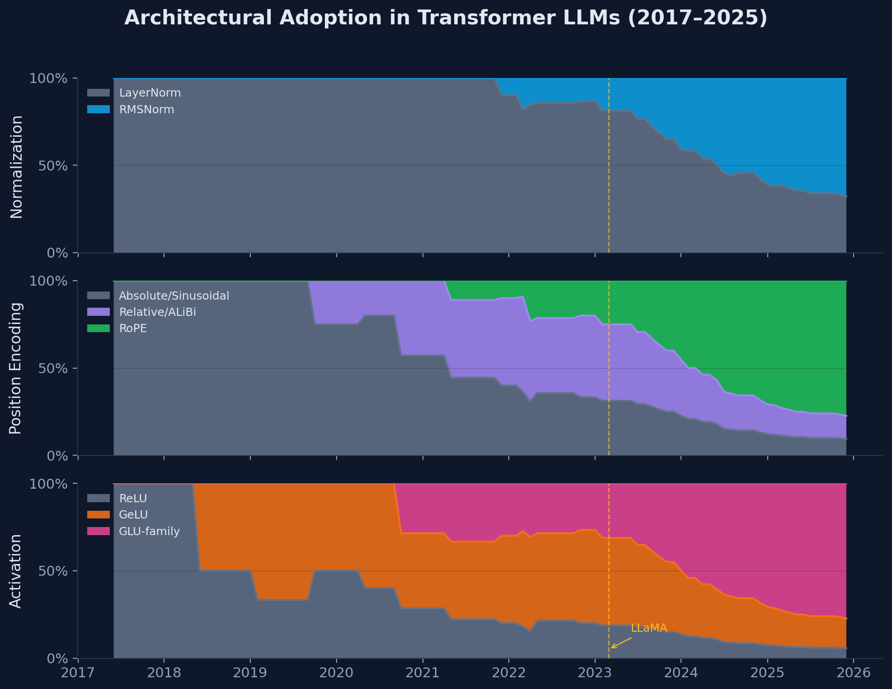

## Summary
[[JunYuTan]] surveys 53 widely discussed Transformer LLMs from 2017 through 2025 and argues that dense decoder-only designs converged on pre-normalization with [[RMSNorm]], [[RotaryPositionalEncoding]], [[SwiGLU]], reduced bias usage, and KV-sharing attention such as [[GroupedQueryAttention]]. The article attributes this [[TransformerArchitecturalConvergence]] to both model quality and stability and to accelerator kernels, memory bandwidth, KV-cache economics, influential open checkpoints, and implementation path dependence. It identifies sparse mixture-of-experts design, long-context attention, and explicit stability mechanisms such as [[QueryKeyNormalization]] as areas where architectural diversity remains active.

## Key Claims
- The original 2017 Transformer choices—post-LayerNorm, sinusoidal positions, ReLU, and a four-times-wide FFN—were progressively displaced rather than remaining architectural invariants.
- In the selected 53-model dataset, 41 models use RMSNorm, 37 use RoPE, and 38 use a GLU-family activation; the adoption chart shows these choices becoming the majority as post-2022 models accumulate.
- LLaMA combined earlier innovations into a reproducible dense decoder-only baseline: pre-RMSNorm, RoPE, SwiGLU, few or no biases, and, from LLaMA 2 onward, grouped-query attention.
- [[GroupedQueryAttention]] reduces autoregressive KV-cache size by sharing each key-value head across several query heads, trading some attention-head independence for memory capacity, batch size, or longer context.
- [[SwiGLU]] trades some hidden width for a third projection and input-dependent multiplicative gating; parameter matching against a four-times-wide two-matrix FFN gives an expansion near `8/3`.
- Sparse MoE increases total capacity without activating every parameter for every token, but expert count, active count, shared experts, routing, and balancing remained diverse in 2024–2025.
- [[QueryKeyNormalization]], logit capping, specialized initialization, and related interventions address attention-logit or optimization instability that becomes more costly at greater depth, scale, and context length.
- Architectural convergence reflects current hardware and software constraints as well as intrinsic model behavior: FlashAttention, fused kernels, tensor-core shapes, memory bandwidth, and released reference implementations all influence what becomes standard.

## Key Quotes
> “the center of mass is clear” — on the dense-model bundle despite surviving alternatives.

> “strong default under modern constraints, not a proof of strict superiority” — on interpreting RoPE adoption.

## Connections
- [[TransformerArchitecture]] — the historical model family whose variable block choices the article compares.
- [[TransformerArchitecturalConvergence]] — the article's central claim about a competitive default stack and its contingent causes.
- [[RMSNorm]] — normalization choice reported in 41 of the 53 selected models.
- [[RotaryPositionalEncoding]] — position mechanism reported in 37 of the 53 selected models.
- [[SwiGLU]] — gated MLP variant reported as part of the dominant post-LLaMA recipe.
- [[GroupedQueryAttention]] — KV-sharing attention variant linked to inference-memory economics.
- [[MixtureOfExpertsLoadBalancing]] — unresolved sparse-routing problem sharpened by increasing expert counts.
- [[QueryKeyNormalization]] — explicit control over query/key norm drift and attention-logit growth.
- [[FlashAttention]] — kernel family used to illustrate hardware-architecture co-evolution.

## Contradictions
- The dataset is descriptive rather than a controlled ablation: adoption frequency cannot isolate quality, stability, throughput, inference cost, or copying of influential baselines as the cause.
- Selection favors widely discussed models with public reports or weights and English-language coverage; it is not a census of all Transformer models.
- Multiple versions of the same family are counted separately, so the reported convergence overstates the number of independent architectural decisions.
- Source verification varies between papers and code, while some implementation details remain undisclosed; the 53 rows should not be treated as uniformly audited specifications.
- The chart is cumulative over the selected model sequence and visually establishes adoption within that sample, not universal market share or causal superiority.
- Claims about MoE dominance are scoped to the 2025 subset: 9 of 15 sampled 2025 models use MoE, while 42 of all 53 sampled models are dense.
- Several efficiency and quality statements rely on cited prior work or implementation-dependent ranges rather than experiments reproduced under one common setup.
