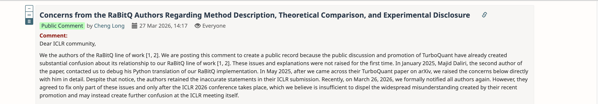

## Summary
[[JianyangGao]], first author of the [[RaBitQ]] line of work, publicly alleges that the [[TurboQuant]] paper obscured the methods' shared random-rotation structure, incorrectly called RaBitQ's theoretical guarantee suboptimal, and compared a translated single-core Python RaBitQ implementation against TurboQuant on an NVIDIA A100. The article supplies a dated account of contacts, review, publication, and complaints that precedes Gao and collaborators' later technical report, but it is an interested-party advocacy piece whose private correspondence and intent claims are not independently established here.

## Key Claims
- RaBitQ and TurboQuant both normalize and randomly rotate vectors before quantization; Gao argues that TurboQuant's paper failed to explain this close methodological relationship even after an ICLR reviewer requested a fuller comparison.
- Gao says the extended RaBitQ paper proves an asymptotically optimal error bound, contrary to TurboQuant's unsupported description of its guarantee as suboptimal and probably loosened by analysis.
- The article alleges that TurboQuant's published speed comparison used the authors' translated Python RaBitQ code on a single CPU core with multiprocessing disabled, while TurboQuant ran on an NVIDIA A100 GPU, without fully disclosing that asymmetry.
- Gao reports that TurboQuant coauthor Majid Daliri sought help debugging a Python RaBitQ implementation in January 2025 and was told about the theoretical and experimental objections in May 2025, before the September 2025 ICLR submission.
- The article says the RaBitQ authors escalated through an OpenReview public comment and complaints to ICLR chairs after private correction requests did not resolve the disputed method description, theory claim, and experimental disclosure.

The retained screenshot shows a public comment by Cheng Long dated 27 March 2026. It states that the RaBitQ authors were creating a public record after earlier private notices and believed the promised partial post-conference corrections were insufficient.

## Key Quotes
> "we were using a single-core CPU instance, and multiprocessing was indeed disabled" — private correspondence attributed to TurboQuant coauthor Majid Daliri.

> "The use of random rotation and Johnson-Lindenstrauss transformations has become a standard technique in the field" — response attributed to the TurboQuant authors when declining the requested discussion of methodological similarity.

## Connections
- [[JianyangGao]] — article author and first author of the RaBitQ work presenting the public complaint.
- [[RaBitQ]] — prior vector-quantization method whose description, theory, implementation, and benchmark treatment are disputed.
- [[TurboQuant]] — competing method and paper accused of incomplete prior-work discussion and asymmetric evaluation.
- [[VectorQuantization]] — shared technical domain in which random rotation, codebook design, estimators, and benchmark conditions must be compared separately.

## Contradictions
- The article directly disputes TurboQuant's characterization of RaBitQ's theory and the fairness of its speed comparison, while also alleging that the shared random-rotation structure was knowingly underdescribed.
- This is Gao's first-person account of a live academic dispute. The supplied article does not include the complete emails, TurboQuant paper revisions, reviewer exchange, complaint package, or a response addressing every allegation, so claims about knowledge, deliberateness, and intent remain allegations rather than independently adjudicated facts.
- The retained OpenReview screenshot corroborates that a public complaint existed and records its stated chronology, but it does not independently prove the underlying technical or private-correspondence claims.
- The later [[2604.19528]] source supplies substantially more technical derivation, released-code comparison, and experimental detail, yet it too is primarily authored by RaBitQ researchers and still calls for independent replication.
