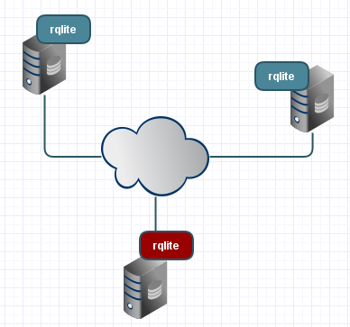

## Summary
Philip O'Toole traces distributed SQLite from [[Rqlite]]'s 2014 combination of [[SQLite]], a Raft log, and majority-acknowledged writes through later embedded, streaming, merge-based, and managed-service designs. His first-party retrospective argues that these systems occupy distinct points in the design space: consensus provides strong availability without restore delay, WAL streaming provides cheap recovery for a single writer, and CRDT-style merging supports divergent writers in local-first applications. The retained architecture image shows rqlite as a three-node networked cluster with one distinguished leader.

## Key Claims
- [[Rqlite]] began in 2014 as a general-purpose open-source server that places a Raft log in front of SQLite and replicates writes across a cluster.
- Rqlite chooses the CP side of the CAP tradeoff: writes pass through a leader, require majority acknowledgement, and are refused by a partitioned minority.
- Earlier or parallel work included Expensify's Paxos-style internal replication later released as Bedrock and ActorDB's per-actor Raft-replicated SQLite databases.
- dqlite shares rqlite's consensus-oriented intent but is embedded as a library, while rqlite runs as a separate server.
- Litestream streams SQLite WAL changes to object storage for low-cost disaster recovery without consensus; LiteFS later added filesystem-level replication with leases.
- cr-sqlite uses CRDTs for leaderless divergent writes and eventual merging, while libSQL, SQLite Cloud, Cloudflare D1, and Turso package distributed SQLite as forks or managed platforms.
- [[DistributedSQLite]] is therefore not one architecture: consensus, streaming, and merge-based systems answer different recovery, availability, consistency, and multi-writer requirements.

## Key Quotes
> "Litestream: what if the machine dies? rqlite: what if the machine dies and I cannot wait to restore?" - distinction between recovery and continuous availability.

> "The design space has three corners" - the author's synthesis of consensus, streaming, and merge approaches.

## Connections
- [[PhilipOToole]] - author and long-term maintainer recounting rqlite's history.
- [[Rqlite]] - the article's central project and consensus-replicated SQLite server.
- [[SQLite]] - embedded relational engine reused across the systems discussed.
- [[DistributedSQLite]] - design space synthesized from the article's project history.
- [[DistributedConsensus]] - mechanism behind the strong-consistency cluster designs.
- [[ReplicatedLog]] - ordered Raft log through which rqlite replicates writes.
- [[SQLiteProductionTradeoffs]] - distributed extensions answer some single-node limits while adding operational complexity.
- [[LocalFirstSoftware]] - local-first applications motivate the leaderless, merge-based corner.

## Contradictions
- The retrospective qualifies [[SQLiteProductionTradeoffs]]' warning that distributed SQLite extensions may erase SQLite's simplicity advantage: added machinery is real, but different extensions deliberately buy distinct recovery, availability, or multi-writer properties that a single SQLite file cannot provide.
- The claim that rqlite was the first open-source Raft-plus-SQLite system is explicitly the author's best historical assessment, not independently established priority evidence.
