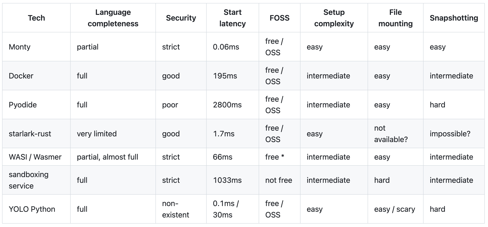

## Summary
[[GaoCe]] compares containers, [[Firecracker]]-based services, Kata Containers, WebAssembly runtimes, [[Monty]], and [[Unikernel]] designs against the competing needs of agent sandboxes: isolation, fast startup, Python compatibility, simple packaging, snapshots, and efficient image delivery. He argues that unikernels deserve renewed attention after limited multiprocess support appeared, but does not present a working unikernel sandbox or benchmark; the more durable conclusion is that image construction and distribution can matter more than runtime boot time alone.

## Key Claims
- Container process startup can be fast enough for agent workloads when image pulling and extraction are excluded, but sharing the host kernel gives microVMs a stronger isolation boundary.
- [[E2B]] turns Dockerfile-like inputs into ext4-rooted Firecracker templates, prepares and snapshots running environments, and uses a lightweight best-of-k placement policy rather than Nomad for sandbox scheduling.
- Kata-based k7 retains ordinary OCI-image compatibility and Kubernetes integration, simplifying image construction at the possible cost of hiding Firecracker snapshot and resume facilities.
- WebAssembly starts quickly but WASI and dynamic-language constraints limit broad CPython library compatibility; [[Monty]] gains much lower reported startup latency by intentionally supporting only a Python subset.

- The retained comparison graphic reports 0.06 ms for Monty, 195 ms for Docker, 2,800 ms for Pyodide, 1.7 ms for Starlark-Rust, 66 ms for WASI/Wasmer, and 1,033 ms for a sandboxing service, but the article itself says the comparison is casual and mixes unlike technologies.
- Traditional unikernels combine application and kernel in one address space, reducing image size and attack surface but historically conflicting with Python's process expectations. Unikraft 0.19's `vfork`-based support improves compatibility without providing fully independent process address spaces.
- Unikernel Linux preserves more Linux and multiprocess compatibility by linking an application with a modified Linux kernel and glibc, while giving up some minimal-image, attack-surface, and startup advantages of stricter unikernels.
- [[Modal]] illustrates why end-to-end startup is often an image-delivery problem: lazy FUSE-backed loading can construct the visible filesystem first and fetch accessed data through a cache hierarchy instead of downloading and unpacking a complete image.

## Key Quotes
> “我们不能只看到启动时间，事实上构建和 image 分发的效率也是非常重要的。” — on evaluating the complete startup path.

> “如果能够在多进程与小镜像之间做一个好的取舍，我还是认为 unikernel 是非常有潜力的。” — on the conditional unikernel opportunity.

## Connections
- [[AgenticSandboxInfrastructure]] — the article compares runtime, scheduling, packaging, snapshot, and distribution choices for short-lived agent environments.
- [[Unikernel]] — proposed runtime family whose small images and narrow interfaces trade against Linux and Python compatibility.
- [[Firecracker]] — microVM monitor underlying the E2B and k7 examples.
- [[E2B]] — example of snapshot-oriented Firecracker templates and lightweight placement.
- [[Monty]] — restricted Python interpreter used to illustrate the speed-versus-language-completeness frontier.
- [[Modal]] — example of lazy image delivery reducing time before useful execution.
- [[GaoCe]] — author and practitioner making the comparative argument.
- [[Kubernetes]] — described as a natural fit for Kata but potentially too heavy for short-lived, local, or very small agent-sandbox fleets.

## Contradictions
- The article cites several latency figures drawn from different scopes and warns that its retained comparison graphic is not rigorous. Empty-runtime boot, process readiness, image transfer, and fully initialized service readiness are not interchangeable measures.
- The E2B, Kata snapshot, FUSE cache hierarchy, Unikraft process, and Kubernetes-fit discussions include code-reading interpretations or explicit author uncertainty rather than controlled validation.
- The article's opening presents unikernels as an exceptionally natural sandbox foundation, but its own analysis shows that Python compatibility, multiprocess semantics, image tooling, and deployment ergonomics have so far outweighed theoretical size and attack-surface advantages.
- No independent security assessment, reproducible benchmark, cost model, workload distribution, or working unikernel agent sandbox is supplied.
