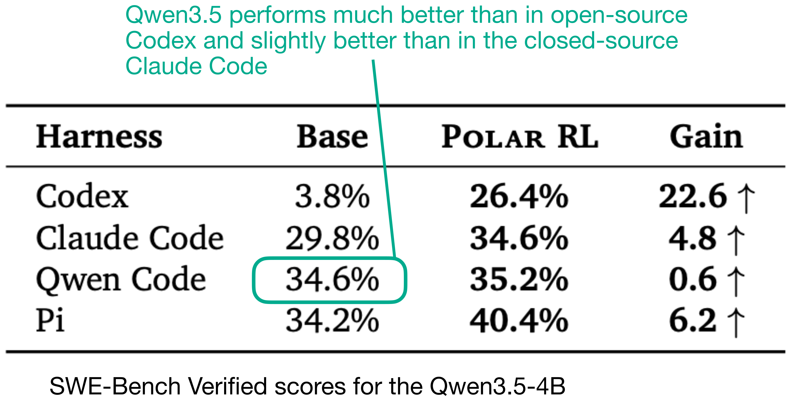
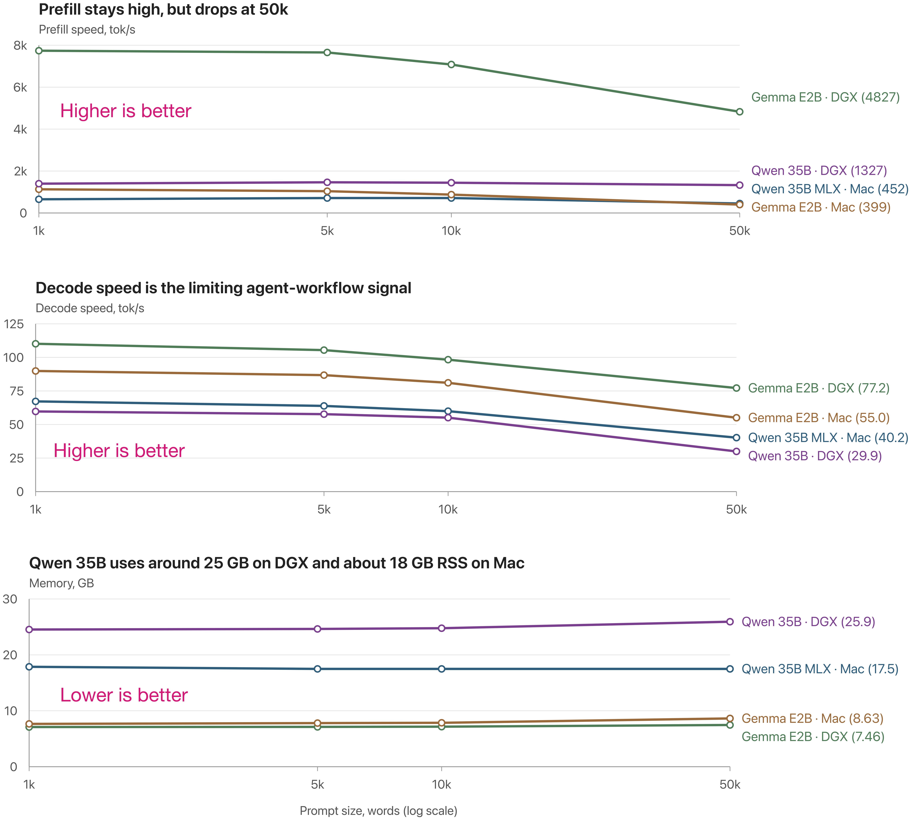
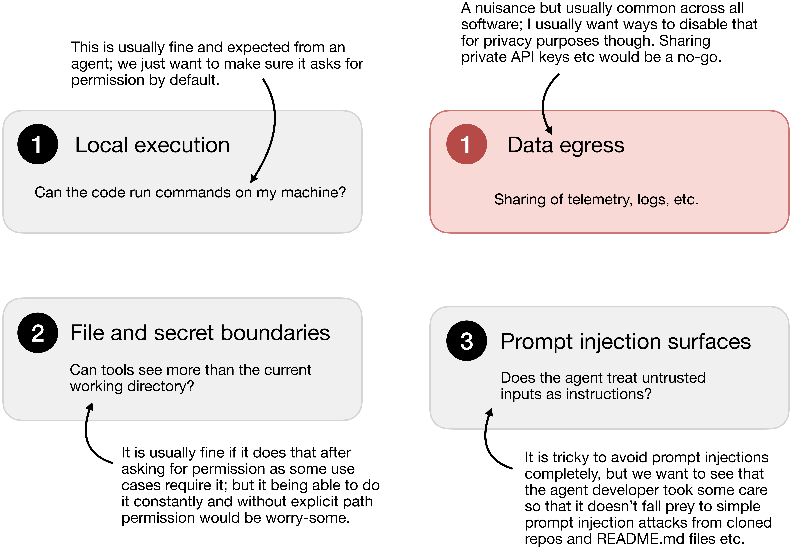
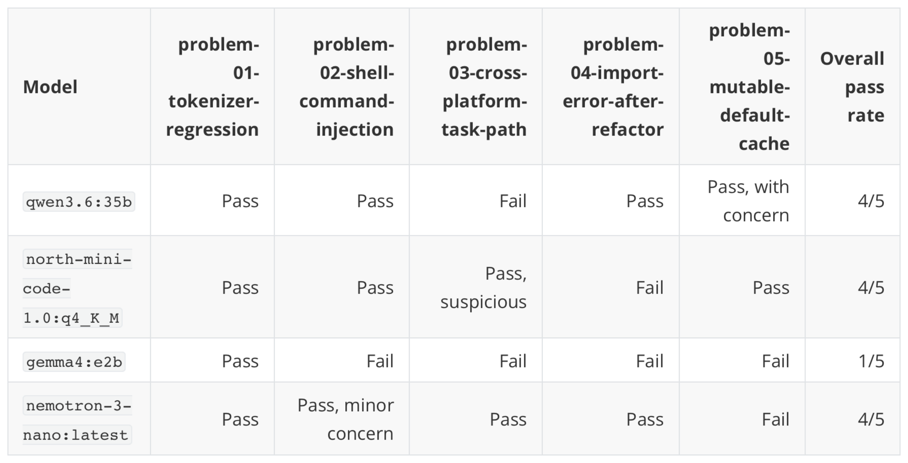
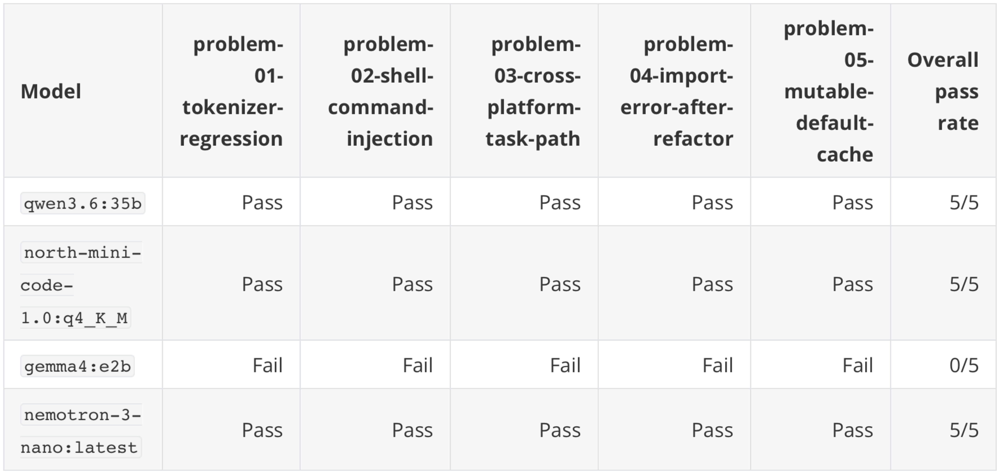
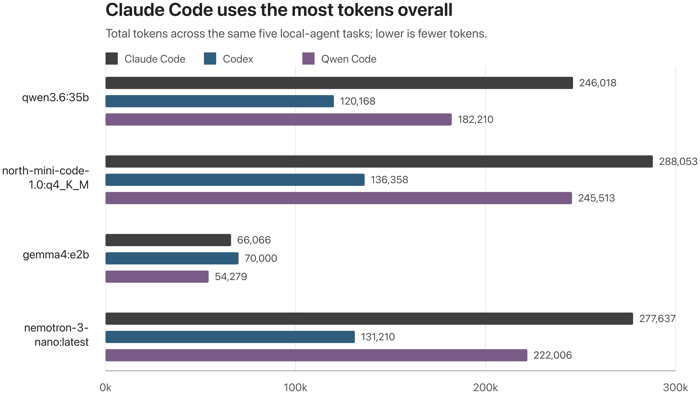
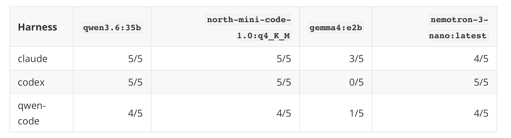

## Summary
[[SebastianRaschka]] presents a fully local coding-agent stack as three replaceable layers: an open-weight model, a local inference runtime such as [[Ollama]], and a coding harness such as [[QwenCode]], [[Codex]], or [[ClaudeCode]]. The tutorial argues that hardware fit, long-context speed, task reliability, harness behavior, permissions, data egress, and personal workflow tests matter more than merely completing installation. Its small first-party evaluation finds capable 30–35B mixture-of-experts models usable on a Mac or DGX-class workstation, while also showing that the harness can change success rate and token cost substantially.

## Key Claims
- A local coding agent separates the reasoning model from the runtime that serves it and the harness that reads files, edits code, runs commands, and verifies changes; OpenAI-compatible endpoints make several combinations possible.
- Local operation can offer privacy, offline availability, version stability, inspectability, and predictable marginal cost, but hardware purchase, electricity, setup, maintenance, and weaker model capability remain real costs.
- Harness fit is empirical rather than guaranteed by model branding. Nvidia's Qwen3.5-4B SWE-bench result favors Qwen Code before Polar training, yet the article's later five-task test gives Qwen3.6 better results in Codex than in Qwen Code.

- Qwen3.6 35B-A3B is presented as a practical local baseline: roughly a 22 GB download, approximately 30–40 GB of RAM headroom, and an MLX variant for Apple silicon; North Mini Code and Nemotron 3 Nano are similar-size alternatives, while the smaller Gemma 4 E2B is faster but much less reliable in the article's tool-use tests.
- Speed testing should cover long prompts, decode rate, prefill rate, and memory rather than a short chatbot turn. In the reported 50k-word runs, Qwen3.6 produced about 40.2 tokens/s on a Mac MLX build and 29.9 tokens/s on a DGX Spark, with measured memory near 17.5 GB RSS on the Mac and 25.9 GB on the DGX; the author warns that macOS RSS underreports Metal-backed use.

- Capability assessment should combine standardized comparisons with a small personal regression pack that tests realistic reasoning, tool choice, security review, editing, and verification. A model that emits the wrong tool or acts when it should answer is not reliable merely because its code looks plausible.
- A local model does not make the surrounding agent safe or private. Before installation, the article recommends auditing command execution, workspace and secret boundaries, prompt-injection surfaces, MCP and extension paths, network calls, telemetry, updates, and terminal-output handling; untrusted repositories should be treated as hostile inputs.

- The Qwen Code audit found approval-gated shell access, readable workspace files, and prompt-injection surfaces typical of coding agents, plus optional usage and telemetry paths that can send metadata to Alibaba or Aliyun even when inference stays local. The proposed settings disable usage statistics, telemetry, prompt logging, auto-update, hooks, MCP servers, and remote artifact publication, but manual update discipline and OS-level isolation remain necessary.
- In the author's five-task Qwen Code problem pack, Qwen3.6, North Mini Code, and Nemotron 3 Nano each scored 4/5 while Gemma 4 E2B scored 1/5; these results cover only five hand-curated tasks and do not measure readability, maintainability, or production safety.

- The same small task set produced 5/5 for Qwen3.6, North Mini Code, and Nemotron 3 Nano in Codex, while Gemma 4 E2B scored 0/5, contradicting a simple assumption that a Qwen model must perform best in its namesake harness.

- Harness efficiency can dominate end-to-end latency. Across the same tasks and the three capable models, Claude Code consumed the most tokens, Codex the fewest, and Qwen Code fell between them; the author attributes most of Claude Code's difference to repeated prompt-side history rather than longer final output.

- Overall task success varied by both model and harness: the three larger local models scored 4/5 in Qwen Code and 4/5 or 5/5 elsewhere, whereas Gemma 4 E2B ranged from 0/5 to 3/5. Equal pass counts still do not establish equal code quality, and five tasks are too few for a general ranking.

- A remote GPU host can remain locally addressable through an SSH tunnel that forwards port 11434, allowing a Mac-side harness to use a DGX-hosted Ollama server without exposing the inference endpoint broadly.

## Key Quotes
> "The most important part is not getting one specific tool installed."

> "Task correctness is a necessary criterion, but it doesn’t measure code quality and readability, which are hard to assess automatically."

## Connections
- [[LocalCodingAgents]] - synthesizes the model-runtime-harness architecture, local operating tradeoffs, and evaluation workflow.
- [[SebastianRaschka]] - author and experimenter who assembled and tested the local stack.
- [[Ollama]] - local model-serving runtime used throughout the setup and remote-host tunnel.
- [[QwenCode]] - open-source harness used for the main setup, security audit, and one benchmark condition.
- [[Codex]] - open-source CLI harness that accepts a separate Ollama profile and used the fewest tokens in the article's capable-model comparisons.
- [[ClaudeCode]] - proprietary harness launched through Ollama whose higher prompt-side token use accompanied strong small-pack task results.
- [[HarnessEngineering]] - explains why context policy, tool loops, and orchestration can change model behavior and cost.
- [[AgentPermissionModel]] - approval gates, readable paths, secret access, and permissive modes determine the agent's authority.
- [[AgentSecurityLayering]] - separate hardware, user accounts, VMs, egress controls, and explicit telemetry settings bound local-machine risk.
- [[SoftwareVerification]] - long-context benchmarks and personal task packs test speed and correctness but must be supplemented by code-quality and production checks.

## Contradictions
- The article's own five-task results qualify the assumption that a model developer's matching harness is necessarily best: Qwen3.6 scores 4/5 in Qwen Code but 5/5 in Codex and Claude Code. The comparison is too small to reverse the general claim conclusively.
- "Fully local" describes model inference, not automatically all data flow. Telemetry, updates, hooks, MCP servers, artifact publishers, or other network-capable tools may still create egress unless audited and disabled.
- The reported memory and speed figures are machine-, runtime-, quantization-, prompt-, and measurement-specific. In particular, macOS RSS is an incomplete measure of Metal-backed memory use.
- The benchmark has only five tasks, uses author-curated pass rules, and does not measure readability, maintainability, security, regression breadth, or long-running autonomous behavior; its harness ranking should remain source-scoped.
