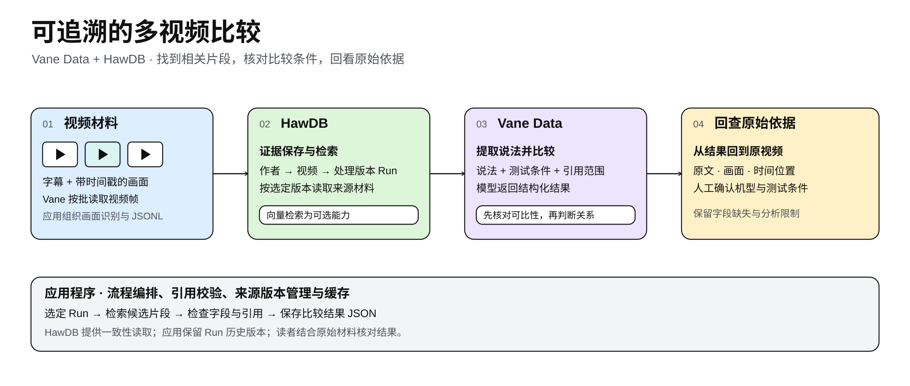
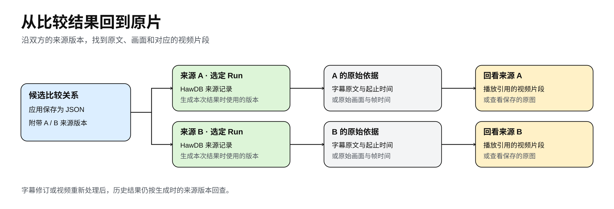

## Summary
The article presents a proof-of-concept [[TraceableMultiSourceComparison]] workflow in which [[VaneData]] reads timestamped video frames and invokes structured multimodal models, while [[HawDB]] stores transcripts, recognized frame content, graph relationships, vectors, and processing-version provenance. Its central lesson is epistemic rather than product-specific: retrieval and typed model output do not make two passages comparable, so applications must validate cited ranges, recover surrounding text and frames, preserve source versions, and expose the original media for human checking.

## Key Claims
- A comparison should retain author, video, processing `run_id`, evidence identifier, timestamp or cue range, and original text or frame so a result can be traced to the exact material used at generation time.
- [[VaneData]] exposes video frames, text, images, and structured model responses through table and Arrow interfaces; the application still chooses sampling, prompts, input budgets, validation rules, and failure handling.
- [[HawDB]] combines Cypher source relationships and transactionally consistent reads with optional vector retrieval, but the application owns chunking, index versions, keyword/vector fusion, cache validity, and mapping hits back to evidence.
- Structured extraction separates observed results, evaluations, comparison objects, conditions, uncertainties, and citation ranges, making omissions inspectable without proving that the fields are correct.
- Comparability must be decided before agreement or conflict: different devices, workloads, durations, metrics, or missing conditions require `different_conditions` or `unknown`, not an inferred contradiction.
- Fixed-interval frame sampling can miss transient charts, and denser sampling raises storage and recognition cost without guaranteeing complete visual capture.
- Incremental reuse is valid only when the question, model configuration, processing protocol, runner, source versions, and prior result completeness are unchanged.

## Key Quotes
> “缺失条件不能默认相同。” — missing comparison conditions cannot be assumed to match.

> “没有提取到说法，不代表作者没有讨论过。” — failure to extract a statement is not evidence that the author never discussed it.

## Connections
- [[VaneData]] - reads timestamped frames and submits tabular text/image inputs for typed model extraction and comparison.
- [[HawDB]] - stores versioned evidence, source relationships, and optional semantic-search records for later reconstruction.
- [[TraceableMultiSourceComparison]] - reusable workflow for deciding whether retrieved claims can be compared and replaying their evidence.
- [[RetrievalAugmentedGeneration]] - keyword, vector, metadata, and raw-record access retrieve candidate passages, but retrieval relevance is distinct from comparability and citation validity.
- [[MultimodalDataPipelines]] - video frames, subtitles, OCR-like image records, vectors, and model outputs remain associated through tabular identifiers and timestamps.

## Contradictions
- The initial automated extraction retrieved a Hurricane Film passage about Duo for an iPhone 18 Pro question and began after the cue that named the device; a Geekerwan passage retained a 44–45°C result but omitted the preceding 30-minute stress-test condition. Human review therefore overturned any implication that the two passages described contradictory results for one device under comparable tests.
- A frame from Zhong Wenze's 15-minute 4K120 recording test yielded a 4% battery-use result but omitted that one comparison phone had 98% battery health while three others had 100%; the frame also cannot establish thermal performance by itself.
- No contradiction with existing wiki claims was found. The source instead narrows retrieval and structured-output claims by showing that source identity, adjacent context, visual evidence, and test conditions require separate validation.
