## Summary
Abhinav Upadhyay builds a Linux/x86-64 model of [[VirtualMemory]] from per-process address spaces through page tables, TLBs, demand paging, reclaim, copy-on-write, mapped files, huge pages, TLB shootdowns, and NUMA. The article connects kernel mechanisms to [[HighThroughputIOOptimization]] by showing that page type, locality, access order, mapping lifetime, and physical placement determine the real cost hidden behind a uniform address abstraction. It also supplies a layered observability workflow for separating reservation, residency, paging I/O, translation overhead, and NUMA misplacement.

## Key Claims
- A process receives a sparse, permissioned virtual address space rather than direct ownership of physical RAM; on common four-level x86-64 systems, four 9-bit indices and a 12-bit offset translate a canonical 48-bit virtual address through hierarchical page tables.

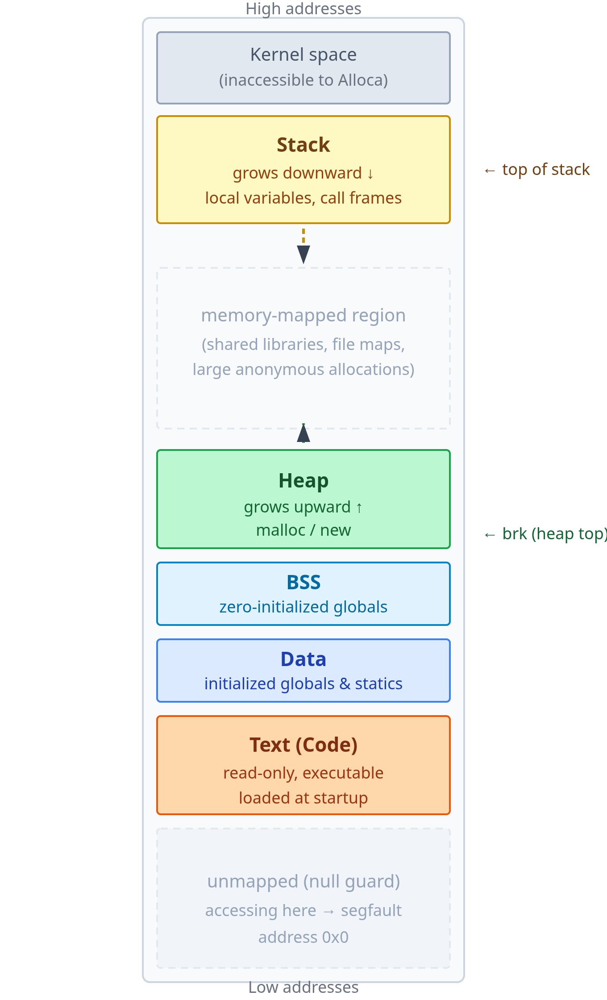

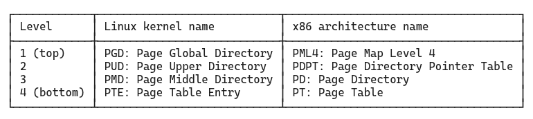

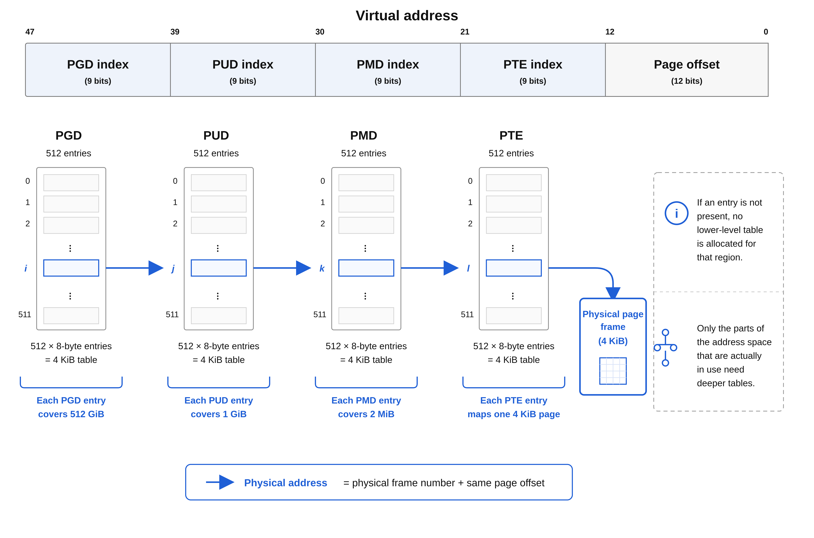

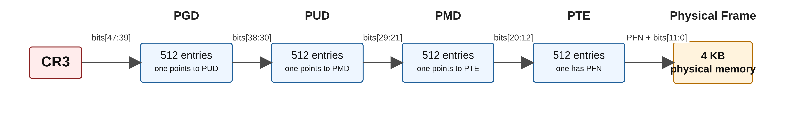

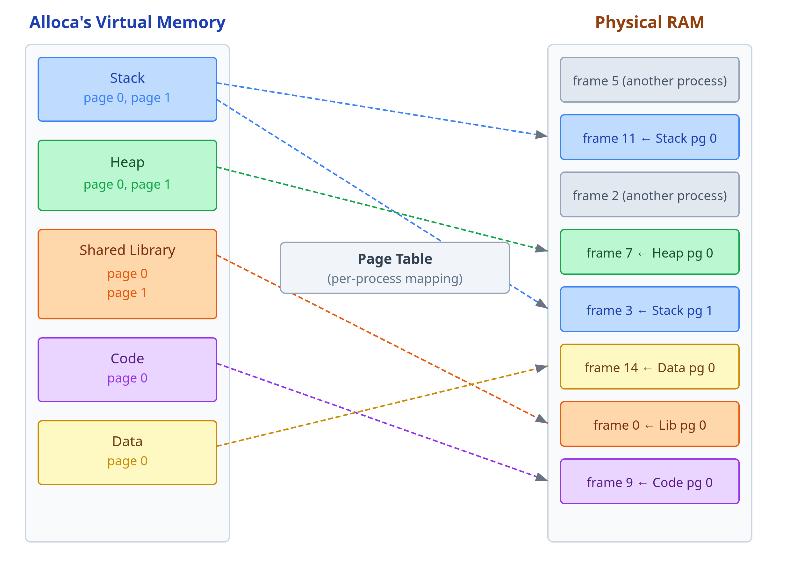

- VMAs record which address ranges and permissions the kernel has promised, while page tables record which pages are currently resident; a valid first touch causes a recoverable fault, whereas an access outside a covering VMA normally becomes a segmentation fault.

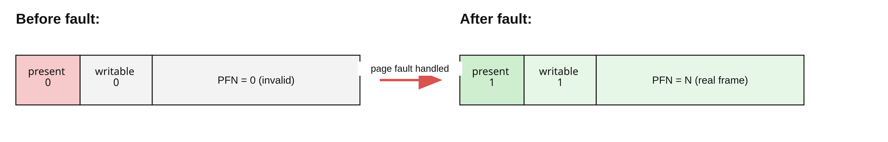

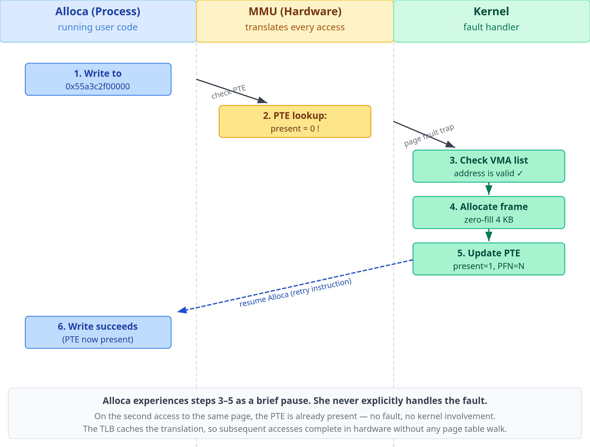

- [[DemandPagingAndReclaim]] makes allocation lazy and reclaim type-dependent: anonymous data may need swap, clean file-backed pages can be dropped, dirty file-backed pages need writeback, and tmpfs combines file APIs with anonymous-like reclaim.

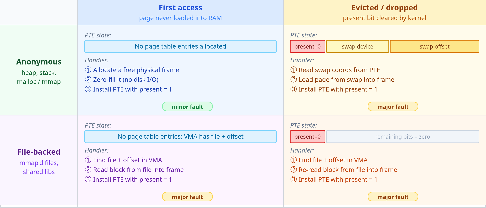

- Copy-on-write makes `fork()` cheap by initially sharing read-only physical frames; the first private write faults, copies only the affected page when still shared, and restores write permission for the writer.

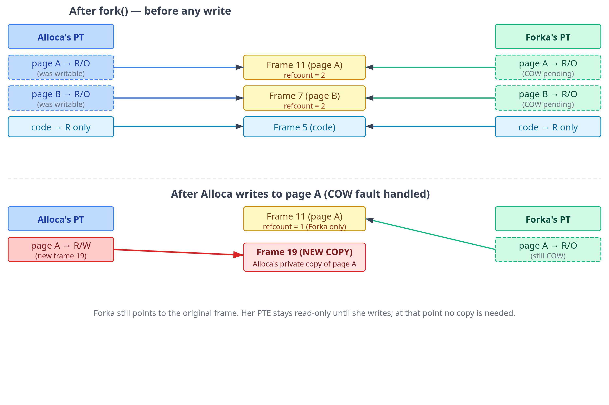

- [[MemoryMappedIO]] maps page-cache frames into a process and avoids `read()`'s page-cache-to-user-buffer copy, but exchanges that copy for fault, page-table, TLB, invalidation, and different error-handling costs.

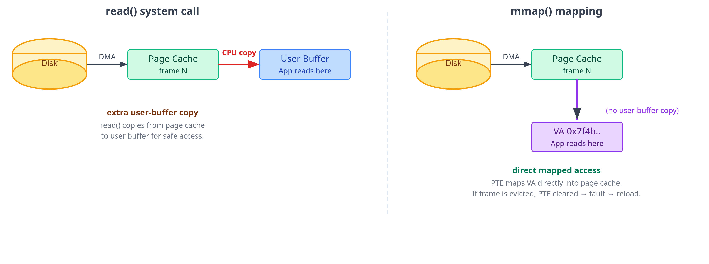

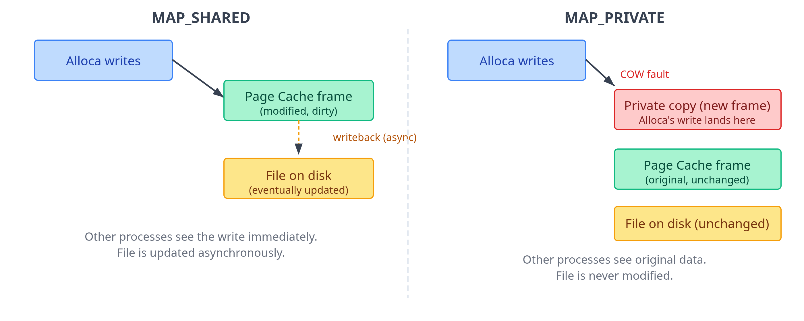

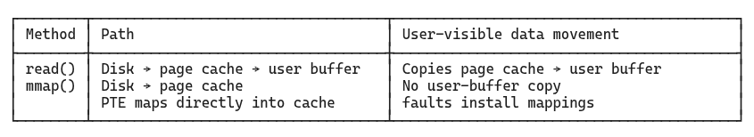

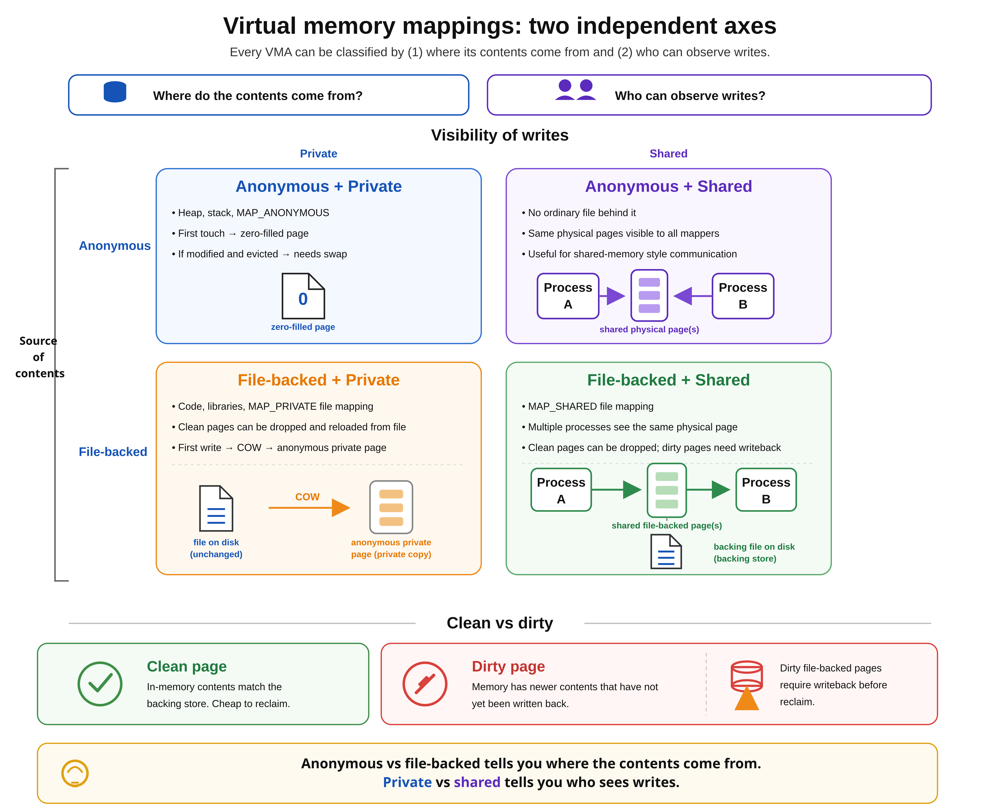

- Sequential, compact access reuses translations and cache lines; random access across many 4 KiB pages can exhaust TLB reach, defeat prefetching, and make page walks part of the hot path.
- Huge pages increase TLB coverage and shorten page-table walks, but require aligned contiguous physical memory; explicit HugeTLB reservation is predictable but reserved, while transparent huge pages are opportunistic and may introduce compaction latency.

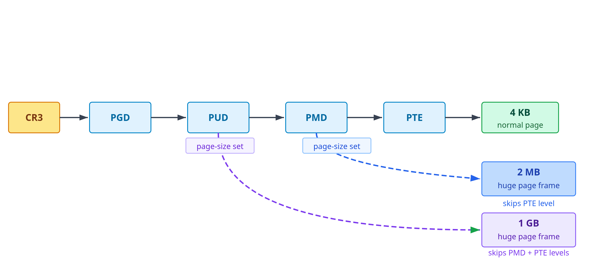

- Page-table changes on multicore systems can require synchronous TLB shootdowns to cores that may hold stale translations, making frequent `munmap`, `mprotect`, reclaim, migration, and COW activity a cross-core coordination cost.
- [[NUMAMemoryPlacement]] is set largely at physical allocation time: first-touch placement can make identical virtual accesses local for one socket and remote for another, so thread affinity and data initialization must be designed together.

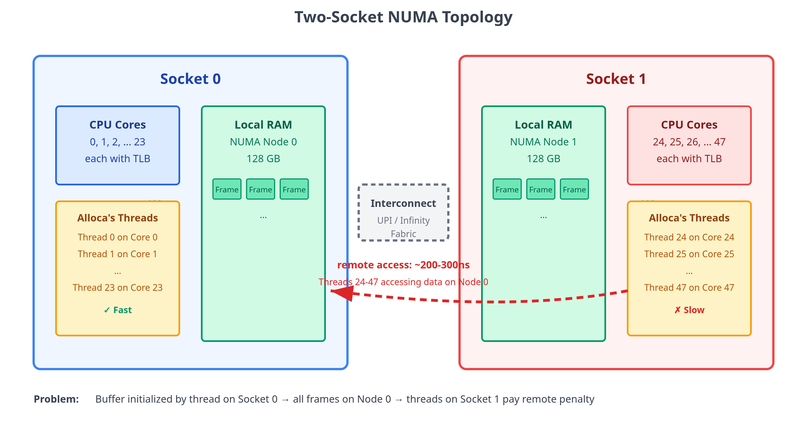

- A practical diagnosis proceeds from `/proc/PID/maps` and `smaps`, to major/minor faults and system pressure, to hardware TLB counters, and finally to page and thread placement across NUMA nodes.

## Key Quotes
> "The VMA is the kernel’s record of intent: what address ranges the process is allowed to access."

> "Virtual memory makes all addresses look the same, but they’re not."

## Connections
- [[AbhinavUpadhyay]] - authored the first-principles systems guide.
- [[VirtualMemory]] - unifies the address-space, translation, protection, and performance model.
- [[DemandPagingAndReclaim]] - covers lazy physical allocation, fault resolution, swap, and eviction policy.
- [[MemoryMappedIO]] - compares buffered and memory-mapped access through the page cache.
- [[NUMAMemoryPlacement]] - explains how hidden physical topology changes memory latency.
- [[HighThroughputIOOptimization]] - supplies workload-level evidence that TLB reach and page size can become active throughput constraints.

## Contradictions
- The article qualifies the intuition that allocated virtual memory is already resident: a successful allocation may establish only a VMA promise until first touch.
- It rejects a universal “`mmap` is faster” rule: sequential buffered reads may outperform fault-driven mappings despite the extra copy.
- It qualifies “used RAM” as a pressure signal because clean page-cache memory is readily reclaimable; residency, reclaim cost, faults, and stalls matter more than the aggregate alone.
- The treatment is an explanatory Linux/x86-64 model, not a portable specification or controlled benchmark. Exact address widths, table levels, TLB sizes, huge-page behavior, reclaim policy, NUMA ratios, and performance-counter names vary by hardware, kernel, configuration, and workload.
