## Summary
[[MaartenGrootendorst]] explains [[DiffusionGemma]] from the hardware motivation through discrete text diffusion, its shared Gemma 4 encoder-denoiser architecture, and its inference scheduler and sampler. The model spends otherwise idle batch-one compute on parallel 256-token canvas refinement, uses uniform random tokens rather than masks so any position can be revised, and combines causal prompt encoding with bidirectional denoising, self-conditioning, blockwise generation, temperature scheduling, adaptive stopping, and entropy-bounded token acceptance. The article is an illustrated conceptual guide rather than a benchmark or primary model report, so its performance and quality characterizations remain qualitative.

## Key Claims
- Autoregressive decoding loads model weights for every emitted token and can amortize that memory traffic across users, whereas text diffusion spends more arithmetic per pass to update many positions for one user; this can reduce single-request sequential latency while sacrificing multi-user throughput.

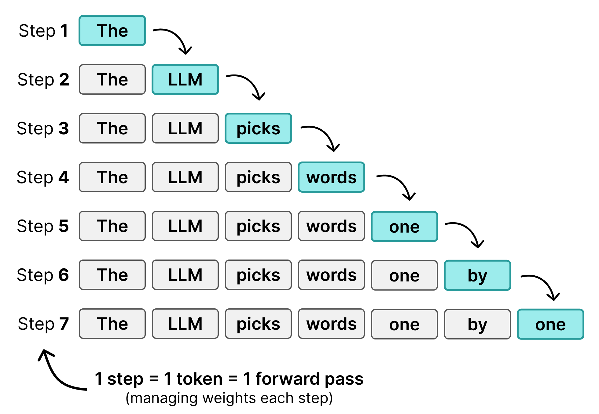

- DiffusionGemma repeatedly improves a 256-token canvas, allowing high-confidence context to anchor later revisions, so it can generate a block with fewer forward passes than its token count.

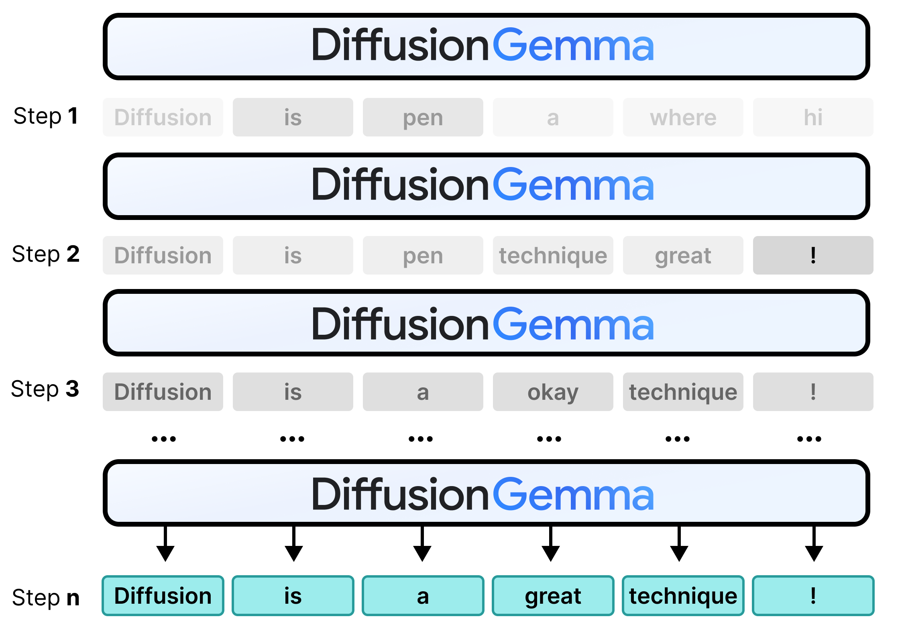

- Masked diffusion replaces selected tokens with `[MASK]` during forward diffusion and accepts confident replacements during reverse diffusion, but accepted tokens become fixed and cannot later self-correct.

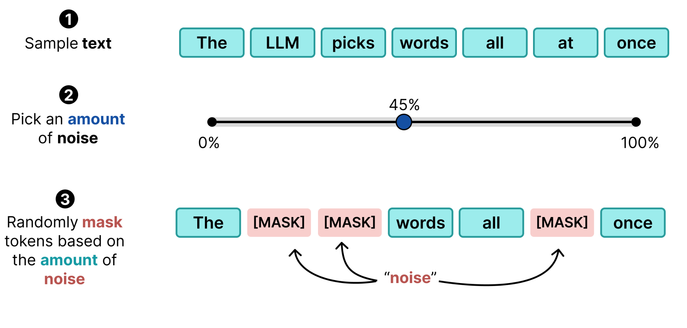

- Uniform-state diffusion instead corrupts text with random vocabulary tokens, predicts every position at every step, retains sufficiently confident candidates, and re-noises uncertain positions; previously accepted positions can still change when later context lowers their confidence.

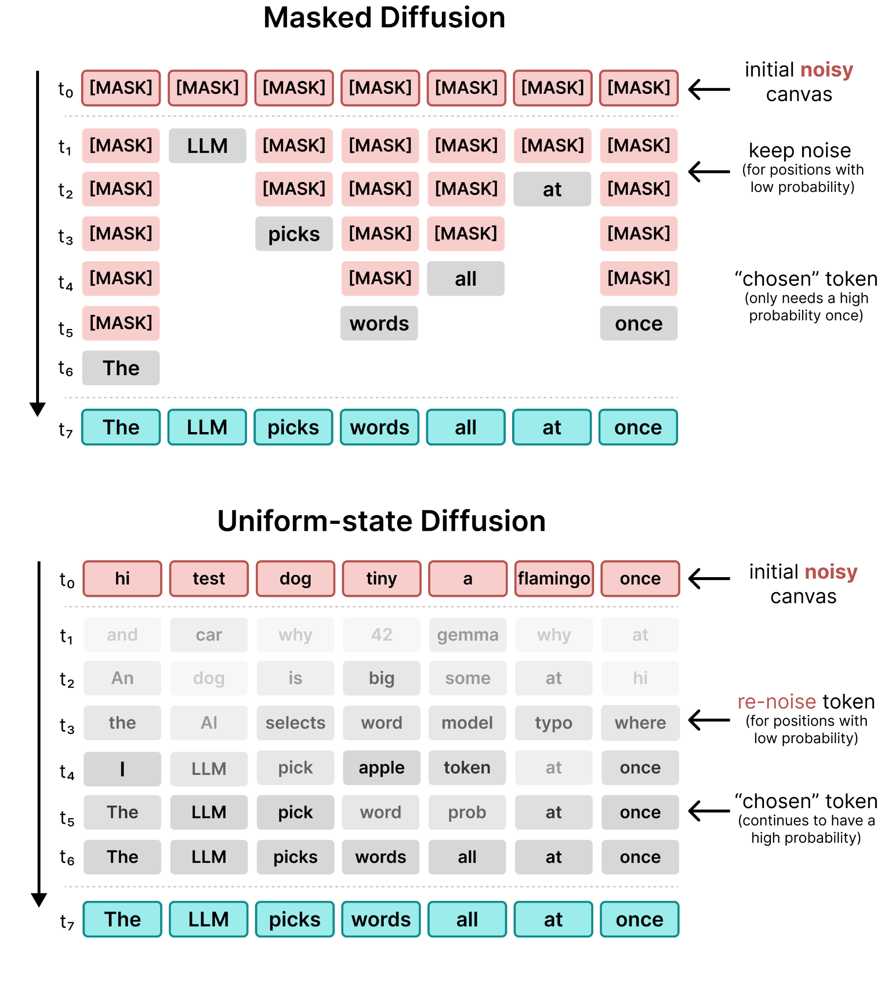

- Compared with autoregression, the guide characterizes text diffusion as parallel within a canvas, revisable at every position, compute-bound rather than memory-bound, and optimized for low per-user latency rather than high concurrent-user throughput.

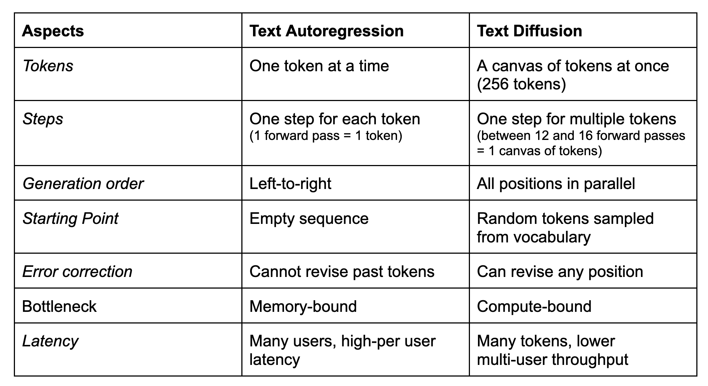

- One Gemma 4 26B A4B checkpoint serves two roles: causal attention encodes the query into a reusable KV cache, while bidirectional attention denoises the random canvas and applies the LM head at every position. Soft self-conditioning converts the prior step's full probability distributions to weighted embeddings, passes them through a small feedforward network, and adds them to the next step's token embeddings.

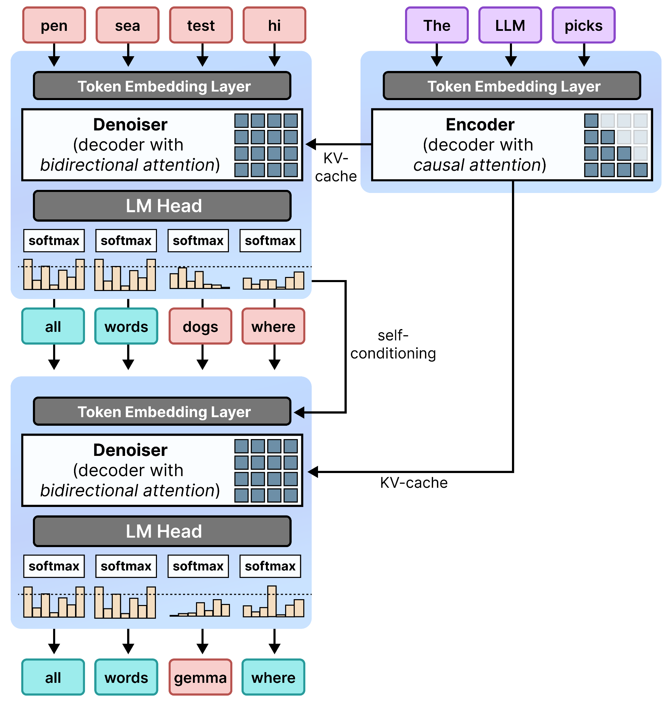

- Outputs longer than 256 tokens use block diffusion: a completed canvas is appended to the causal prefix, its KV state is extended, and a new 256-token canvas is denoised until a stop token ends generation.

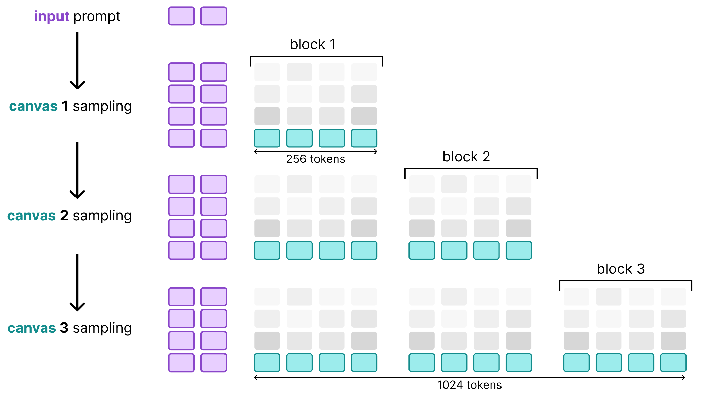

- The scheduler controls maximum step count, samples from temperature-adjusted logits, lowers temperature from 0.8 toward 0.4 over 48 illustrated steps, and can stop early when argmax predictions are stable and mean entropy is sufficiently low.

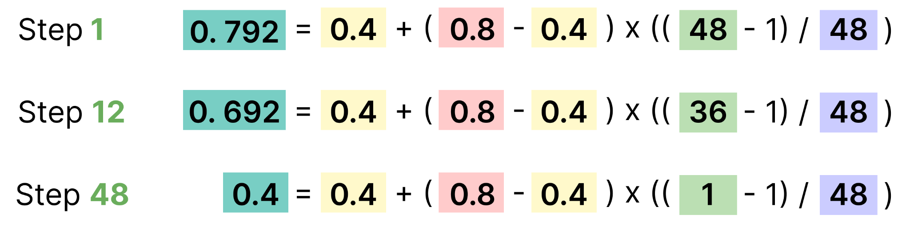

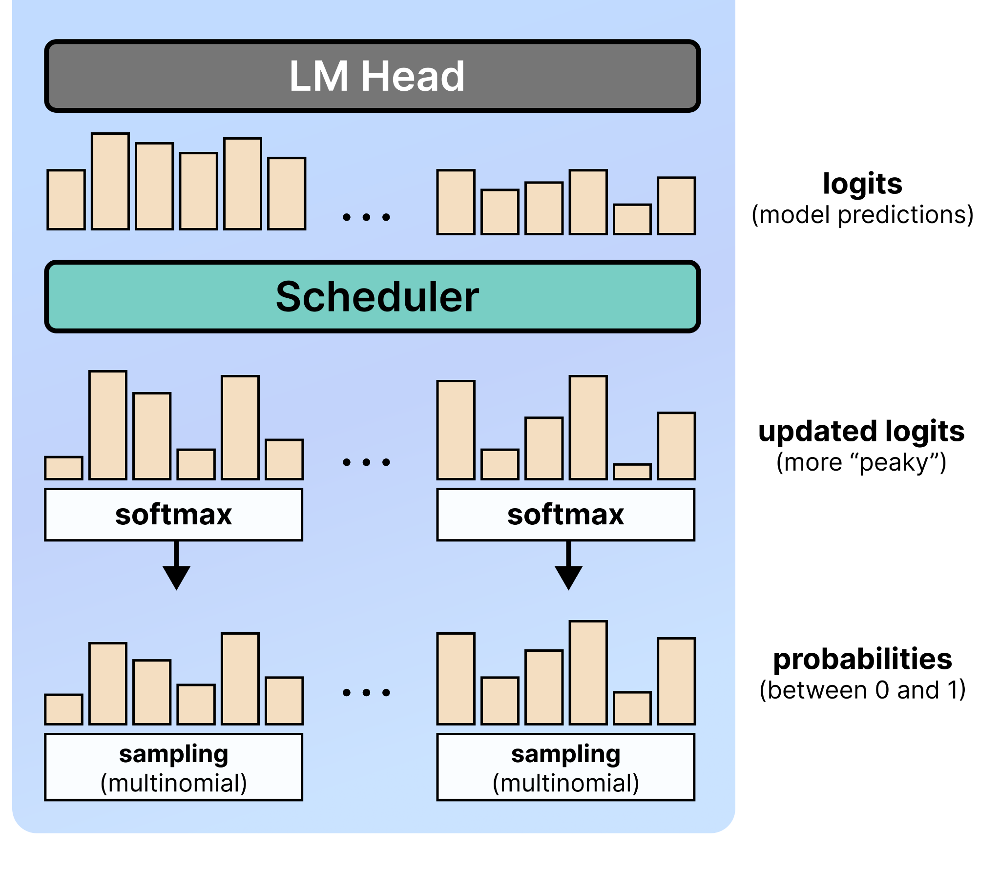

- The default entropy-bounded sampler sorts positions from lowest to highest entropy and accepts a growing confident set while cumulative entropy minus its maximum stays within a configured bound; rejected positions are replaced by fresh uniform noise.

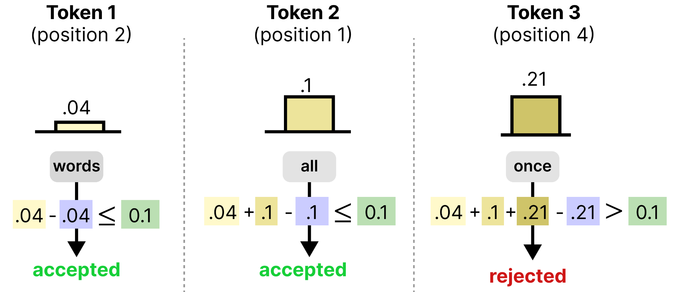

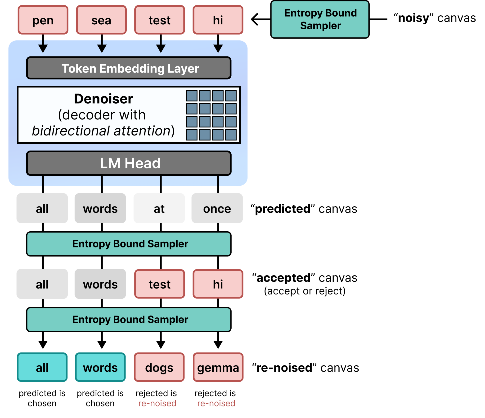

## Key Quotes
> "This is where iterative refinement comes in." - on turning an initially poor parallel prediction into coherent text through repeated passes.

> "As such, the canvases are generated using diffusion but are stitched together sequentially." - on combining within-block diffusion with between-block autoregression.

## Connections
- [[DiffusionGemma]] - the Gemma 4-based model whose architecture and inference loop the guide explains.
- [[DiffusionLanguageModels]] - the broader family of iterative discrete-token denoisers contrasted with autoregressive generation.
- [[MaartenGrootendorst]] - author and visual explainer.
- [[AttentionMechanism]] - switches between causal query encoding and bidirectional canvas denoising.
- [[TextGenerationSampling]] - encompasses temperature, multinomial choice, entropy, acceptance, re-noising, and stopping decisions.
- [[DiffusionModelSampling]] - supplies the forward-noising and reverse-denoising analogy from image generation.

## Contradictions
- No direct contradiction with the existing wiki was found. The guide complements [[diffusion-gemma]] with a more granular conceptual account of masked versus uniform-state diffusion, temperature scheduling, and entropy-budget acceptance.
- The article calls the single-user result "much much faster" and says the output converges to quality similar to regular Transformers, but supplies no measured latency, quality, throughput, energy, or hardware table. Those statements should not override the qualified first-party benchmark limits already recorded in [[DiffusionGemma]].
- The text gives an adaptive-stopping confidence threshold of 0.005 and stability threshold of 1, while the entropy-acceptance illustration uses a default bound of 0.1; these govern different decisions and must not be conflated.
- Some diagrams use abbreviated toy sequences, and the article's 12-16 or 48 illustrated forward-pass counts are explanatory configurations rather than a demonstrated universal convergence requirement.
