## Summary
Connor Tsui presents [[Vortex]] as an extensible Rust columnar format that separates logical types, physical array encodings, and storage layouts while retaining a canonical fallback for interoperability with Apache Arrow. The design composes encodings recursively, evaluates supported operations without fully decompressing data, and registers third-party types, encodings, and layouts through sessions. It expands [[ColumnarStorageTradeoffs]] from fixed file hierarchies toward workload-specific composition, but readers still need extension code and the article's performance claims come from first-party benchmarks.

## Key Claims
- One logical array can use different physical encodings without changing its data type; Vortex exposes encodings behind a shared array interface rather than a central closed enumeration.

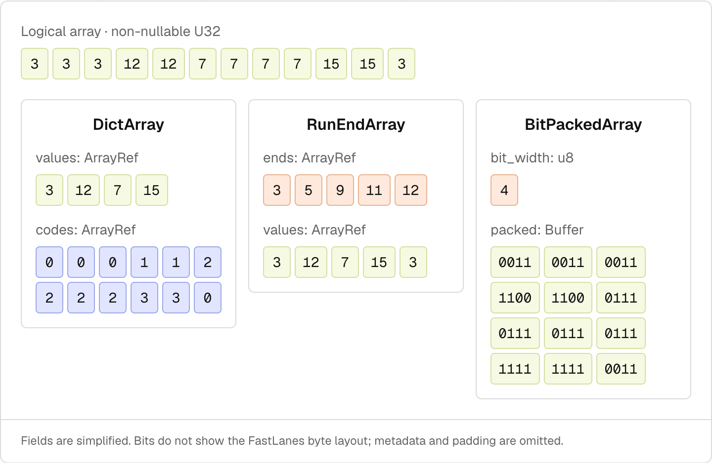

- Cascading compression treats encoded children as arrays that can be encoded again: dictionary encoding turns repeated strings into values and codes, run-end encoding compresses repeated codes, and bit packing compresses the resulting integer children.

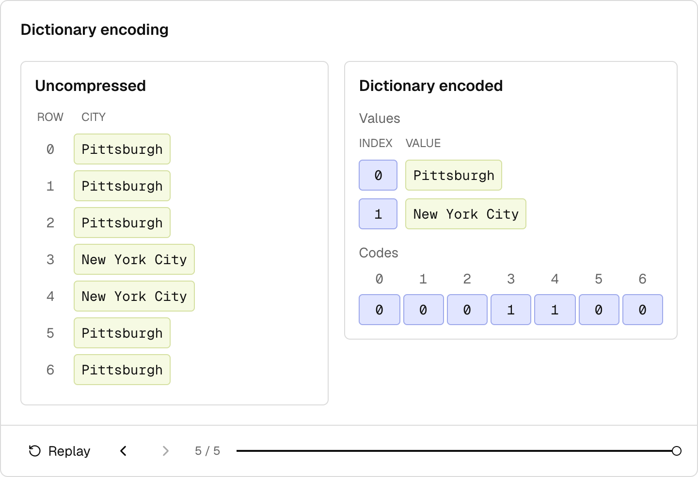

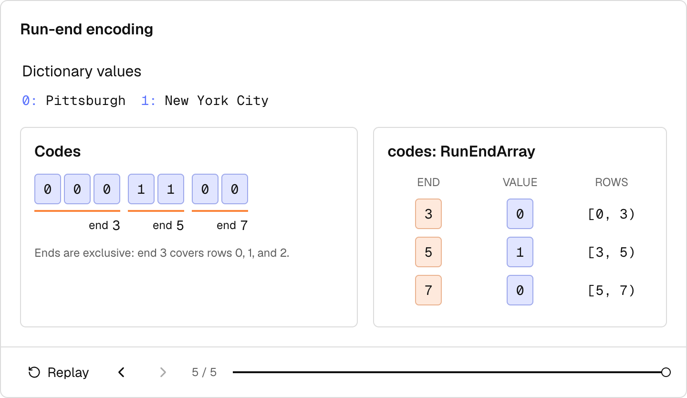

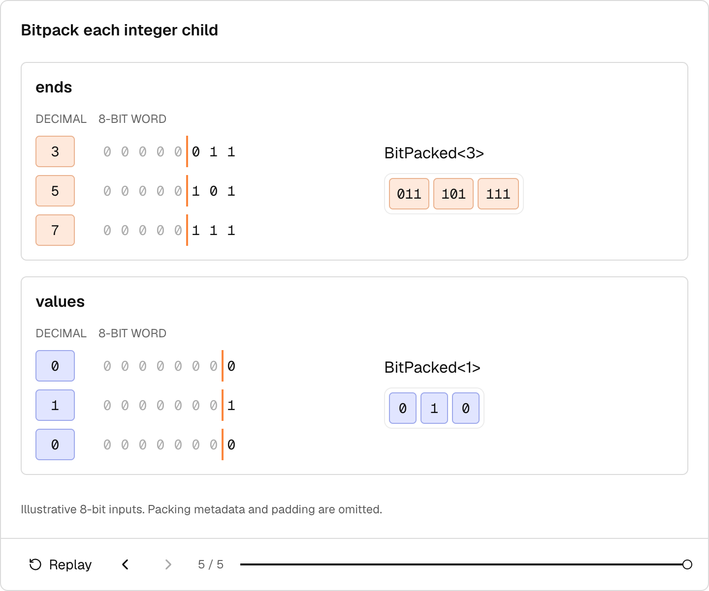

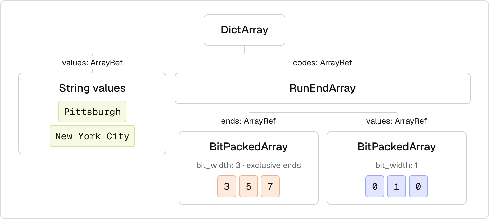

- [[CompressedDataComputation]] can exploit encoded structure through specialized kernels and rewrite rules instead of reconstructing every logical value.

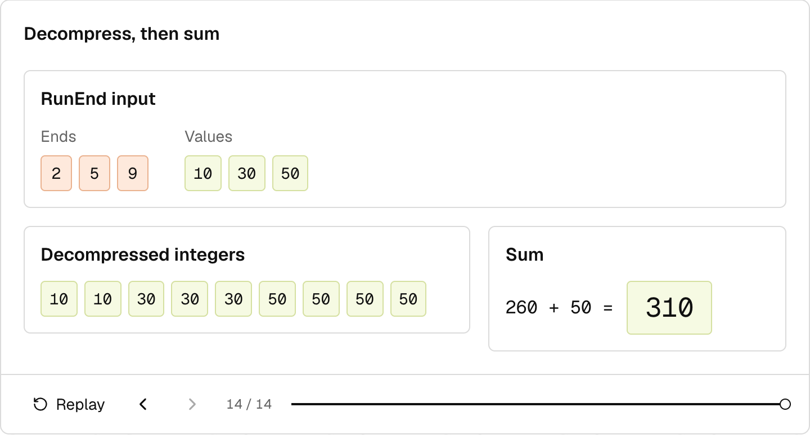

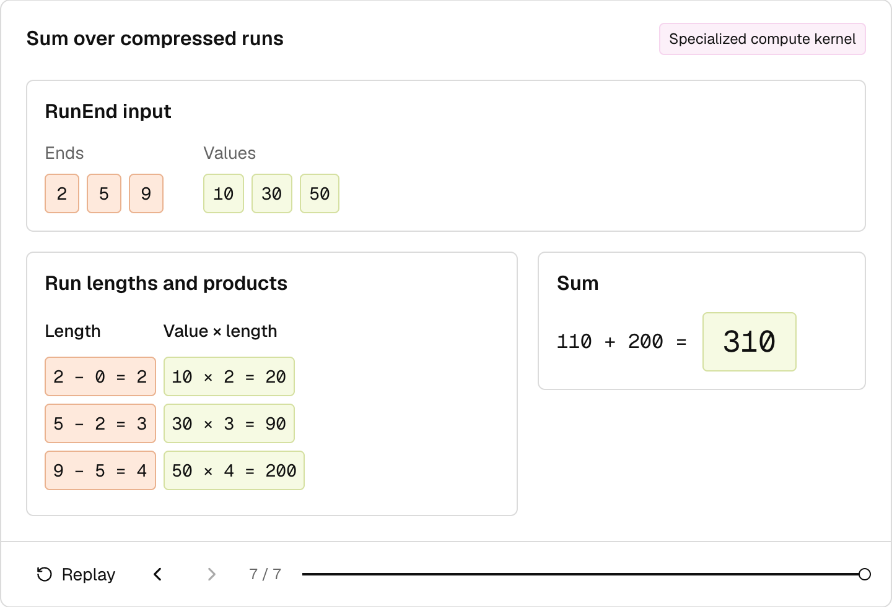

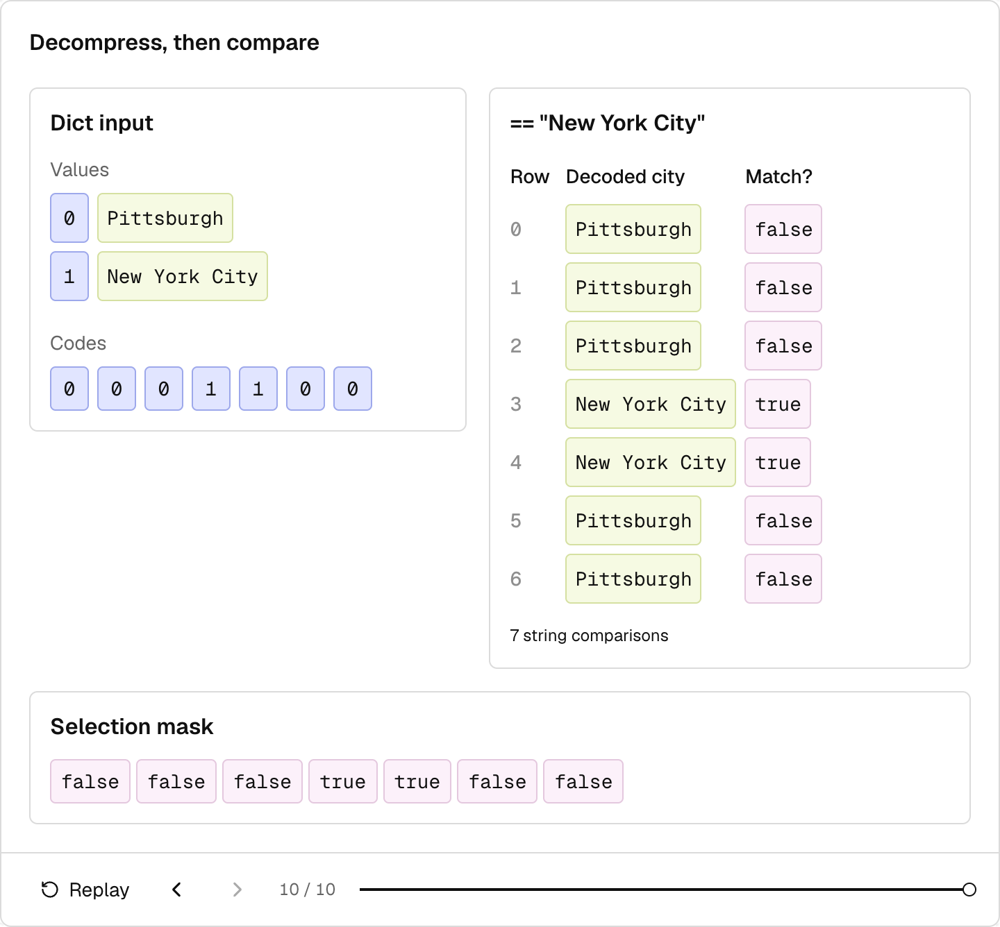

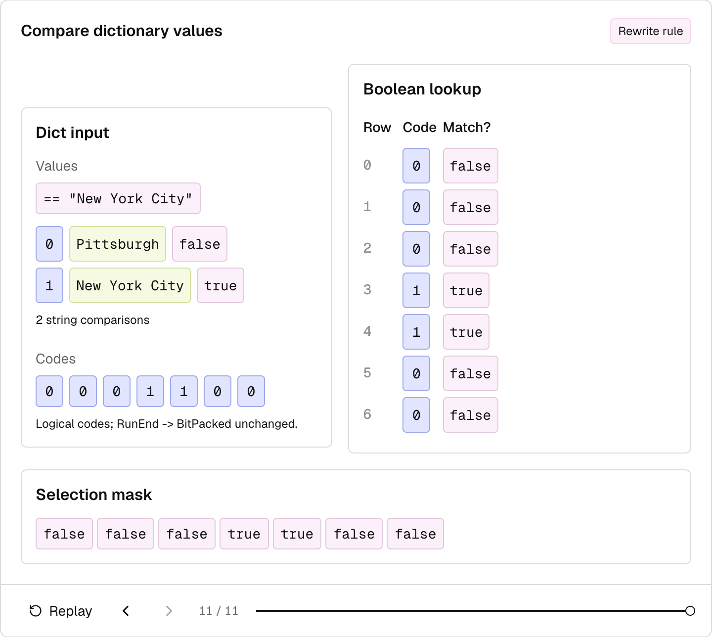

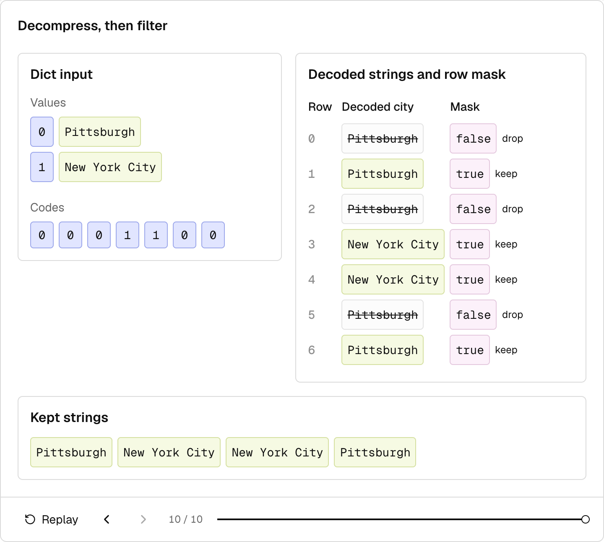

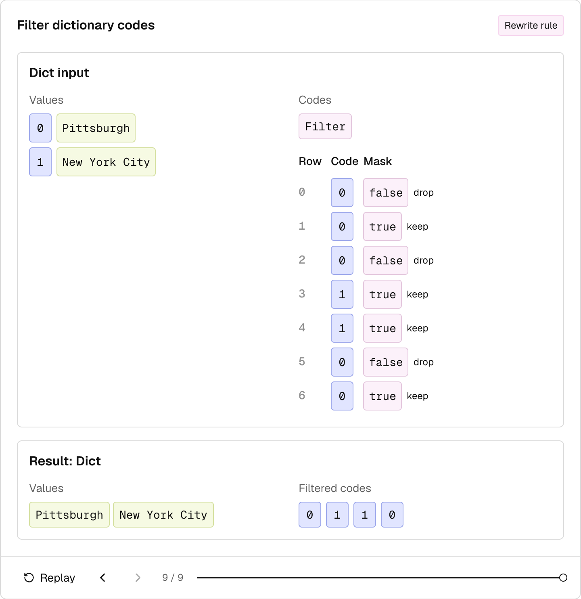

- Every logical type has a canonical encoding, so an unfamiliar or unoptimized physical encoding can execute toward a common form; specialized kernels can then be added incrementally.
- Array trees choose in-memory representation, while layout trees choose which byte segments are fetched together. Composable `Struct`, `Chunked`, and `Flat` layouts can reproduce Parquet's hierarchy or target different storage and access patterns.

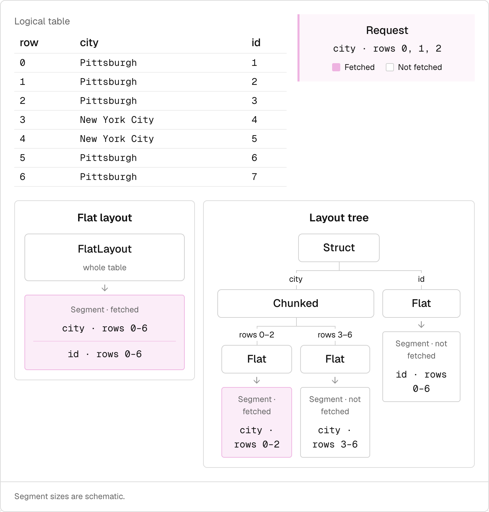

- Extension logical types add invariants and operations over existing storage types. A vector can remain a fixed-size float list physically while being exposed to query engines as a vector with cosine similarity, inner product, and L2 operations.

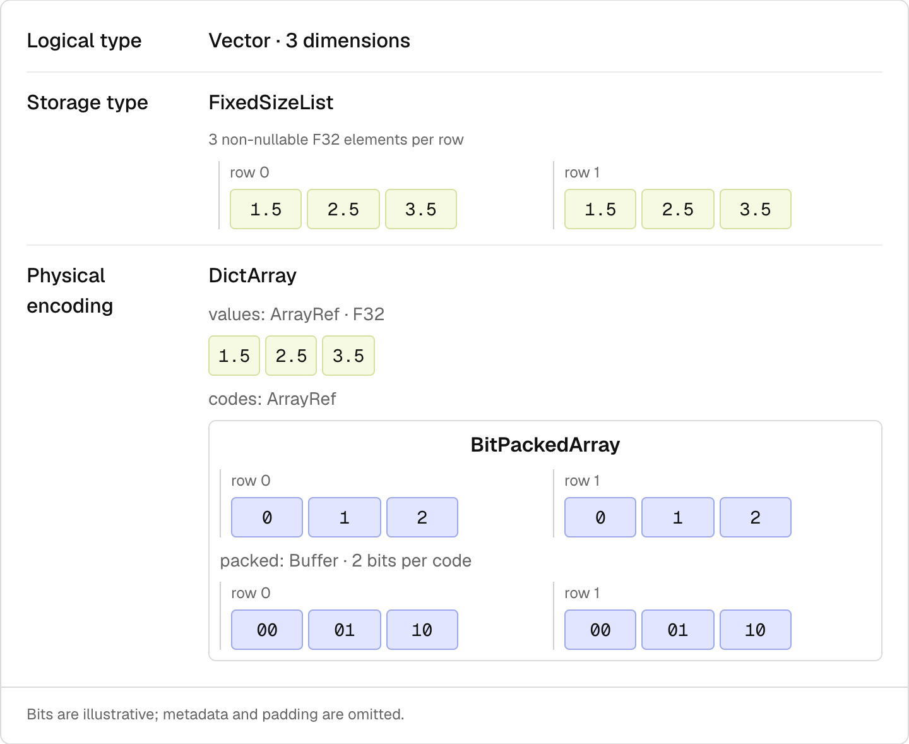

- Vortex's self-description and registries move type, encoding, and layout evolution outside the core format specification, while shared Rust bindings reduce repeated cross-language implementation work.
- The author reports Parquet-comparable compressed size and faster writes, scans, and random access in Vortex's benchmark suite, while explicitly noting workload and query-engine dependence.

## Key Quotes
> "your complex data must fit the format instead of the format fitting your data" - on the constraint imposed by fixed physical encodings and layouts.

> "you don't have to build a new file format from scratch" - on the practical boundary of extensibility even though readers still need extension code.

## Connections
- [[Vortex]] - the extensible columnar format and execution model described by the article.
- [[ApacheParquet]] - fixed-specification comparison point that Vortex can emulate at the layout level.
- [[ColumnarStorageTradeoffs]] - broader choices among compression, selective I/O, computation, compatibility, and extension ownership.
- [[CompressedDataComputation]] - kernels and rewrite rules that use encoded structure before canonical materialization.
- [[LiquidCache]] - independently demonstrates cascading encodings and encoded predicate evaluation in an ephemeral cache representation.
- [[LanceFormat]] - alternative extensible columnar design motivated by vector, multimodal, and selective-access workloads.

## Contradictions
- The article qualifies rather than eliminates the extension-distribution problem: a reader can preserve an unknown encoding or layout as a placeholder, but cannot decode or compute over it without the extension's code.
- Self-description does not remove compatibility obligations. Readers still depend on supported file versions, registered identifiers, metadata validation, canonicalization behavior, and stable extension implementations.
- The performance comparison is a first-party benchmark pointer, not results reproduced in the article. Dataset shape, query engine, cache state, implementation maturity, storage system, and chosen layouts or encodings can change the outcome.
- The examples show mechanisms on small illustrative arrays and omit most implementation costs, including metadata, padding, compressor search, validation, serialization, extension governance, and operational deployment.

## Image Notes
All 13 effective local image references were opened and retained at their semantic positions. Nine are static final frames of source animations, so they preserve the final mechanism state but not interactive transitions; the source prose supplies the missing sequence. The diagrams cover alternative and cascading encodings, naive and encoded computation paths, selective layout fetching, and logical-versus-physical type separation.
